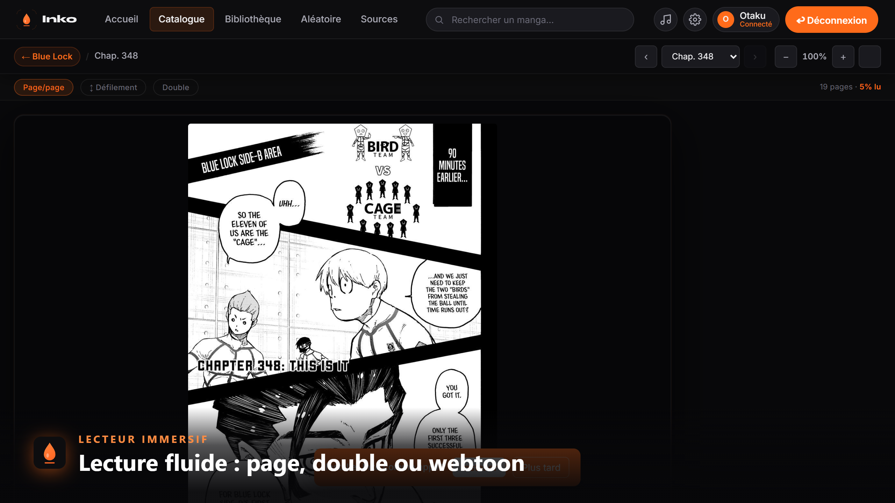
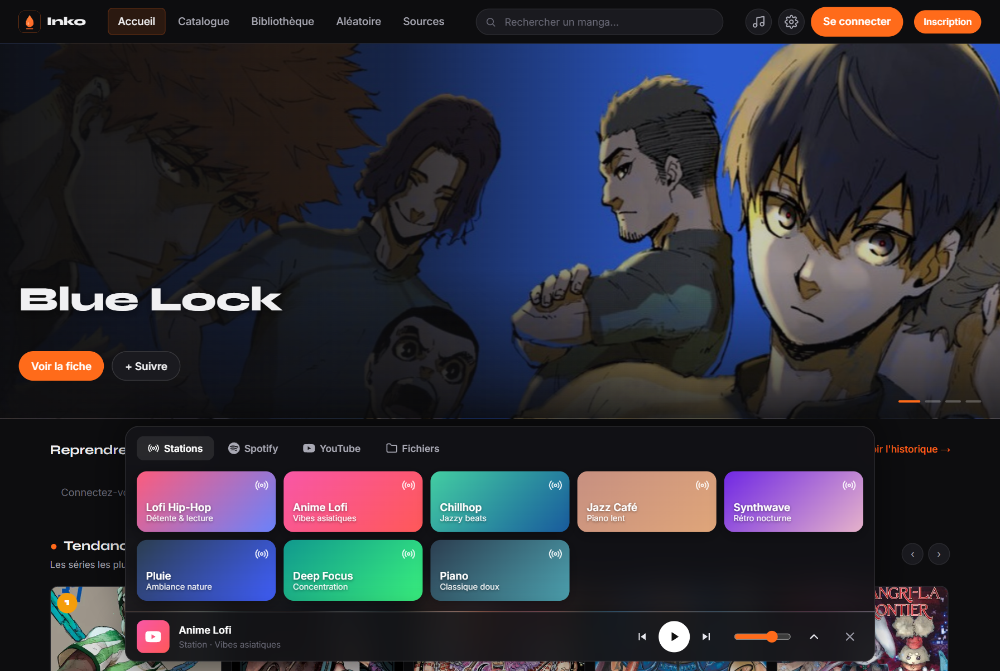
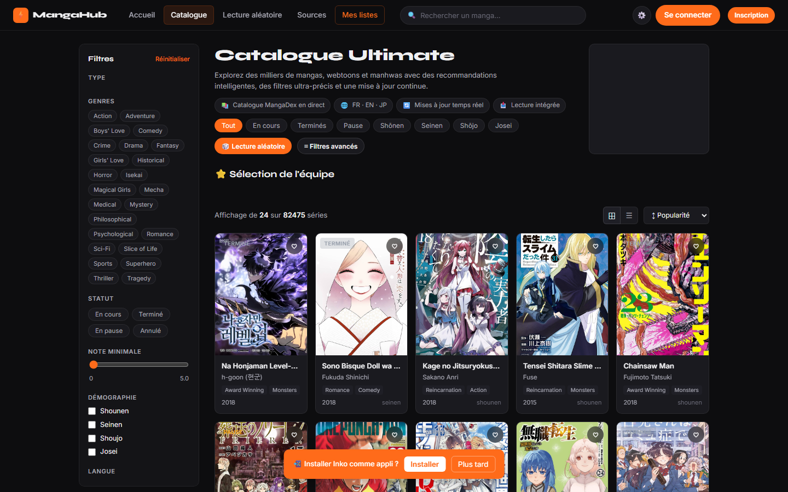
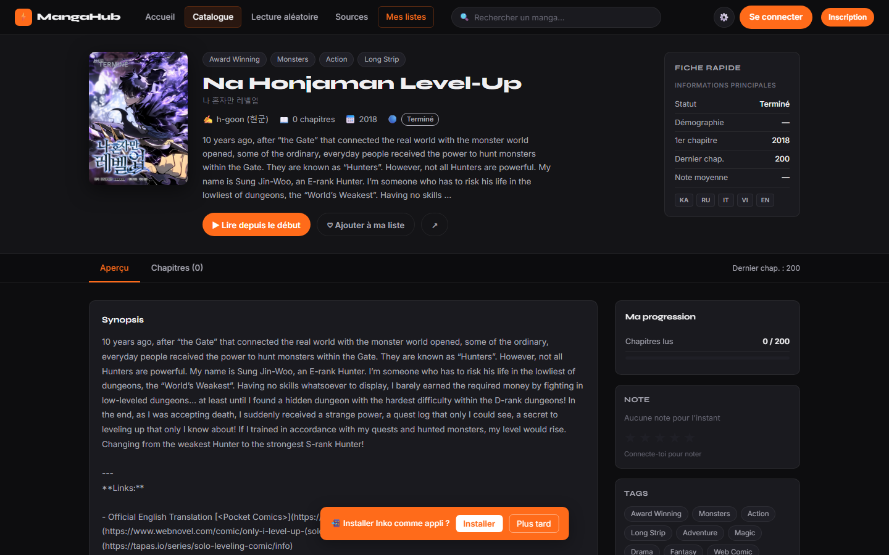

<div align="center">


# Inko

**Mangas, light novels et livres dans une seule application — locale, sans compte, sans publicité.**

Inko est un lecteur personnel dans l'esprit de Mihon / Tachiyomi, pensé pour
l'ordinateur **et** le téléphone. Tu l'installes, tu lis : ta bibliothèque, ta
progression et ton journal de lecture restent chez toi. Un système d'extensions
ouvert apporte les sources ; le reste — lecteur, suivi, notifications, hors-ligne,
statistiques — est intégré.

[](https://github.com/Abdoulrazack1/Inko/actions/workflows/ci.yml)
[](https://github.com/Abdoulrazack1/Inko/releases/latest)
[](LICENSE)
[](https://nodejs.org/)
[](https://tauri.app/)
[](#application-android)
[](#sans-installer--la-pwa)

<br>

<a href="https://github.com/Abdoulrazack1/Inko/releases/latest/download/Inko-Setup.exe">
  
</a>
&nbsp;
<a href="https://github.com/Abdoulrazack1/Inko/releases/download/mobile-v1.4.1/Inko-1.4.1.apk">
  
</a>

<sub>Empreintes SHA-256 :
[Windows](https://github.com/Abdoulrazack1/Inko/releases/latest/download/SHA256SUMS) ·
[Android](https://github.com/Abdoulrazack1/Inko/releases/download/mobile-v1.4.1/SHA256SUMS-android.txt)
— à comparer avec celle du fichier téléchargé.</sub>

<br>

[Aperçu](#aperçu) · [Pourquoi Inko](#pourquoi-inko) · [Fonctionnalités](#fonctionnalités) · [Installation](#installation) · [Sources](#sources-et-extensions) · [Android](#application-android) · [Configuration](#configuration) · [Architecture](#architecture) · [Qualité](#qualité-et-intégration-continue) · [Sécurité](#sécurité-et-confidentialité) · [Dépannage](#dépannage) · [Contribuer](#contribuer)

</div>

---

## Sommaire

1. [Aperçu](#aperçu)
2. [Pourquoi Inko](#pourquoi-inko)
3. [Fonctionnalités](#fonctionnalités)
4. [Installation](#installation)
5. [Sources et extensions](#sources-et-extensions)
6. [Application Windows](#application-windows)
7. [Application Android](#application-android)
8. [Multi-appareils](#multi-appareils)
9. [Comptes liés](#comptes-liés)
10. [Configuration](#configuration)
11. [Raccourcis clavier](#raccourcis-clavier)
12. [Architecture](#architecture)
13. [Qualité et intégration continue](#qualité-et-intégration-continue)
14. [Sécurité et confidentialité](#sécurité-et-confidentialité)
15. [Déploiement](#déploiement)
16. [Dépannage](#dépannage)
17. [Limites connues](#limites-connues)
18. [Contribuer](#contribuer)
19. [Légalité](#légalité)

---

## Aperçu


<table>
<tr>
<td width="50%"></td>
<td width="50%"></td>
</tr>
<tr>
<td width="50%"></td>
<td width="50%"></td>
</tr>
</table>

---

## Pourquoi Inko

Comme Mihon, **Inko n'a pas d'écran de connexion**. Chaque installation est
personnelle : au premier lancement, l'application crée ton profil local et tout
t'appartient — bibliothèque, progression, notes, signets. Le seul compte externe
est **optionnel** : [AniList](#comptes-liés), pour synchroniser progression,
statuts et notes.

|  | **Inko** | Mihon | Suwayomi | Komga / Kavita |
|---|:---:|:---:|:---:|:---:|
| Mangas **et** romans **et** livres | ✅ | mangas | mangas | fichiers |
| Sans compte, local d'abord | ✅ | ✅ | ✅ | comptes |
| Application Windows native | ✅ | — | web | web |
| Application Android + PWA | ✅ | ✅ | PWA | PWA |
| Journal de lecture privé | ✅ | — | — | — |
| Notifications de nouveaux chapitres | ✅ (app fermée incluse) | ✅ | — | — |
| Lecture hors-ligne réelle (hub éteint) | ✅ | ✅ | — | — |
| Interface bilingue FR / EN | ✅ | ✅ | — | partiel |
| Import local EPUB / CBZ / PDF | ✅ | ✅ | — | ✅ |
| Migration de source sans perte | ✅ | ✅ | — | — |
| Sans publicité, sans télémétrie | ✅ | ✅ | ✅ | ✅ |

<sub>Comparaison établie sur les fonctions annoncées par chaque projet ; les
écarts de couverture évoluent, vérifie auprès de chacun avant de choisir.</sub>

---

## Fonctionnalités

### Lecture des mangas

- **Quatre modes** : page par page, défilement vertical continu (webtoon),
  double page, et sens de lecture RTL / LTR.
- **Double page automatique** en paysage ; une planche **panoramique** (deux pages
  d'un seul tenant) s'affiche seule au lieu d'être collée à sa voisine.
- **Rotation d'une planche paysage** sur un écran en portrait, dans le sens de
  lecture, pour ne pas la lire sur un tiers de l'écran.
- **Zoom ancré** sur le point visé, **zoom sur une case** par double-clic ou
  double-tap, plein écran, mode immersif.
- **Reprise au pixel près** en défilement, historique de position **par appareil**
  (« reprendre là où l'autre appareil s'est arrêté »).
- **Défilement automatique** à vitesse réglable, **enchaînement automatique** du
  chapitre suivant, préchargement adaptatif pendant les dernières pages.
- **Signets avec une phrase** : un signet porte une note, pas seulement une position.
- **Minuterie de lecture** (« encore 20 minutes ») et **mode nuit progressif**
  (assombrissement et chaleur croissants selon l'heure locale).
- Barre de progression cliquable avec **vignette de prévisualisation**.
- Le lecteur reste **toujours sombre**, quel que soit le thème de l'application.
- **Comparaison de traductions** : deux sources, même chapitre, côte à côte.

### Lecture des romans et des livres

- Typographie réglable : police (serif / sans / mono), taille, interligne, **largeur
  en caractères** (et non en pixels, pour que la ligne reste lisible quand on
  grossit le texte), thèmes de page (sombre, noir, sépia, clair).
- Modes **défilement** ou **pages**.
- **Synthèse vocale** avec surlignage du paragraphe lu.
- **Recherche dans le chapitre**, avec surlignage des occurrences.
- **Citations** : surligne un passage et garde-le dans ton journal.
- Progression fine, reprise à l'endroit exact.

### Fichiers locaux

Importe **tes propres fichiers** : **EPUB** (synthèse vocale et reprise), **CBZ**
(décompression parallèle), **PDF** (pdf.js). Le fichier reste sur le hub ; la
position de lecture suit ton compte. Quota réglable (`LOCAL_IMPORT_QUOTA_MB`,
2 Go par défaut).

### Bibliothèque et suivi

- **Étagère unifiée** : statuts, catégories personnalisées, listes (dont des
  **listes intelligentes** à règles : « en cours, non lu depuis 30 jours »…).
- Vues **grille** et **liste dense**, **densité d'affichage** réglable (compact,
  confortable, spacieux), sélection multiple, filtres, recherche instantanée.
- **Filtre par temps restant** : « ce que je peux finir ce week-end ».
- **Reprise des séries abandonnées** : « de retour après N mois ».
- **Détection des doublons** : la même œuvre suivie sur deux sources est signalée,
  fusion proposée.
- **Tri par rythme de parution** (hebdomadaire, mensuel, irrégulier, à l'arrêt) et
  **vue chronologique** de ce qui est sorti cette semaine.
- **Notation personnelle** sur dix niveaux, distribution visible sur le profil.
- **Mise à jour intelligente** : ignore par défaut les séries terminées ou
  abandonnées, échecs de vérification visibles, compteur de non-lus **sans plafond**.
- **Notifications de nouveaux chapitres** : tâche de fond et Web Push.
- **Import MyAnimeList / AniList** depuis un export — utile précisément quand
  l'API de l'un d'eux est coupée.
- **Export / import JSON** complet, **sauvegardes** automatiques restaurables.

### Découverte

- Catalogue **par source** ou **« Toutes les sources »** à la fois, résultats
  **groupés par source** avec leur compte, fusion et dédoublonnage par titre.
- Recherche globale en direct, badge « déjà dans ma bibliothèque ».
- **Recommandations par tags croisés**, calculées localement sur ton historique,
  sans service tiers ; « Tu aimeras aussi » via AniList, vérifié sur tes sources.
- **Comparateur** d'une même œuvre entre plusieurs sources.

### Hors-ligne et stockage

- **Téléchargements** en file, avec pause, reprise après coupure, annulation,
  **estimation du poids avant lancement** et relance des chapitres incomplets
  (« ⚠ N page(s) manquante(s) » — seules les pages absentes sont retéléchargées).
- **Préchauffage** des prochains chapitres suivis, sur secteur et en Wi-Fi.
- **Budget de stockage** réglable et **purge intelligente** : on supprime d'abord
  ce qui est lu et ancien, jamais ce qui est en cours.
- **Export d'une série en CBZ** avec `ComicInfo.xml`, pour la lire ailleurs.
- Quand le serveur est injoignable, la bibliothèque affiche son **miroir local**
  daté plutôt qu'une page d'erreur.

### Journal, statistiques et suivi personnel

- **Notes privées pendant la lecture** (touche `J`) : contexte capturé
  automatiquement (série · chapitre · page), humeurs, édition.
- **Page Journal** : timeline par série, recherche plein texte, statistiques.
- **Temps de lecture réellement mesuré**, pas estimé à huit secondes par page.
- **Statistiques** : carte de chaleur de l'année (résumée en une phrase pour les
  lecteurs d'écran), répartition par source sur douze mois avec **tableau des
  valeurs**, séries, records, badges.
- **Rétrospective annuelle** générée localement, partageable par presse-papiers.
- **Objectifs souples** : un rythme visé (suggéré d'après la médiane de tes huit
  dernières semaines) plutôt qu'une série de jours à ne pas briser.

### Personnalisation et accessibilité

- **Thèmes** : Washi (clair, la référence), Sumi (sombre), AMOLED (noir pur),
  **contraste renforcé** (AAA), et automatique selon le système. Couleur d'accent
  personnalisable.
- **Emporter son apparence** : thème, accent, densité et typographie des romans
  dans un fichier, relisible sur un autre appareil. Un fichier d'apparence ne peut
  rien faire que la page des réglages ne permette déjà (liste fermée, valeurs
  validées) ; rien n'est envoyé nulle part.
- **Raccourcis clavier remappables**, **palette de commandes** `Ctrl+K` avec
  recherche floue, **recherche d'un réglage par son nom**.
- **Gestes de cartes personnalisables** (balayages, appui long) et **annulation**
  (`Ctrl+Z`, barre d'annulation) sur les gestes qui défont du travail.
- **Interface bilingue FR / EN**, traduction au vol sans jamais toucher aux
  titres d'œuvres ni au contenu des chapitres.
- Accessibilité : tests automatisés avec axe-core, plans de page cohérents,
  champs étiquetés, cibles tactiles mesurées, repères pour lecteurs d'écran, états
  vides annoncés, navigation clavier complète, couleurs **doublées par une forme
  ou un chiffre** quand une palette de graphique ne peut pas être distinguée par
  tous.

### Confidentialité au quotidien

- **Mode invité** : prête ton appareil sans que la lecture entre dans l'historique.
  Ni reprise, ni chapitres lus, ni temps de lecture ; les favoris et les notes,
  gestes décidés, continuent de fonctionner. Un bandeau permanent rappelle que le
  mode est actif.
- **Lecture privée** (incognito) ; le widget Android n'affiche pas une lecture privée.
- **Filtre de contenu adulte** : œuvres +18 floutées par défaut, confirmation à
  l'ouverture, réglable.
- Export complet de tes données, suppression totale, **aucune télémétrie**.

### Lecteur de musique d'ambiance

Un dock de musique intégré (intégration médias du système : écran verrouillé,
touche du casque, notification), onglets, minuterie avec **extinction en fondu**,
volume.

---

## Installation

### Windows

1. Télécharge [`Inko-Setup.exe`](https://github.com/Abdoulrazack1/Inko/releases/latest/download/Inko-Setup.exe)
   (environ 39 Mo) et lance-le.
2. Windows peut afficher « éditeur inconnu » : l'installeur n'est **pas signé**
   (comme beaucoup de projets open source). Clique sur **Informations
   complémentaires → Exécuter quand même**. Compare auparavant l'empreinte avec
   [`SHA256SUMS`](https://github.com/Abdoulrazack1/Inko/releases/latest/download/SHA256SUMS) :
   ```powershell
   Get-FileHash .\Inko-Setup.exe -Algorithm SHA256
   ```

**Prérequis** : Windows 10 ou 11 (WebView2). Aucune base de données à installer :
Inko embarque sa propre **MariaDB** si aucun MySQL ne répond.

Les mises à jour sont proposées dans l'application ([détails](#mises-à-jour-de-lapplication-de-bureau)).

### Android

1. Télécharge [`Inko-1.4.1.apk`](https://github.com/Abdoulrazack1/Inko/releases/download/mobile-v1.4.1/Inko-1.4.1.apk)
   sur le téléphone et autorise l'installation depuis les « sources inconnues ».
2. Ouvre l'application et [connecte-la à ton hub](#connecter-le-téléphone-au-hub)
   (le PC qui fait tourner Inko).

**Prérequis** : Android 8 (API 26) ou plus. L'APK pèse environ 6 Mo.
Les versions mobiles sont publiées sous le tag `mobile-v*` ; la dernière se trouve
sur la [page des releases](https://github.com/Abdoulrazack1/Inko/releases).

### Sans installer : la PWA

Ouvre une instance d'Inko dans le navigateur (ordinateur ou téléphone) puis
« Installer l'application » / « Ajouter à l'écran d'accueil ». Même bibliothèque,
mêmes notifications Web Push.

### Depuis les sources

**Prérequis** : Node **22 ou plus** (`nvm use 22`), et MySQL 8 ou MariaDB.
`npm install` s'arrête net si Node est trop ancien — sans ce garde-fou l'échec
arrivait plus tard sous la forme `webidl.util.markAsUncloneable is not a function`,
où rien n'indique que la cause est la version de Node.

```bash
git clone https://github.com/Abdoulrazack1/Inko.git
cd Inko

# Dépendances du front (tests, lint, outils de build) puis du serveur
npm install
cd server && npm install

cp .env.example .env        # puis ajuste DB_* si besoin
npm run init-db             # crée la base et le schéma
npm start                   # http://localhost:8088 — aucun compte à créer
```

En développement : `npm run dev` (rechargement automatique du serveur).
Configuration complète : [Configuration](#configuration).

### Docker

```bash
docker compose up -d        # backend Node 22 + MySQL 8, HEALTHCHECK inclus
```

Pour un hub toujours allumé, voir [Déploiement](#déploiement).

---

## Sources et extensions

Les sources de contenu sont des **modules indépendants**
(`server/extensions/<id>/index.js`), installables et mis à jour **en un clic**
depuis la page **Sources**, avec rechargement à chaud. Les mises à jour proviennent
d'une **release figée** du dépôt et sont **vérifiées par empreinte SHA-256** avant
toute écriture sur le disque.

### Sources fournies

| Source | Type | Langue | Contenu |
|---|---|:---:|---|
| **MangaDex** | manga (images) | multi | Catalogue très large, filtres par tags |
| **Weeb Central** | manga (images) | en | Chapitres en images |
| **SushiScan** | manga (images) | fr | Scans français |
| **NovelFull** | roman | en | Light / web novels traduits |
| **NovelBin** | roman | en | Light / web novels traduits |
| **Royal Road** | roman | en | Fictions web originales |
| **Chireads** | roman | fr | Romans traduits en français |
| **Project Gutenberg** | livre | multi | Classiques du domaine public |
| **Livres en français** | livre | fr | Gutenberg, filtré sur le français |

> **L'état d'une source dépend d'un site tiers**, qui peut changer sa structure,
> limiter les accès ou se placer derrière un anti-bot du jour au lendemain. Aucune
> table figée ne peut le garantir : l'état réel est visible dans **Sources**, et le
> bouton **Essayer** le mesure sur le moment.
>
> *Relevé du 9 novembre 2026, depuis une connexion résidentielle :* Weeb Central,
> NovelFull, NovelBin, Project Gutenberg et Livres en français lisibles de bout en
> bout ; MangaDex renvoie certaines séries d'éditeurs vers leur lecteur officiel
> (chapitres non servis) et protège désormais ses couvertures par un défi
> anti-bot ; Royal Road et SushiScan refusaient les accès au moment du relevé.

### Essayer une source avant de l'activer

« Tester » répond à une seule question : *la source répond-elle ?* Ça ne suffit pas
à décider. **Essayer** déroule la **chaîne complète** sur une seule série —
chercher, ouvrir la fiche, lister les chapitres, récupérer les pages ou le texte —
et rend **chaque étape séparément**, avec son temps :

```
Essai de « weebcentral »

✓  recherche « Wind Breaker » — 260 ms
— « Wind Breaker »
✓  fiche de l’œuvre — 36 ms
— « Wind Breaker », couverture, cancelled, 6 tag(s)
✓  liste des chapitres — 270 ms
— 556 chapitre(s)
✓  pages du chapitre — 1 ms
— 16 page(s), la 1re : official.lowee.us

complet : cette source est lisible de bout en bout
Aucune source n’a été activée, et rien n’a été enregistré.
```

Rien n'est activé, installé ni écrit. L'essai est borné (une œuvre, un chapitre,
une page, un délai par étape) : le site d'une source est tenu par quelqu'un.

### Quand une source meurt

Un site change de structure, ferme, ou passe derrière un anti-bot : la source
cesse de répondre. Ta progression, tes notes et tes signets sont toujours là —
mais l'œuvre ne s'ouvre plus.

**Changer de source ne perd rien.** Sur une série suivie : « ⇄ Changer de
source ». Inko la cherche sur toutes les autres sources installées, classe les
candidats et affiche un score — **jamais appliqué automatiquement** :

```
Migrer « Solo Leveling »
Depuis : novelbin  (ne répond plus)

Trouvé sur :
  SushiScan     Solo Leveling            200 ch.   79
  MangaDex      Solo Leveling            179 ch.   62
  WeebCentral   Na Honjaman Level-Up     201 ch.   19

À conserver :  ☑ Progression  ☑ Favori  ☑ Notes  ☑ Notation  ☑ Chapitres lus
```

- **Rien n'est deviné.** Les chapitres lus sont reportés par **numéro**, pas par
  identifiant — deux sources n'ont aucun identifiant en commun. Un numéro sans
  équivalent est **signalé**, jamais rapproché du chapitre le plus proche : faire
  croire qu'on a lu un chapitre qu'on n'a pas lu est une erreur qu'on ne peut ni
  voir ni corriger.
- **Tout est réversible 7 jours.** L'état complet est photographié avant la moindre
  écriture, et l'annulation est proposée dans le message de succès.
- Une **bascule automatique** sur une source de secours est possible quand la
  source d'une série ne répond plus.

L'état de chaque source est visible en permanence, y compris la **panne
silencieuse** : une source qui répond mais ne renvoie plus rien affiche « Répond,
mais ne renvoie rien » au lieu de passer pour opérationnelle. Ce que la source
référence **sans l'héberger** est dit lui aussi : MangaDex annonce, sur la fiche,
les chapitres publiés sur le lecteur officiel de l'éditeur.

### Écrire une extension

```js
module.exports = {
  id: 'masource', name: 'Ma Source', lang: 'fr', version: '1.0.0',
  baseUrl: 'https://…', nsfw: false,
  type: 'manga',          // 'manga' (images) | 'novel' | 'book' (texte)
  unit: 'chapter',        // 'chapter' | 'volume'  → affichage « Chap. » / « Tome »
  capabilities: ['popular', 'latest', 'search', 'manga', 'chapters', 'pages'],

  async popular({ limit, offset })              { /* → MangasPage  */ },
  async latest({ limit, offset })               { /* → MangasPage  */ },
  async search({ q, limit, offset, filters })   { /* → MangasPage  */ },
  async getManga(id)                            { /* → Manga       */ },
  async getChapters(mangaId, { lang, limit })   { /* → ChaptersPage — liste COMPLÈTE si pas de limit */ },
  async getPages(chapterId)                     { /* → PagesPayload (manga) */ },
  async getText(chapterId)                      { /* → TextPayload  (novel / book) */ },
};
```

- Contrat complet : [`server/lib/source-interface.js`](server/lib/source-interface.js).
- **La source de vérité est [`extensions-community/`](extensions-community/)** ; le
  serveur refuse une extension dont l'empreinte diffère de `hashes.json`.
  Après une modification : `npm run gen-ext-hashes`, puis tiens
  `changelog.json` à jour (contrôlé en CI).
- Déclare toujours `type` : le bac à sable et le lecteur s'en servent pour choisir
  entre pages et texte. Une extension qui expose `getText` **et** `getPages` (pour
  lever une erreur explicative, par exemple) ne se devine pas à ses méthodes.
- Lis le **code HTTP**, pas seulement le corps : une page « 429 » de 1 700 octets
  passe tous les seuils de taille. Ne mets jamais en cache une réponse en erreur.
- Guide : [`extensions-community/README.md`](extensions-community/README.md) et
  [`CONTRIBUTING.md`](CONTRIBUTING.md#écrire-une-extension-de-source).

> ⚠️ **Sécurité des extensions** : une extension est du JavaScript exécuté avec les
> pleins droits du serveur (disque, réseau) — le modèle « façon Mihon » n'est pas
> sandboxé. Le canal officiel est protégé (tag de release figé et vérification
> SHA-256 **fail-closed**), mais une extension **installée à la main** revient à
> faire tourner du code tiers : n'installe que du code que tu as lu ou dont tu
> connais l'auteur. Le serveur signale au démarrage toute extension hors canal
> officiel.

### Couvertures manquantes

Une couverture peut manquer parce que l'œuvre n'en a pas, ou parce que l'hébergeur
refuse les accès automatisés (c'est le cas du CDN de couvertures de MangaDex
depuis novembre 2026). Inko affiche alors un livre dessiné sur une teinte propre à
l'œuvre — jamais une lettre —, et **cesse de solliciter un hébergeur qui refuse
tout** pendant deux minutes au lieu de répéter des requêtes vouées à l'échec. Il ne
contourne pas un défi anti-bot : c'est une décision du site.

---

## Application Windows

L'application de bureau est construite avec **Tauri 2** : elle utilise le
**WebView2** natif de Windows — pas de Chromium embarqué, un binaire léger, un
installeur d'environ 39 Mo, un démarrage rapide.

- **Fenêtre sans bordure système** : la barre de titre (déplacer, réduire,
  agrandir, fermer) est dessinée par l'application, aux couleurs du thème.
- **Réduction dans la barre d'état** : la croix réduit Inko au lieu de le quitter,
  pour que le scan de nouveautés continue. **Instance unique** : relancer Inko
  ramène la fenêtre existante.
- Le **backend Node** (Express + extensions) est embarqué en *sidecar* ; au
  lancement, un écran de démarrage attend `/api/health` puis bascule sur l'app.
- **Base de données** : si un MySQL répond (`DB_*`, par défaut `127.0.0.1:3306`) il
  est utilisé ; sinon une **MariaDB embarquée** démarre (port `3406`, données dans
  `%APPDATA%\Inko\db`), crée la base et le schéma. Aucun prérequis externe.
- Chaque lancement vérifie les mises à jour publiées.

### Mises à jour de l'application de bureau

Un bandeau propose la nouvelle version ; « Installer maintenant » télécharge
l'installeur, le **vérifie**, puis le lance en mode silencieux (NSIS ferme Inko,
installe, relance).

- **Le téléchargement reprend où il s'est arrêté.** Le transfert écrit dans un
  fichier partiel, repris après une coupure ; un partiel qui ne vient pas de la même
  URL est jeté plutôt que repris (reprendre sur un fichier d'une autre version
  donnerait un fichier de la bonne taille et du mauvais contenu).
- **Rien n'est exécuté sans vérification** : empreinte SHA-256 publiée dans la
  release, ou signature Authenticode valide. Sans l'une des deux, l'installation est
  refusée et le fichier effacé (`INSTALLER_ALLOW_UNVERIFIED=1` pour passer outre en
  connaissance de cause — déconseillé).

### Construire l'installeur

```bash
cd desktop-tauri
npm install
npm run build      # prépare les ressources + le sidecar Node, puis tauri build
# → src-tauri/target/release/bundle/nsis/Inko_<version>_x64-setup.exe
```

La publication est automatisée : pousser un tag `v*` construit l'installeur,
calcule `SHA256SUMS` et crée la release.

---

## Application Android

L'APK embarque **l'interface complète** (les mêmes fichiers que le site, transpilés
pour le WebView d'Android 8) et lit sa bibliothèque depuis **l'Inko qui tourne sur
ton ordinateur** — le *hub*. Voir
[pourquoi le téléphone ne scrape pas](#pourquoi-le-téléphone-ne-scrape-pas).

Chaque build est vérifié avant publication : contenu embarqué complet, ordre de
chargement des scripts, **aucune syntaxe que le WebView d'Android 8 ne sache lire**
(contrôle du *paquet construit*, pages et blocs en ligne compris), et **démarrage
réel sur un émulateur Android 8** — pas seulement une compilation qui réussit. Le
paquet est allégé de tout module qu'aucune page ne réclame.

> L'APK publié est signé avec la clé de debug d'Android. Une chaîne de
> **publication signée** existe ([`android-release.yml`](.github/workflows/android-release.yml)) :
> sur un tag, elle vérifie que l'APK est signé et complet, publie
> `SHA256SUMS-android.txt` et rattache le tout à la release. Elle attend une clé —
> voir [docs/android-signature.md](docs/android-signature.md). Générer cette clé
> engage : Android identifie une app par sa signature, et la perdre interdit toute
> mise à jour des installations existantes.

### Connecter le téléphone au hub

1. **Sur le PC** — Paramètres → Appareils → « Afficher le code ». Un QR apparaît,
   valable **2 minutes**, à usage unique.
2. **Sur le téléphone** — « Scanner le QR code », ou saisis le code à la main. Ou
   **« Rechercher mon hub sur le réseau »**, qui le trouve tout seul.

Le téléphone et l'ordinateur doivent être sur le même réseau Wi-Fi.

Chaque appareil appairé apparaît dans Paramètres → Appareils et se déconnecte d'un
geste, **immédiatement**, sans attendre l'expiration d'un jeton : c'est le geste
« j'ai perdu mon téléphone ». Un appareil appairé n'est **jamais administrateur**,
même si le compte l'est sur le PC.

### Le hub a une identité, pas seulement une adresse

Ton PC reçoit son adresse en DHCP : au redémarrage de la box, `192.168.1.34` devient
`192.168.1.52`. Un téléphone qui a mémorisé une adresse a mémorisé une place de
parking, pas une personne. Le hub tire donc une **identité** au premier démarrage,
que le téléphone retient lors de l'appairage :

- **Il retrouve son hub tout seul.** Au démarrage ou en changeant de Wi-Fi, si
  l'adresse ne répond plus, l'app cherche le service `_inko._tcp` sur le réseau et
  corrige l'adresse sans rien demander.
- **Il refuse un inconnu.** Un hub dont l'identité ne correspond pas n'est jamais
  adopté, même s'il est seul sur le réseau : sur un Wi-Fi partagé, se connecter au
  premier venu reviendrait à lui confier sa bibliothèque.

<sub>mDNS est filtré sur beaucoup de réseaux (Wi-Fi invité, entreprise). La recherche
échoue alors proprement et le dit ; la saisie manuelle de l'adresse reste le chemin
garanti. `INKO_MDNS=0` coupe l'annonce côté hub.</sub>

### Lire sans réseau

Le hors-ligne est **réel**, pas annoncé : l'interface est embarquée dans l'APK,
seules les données viennent du hub. Hub éteint, avec des chapitres téléchargés, la
lecture continue — et la progression lue hors ligne **remonte toute seule** quand le
hub revient.

- Le stockage d'un WebView est effaçable par Android sous pression mémoire. L'app
  demande le mode **persistant** et le dit honnêtement quand il est refusé ; dans ce
  cas seulement, elle double les planches dans le stockage privé de l'application,
  que le système n'évince jamais.
- Hub injoignable **avec** des chapitres en réserve : bandeau et lecture possible.
  Hub injoignable **sans** rien à lire : écran de configuration. On ne bloque que
  s'il n'y a rien à faire.
- **Perdre le réseau en cours de chapitre** est annoncé **une fois** — un bandeau
  unique selon la page — au lieu de dix échecs séparés.

### Pensée pour le pouce

| | |
|---|---|
| **Appui long** sur une carte | menu : favori, liste, télécharger, marquer lu |
| **Balayage droite / gauche** | marquer la série lue · télécharger le prochain chapitre — **annulables 5 s**, et réassignables |
| **Tirer vers le bas** | actualiser la liste |
| **Balayage depuis le bord bas** | mode une main : la page descend à portée du pouce |
| **Touches de volume** | tourner les pages, sans regarder l'écran |
| **Appui long sur l'icône** | Bibliothèque · Rechercher · Téléchargements |
| **Partager un titre** | depuis n'importe quelle app → la recherche s'ouvre dessus |
| **Menu « Plus » → Télécommande** | tourner les pages du PC depuis le téléphone |
| **Widget d'écran d'accueil** | la lecture en cours, à un appui |
| **Bouton retour d'Android** | ferme le menu, le panneau ou la recherche ouverts au lieu de quitter l'écran |

Grille à trois colonnes, couvertures au rapport 2:3, feuilles montantes à la place
des barres latérales, barre d'application avec titre et bouton retour, rotation en
cours de lecture, **redimensionnement sans que le lecteur ne tourne les pages à ta
place**.

### Widget « Reprendre »

Reprendre demandait quatre gestes : ouvrir Inko, attendre, retrouver la série,
retrouver le chapitre. Le widget les remplace par un seul appui — et il **affiche**
où on en est. Appui long sur l'écran d'accueil → *Widgets* → **Inko — Reprendre**.

- Il **ne va rien chercher lui-même** : c'est la page qui pousse son état quand on
  lit, le widget peint ce qu'il trouve. Aucune logique dedans, donc rien qui puisse
  diverger.
- **La lecture privée n'y apparaît pas**, et il **se vide à la déconnexion**.
- **Pas de couverture**, volontairement : une image à télécharger, stocker, purger —
  et visible par-dessus l'épaule.
- **Aucun réveil périodique** (`updatePeriodMillis="0"`) : le contenu ne change que
  lorsqu'on lit.

### Notifications — sans compte Google

Deux transports, essayés dans cet ordre :

| | Délai | Ce qu'il faut |
|---|---|---|
| **Firebase (FCM)** | quelques secondes | un projet Google, deux fichiers de clés |
| **Veille locale** | 15 minutes au plus | **rien** |

La veille est le repli automatique : le téléphone interroge lui-même ton hub via
`WorkManager`. Aucun service tiers, aucune clé — pour un lecteur auto-hébergé dont le
hub est le PC du salon, passer par les serveurs de Google pour apprendre qu'un
chapitre est arrivé à trois mètres est une dépendance qu'on peut refuser. Voir
[docs/notifications-push.md](docs/notifications-push.md).

### Pourquoi le téléphone ne scrape pas

Les extensions utilisent `cheerio` pour analyser du HTML, un repli `curl` parce que
l'empreinte TLS de Node est bloquée par Cloudflare, et des en-têtes `Referer` /
`User-Agent` qu'un navigateur **interdit** de définir. Un WebView ne peut
structurellement pas les exécuter : ce n'est pas une question d'effort, c'est la
politique d'origine croisée et l'anti-bot des sites sources. Le téléphone est donc un
**client du hub** : ton PC, ton NAS ou ton VPS fait le travail, le téléphone affiche.

### Construire l'APK

```bash
npm run mobile:www           # construit le paquet transpilé (chrome 61) dans mobile/www
npm run verifier-android8    # relit le PAQUET : aucune syntaxe hors de portée
npm run verifier-apk         # contenu embarqué, ordre des scripts, repli aspect-ratio
npm run mobile:sync          # puis cap sync android
```

Le build Gradle (`android/`) nécessite un JDK et le SDK Android ; la CI le fait pour
toi à chaque push et conserve l'APK en artefact du workflow
[**APK Android**](.github/workflows/android.yml).

---

## Multi-appareils

### Ce qui suit d'un appareil à l'autre

Tout ce qui transite par le compte :

- favoris, bibliothèque, progression de lecture (mangas **et** romans) ;
- notes de journal, avis, réglages du compte, historique ;
- état activé / désactivé de chaque source ;
- position de lecture des **fichiers importés** (EPUB / CBZ / PDF) — le fichier vit
  sur le hub, la reprise suit le compte ;
- les actions faites **hors-ligne** (marquer lu, progression), mises en file et
  rejouées au retour du réseau, avec l'**horodatage réel** de la lecture : une
  écriture rejouée n'écrase pas une lecture plus récente faite ailleurs.

Un **journal de synchronisation** montre ce qui est parti, ce qui est arrivé, ce qui
a échoué ; quand deux appareils divergent, les deux versions sont montrées et tu
choisis.

### Télécommande — piloter le grand écran depuis le téléphone

On lit sur l'ordinateur et on tourne les pages avec le téléphone qu'on a déjà en
main. **Menu « Plus » → Télécommande** sur le téléphone (ou `Ctrl+K` sur le PC) : le
panneau annonce d'abord **quel écran il pilote**, puis deux grandes flèches, le saut
de chapitre, le plein écran et le défilement automatique. Le lecteur ouvert sur le PC
s'abonne tout seul.

- **Rien n'est mémorisé.** Une commande qui ne trouve aucun écran est perdue, pas mise
  en file : un « page suivante » rejoué trois minutes plus tard ferait sauter des
  pages sans qu'on comprenne pourquoi.
- **Le hub ne fait que relayer.** Il ignore ce qu'affiche l'écran piloté, donc il ne
  peut pas le désynchroniser.
- **Jamais entre comptes.** Sur un hub familial, personne ne tourne les pages de
  quelqu'un d'autre.

Techniquement : un flux **SSE** (`text/event-stream`) plutôt qu'un WebSocket — trafic
minuscule et à sens unique, du HTTP ordinaire, reconnexion automatique, aucune
dépendance.

### Ce qui reste par appareil, volontairement

- les téléchargements hors-ligne : « téléchargé » sur un appareil ne veut pas dire
  « disponible hors-ligne » sur les autres ;
- en mode bureau pur (sans hub), chaque installation a sa propre base — la
  continuité entre deux PC passe par Exporter / Importer.

### Sauvegardes

Une sauvegarde JSON de **tous les comptes** est écrite chaque nuit (rotation de 14
jours, `BACKUP_KEEP`). Définis `BACKUP_PASSPHRASE` pour les **chiffrer** (AES-256-GCM)
— sans elle, elles sont en clair et le serveur le signale au démarrage.
**Paramètres → Données → Sauvegardes** permet de les lister, d'en prévisualiser le
contenu et de les restaurer.

---

## Comptes liés

**AniList** (optionnel) : crée un client sur `anilist.co/settings/developer`
(Redirect URL : `http://127.0.0.1:8088/anilist.html`), colle l'ID client dans
Paramètres ou Profil, « Connecter ». La synchronisation (progression, statuts,
notes) respecte la limite de l'API (~30 requêtes/minute) : elle s'espace et reprend
seule en cas de 429. Les recommandations « Tu aimeras aussi » s'appuient aussi sur
AniList, puis sont **vérifiées sur tes propres sources**.

---

## Configuration

Toute la configuration vit dans `server/.env`
([`server/.env.example`](server/.env.example) en liste l'essentiel). Aucune variable
n'est obligatoire en usage local.

### Essentiel

| Variable | Défaut | Rôle |
|---|---|---|
| `PORT` | `8088` | Port du serveur |
| `NODE_ENV` | `development` | `production` active CSP et HSTS |
| `DB_HOST` / `DB_PORT` | `127.0.0.1` / `3306` | MySQL à utiliser ; s'il ne répond pas, la MariaDB embarquée prend le relais (bureau) |
| `DB_USER` / `DB_PASSWORD` / `DB_NAME` | `root` / *(vide)* / `inko` | Accès à la base |
| `LOCAL_MODE` | `1` | Mode « un propriétaire, aucun compte ». `0` ré-expose une instance multi-comptes |
| `JWT_SECRET` / `JWT_EXPIRES` | — / `30d` | Signature des sessions (multi-comptes) |
| `INKO_EMBEDDED_DB_PORT` | `3406` | Port de la MariaDB embarquée |
| `STATS_TZ` | — | Fuseau des statistiques (`Europe/Paris`) |

### Réseau et exposition

| Variable | Rôle |
|---|---|
| `TRUST_PROXY` | Derrière un reverse proxy, pour que les limites de débit voient la vraie IP |
| `CORS_ORIGINS` | Origines autorisées, séparées par des virgules |
| `COOKIE_SECURE` | Cookie de session réservé au HTTPS |
| `INKO_MDNS` | `0` coupe l'annonce du hub sur le réseau local |
| `APP_URL` | Base publique des liens envoyés par e-mail |

### Limites de débit (par IP et par minute, sauf mention)

| Variable | Défaut à distance | Rôle |
|---|---:|---|
| `AUTH_RATE_MAX` | 12 / 15 min | Tentatives d'authentification |
| `SEARCH_RATE_MAX` | 30 | Recherches multi-sources |
| `IMG_RATE_MAX` | 300 | Images (proxy de couvertures) |
| `RELAY_RATE_MAX` | 180 | Relais vers les sources, dont **Essayer** |

En local (propriétaire unique), les plafonds sont multipliés par dix.

### Images

| Variable | Défaut | Rôle |
|---|---:|---|
| `IMG_PROXY_ALLOW` | — | Domaines supplémentaires autorisés par le proxy (liste blanche) |
| `IMG_CACHE_MB` | 150 | Cache mémoire |
| `IMG_DISK_CACHE_MB` / `IMG_DISK_CACHE` | 512 / on | Cache disque persistant (`0` pour désactiver) |
| `IMG_UPSTREAM_MAX` | 4 | Téléchargements simultanés vers les sources |
| `IMG_TIMEOUT_S` | 60 | Délai de **transfert** (la connexion, elle, a 10 s) |
| `IMG_HOTE_SEUIL` / `IMG_HOTE_REPOS_MS` | 6 / 120000 | Échecs d'affilée avant pause d'un hôte, et durée de la pause |

### Sources et extensions

| Variable | Rôle |
|---|---|
| `SOURCE_CONCURRENCY` | Requêtes simultanées vers une même source |
| `SOURCE_SEARCH_TTL_MS` / `SOURCE_META_TTL_MS` / `SOURCE_CHAP_TTL_MS` | Durée de vie des caches de recherche, de fiches et de chapitres |
| `SANDBOX_STEP_TIMEOUT_MS` | Délai par étape de **Essayer** (20 s) |
| `EXT_UPDATE_REF` | Référence (tag) d'où sont tirées les mises à jour d'extensions |
| `ALLOW_UNVERIFIED_EXTENSIONS` | Accepte une extension sans empreinte publiée (déconseillé) |
| `EXT_ALLOW_MODIFIED` | Accepte une extension modifiée localement (développement) |

### Sauvegardes, mises à jour, notifications

| Variable | Rôle |
|---|---|
| `BACKUP_PASSPHRASE` | Chiffre les sauvegardes (AES-256-GCM) |
| `BACKUP_DIR` / `BACKUP_KEEP` / `DISABLE_BACKUPS` | Dossier, rotation (14), désactivation |
| `UPDATE_TIMEOUT_S` | Délai de transfert de l'installeur de bureau (3600) |
| `INSTALLER_ALLOW_UNVERIFIED` | Autorise un installeur sans empreinte ni signature (déconseillé) |
| `VAPID_PUBLIC_KEY` / `VAPID_PRIVATE_KEY` / `VAPID_SUBJECT` | Clés Web Push |
| `FCM_SERVICE_ACCOUNT` | Compte de service Firebase (optionnel) |
| `SMTP_HOST` / `SMTP_PORT` / `SMTP_SECURE` / `SMTP_USER` / `SMTP_PASS` / `MAIL_FROM` | Envoi d'e-mails (« mot de passe oublié ») |
| `ANILIST_CLIENT_ID` / `ANILIST_REDIRECT_URI` | Liaison AniList |

### Diagnostic

| Variable | Rôle |
|---|---|
| `MIGRATE_TOLERANT` | Ignore les erreurs de migration au démarrage (dépannage) |
| `DISABLE_CSP` / `DISABLE_HSTS` | Coupe un en-tête de sécurité (dépannage uniquement) |
| `SEED_DEMO` | Données de démonstration |

**Mot de passe oublié (multi-comptes)** : `cd server && npm run reset-password` —
filet de secours administrateur ; le jeton n'est jamais renvoyé dans la réponse HTTP.

---

## Raccourcis clavier

Les raccourcis globaux sont **remappables** (Paramètres) ; `?` affiche l'aide.

| Touche | Action |
|:---:|---|
| `/` | Rechercher |
| `Ctrl` `K` | Palette de commandes (recherche floue) |
| `c` | Reprendre la lecture |
| `r` | Lecture aléatoire |
| `b` | Ma bibliothèque |
| `h` | Accueil |
| `m` | Ouvrir / fermer la musique |
| `?` | Afficher l'aide |
| `Ctrl` `Z` | Annuler la dernière action |

**Dans le lecteur de mangas**

| Touche | Action |
|:---:|---|
| `←` `→` | Page précédente / suivante (inversées en RTL) |
| `Espace` `↓` `PageDown` | Défiler ou avancer |
| `↑` `PageUp` | Défiler ou reculer |
| `Début` `Fin` | Première / dernière page |
| `n` / `p` | Chapitre suivant / précédent |
| `f` | Plein écran |
| `+` `-` | Zoom |
| `a` | Défilement automatique (`[` `]` : vitesse) |
| `b` | Poser ou retirer un signet |
| `j` | Ouvrir le journal de lecture |
| `i` | Mode immersif |
| `s` | Réglages du lecteur |
| `Échap` | Fermer ce qui est ouvert |

Les modificateurs sont respectés : `Ctrl+P` n'imprime pas en changeant de chapitre,
`Ctrl+F` ne lance pas le plein écran au lieu de la recherche du navigateur.

---

## Architecture

### Une base de code, trois coques

Pourquoi l'application Windows, l'application Android et le site vivent-ils au même
endroit ? Parce que ce n'est **pas** trois applications.

```
Frontend PARTAGÉ        26 pages · 64 scripts · 26 feuilles de style
Deux fichiers mobile    hub.js (à quel serveur parler) · natif.js (la couche Android)
Deux coques             android/ (Capacitor)  ·  desktop-tauri/ (Tauri)
Un serveur              Express + MySQL/MariaDB, ~150 routes, extensions à chaud
```

L'APK ne contient pas une autre application : il contient **ces mêmes fichiers**,
transpilés pour le WebView d'Android 8, avec quelques scripts injectés à la
construction. Une correction profite aux trois d'un coup. Le risque de ce choix — un
ajout mobile qui abîme le bureau — est tenu par des tests : les modules tactiles
doivent s'effacer avant de poser le moindre écouteur sur un poste à souris,
`hub.js` et `natif.js` ne doivent être référencés par aucune page du dépôt, et les
règles pensées pour le doigt restent enfermées dans `hover: none`.

### Pile technique

| Couche | Technologies |
|---|---|
| Frontend | JavaScript **vanilla** (modules IIFE, espace de noms `MH`), CSS sans préprocesseur, **aucun framework, aucune étape de build** pour le web |
| Serveur | Node 22, Express 4, `mysql2`, `cheerio`, `axios`, `curl` en repli anti-Cloudflare |
| Base de données | MySQL 8 / MariaDB, migrations versionnées (`server/db/migrate.js`) |
| Bureau | Tauri 2, WebView2, sidecar Node, MariaDB embarquée |
| Mobile | Capacitor 8, cinq greffons Java maison (volume, raccourcis, veille, widget, découverte réseau) |
| Qualité | `node:test`, jsdom, Playwright, axe-core, ESLint |
| Bibliothèques locales | jszip, pdf.js, QR code, GSAP — tout en local, **CSP stricte** |

### Organisation du dépôt

```
Inko/
├── *.html                  # 26 pages — vanilla JS, aucun framework
├── assets/
│   ├── css/                # global.css (design system) + 1 feuille par page
│   ├── js/                 # api.js, global.js, un module par page, gestes tactiles…
│   ├── i18n/               # traductions FR / EN
│   └── vendor/             # bibliothèques tierces locales
├── server/                 # Express + MySQL (embarqué dans l'app de bureau)
│   ├── controllers/        # manga, user, notes, devices, extensions, images…
│   ├── extensions/         # copie d'exécution des sources (chargées à chaud)
│   ├── lib/                # push, notify, updates, identité du hub, annonce mDNS,
│   │                       #   bac à sable, détection du type d'image…
│   ├── middleware/         # sécurité (CSP, HSTS, limites de débit)
│   ├── db/                 # schema.sql + migrations versionnées
│   └── test/               # suite du serveur
├── extensions-community/   # SOURCE DE VÉRITÉ des extensions + hashes.json + changelog
├── android/                # coque Capacitor + greffons Java
├── desktop-tauri/          # application Windows (Tauri 2)
├── scripts-ci/             # build mobile, vérificateurs, générateurs, mesures
├── test/{unit,e2e}/        # tests du front et parcours Playwright
└── docs/                   # audits, signature Android, notifications push
```

### Données

Une trentaine de tables : comptes et sessions, favoris, bibliothèque, progression
(par appareil, avec historique), chapitres lus, signets, notes de journal, temps de
lecture, listes, notifications et abonnements push, appareils appairés, imports
locaux, migrations de source. Le schéma de base est dans `server/db/schema.sql` ;
**27 migrations** additives et rejouables le font évoluer, appliquées **dans l'ordre
de leurs numéros**. La mise à jour depuis une base de deux versions en arrière est
vérifiée sur une base jetable (`node scripts-ci/essai-migrations.js`).

### API REST

Base `/api`. Référence OpenAPI générée depuis le routeur et vérifiée en CI :
`GET /api/openapi.json`. Détail des routes : [`server/routes/index.js`](server/routes/index.js).

```
Santé     GET  /health
Local     POST /auth/local                (session automatique du propriétaire)
Sources   GET  /sources    /sources/:id/mangas/*
          GET  /extensions/{updates,health,uninstalled}   GET /extensions/:id/{test,log}
          POST /extensions/:id/bac-a-sable    (essayer une source sur une série)
          POST /extensions/update             (admin, MAJ vérifiées SHA-256)
Mangas    GET  /mangas/{search,popular,latest,tags,:id,:id/chapters}    GET /search-all
Lecture   GET  /chapters/:id/pages (manga)    /chapters/:id/text (roman / livre)
Images    GET  /img?u=<url>               (proxy + cache des couvertures, anti-SSRF)
Compte    GET/PUT /me/{favorites,library,progress,lists,settings,ratings}
          GET  /me/export   POST /me/import   /me/backups
Lecture   POST /me/read-chapters{,/bulk}    POST /me/temps-lecture
Updates   GET  /me/updates?scope=active|all&manga=<id>
Journal   GET/POST /me/notes    GET /me/notes/stats    PUT/DELETE /me/notes/:id
Stats     GET  /me/stats    /me/events    /ratings/:id
Notifs    GET  /me/notifications{,/unread}    POST /me/notifications/{read-all,:id/read}
          GET  /push/vapid    POST /me/push/subscribe
Appareils POST /devices/pair …    télécommande (SSE)
Local fs  POST /library/import/local    GET /library/local{,/:id/file}
Artwork   GET  /artwork?title=…   (illustrations officielles AniList)
App       POST /app/update        (téléchargement vérifié de l'installeur, bureau)
AniList   GET  /anilist/{config,similar}    PUT /anilist/config
```

### Design : l'édition « Washi »

- **Le mode clair est la référence** (« Washi », papier `#eeece6`) ; le sombre
  (« Sumi », `#111113`) en est la seconde édition ; AMOLED et contraste renforcé
  complètent.
- **Accents fonctionnels** : Kakishibu `#c1531b` code le manga, Ai `#3d5170` le
  roman, Hanko `#a83232` est réservé aux signaux forts.
- **Signature** : la corne de page pliée sur les couvertures avec signet ou reprise.
- Typographie à trois rôles : Archivo Narrow (titres), IBM Plex Sans (interface),
  Bitter (lecture longue).
- **Jetons de design** pour tout : échelle de textes, de rayons, d'élévations,
  d'espacements, de densités — vérifiés par des tests qui interdisent de les
  contourner.

---

## Qualité et intégration continue

Les défauts les plus coûteux de ce projet ont tous eu le même profil : du code
valide, des tests verts, et un **résultat faux à l'écran**. Les contrôles visent
donc l'**artefact**, pas le dossier qui a servi à le produire. Plus de 1 200 tests
automatisés (front et serveur) tournent à chaque changement.

| Contrôle | Ce qu'il empêche |
|---|---|
| Tests unitaires du front (`npm test`) | une régression de logique, y compris sur la source réelle chargée dans jsdom |
| Tests du serveur (`cd server && npm test`) | idem côté API, proxy, migrations, extensions |
| `gen-precache --check` | une page qui s'ouvre hors-ligne en coquille vide |
| `check-i18n --check` | un libellé reformulé qui casse sa traduction en silence |
| `gen-openapi --check` | une référence d'API qui diverge du routeur |
| `gen-meta --check` | des aperçus de partage absents ou périmés |
| `gen-repli-aspect-ratio --check` | des couvertures à 0 px de haut sur Android 8 |
| `verifier-apk` | un APK sans `inset` abaissé, sans repli, avec un ordre de scripts faux |
| `verifier-android8` | une syntaxe illisible par Chrome 61 **dans le paquet construit**, pages incluses |
| `verifier-java-android` | une erreur de signature Java, sans installer le SDK |
| `verifier-changelog-extensions` | une extension modifiée sans changelog |
| Démarrage sur émulateur Android 8 | un APK qui compile mais ne s'ouvre pas |
| e2e Playwright + axe-core | un parcours cassé, une régression d'accessibilité, une CSP trop lâche |
| Audit npm | une dépendance avec une faille connue |
| **Santé des sources** (hebdomadaire) | une source qui meurt sans que personne le sache |

<sub>Le WebView d'Android 8 ignore **silencieusement** `inset` (Chrome 87),
`aspect-ratio` (88), `env()` (69) et `color-mix()` (111). Chacun a déjà produit un
contrôle vert sur un produit cassé — un voile de modale à 0 × 0, des couvertures à
0 px, un bandeau collé en haut de l'écran, des surfaces sans fond. Les trois premiers
sont tenus par des tests ; `color-mix()` est **compté** et non refusé, parce qu'une
déclaration ignorée dégrade, là où un fichier qui ne se parse pas disparaît.</sub>

### Lancer les contrôles

```bash
npm test                          # tests du front
cd server && npm test             # tests du serveur
npm run lint                      # ESLint
npm run test:e2e                  # parcours Playwright
npm run test:a11y                 # accessibilité (axe-core)

npm run gen-precache -- --check   # et les autres générateurs, en --check
node scripts-ci/mesure-demarrage.js   # où part le temps de démarrage du serveur
```

### Principes d'ingénierie

Ce qui a servi à tenir la qualité, et qui guide les contributions :

- **Mesurer avant de corriger.** Plusieurs affirmations du backlog se sont avérées
  fausses à la mesure (« la base domine le démarrage » : elle en fait 13 %). On
  corrige ce que la mesure montre, et on dit ce qu'on n'a pas pu atteindre.
- **Une règle, un endroit.** Quand un mécanisme existe, il se pose à un seul endroit
  et les pages l'utilisent : un test qui interdit de le contourner vaut mieux qu'une
  consigne.
- **Contrôler l'artefact.** Le test d'un fichier ne garantit pas le fichier livré.
- **Un chiffre invraisemblable est presque toujours un défaut de la mesure**, pas du
  code : service worker qui rejoue une ancienne réponse, document réutilisé,
  serveur arrêté.

---

## Sécurité et confidentialité

### Ce qui sort de ta machine

Rien d'autre que : les requêtes vers **les sources que tu actives**, la
vérification des **mises à jour** (GitHub) et, si tu l'as liée, **AniList**. Aucune
télémétrie, aucune publicité, aucune revente de données.

### Mesures

| Sujet | Mesure |
|---|---|
| Proxy d'images | liste blanche de domaines, résolution DNS **épinglée**, refus des adresses internes (anti-SSRF), le type d'image est lu dans les **octets** reçus et non d'après l'URL |
| Extensions | empreinte SHA-256 **fail-closed**, vérifiée au chargement et à la mise à jour ; extension hors canal officiel signalée au démarrage |
| Mises à jour de bureau | SHA-256 publié ou signature Authenticode, sinon refus et effacement |
| En-têtes | CSP stricte et HSTS en production, tout en local (aucun CDN) |
| Authentification | limites de débit, jeton de réinitialisation jamais renvoyé dans la réponse |
| Sessions | révocation immédiate d'un appareil appairé ; un appareil n'est jamais administrateur |
| Sauvegardes | chiffrement AES-256-GCM avec `BACKUP_PASSPHRASE` |
| Contenu adulte | flouté par défaut, confirmation à l'ouverture |
| Journal et widget | une lecture privée n'apparaît ni dans l'historique ni sur le widget |

### Signaler une faille

**N'ouvre pas d'issue publique.** Utilise
[Security → Report a vulnerability](https://github.com/Abdoulrazack1/Inko/security/advisories/new).
Réponse sous 7 jours. Politique complète : [`SECURITY.md`](SECURITY.md).

---

## Déploiement

### Docker

```bash
docker compose up -d       # backend Node 22 (alpine) + MySQL 8, HEALTHCHECK inclus
```

En production multi-comptes : `LOCAL_MODE=0`, `NODE_ENV=production` (active CSP et
HSTS), `JWT_SECRET`, `CORS_ORIGINS`, `TRUST_PROXY` derrière un reverse proxy, et un
SMTP pour « mot de passe oublié ».

### Le mode « hub à la maison »

Deux profils d'usage, tous deux légitimes :

| | Application de bureau | Hub à la maison |
|---|---|---|
| **Où ça tourne** | Ton PC, le temps d'une session | NAS, Raspberry Pi, mini-PC, VPS — 24 h/24 |
| **Comment** | Installeur Windows | `docker compose up -d` |
| **Notifications** | Seulement quand l'app est ouverte | **Fiables** : le scan de nouveautés (toutes les 4 h) et le Web Push tournent en continu |
| **Multi-appareils** | Via le téléphone appairé | N'importe quel navigateur ou PWA du réseau voit la même bibliothèque |

Le hub ne demande **aucun changement de code** : c'est le même `docker-compose.yml`.

**Accès hors de la maison, sans ouvrir de port** — deux pistes éprouvées :

- **Tailscale** (le plus simple) : installe-le sur la machine du hub et sur le
  téléphone ; le hub est joignable via son IP Tailscale (`http://100.x.y.z:8088`) de
  partout, chiffré de bout en bout, sans configuration réseau.
- **Cloudflare Tunnel** : expose le hub sur un sous-domaine à toi, sans IP publique.
  Un sidecar optionnel est prêt en commentaire dans `docker-compose.yml`
  (renseigne `TUNNEL_TOKEN` dans `.env` et décommente-le).

---

## Dépannage

<details>
<summary><b>Ma bibliothèque est vide</b></summary>

Avant de paniquer : les données sont en base, pas dans l'affichage.

1. **Vérifie le mode invité** : un bandeau orange en haut de page signale qu'il est
   actif. Il n'efface rien, mais n'enregistre plus la lecture.
2. **Regarde les sauvegardes** : Paramètres → Données → Sauvegardes liste les
   sauvegardes nocturnes avec un aperçu de leur contenu, et la restauration est
   proposée. Les fichiers eux-mêmes sont dans `server/backups/` (ou `BACKUP_DIR`).
3. **Vérifie la base utilisée** : l'application de bureau utilise une MySQL si elle
   répond, sinon sa MariaDB embarquée (`%APPDATA%\Inko\db`). Si tu lances une suite de
   tests ou un second serveur avec une autre `DB_*`, tu regardes une autre base.
4. Le **miroir local** (la dernière copie affichable hors-ligne) ne se vide plus tout
   seul sur une réponse vide du serveur.

Les tests du serveur utilisent une base dédiée (`inko_test`) ; ne les lance jamais
avec un `DB_NAME` pointé sur ta vraie base.
</details>

<details>
<summary><b>Les couvertures MangaDex ne s'affichent pas</b></summary>

MangaDex a placé son CDN de couvertures derrière un défi anti-bot : toute requête
automatisée est redirigée vers une page HTML. Inko ne contourne pas ce défi. Il
affiche un livre dessiné à la place, et met l'hôte en pause pendant deux minutes
après six échecs d'affilée pour ne pas répéter des requêtes vouées à l'échec. Les
images déjà en cache continuent de s'afficher. `IMG_HOTE_SEUIL` et
`IMG_HOTE_REPOS_MS` règlent la pause.
</details>

<details>
<summary><b>« La source ne répond pas » / une source semble vide</b></summary>

1. Ouvre **Sources → Essayer** sur cette source : le rapport dit **à quelle étape**
   elle casse (recherche, fiche, chapitres, pages).
2. `HTTP 403` / `429` : le site te refuse ou te limite. Attends quelques minutes ;
   ne mets pas la source en boucle.
3. Une série qui affiche « 1 chapitre » alors qu'elle en a des centaines : la source
   renvoie vers le lecteur officiel de l'éditeur (la fiche l'indique).
4. Une source qui répond mais ne renvoie rien ressort comme telle dans **Sources**.
5. Si la source est durablement morte : **⇄ Changer de source** sur la série
   conserve progression, notes et chapitres lus.
</details>

<details>
<summary><b>Le serveur est éteint, que se passe-t-il ?</b></summary>

La bibliothèque s'affiche depuis son **miroir local**, avec la date de la dernière
sauvegarde et un bouton « Réessayer ». Sur téléphone, les chapitres téléchargés
restent lisibles et la progression remonte au retour du hub.
</details>

<details>
<summary><b>L'écran est figé ou incohérent après une mise à jour</b></summary>

Paramètres → Application → **Vider le cache** : recharge l'application à neuf sans
toucher à ton compte, ta bibliothèque ni tes chapitres téléchargés.
</details>

<details>
<summary><b>La mise à jour de l'application de bureau échoue</b></summary>

Le téléchargement **reprend** après une coupure : relance-le. Une erreur
« empreinte invalide » efface le fichier partiel et protège d'un installeur
corrompu ou altéré. Tu peux aussi télécharger l'installeur depuis la
[page des releases](https://github.com/Abdoulrazack1/Inko/releases/latest) et
comparer son empreinte avec `SHA256SUMS`.
</details>

<details>
<summary><b>Le téléphone ne trouve pas mon hub</b></summary>

Même réseau Wi-Fi obligatoire. Beaucoup de Wi-Fi invité ou d'entreprise filtrent
mDNS : saisis alors l'adresse à la main (le QR d'appairage la contient). Un
pare-feu Windows peut bloquer le port `8088` : autorise-le pour les réseaux privés.
</details>

<details>
<summary><b>Un temps de chargement me semble long</b></summary>

Paramètres → **Diagnostic** produit un rapport copiable qui inclut le **temps au
premier contenu utile** des dernières pages visitées. Côté serveur,
`node scripts-ci/mesure-demarrage.js --modules` détaille où part le démarrage.
</details>

<details>
<summary><b>Un module Node ou l'installation échoue</b></summary>

Vérifie `node -v` : Node 22 ou plus est requis. `nvm use 22`, puis relance
`npm install` à la racine **et** dans `server/`.
</details>

---

## Limites connues

Dites telles quelles, parce qu'un README qui ne les dit pas pousse l'utilisateur à
les découvrir :

- **Les sources dépendent de sites tiers** qui changent, limitent ou se protègent à
  tout moment. Le code les répare ; il ne peut pas les garantir. Le bouton
  **Essayer** et la page **Sources** disent la vérité du moment.
- **L'installeur Windows n'est pas signé** (avertissement « éditeur inconnu ») et
  l'**APK est signé avec la clé de debug** : la chaîne de signature de production
  existe mais attend une clé. Les empreintes SHA-256 sont publiées à côté.
- **Les extensions ne sont pas sandboxées** : n'installe que du code de confiance.
- **Pas d'application iOS.** La PWA est installable ; l'appairage par QR, le widget
  et le stockage natif sont propres à Android.
- **Android 8 ignore certaines fonctions CSS récentes** (`color-mix`, `clamp`,
  `backdrop-filter`) : elles sont dégradées, pas refusées.
- **L'administration multi-comptes** (modération, rôles) est prévue dans une
  application dédiée, *Inko Admin* ; l'application de lecture reste centrée sur la
  lecture.
- **Le premier lancement** (création de la MariaDB embarquée et migrations) est plus
  long que les suivants ; seul le démarrage « à chaud » a été mesuré.

---

## Contribuer

Les pull requests sont bienvenues — en particulier **de nouvelles extensions** et
des réparations de sources, qui sont ce qui vieillit le plus vite.

1. Lis [`CONTRIBUTING.md`](CONTRIBUTING.md) (structure, attentes sur le code,
   écriture d'une extension) et
   [`extensions-community/README.md`](extensions-community/README.md).
2. Branche, change, puis lance `npm test`, `cd server && npm test` et les contrôles
   concernés. **Un test qui prouve le défaut avant la correction** vaut mieux qu'une
   description.
3. Pour une extension : essaie-la avec **Sources → Essayer**, régénère les
   empreintes (`npm run gen-ext-hashes`), mets à jour `changelog.json`.
4. Ouvre la PR avec la mesure qui a motivé le changement.

Historique des versions : [`CHANGELOG.md`](CHANGELOG.md) · Politique de sécurité :
[`SECURITY.md`](SECURITY.md) · Audits internes : [`docs/`](docs/).

---

## Légalité

Inko **n'héberge aucun contenu** : les extensions lisent des sources publiques
tierces, et les fichiers importés restent sur **ta** machine. Les notes du journal
sont privées. Respecte les conditions d'utilisation des sites que tu consultes et les
droits des auteurs. Voir [`confidentialite.html`](confidentialite.html).

---

<div align="center">

**Licence** : [Apache 2.0](LICENSE) · © Abdoulrazack Abdillahi

<sub>Fait avec un seul objectif : que lire reste simple.</sub>

</div>
