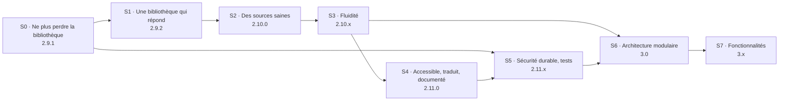

# Inko — Audit complet du chantier

> **Version** 2.9.0 (desktop) · 1.4.1 (Android) · **Date de l'audit** 2026-11-25, complété le 26/11/2026
> **Méthode** : 55 sondes automatiques (statiques et dynamiques), 7 sondes d'expérience (`docs/ux/`) + lecture ciblée du code + essais en direct sur des serveurs et des bases jetables.
> **Résultat brut** (hors expérience, avant tri des faux positifs) : 930 trouvailles — 18 critiques, 155 hautes, 468 moyennes, 284 basses.
> Ce document est **assemblé** : chaque chiffre vient de `docs/audit/sondes.json`, jamais tapé à la main. Il se régénère (voir §17).

---

## Comment lire ce document

Ce n'est pas une liste de reproches : l'application est, sur beaucoup de points, **plus soignée que la moyenne des projets de cette taille** (voir §1.3). C'est un inventaire de tout ce qui reste à faire pour passer de « solide et personnel » à « sérieux et durable » — corriger, ajouter, retravailler, refaire.

**Chaque point** porte un identifiant stable (`SEC-03`, `DAT-02`…) que l'on peut citer dans un commit, une PR ou une conversation, et suit toujours le même schéma :

| Rubrique | Contenu |
|---|---|
| **Gravité** | 🔴 critique (perte de données, faille exploitable, fonction cassée) · 🟠 haute (défaut visible ou risque réel) · 🟡 moyenne (dette qui coûtera) · 🔵 basse (finition) · ⚪ info |
| **Effort** | S ≤ ½ journée · M ≈ 1–2 jours · L ≈ 3–5 jours · XL > 1 semaine |
| **Preuve** | fichier:ligne ou mesure — toujours vérifiable |
| **Correctif** | ce qu'il faut faire, concrètement |
| **Critère d'acceptation** | comment savoir que c'est fini (souvent : « la sonde X ne le signale plus ») |
| **Auto** | 🤖 si un correcteur de `scripts-ci/sondes/correcteurs/` sait le faire seul |

**Les sections** sont ordonnées de ce qui peut faire perdre des données ou ouvrir une porte, à ce qui améliore le confort. La **feuille de route** du §16 les remet en séquence de travail avec les dépendances.

### Ce que « sonde » veut dire ici

Une sonde est un script reproductible (`scripts-ci/sondes/*.js`) qui **mesure** au lieu de supposer. Les sondes sont conçues pour ne lire que le dépôt et votre vraie base ; les parcours d'écriture tournent sur des bases créées puis détruites, sur des serveurs lancés sur d'autres ports. **Une fois, cette règle n'a pas tenu** : voir §1.7.6 (une table vide ajoutée à votre base, sans perte de données). Un garde-fou la fait désormais respecter.

| Sonde | Ce qu'elle examine | Trouvailles | 🔴 | 🟠 | 🟡 | 🔵 |
|---|---|---:|---:|---:|---:|---:|
| `structure` | Taille des fichiers, fonctions géantes, TODO/FIXME, doublons de code | 26 | · | 2 | 21 | 3 |
| `ecouteurs` | Contrôles branchés après une attente réseau (boutons inertes pendant le chargement) | 3 | · | · | 3 | · |
| `securite` | innerHTML non échappé, eval, SQL concaténé, secrets versionnés, CORS/cookies, commandes, redirections, npm audit | 63 | · | 11 | 39 | 13 |
| `routes` | Routes mutantes sans auth, sans limiteur, handlers manquants/orphelins, dérive OpenAPI | 8 | · | 1 | 4 | 3 |
| `sql` | Clés étrangères sans index, SELECT *, requêtes dans des boucles, LIKE %x%, migrations | 16 | · | · | 11 | 5 |
| `erreurs` | catch vides, promesses sans catch, console.*, setInterval sans nettoyage, handlers async | 7 | · | · | 3 | 4 |
| `a11y-html` | Images sans alt, boutons sans nom, champs sans label, titres, lang, tabindex, clics sur éléments non interactifs | 39 | · | · | 11 | 28 |
| `css` | Couleurs littérales, !important, z-index, tailles en px, sélecteurs morts, poids par feuille | 14 | · | · | 4 | 10 |
| `i18n` | Couverture EN, chaînes françaises en dur dans le JS, clés orphelines | 2 | · | · | · | 1 |
| `perf-statique` | Poids JS/CSS/images/polices par page, scripts sans defer, images sans dimensions, cache SW | 38 | · | · | 24 | 14 |
| `code-mort` | Fichiers JS non référencés, fonctions globales jamais appelées, modules serveur orphelins | 11 | · | · | · | 11 |
| `dependances` | Versions divergentes entre manifestes, npm outdated, engines, dépendances non utilisées | 12 | · | · | · | 12 |
| `tests` | Couverture par module, tests « source-grep », tests ignorés, e2e, tests sans assertion | 7 | · | · | 4 | 3 |
| `plateformes` | AndroidManifest, capacitor.config, tauri.conf (CSP, permissions), Dockerfile, Caddyfile | 5 | · | · | 2 | 3 |
| `docs` | Liens relatifs cassés, variables d'env non documentées, chiffres du README, captures référencées | 6 | · | · | · | 5 |
| `ci` | Actions non épinglées, permissions larges, secrets, caches, jobs manquants | 14 | · | · | 1 | 13 |
| `extensions` | Hash, changelog, version, taille, gestion d'erreur de chaque extension + bac à sable en direct | 8 | · | 4 | 3 | 1 |
| `donnees` | Volumétrie, orphelins, doublons, couvertures absentes, sessions, événements, index réels | 2 | · | 2 | · | · |
| `couvertures` | Joignabilité des couvertures réelles via le proxy d'images, par hôte (lecture seule) | 3 | 3 | · | · | · |
| `api-acces` | Balayage sans authentification, fichiers sensibles, en-têtes de sécurité, CORS, corps malformés/énormes | 2 | · | · | · | 2 |
| `api-contrat` | Balayage authentifié des GET (lecture seule) : 5xx, lenteurs, charges utiles, cache, puis percentiles sous charge légère | 0 | · | · | · | · |
| `flux-ecriture` | Inscription, favoris, progression, listes, notes, export/import, suppression en masse, limiteur : sur serveur et base jetables | 3 | · | 1 | 1 | · |
| `pages` | Console/réseau/CLS/débordement/images cassées/axe/LCP sur toutes les pages, bureau et mobile | 41 | · | 17 | 23 | 1 |
| `boutons` | Chaque contrôle de chaque page : recouvrement, clic réel, effet, erreurs ; scénarios mise à jour et lecture | 88 | · | 4 | 27 | 57 |
| `analyse` | ESLint strict sur tout le code (bugs probables, fonctions démesurées, code mort local) | 31 | · | · | 23 | 8 |
| `certificats` | Certificats TLS, résolution et réponse de chaque hôte externe ; liens cités dans l'application | 1 | · | · | 1 | · |
| `chaos` | Pannes simulées de l'API sur chaque page : message, exception, chargement sans fin, page blanche | 44 | · | 23 | 21 | · |
| `integrite` | Sauvegarde → restauration, export → import, effacement de compte, écritures simultanées, migrations, écart de schéma | 8 | 2 | · | 3 | 2 |
| `securite-dyn` | Attaques jouées : prise de compte, isolement entre comptes, jetons forgés, rôles, SSRF, saisies de mauvais type | 31 | 3 | 5 | 21 | 2 |
| `lecteur` | Lecteur manga et lecteur roman : chaque touche, chaque mode, chaque réglage, reprise et progression | 6 | · | 1 | 5 | · |
| `interaction` | Parcours au clavier (focus visible, pièges), ouverture de chaque menu et fenêtre, saisie dans chaque champ | 47 | · | 11 | 19 | 17 |
| `references` | Appels à des membres inexistants, routes front/serveur, identifiants, fichiers, variables CSS, événements, clés de stockage | 27 | · | 4 | 17 | 6 |
| `mobile` | Téléphone : cibles tactiles, barre du bas, saisie, paysage, appui sur chaque contrôle, mode application Android | 78 | · | 20 | 50 | 8 |
| `parcours` | Compte vide, 5 largeurs, thème clair (axe), 7 couleurs d'accent, interface anglaise | 114 | · | 25 | 74 | 15 |
| `xss` | Charges hostiles dans tous les champs et paramètres d'URL, rendues dans un vrai navigateur | 2 | 1 | · | 1 | · |
| `charge` | 2 000 et 10 000 favoris, poids réel de chaque page, requêtes en double, code inutilisé, fuites après gestes répétés | 37 | · | 2 | 5 | 30 |
| `imports` | EPUB, CBZ et PDF sains et piégés : injection à la lecture, pistage, refus, quota, isolement, reprise, suppression | 6 | 1 | 2 | 1 | 2 |
| `modes` | Application de bureau et hub de production : politique de contenu, rendu et connexion depuis la machine et depuis le réseau | 4 | 2 | · | 2 | · |
| `hors-ligne` | Service worker, pages rouvertes sans réseau, chapitre téléchargé relu coupé, écritures hors ligne puis rejouées, installabilité | 11 | · | 2 | 9 | · |
| `livraison` | Image Docker depuis un dépôt propre, mises à jour de l'application installée, commandes de vérification de l'installeur | 5 | 2 | 3 | · | · |
| `mise-a-niveau` | Mise à niveau depuis chaque version publiée : migrations, données conservées, schéma final | 1 | · | · | 1 | · |
| `exactitude` | Statistiques, séries de jours, fuseaux, listes intelligentes, compteurs affichés, exports CSV et Markdown | 2 | · | 1 | · | 1 |
| `appareils` | Appairage de bout en bout, droits et révocation d'un appareil, télécommande en direct, cohérence entre écrans | 3 | · | 1 | 2 | · |
| `administration` | Rôles, bannissement, modération, commentaires et leurs règles sur une instance à plusieurs comptes | 7 | · | 2 | 3 | 2 |
| `licences` | Licences des dépendances livrées, bibliothèques et polices copiées, mentions dans NOTICE | 2 | · | · | 1 | · |
| `resilience` | Coupure de la base, démarrages impossibles, stockage navigateur bloqué ou plein, navigation au hasard prolongée | 5 | · | 1 | 4 | · |
| `vie-privee` | Hôtes réellement contactés (navigateur et serveur) comparés à la page Confidentialité ; traces gardées | 2 | · | · | 2 | · |
| `adaptabilite` | Zoom 200 %, espacement de texte imposé, contraste forcé, contenus extrêmes | 16 | · | · | 14 | 2 |
| `filtre-adulte` | Filtre des contenus +18 quand la source répond mal (source jouée sans réseau, cache isolé) | 1 | 1 | · | · | · |
| `autonome` | Interface construite pour l'APK, sans PC : chaque page, bibliothèque locale, sources embarquées | 3 | · | · | 3 | · |
| `exposition` | Relais sur la même machine, en-tête d'hôte non vérifié, requêtes forgées depuis un autre port | 3 | 1 | 2 | · | · |
| `nouveautes` | Notifications de nouveaux chapitres (source simulée), horloge d'un appareil, adresses de notification | 4 | · | 2 | 2 | · |
| `migration` | Changement de source d'une série puis annulation, table par table | 3 | · | 2 | 1 | · |
| `base-embarquee` | MariaDB livrée avec l'application, démarrée dans un profil jetable : comptes, accès, écoute | 3 | 2 | 1 | · | · |
| `coquille` | Écran de démarrage face à un autre programme sur le port ; emplacement des sauvegardes et fichiers | 5 | · | 3 | 2 | · |

### Limites honnêtes de cet audit

- **Faux positifs assumés et triés.** Les sondes statiques sont volontairement larges. Exemple : la sonde de sécurité a signalé 103 interpolations HTML « à vérifier » ; la première passe en avait relu 9 à la main et conclu qu'aucune n'était exploitable. **La seconde passe en a prouvé une qui l'est** (SEC-15) : elles restent à traiter par un échappement automatique.
- **Ce que les sondes ne voient pas** : la qualité du design, la justesse des textes, la pertinence du produit, la sécurité des sites tiers. Ces points sont traités par lecture et jugement, et signalés comme tels.
- **Instantané.** Les sources externes (MangaDex, SushiScan, Gutenberg…) changent d'un jour à l'autre : l'état du §9 est celui du 2026-11-25. La CI `sources-health.yml` est faite pour suivre cela dans le temps.
- **Une seule machine.** Les mesures de vitesse viennent d'un PC de bureau. Le WebView Android 8 — la cible la plus contrainte — n'a pas été mesuré en direct ici ; ses risques sont déduits du code et du garde-fou `verifier-android8`.

## 1. Synthèse exécutive

### 1.1 Le verdict en cinq phrases

> **Mise à jour des 25 et 26 novembre.** La plus grave d’abord : **sur un PC neuf sans MySQL, l’application 2.9.0 ne démarre jamais** (§1.8, DSK-10 et DSK-11). Trois passes bien plus profondes (§1.6 à §1.8) contredisent une partie de la première : prise de compte depuis le réseau local, code exécuté par un livre piégé ou une donnée de favori, filtre des contenus pour adultes qui se désactive, interface morte depuis un autre appareil, sauvegardes incomplètes, déploiement Docker inutilisable. **À lire avant le reste.**

Inko est une application **mûre sur beaucoup de points** : aucune route protégée ne s'ouvre à un visiteur anonyme (117 testées, 0 ouverte), l'isolement entre comptes tient, la suppression de compte ne laisse rien, la connexion est freinée contre les essais répétés, et `npm audit` ne trouve aucune vulnérabilité en production. La première passe en tirait un jugement trop favorable : elle avait validé l'aller-retour export/import en ne comparant que les favoris.

Cinq problèmes structurels ressortent, par ordre de gravité :

1. **La bibliothèque peut être vidée en moins d'une minute, sans garde-fou ni retour arrière.** Le 9 novembre, 993 retraits de favoris ont été enregistrés en deux minutes pour le compte propriétaire ; le serveur les a tous acceptés. La sonde d'écriture a reproduit le mécanisme : 300 suppressions en 0,7 s, aucune limite, aucune corbeille. Seule la sauvegarde nocturne a sauvé les 495 séries (§3.1).
2. **Plus d'une couverture sur cinq ne s'affiche pas** (117 favoris sur 521 ≈ 22 % dépendent d'hôtes qui échouent ; 28 % d'échec sur un échantillon de 80 couvertures réelles), et c'est systématique, pas aléatoire : *toutes* celles de MangaDex, de SushiScan et de NovelFull échouent. Le correctif prévu — chercher la couverture ailleurs (AniList, Kitsu, MangaDex API) — n'est pas encore écrit (§3.2).
3. **Le catalogue de sources est fragile.** Sur 9 sources, **2 passent la chaîne complète** (WeebCentral, NovelFull). WeebCentral porte à lui seul **391 des 521 favoris (75 %)** : s'il tombe, trois quarts de la bibliothèque devient illisible. Il n'y a que **3 sources de manga** (§9).
4. **Un serveur de développement se laisse lire par n'importe quel site web.** Sans `NODE_ENV=production`, le CORS réfléchit l'origine demandée *avec* les identifiants, et `/api/auth/local` rend le jeton de session à l'appelant. Démonstration faite : une page quelconque ouverte dans votre navigateur pendant que le serveur tourne peut lire votre jeton. Le serveur sert aussi la racine du dépôt (code, tests, documents) (§2).
5. **L'application est plus lourde et moins fluide qu'elle ne le devrait.** 2 Mo de JavaScript servis sans minification, 11 à 18 scripts bloquants par page, des décalages de mise en page très élevés en affichage bureau (CLS jusqu'à 0,81 sur le catalogue, 0,69 sur la bibliothèque), 6 800 nœuds DOM sur la bibliothèque sans virtualisation (§7).

À cela s'ajoutent des chantiers de fond qui ne sont pas urgents mais pèsent sur la vitesse d'évolution : deux fichiers de 3 800 et 2 900 lignes, **113 fichiers de test qui vérifient le texte du code plutôt que son comportement**, 338 chaînes françaises sans traduction anglaise, des défauts d'accessibilité mesurés (contraste, lien sans nom, aucun lien d'évitement sur 24 pages).

### 1.2 Tableau de bord

| Domaine | État | Ce qui le justifie |
|---|---|---|
| Installation neuve (Windows) | 🔴 à corriger | la base embarquée ne se crée pas, puis refuse la connexion (DSK-10, DSK-11) |
| Sécurité du compte | 🔴 à corriger | prise du compte propriétaire depuis le réseau (SEC-14) · injections exécutées (SEC-15, SEC-24) · secret de signature public hors bureau et Docker (SEC-16) |
| Protection des mineurs | 🔴 à corriger | le filtre des contenus pour adultes de SushiScan se désactive quand la source répond mal (SEC-28) |
| Déploiement réseau et Docker | 🔴 à corriger | interface morte depuis un autre appareil (OPS-06) · image sans sources, connexion impossible (OPS-07, OPS-08) |
| Contrôle d'accès | 🟠 à corriger | routes protégées fermées à l'anonyme et comptes isolés, mais un relais local ouvre le compte administrateur (SEC-30) |
| Sécurité du mode développement | 🟡 corrigé sur la branche | CORS réfléchi et dépôt servi : fermés sur `audit/s0-s1`, non publiés |
| Intégrité des données | 🔴 à corriger | sauvegarde et export incomplets (DAT-15, DAT-16) · corbeille et plafond écrits sur la branche |
| Couvertures | 🔴 à corriger | ≈ 22 % des favoris touchés, 18 favoris sans URL, aucun repli par œuvre |
| Sources / extensions | 🟠 fragile | 2/9 sources saines · 3 sources de manga · dépendance à WeebCentral (75 %) |
| Performance côté serveur | 🟢 excellent | p95 < 70 ms sous 6 clients simultanés sur toutes les routes locales · démarrage base vierge ≈ 3 s |
| Performance côté navigateur | 🟠 à améliorer | pas de minification · scripts bloquants · CLS élevé · DOM de 6 800 nœuds |
| Accessibilité | 🟡 correcte, perfectible | contraste (9 pages) · 24 pages sans lien d'évitement · cibles tactiles < 24 px |
| Internationalisation | 🟡 partielle | 75 % de couverture EN · deux langues seulement, mécanisme qui n'en admet pas une troisième |
| Qualité des tests | 🟡 large mais superficielle | **1 289 tests, 0 échec**, mais 113 fichiers testent le texte du source ; 84/151 routes jamais appelées par un test |
| CI / livraison | 🟢 bon | gardes de dérive (openapi, précache, hashes, Android 8) ; manque permissions, timeouts, audit de dépendances |
| Documentation | 🟢 bon | 0 lien cassé · README refait ; manque variables d'environnement documentées, gabarits de contribution |
| Mobile (Android) | 🟡 correct | `allowBackup` actif, SDK cible 35 OK, trafic en clair nécessaire mais trop large |
| Maintenabilité | 🟠 dette | `global.js` 3 790 lignes, `chapitre.js` 2 912 · fonctions de 140 à 284 lignes |

### 1.3 Ce qui est solide — et qu'il ne faut pas casser

Un audit qui ne dit que le négatif fait perdre du temps à refaire ce qui marche. Les sondes ont **confirmé** :

- **Contrôle d'accès** : aucune route protégée ouverte à l'anonyme ; JSON invalide → 400 ; corps de 13 Mo → 413 ; `file://`, boucle locale, formes détournées d'adresses internes et métadonnées cloud refusés par le relais d'images (hors redirections, SEC-18). Hors production, certaines erreurs 500 renvoient le message SQL brut (API-14).
- **Isolement** : un second compte ne voit pas les favoris du premier et ne peut pas les supprimer.
- **Suppression de compte** : cascade complète, 0 reste dans `favorites`, `progress`, `read_chapters`, `events`.
- **Limiteur de connexion** : depuis le réseau, refus au 13ᵉ essai.
- **Favoris** : export puis import les restitue, emoji et caractères CJK compris (le reste du compte, non : DAT-16).
- **Charge** : `/api/health` p95 27 ms · `/api/sources` 19 ms · `/api/me/favorites` (192 Ko) p95 69 ms · pages statiques 15–22 ms, 0 erreur sur 720 requêtes.
- **API de lecture** : 51 routes GET testées, **aucun 5xx**.
- **Démarrage sur une base vierge** préparée sur un MySQL existant : ≈ 3 s, migrations comprises. La base livrée avec l'application, elle, échoue (DSK-10).
- **Dépendances** : 0 vulnérabilité (`npm audit --omit=dev`, racine et serveur).
- **Sauvegardes** : 13 fichiers en rotation, la dernière date de moins de 24 h.
- **Suite de tests** : **1 289 tests exécutés, 0 échec** (1 008 front + 281 serveur), 165 fichiers + 14 scénarios e2e, gardes de dérive en CI.

### 1.4 Les quinze actions qui changent le plus de choses

Classées par *valeur ÷ effort*. Le détail et les dépendances sont au §16.

| # | Action | ID | Gravité | Effort |
|---|---|---|---|---|
| 0a | **Rendre l'application installable** : créer la base embarquée dans la bonne base, avec des comptes cohérents, et jouer une installation neuve en CI | DSK-10, 11 · SEC-33 | 🔴 | S |
| 0 | **Avant tout** : fermer la prise de compte, les injections et le secret public, rendre le filtre adulte sûr, réparer l'accès réseau, puis compléter sauvegarde et export | SEC-14, 15, 16, 24, 28, 30 · OPS-06 · DAT-15, 16 | 🔴 | M |
| 1 | Plafond de suppressions + corbeille 30 jours + sauvegarde avant suppression en masse (écrit sur la branche) | DAT-01 | 🔴 | M |
| 2 | Repli de couverture par œuvre (MangaDex API → AniList → Kitsu), écrit en base | COV-01 | 🔴 | M |
| 3 | CORS fermé par défaut (liste blanche locale) + ne servir que les fichiers publics | SEC-01, SEC-02 | 🔴 | S |
| 4 | Journal d'événements avec origine (appareil, agent, adresse) | DAT-02 | 🟠 | S |
| 5 | Réparer SushiScan, NovelBin, Chireads (recherche) ; contourner Gutendex lent | EXT-01…04 | 🟠 | M |
| 6 | Ajouter 3 sources de manga de redondance (MangaKatana, Mangapill, Bato) | EXT-10 | 🟠 | L |
| 7 | Minifier le JS/CSS au build web et desktop (esbuild déjà présent) | PER-01 | 🟠 | M |
| 8 | `defer` sur les scripts non critiques, ordre préservé | PER-02 | 🟠 | S |
| 9 | Réserver la place des grilles et images (CLS 0,4–0,8 → < 0,1) | PER-03 | 🟠 | M |
| 10 | Virtualiser la grille de bibliothèque (6 800 → ≈ 800 nœuds) | PER-04 | 🟠 | L |
| 11 | Remplacer `bulkDelete` séquentiel par un appel serveur unique et annulable | DAT-03 | 🟠 | M |
| 12 | Import : valider la forme (500 → 400) ; refuser `javascript:` en couverture | API-01, SEC-05 | 🟠 | S |
| 13 | Contrastes (9 pages) + lien d'évitement + libellés manquants | A11Y-01…04 | 🟡 | M |
| 14 | Aligner la version du serveur (2.5.7 → 2.9.0) et l'imposer en release | DEP-01 | 🟡 | S 🤖 |
| 15 | Convertir les tests « lisent le source » des modules critiques en tests de comportement | TST-01 | 🟡 | XL |

### 1.5 Avancement au 25 novembre (branche `audit/s0-s1`, non commitée)

> Les chiffres du reste du document décrivent l'état **avant** ces corrections (relevés du 24 novembre). Ce tableau dit ce qui a été fait depuis, et comment cela a été vérifié.

**Vérifications** : 1 008 tests du front et 300 du serveur au vert (0 échec) · OpenAPI, précache, métadonnées, Android 8, changelog des extensions : à jour · parcours complets dans un vrai navigateur sur **serveur et base jetables** (la base réelle n'a pas été migrée).

| Point | Fait | Preuve |
|---|---|---|
| **DAT-01** Corbeille 30 j, plafond | Table `favorites_corbeille` (migration 28), purge quotidienne ; au-delà de 20 retraits à l'unité en 10 s → `429` | `corbeille.test.js` rejoue la boucle : 20 acceptés, 40 refusés |
| **DAT-02** Origine des événements | `events.origine` (client · navigateur · local/réseau · automate) | base d'essai : `web · Chrome/153 · local · automate` |
| **DAT-03** Retrait en lot annulable | `POST /me/favorites/bulk-remove` atomique, nombre à confirmer, « TOUTE ta bibliothèque », barre **Annuler** ; mode autonome Android compris | navigateur : 36 retirées → 0, **Annuler** → 36 |
| **DAT-06** (partiel) | Sauvegarde `inko-avant-retrait-…` avant tout lot ≥ 10, rotation à part ; refus si elle échoue | `corbeille.test.js` |
| **DAT-04** Tests isolés | e2e : base `inko_e2e` préparée à la volée, port 8187, aucun serveur repris | `serveur-sous-test.spec.js` au vert |
| **SEC-01** CORS | Fermé par défaut ; `/auth/local` refuse toute origine tierce | page tierce : **403**, aucun `Access-Control-Allow-Origin` |
| **SEC-02** Fichiers servis | Liste blanche (pages, `assets/`, manifeste, service worker) | `/package.json`, `/docs/…`, `/server/.env` : **404** |
| **SEC-04** Adresses de couverture | `javascript:`, `data:text/html`… refusées à l'écriture et à l'import | `fermeture.test.js` |
| **API-01** Import | Forme validée : `400` avec le champ en cause | `corbeille.test.js` |
| **UPD-01** Écouteurs d'abord | Bibliothèque et Journal branchés avant tout appel réseau | sonde `ecouteurs` : plus signalés |
| **UPD-02/03/04/05** Bouton | Compteur dans le bouton, bilan hors du flux, injoignables annoncés, vérification automatique silencieuse | sonde `boutons` : retour en **1 ms** (7 à 20 s avant), décalage **0 px** (208 avant) |
| **UPD-06** Un bouton, un sens | « Vérifier les chapitres » | — |
| **COV-01/02** Couvertures | Réparation automatique : adresse actuelle → source → identifiant MangaDex→AniList → titre AniList (comparaison sévère), vérifiée puis enregistrée | vrais favoris morts copiés : **0 → 18 / 20** en une minute |
| **EXT-01** SushiScan | Passé à `sushiscan.net` (1.2.0) — **cause : certificat de `sushiscan.fr` expiré le 21 novembre** | en direct : recherche, fiche, 9 tomes, 194 planches, couverture |
| **EXT-07**, **API-11** | `versions.json` et version du serveur alignés (correcteurs) | `npm run gen-ext-hashes`, gardes au vert |

**Restent, dans S0/S1** : DAT-05 (purger les 25 comptes de test **de votre base** — attend votre accord) · DAT-06 complet (sauvegarde avant migration, à la fermeture) · COV-03/04/05 (réparation de fond, octets en cache, ratios réservés) · UPD-07/08 · A11Y (reste du §8).

**Deux affirmations de la première version, corrigées** : les événements **sont** purgés après 400 jours (DAT-07) ; `lecture.js` signalé par la sonde `ecouteurs` est un **faux positif** (l'attente est dans la branche hors ligne).

### 1.6 Seconde passe : ce que la première n'avait pas vu

La première passe regardait chaque page dans des conditions favorables. La seconde cherche à casser : attaques jouées, sauvegardes réellement restaurées, pannes simulées, comptes vides, 10 000 favoris, clavier seul, téléphone, anglais, thème clair, lecteur fonction par fonction. Douze sondes de plus, toutes sur des bases jetables.

| Sonde ajoutée | Ce qu'elle éprouve |
|---|---|
| `securite-dyn` | 66 attaques jouées et 1413 requêtes de mauvais type |
| `integrite` | sauvegarde puis restauration, export puis import, effacement, écritures simultanées, migrations, écart de schéma |
| `xss` | charges hostiles dans chaque champ et dans l'adresse, rendues dans un vrai navigateur |
| `chaos` | chaque page face à une API en erreur, vide, illisible, coupée ou lente |
| `parcours` | compte neuf, cinq largeurs, thème clair, sept couleurs d'accent, interface anglaise |
| `interaction` | clavier seul, ouverture des menus et fenêtres, saisies inhabituelles |
| `lecteur` | chaque touche, mode et réglage des deux lecteurs, reprise et progression |
| `mobile` | cibles tactiles, barre du bas, saisie, paysage, appui sur chaque contrôle |
| `charge` | 2 000 et 10 000 favoris, poids réel, requêtes en double, fuites |
| `references` | fonctions, routes, identifiants, fichiers et événements qui pointent dans le vide |
| `certificats` | certificat et réponse de 35 hôtes externes |
| `analyse` | analyse statique stricte de tout le code, extensions et serveur compris |

#### 1.6.1 Sécurité

#### SEC-14 🔴 Tout appareil du réseau local peut prendre le compte propriétaire · effort S

**Preuve, rejouée sur un serveur jetable configuré comme l'application de bureau, depuis l'adresse réseau de la machine :** `/api/auth/local` refuse (403), puis `POST /api/auth/forgot` avec `owner@inko.local` renvoie le jeton de réinitialisation dans sa réponse ; `POST /api/auth/reset` change le mot de passe ; `POST /api/auth/login` rend un jeton **administrateur** ; `/api/admin/users` et `/api/me/export` répondent 200.

**Cause** : `requestReset` (`server/controllers/auth.controller.js`) ne retient le jeton que si `NODE_ENV=production`. Ni le lanceur de l'application de bureau ni `.env.example` ne le posent, et le serveur écoute sur toutes les interfaces. Le filtre ajouté pour `/auth/local` ne couvre pas cette route. **La version 2.9.0 installée est concernée.**

**Correctif** : ne rendre le jeton qu'à la boucle locale (`estLocale` et origine admise), sinon répondre 503 ; test depuis une adresse non locale. **Acceptation** : la sonde `securite-dyn` ne signale plus `SD-PRISE-DE-COMPTE`. En attendant une version corrigée : ne pas ouvrir Inko sur un réseau qu'on ne maîtrise pas.

#### SEC-15 🔴 Injection de code exécutée dans la bibliothèque · effort S

**Preuve** : un favori dont l'identifiant d'œuvre contient une balise fait **exécuter** son code à l'ouverture de `bibliotheque.html`. **Cause** : `assets/js/bibliotheque.js`, `data-manga-id="${f.mangaId}"` sans échappement (le titre, juste à côté, est échappé). Les identifiants viennent des extensions de sources et des fichiers importés : un fichier de sauvegarde piégé ou une source compromise suffit, et le code agit avec la session ouverte. La politique de contenu autorise le script en ligne : elle ne l'arrête pas.

**Correctif** : `MH.esc()` sur cet attribut, refuser côté serveur les identifiants contenant `<`, `>`, guillemets ou espaces de contrôle, et généraliser le gabarit qui échappe par défaut (SEC-11).

#### SEC-16 🔴 Un jeton signé avec le secret public du code est accepté hors bureau et hors Docker · effort S

**Preuve** : sur une instance lancée depuis les sources avec le secret d'exemple, un jeton fabriqué avec la chaîne de repli écrite dans `server/lib/secret.js` obtient 200 sur `/api/auth/me` au nom d'un autre compte, sans session enregistrée. **Correctif** : tirer un secret au sort et le conserver dans tous les cas ; refuser tout jeton sans identifiant de session. Le fichier `server/.env` de cette machine est dans ce cas.

#### SEC-17 🟠 Se déconnecter ne ferme pas la session · effort S

`POST /api/auth/logout` efface le cookie ; le même jeton reste accepté ensuite, jusqu'à 30 jours. **Correctif** : supprimer la ligne de session correspondante.

#### SEC-18 🟠 Le relais d'images suit les redirections sans revérifier la destination · effort M

Seul le premier hôte est contrôlé ; `curl -L` suit ensuite jusqu'à quatre redirections. **Rejoué sur la fonction de téléchargement** : une redirection vers `127.0.0.1` est suivie et l'image interne rendue. La chaîne complète à travers la route n'a pas été jouée (il faut un domaine autorisé qui redirige : redirection ouverte ou source compromise). Les adresses internes demandées directement sont toutes refusées. **Correctif** : suivre les redirections une à une en revalidant chacune.

#### SEC-19 🟠 Des réglages de toute l'instance sont modifiables sans être administrateur · effort S

`POST /app/update`, `PUT /auth/google-config` et `PUT /anilist/config` n'exigent qu'une session. Un téléphone appairé, volontairement privé du rôle administrateur, peut donc changer l'identifiant de connexion Google de l'instance ou lancer la mise à jour. Constaté dans la déclaration des routes (non joué, ces routes modifient la machine). **Correctif** : `adminRequired`.

#### SEC-20 🟡 Un lien de réinitialisation sert plusieurs fois s'il est envoyé en parallèle · effort S

Six envois simultanés du même jeton ont tous réussi : lecture puis écriture sans verrou. **Correctif** : consommer le jeton par un `UPDATE … WHERE used = 0` avant de changer le mot de passe.

#### SEC-21 🟡 Un corps de 11 Mo est lu avant toute authentification · effort S

La limite de 12 Mo, posée pour l'import, vaut pour toutes les routes et s'applique avant le limiteur. **Correctif** : 100 ko par défaut, 12 Mo sur `/me/import` seulement.

#### SEC-22 🟡 La couverture d'une note accepte une adresse javascript: · effort S

Le filtre ajouté aux favoris et aux listes n'a pas été appliqué à `createNote`. **Correctif** : `couverture.brute()`.

#### SEC-23 🔵 Instance partagée : inscription toujours ouverte, adresses devinables · effort M

Aucune option pour fermer l'inscription ; la réponse « un compte existe déjà » et la réinitialisation révèlent les adresses inscrites.

#### 1.6.2 Données

#### DAT-15 🔴 La sauvegarde automatique ne contient pas toute la bibliothèque · effort M

**Preuve** : compte rempli, sauvegarde, tables vidées, restauration par le script prévu. Ne reviennent pas : signets, notes du carnet, liens AniList, temps de lecture, historique d'activité et de position, commentaires, abonnements aux notifications, corbeille. Reviennent amputés : la date d'ajout et le réglage de surveillance des favoris, le nombre de pages et la date de la progression, les couvertures des éléments de liste. **Dans la base réelle de cette machine, 189 liens AniList et 94 lignes d'historique sont dans ce cas.**

**Correctif** : une seule liste des tables d'un compte, partagée par la sauvegarde, la restauration, l'export et l'import, et un test qui échoue dès qu'une table portant `user_id` n'y figure pas.

#### DAT-16 🔴 Exporter puis réimporter son compte perd les listes, les réglages, les signets et les notes · effort M

L'export contient les listes et les réglages, **mais l'import les ignore** : seuls favoris, statuts, progression, chapitres lus et notes sur dix sont rétablis. Signets, notes du carnet, temps de lecture et liens AniList ne sont même pas exportés. La première passe avait déclaré cet aller-retour « sans perte » en ne comparant que les favoris : c'était faux.

#### DAT-17 🟡 Les migrations ne sont pas rejouables · effort S

Rejouées sur une base à jour, la migration 5 échoue (contrainte déjà présente) et bloque toutes les suivantes, contrairement à ce que dit son commentaire. Sur une base vide, elles échouent aussi sans `schema.sql`.

#### DAT-18 🟡 La base réelle diffère d'une installation neuve · effort S

Une table `spotify_accounts` subsiste (vide) avec des colonnes de jetons, et l'index `favorites (user_id, status)` d'une installation neuve y manque. **Correctif** : migration de réalignement.

#### API-14 🟡 Des saisies de mauvais type provoquent 19 erreurs 500 · effort M

Un nombre à la place d'un pseudo ou d'un nom de liste, un tableau, `?limit=abc`, un identifiant non numérique : le serveur répond 500 et, hors production, renvoie le message SQL brut. Le détail route par route est dans l'annexe (`securite-dyn`). **Correctif** : un schéma de validation par route.

#### 1.6.3 Fonctions absentes ou inaccessibles

#### FON-01 🟠 La section Commentaires n'existe sur aucune page · effort M

`serie.js` sait publier, répondre, signaler, supprimer et paginer, mais `serie.html` n'a aucun des éléments attendus et rien ne lance le chargement. Les routes serveur et la modération sont donc inutilisables.

#### FON-02 🟠 Les recommandations « Pour toi » ne s'affichent jamais · effort S

`rendreReco()` (`accueil.js`) cherche `#shelfReco`, absent d'`accueil.html`, et s'arrête. La fonction est pourtant annoncée dans le README.

#### FON-03 🟠 Aucun écran de connexion, d'inscription ou de mot de passe · effort L

`API.auth.login`, `register`, `changePassword` et `requestReset` ne sont appelés nulle part ; deux boutons « Se connecter » pointent vers des pages absentes. Le mode multi-comptes documenté (Docker) est inaccessible par l'interface.

#### FON-04 🟠 Le propriétaire d'une installation locale ne peut pas supprimer son compte · effort S

Le compte est créé avec un mot de passe aléatoire, et la suppression l'exige. Déduit du code.

#### FON-05 🟡 Des fonctions du serveur sans aucun écran · effort L

Corbeille, annulation d'une migration de source, historique de position d'une série, toute l'administration, commentaires récents : voir la trouvaille `REF-FONCTION-SANS-ECRAN`. S'y ajoute du code cherchant des éléments disparus (calendrier de la semaine, sélection du catalogue).

#### 1.6.4 Robustesse face aux pannes

#### ROB-01 🟠 Une réponse illisible fait planter plusieurs pages · effort S

Quand le serveur répond 200 avec autre chose que du JSON (portail Wi-Fi d'hôtel, proxy), `api.js` rend `null` comme s'il s'agissait d'un succès : exceptions et messages du type « Cannot read properties of null » affichés à l'écran sur accueil, bibliothèque, collections, notifications, paramètres, statistiques et profil. **Cause unique** : traiter une réponse non JSON comme une erreur dans `request()`.

#### ROB-02 🟠 Des squelettes de chargement qui ne s'arrêtent jamais · effort S

Recherche (erreur 500 et réseau coupé) et bibliothèque (réseau coupé, sur un appareil sans copie locale) gardent leurs 8 signalements d'attente sans message ni bouton « Réessayer ».

#### ROB-03 🟡 API lente : plusieurs pages restent vides sans rien indiquer · effort S

Avec 14 secondes de latence, la fiche série, une liste, une collection et un profil restent quasi blancs.

### 1.7 Troisième vague : ce qui est livré, le hors-ligne, les fichiers, les autres appareils

Sondes ajoutées : `imports`, `modes`, `hors-ligne`, `livraison`, `mise-a-niveau`, `exactitude`, `appareils`, `administration`, `resilience`, `vie-privee`, `adaptabilite`, `licences`, `autonome`, et sept sondes d'expérience (`ux-*`).

#### 1.7.1 Urgences

#### SEC-28 🔴 Quand SushiScan répond mal, le filtre des contenus pour adultes se désactive · effort S

**Preuve**, rejouée sans réseau avec une source simulée : les pages de genres sont refusées, le catalogue répond ; le titre réservé aux adultes sort dans le catalogue normal, et **y reste après le rétablissement**. **Cause** : l'index des titres à masquer est construit à partir des pages de genres ; chaque échec est avalé, la liste vide ou incomplète est gardée six heures en mémoire et écrite dans le dossier temporaire, relue au redémarrage. Un fichier de ce type, vide, a été trouvé sur cette machine (§1.7.6). **Correctif** : ne jamais garder un index incomplet ; tant qu'il n'est pas complet, ne rien servir de cette source plutôt que tout.

#### SEC-24 🔴 Un livre EPUB piégé exécute du code dans l'application · effort M

**Preuve** : un EPUB fabriqué pour l'essai, ouvert dans le lecteur de fichiers, exécute du JavaScript par quatre voies différentes (section CDATA, commentaire, instruction de traitement, animation SVG). **Cause** : `sanitizeChapter` (`assets/js/localreader.js`) analyse le chapitre comme du XML puis le réinjecte avec `innerHTML`, qui le relit comme du HTML : ces constructions changent de sens entre les deux ; la liste des balises retirées est par ailleurs incomplète. Le script agit avec la session ouverte. **Correctif** : liste blanche de balises et d'attributs en reconstruisant des nœuds (ou une bibliothèque éprouvée), et affichage dans un cadre isolé sans script. **N'ouvrir que des livres dont on connaît la provenance.**

#### OPS-06 🔴 Depuis un autre appareil du réseau, l'interface ne se charge pas · effort S

**Preuve**, application de bureau et configuration de production : depuis l'adresse réseau, en http, aucune page ne fonctionne ; le navigateur réclame chaque fichier en https. **Cause** : la politique de contenu ajoute `upgrade-insecure-requests` (défaut de la bibliothèque `helmet`). Sur la machine elle-même, tout marche, ce qui rend le défaut invisible au développement. **Correctif** : désactiver cette directive tant que le serveur n'est pas derrière HTTPS.

#### OPS-07 🔴 L'image Docker construite depuis un dépôt propre ne contient aucune source · effort S

**Preuve par simulation** (Docker n'est pas installé sur cette machine) : un serveur démarré avec les seuls fichiers d'un clone répond avec zéro source ; `server/extensions/*/` est ignoré par git et le `Dockerfile` ne copie pas `extensions-community/`.

#### OPS-08 🔴 Avec le fichier Docker fourni, personne ne peut entrer · effort L

**Déduit du code** : la connexion automatique reste active mais n'accepte que la boucle locale, et une requête qui traverse le port publié arrive d'une autre adresse (refus rejoué depuis le réseau). Avec `LOCAL_MODE=0`, il n'existe aucun écran de connexion (FON-03). Avec OPS-06 et OPS-07, **le déploiement Docker documenté est inutilisable**.

#### FON-06 🟠 Les commentaires publiés avec la portée par défaut ne sont visibles de personne · effort S

La lecture utilise `authOptional`, qui ne renseigne que `req.userId`, alors que le filtre regarde `req.user` : tout lecteur connecté est traité comme un visiteur. Il ne voit ni les commentaires réservés à l'instance (le défaut) ni les siens ; la modération perd sa vue d'ensemble. **Rejoué** sur une instance à trois comptes.

#### 1.7.2 Données et fichiers

#### DAT-19 🟠 Les fichiers importés ne sont dans aucune sauvegarde · effort M

Ni la sauvegarde automatique ni l'export ne mentionnent la table `local_imports` ou le dossier des fichiers.

#### DAT-20 🟠 Favoris, signets et notes faits sans réseau sont perdus · effort M

**Preuve** : réseau coupé, cinq gestes ; au retour, seuls la progression et les chapitres lus arrivent. Les autres ne sont pas mis en file (`api.js`, `OFFLINE_OK`) et l'écran ne le dit pas.

#### SEC-25 🟠 Un livre peut emmener ailleurs et signaler qu'on le lit · effort S

Un chapitre contenant une redirection fait quitter l'application ; images de fond, vidéos, sons et liens suivis contactent six adresses extérieures à l'ouverture.

#### SEC-26 🟠 Les exports CSV transforment des titres en formules · effort S

Un titre commençant par `=`, `+`, `-` ou `@` sort tel quel : un tableur l'exécute. Les titres viennent des sources et des fichiers importés.

#### SEC-27 🟠 Un téléphone appairé peut appairer d'autres appareils · effort S

Un appareil au rôle « lecteur » obtient un code d'appairage et la liste des sauvegardes. Un téléphone volé peut donc se multiplier avant d'être révoqué. Les routes d'administration, elles, sont bien refusées, et la révocation coupe l'accès immédiatement.

#### 1.7.3 Application installée et mises à jour

#### DSK-07 🟠 La vérification de signature et le téléchargement de secours de la mise à jour sont cassés · effort S

Les deux commandes PowerShell de `update.controller.js`, rejouées à l'identique sur un fichier inoffensif, échouent à l'analyse : avec `-Command`, les arguments sont recollés au texte au lieu d'être passés à `param()`. Seules restent l'empreinte publiée et `curl`.

#### DSK-08 🟠 L'application installée ne reçoit aucun correctif de source entre deux versions · effort M

L'installeur embarque `extensions-community/` et le contrôleur lit ce dossier dès qu'il existe : « Mettre à jour » compare la version installée à la copie livrée avec elle. **Déduit du code et de la configuration du paquet.** La réparation de SushiScan exigera donc une nouvelle version.

#### DSK-09 🟠 Quatre pages de l'application Windows n'ont pas de boutons de fenêtre · effort S

**Preuve** en simulant l'environnement de l'application dans un navigateur : `localreader.html` (la lecture de vos fichiers), `systeme.html`, `confidentialite.html` et `anilist.html` ne reçoivent pas la barre de titre. La fenêtre est configurée sans cadre (`"decorations": false`) et la barre n'est ajoutée que par `MH.initPage`, que ces pages n'appellent pas : impossible d'y réduire, fermer ou déplacer la fenêtre à la souris ; `systeme.html` n'offre en plus aucun lien pour en sortir. **Correctif** : injecter la barre depuis un script chargé par toutes les pages.

#### ROB-05 🟠 Une panne de la base déconnecte l'utilisateur · effort S

**Preuve** : base indisponible, chaque requête authentifiée répond 401 « Token invalide ou expiré » ; l'interface efface alors la session (`api.js`). **Cause** : `authRequired` entoure la vérification du jeton **et** la lecture en base d'un seul `catch`. **Correctif** : ne répondre 401 que si le jeton est refusé, 503 sinon.

#### OPS-10 🟡 Port déjà pris : le serveur annonce qu'il a démarré · effort S

**Preuve** : un second serveur lancé sur un port occupé écrit « Inko backend → http://localhost:… » et reste en vie sans écouter. **Cause** : avec Express 5, la fonction passée à `listen` est aussi appelée en cas d'erreur, et `app.js` ignore son argument. **Correctif** : tester l'erreur, la dire, quitter avec un code non nul.

#### UX-08 🟠 Après un téléchargement réussi, le bouton propose encore « Télécharger », et le toucher efface · effort S

Le bloc `finally` de `chapitre.js` remet l'ancien libellé après le succès ; l'appui suivant supprime le chapitre sans confirmation. La lecture sans réseau, elle, fonctionne.

#### 1.7.4 Expérience

#### A11Y-14 🟠 Les résultats de recherche ne sont pas des liens · effort S

Des `<div>` avec un écouteur de clic : impossibles à ouvrir au clavier, dans un nouvel onglet, ou à annoncer par un lecteur d'écran.

#### UX-09 🟠 Retirer une série à l'unité ne s'annule pas · effort S

La confirmation existe, mais « Annuler » n'a été posé que sur le retrait en lot (parcours joué au bureau et au téléphone).

#### UX-10 🟠 Au téléphone, le bouton Retour quitte la page au lieu de fermer le panneau · effort M

Rejoué sur les réglages du lecteur et sur un menu de la fiche série ; les panneaux de la bibliothèque et du catalogue, eux, se ferment.

#### A11Y-15 🟠 Thème clair : contrastes insuffisants · effort S

Relevés par `parcours` et `pages` sur plusieurs pages ; les couleurs d'accent alternatives en ajoutent (56 cas).

#### I18N-05 🟠 L'interface anglaise reste largement en français · effort L

Textes restants sur 22 pages ; certains relevés incluent des titres d'œuvres, qui n'ont pas à être traduits.

#### MOB-09 🟠 Des cibles tactiles sous 24 px · effort S

Sur 15 pages (minimum WCAG 2.2).

#### MOB-10 🟠 La barre du bas masque des contrôles en fin de page · effort S

#### MOB-11 🟡 En paysage, les barres fixes prennent la moitié de l'écran · effort S

194 px sur 390 sur la plupart des pages.

#### MOB-12 🟡 Des champs sous 16 px font zoomer l'écran sur iPhone · effort S

#### PER-13 🟠 La bibliothèque devient très lente à partir de quelques milliers de séries · effort L

2 000 favoris : 26 577 éléments et 16 s de rendu ; 10 000 : 46 448 éléments, 37 s, filtrage qui bloque près de 3 s. Les interfaces des autres pages tiennent. Liste virtualisée.

#### ROB-04 🟡 Un changement fait sur un autre appareil n'apparaît qu'après rechargement · effort M

#### OPS-09 🟡 Instance partagée : personne n'est administrateur au départ, le dernier peut disparaître · effort S

Le premier compte inscrit a le rôle ordinaire ; le dernier administrateur peut supprimer son compte ; un compte banni obtient encore un jeton à la connexion ; modifier un compte inexistant répond « réussi ».

#### LEC-01 🟡 Échap ne ferme plus les réglages du lecteur après une case ou un curseur · effort S

#### DOC-12 🔵 Deux bibliothèques copiées dans le dépôt ne sont pas citées · effort S

`qrcode` et `three` n'apparaissent ni dans `NOTICE.md` ni dans le README.

#### A11Y-16 🟡 En contraste forcé, on ne voit plus quel choix est actif · effort S

**Preuve** (captures) : onglets de la bibliothèque et de l'accueil tous soulignés pareil, boutons de vue du catalogue identiques, et le libellé de la catégorie sélectionnée « Tout » **disparaît**. **Correctif** : `@media (forced-colors: active)` avec un contour sur l'état actif, sans aplat par-dessus le texte.

#### UX-11 🟡 Un titre hors norme élargit la page · effort S

Un titre long sans espace, ou une description de liste de 2 000 caractères collés, provoque un défilement horizontal à l'accueil, dans le carnet et sur le profil public. `overflow-wrap: anywhere` et `min-width: 0`.

#### UX-12 🟡 « Confidentialité » et « Système » s'affichent sans en-tête · effort S

L'emplacement de l'en-tête est présent mais jamais rempli (`MH.initPage` n'est pas appelé) : plus de navigation, et aucun lien du tout sur la page « Système ». Même cause que DSK-09.

#### SEC-29 🟡 Le navigateur contacte AniList directement ; un hôte du serveur n'est pas déclaré · effort S

La recherche d'illustrations part du navigateur vers `graphql.anilist.co` et charge les images de `s4.anilist.co` : ces services voient l'adresse du lecteur. Côté serveur, `hot.planeptune.us` (images d'une source) ne figure pas dans la page « Confidentialité ».

#### MOB-13 🟡 Sans PC, chaque page relance des appels à SushiScan, et le catalogue n'a qu'une source · effort M

**Preuve** sur l'interface construite pour l'APK : 21 appels à `sushiscan.net` à chaque ouverture de page, parce que les sources sont rechargées et que l'index des titres pour adultes ne peut pas être gardé (voir SEC-28). Le catalogue ne propose que MangaDex : quand elle refuse (depuis ce réseau, défi anti-robot), l'écran affiche « Unexpected token '<' … is not valid JSON ».

#### 1.7.5 Ce qui a tenu

À ne pas casser, éprouvé dans cette vague : mise à niveau depuis les huit versions publiées sans perte (seul un index manque après la 2.3.4) ; statistiques, séries de jours, fuseau, listes intelligentes et compteurs d'écran justes (20 vérifications sur 20) ; refus des fichiers importés au mauvais contenu, quota et isolement entre comptes ; chapitre et roman téléchargés relisibles sans réseau ; installation du service worker complète ; gestes du mode autonome conservés après rechargement ; télécommande et révocation d'appareil ; connexions à la base coupées en pleine activité : reprise immédiate, et les 39 écritures annoncées réussies sont toutes en base ; base disparue : le contrôle de santé répond bien « indisponible » ; 218 gestes au hasard sans une exception ; lecture privée : aucune trace en base.

#### 1.7.6 Deux incidents pendant l'audit

**La base réelle.** La première version de la sonde `mise-a-niveau` a chargé le `schema.sql` de la v2.3.4 sans le filtrer. Ce fichier commence par `USE inko;` : il s'est exécuté **sur la base réelle**. Vérification faite ensuite, en lecture seule : une table vide `library` a été créée (2 index), sept tables ont été reconstruites à l'identique ; aucune colonne, aucun index existant ni aucun nombre de lignes n'a changé. La table n'a pas été supprimée sans accord. Depuis, tout script SQL chargé par une sonde passe par `_garde-sql.js`, qui retire les ordres désignant une base et refuse le script s'il en reste.

**Le dossier temporaire.** Un test de l'application lancé le 25/11 à 21 h 49 (serveur réel démarré par Playwright) a écrit un index **vide** des titres pour adultes, que votre application aurait relu jusqu'à 3 h 49 le 26/11 (conséquence de SEC-28). Le fichier a été copié puis supprimé le 26/11 vers 0 h 25 ; il se reconstruit au prochain démarrage. Les serveurs d'essai des sondes ont désormais leur propre dossier temporaire.

### 1.8 Quatrième vague : installation neuve, exposition réseau, synchronisation, migration

Sondes ajoutées : `base-embarquee`, `exposition`, `nouveautes`, `migration`, `coquille`.

#### 1.8.1 Urgences

#### DSK-10 🔴 Sur un PC neuf sans MySQL, la base ne se crée pas : l'application ne démarre jamais · effort S

**Preuve**, avec le code, le Node et la MariaDB de l'application 2.9.0 **installée**, dans un profil vierge : « base vierge : application du schéma complet… » puis `No database selected`. **Cause** : `ensureSchemaOn` (`server/lib/embedded-db.js`) joue `schema.sql` sur une connexion qui ne choisit aucune base, et le fichier n'en choisit plus depuis la 2.5.0. Les installations déjà initialisées, ou reliées à un MySQL rempli, ne le voient pas : c'est pourquoi rien ne s'est signalé ici. **Correctif** : passer `database: DB_NAME` à cette connexion. **Critère d'acceptation** : un essai d'installation neuve dans la CI, avant chaque publication.

#### DSK-11 🔴 Même la structure en place, l'application se voit refuser la connexion à sa base neuve · effort S

**Preuve** : structure posée à la main, second démarrage : `Access denied for user 'root'@'127.0.0.1' (using password: YES)`. **Cause** : le mot de passe n'est posé que sur `root@localhost`, alors que, résolution de noms désactivée, l'application arrive comme `root@127.0.0.1`, resté sans mot de passe. Le même code est présent depuis la 2.3.4. **Correctif** : traiter tous les comptes `root` (ou n'en garder qu'un), puis vérifier par une vraie reconnexion. **DSK-10 et DSK-11 se cumulent** : les corriger ensemble. Chez vous, l'application installée utilise le MySQL de Laragon ; son repli sur la base embarquée, quand Laragon est arrêté, suit ce même code (déduit, non éprouvé sur vos données).

#### SEC-30 🔴 Derrière un relais installé sur la même machine, n'importe qui devient administrateur · effort S

**Preuve** : depuis l'adresse réseau, en direct, la connexion automatique est refusée (403) ; par un relais local qui transmet `X-Forwarded-For`, elle rend un jeton administrateur, sans mot de passe. **Cause** : sans `TRUST_PROXY`, le serveur ne voit que la boucle locale (`lib/reseau.js`). Concerne Caddy, nginx ou un tunnel lancés sur la machine qui héberge Inko ; la configuration Docker fournie pose `TRUST_PROXY`. **Correctif** : traiter comme distante toute requête portant un en-tête de relais non local, et le documenter.

#### SEC-31 🟠 Le serveur répond à n'importe quel nom d'hôte, jeton de réinitialisation compris · effort S

**Preuve** : une requête locale annonçant l'hôte et l'origine d'un autre nom de domaine reçoit les pages, et `/api/auth/forgot` rend le jeton (la connexion automatique, elle, est refusée). Un site dont le domaine est redirigé vers 127.0.0.1 pourrait ainsi prendre le compte ; la protection d'accès au réseau local des navigateurs n'a pas été éprouvée. **Correctif** : liste des noms d'hôte admis, et celui de SEC-14.

#### SEC-32 🟠 Une page d'un autre port du même hôte peut effacer l'historique de lecture · effort S

**Preuve** : après une visite d'Inko, un formulaire vide envoyé depuis un autre serveur local à `/api/me/clear-history` efface positions, chapitres lus et activité. Le cookie accompagne la requête (les ports ne comptent pas pour « SameSite »), l'origine n'est pas vérifiée et un corps absent signifie « tout ». **Correctif** : exiger un corps JSON ou un en-tête propre à l'application pour toute écriture par cookie.

#### SEC-33 🟠 La base embarquée garde des comptes administrateur sans mot de passe · effort S

`root@127.0.0.1`, `root@::1` et le compte au nom de la machine restent ouverts à tout programme local, alors que le journal annonce « mot de passe root posé ». L'écoute est bien limitée à la machine.

#### FON-07 🟠 Au-delà de cinq séries, les nouveaux chapitres ne sont jamais annoncés · effort S

**Preuve** : douze séries avec un chapitre de plus, trois passages de la tâche de fond : cinq annonces, puis plus aucune. Le même passage enregistre le dernier chapitre des douze ; les sept restantes ne sont plus « nouvelles », contrairement à ce que dit le commentaire du code. **Correctif** : n'enregistrer qu'après l'annonce, ou regrouper.

#### DAT-21 🟠 Un appareil à l'heure fausse fige la position sur tous les autres · effort S

**Preuve** : un enregistrement daté d'un an dans le futur, puis un enregistrement normal : réponse « réussi », position inchangée. Une date très lointaine provoque une erreur 500. **Correctif** : borner la date du client à celle du serveur.

#### DAT-22 🟠 Changer de source laisse la série hors de ses listes et sans son historique · effort M

Listes, historique des positions, activité et commentaires restent attachés à l'ancienne série.

#### DAT-23 🟠 « Annuler » une migration ne rend pas l'état d'avant · effort S

**Preuve** : les notes des signets disparaissent, une série en sourdine se remet à notifier, la date d'ajout et les dates de lecture deviennent celles de l'annulation. **Correctif** : photographier et restaurer toutes les colonnes.

#### DAT-24 🟠 Windows : sauvegardes, fichiers importés et clés sont dans le dossier d'installation · effort M

**Constaté sur l'application installée** (sauvegardes dans `resources\server\backups`). Le lanceur ne fixe pas leur emplacement, contrairement à ce qu'annonce le code de la base (« jamais dans le dossier d'installation »). Leur sort à la désinstallation n'a pas été éprouvé. **Correctif** : `%APPDATA%\Inko`, avec déplacement de l'existant.

#### DAT-25 🟠 Docker : fichiers importés et sauvegardes disparaissent à chaque mise à jour · effort S

Le service de l'application n'a aucun volume. Déduit de la configuration.

#### DSK-12 🟠 N'importe quel programme sur le port 8088 s'affiche dans la fenêtre d'Inko · effort M

**Preuve** : l'écran de démarrage accepte une réponse vide « réussie » d'un faux serveur et ouvre sa page ; les droits de fenêtre sont accordés à tout ce qui répond à cette adresse. Un second serveur Inko (développement) suffit à afficher une autre bibliothèque. **Correctif** : un secret propre à chaque lancement, vérifié avant d'ouvrir.

#### 1.8.2 À corriger ensuite

#### SEC-34 🟡 Les notifications peuvent être envoyées vers n'importe quelle adresse, interne comprise · effort S

Un compte enregistre une adresse de la machine ; le serveur s'y connecte au scan suivant.

#### DSK-13 🟡 La protection SmartScreen du moteur d'affichage est désactivée · effort S

#### DAT-26 🟡 Le chapitre 0 est enregistré sans numéro · effort S

#### DAT-27 🟡 La restauration en ligne de commande ne lit pas les sauvegardes de l'application de bureau · effort S

La phrase de chiffrement est dans `%APPDATA%\Inko` ; le script n'accepte que `BACKUP_PASSPHRASE`. La restauration depuis l'application, elle, la connaît.

#### 1.8.3 Ce qui a tenu, et un raté de ma part

La base embarquée n'écoute que sur la machine et refuse les connexions anonymes. La migration entre sources reporte favori, position, chapitres appariés, note et avis, signale les chapitres introuvables, et son annulation rend positions, avis et notes de carnet.

En vérifiant le chargement d'un fichier, j'ai lancé par erreur la campagne complète des sondes. Arrêtée après environ une minute ; elle n'avait créé que des bases et des dossiers d'essai, supprimés ensuite. Base réelle, profil, configuration et code vérifiés inchangés ; résultats précédents restaurés.

## 2. Sécurité

> **Posture générale : bonne, avec un trou précis.** Le travail d'audit antérieur (S1…S14, SEC-01…SEC-11) se voit : isolation par `estLocale` à double adresse, SSRF fermé, mots de passe à politique, sessions révocables, jetons hachés, secret JWT par installation en mode desktop. Les sondes confirment : **112/112** routes protégées refusent l'anonyme, **0** fuite de pile ou de SQL, `npm audit` à **0**.
> Ce qui reste est concentré sur **ce que le serveur sert et à qui il répond hors production**.

### SEC-01 🔴 Un site web quelconque peut lire votre jeton de session (serveur lancé hors production) · effort S

**Preuve (démontrée en direct, `api-acces`)**

```
POST /api/auth/local        Origin: https://evil.example
→ 200   Access-Control-Allow-Origin: https://evil.example   (+ Access-Control-Allow-Credentials: true)
        corps : { user, token: "<jeton admin>", localMode: true }
```

`corsOptions()` (`server/middleware/security.js:124-160`) ne ferme CORS qu'en production ou desktop (`permissiveOk = !(IS_PROD || IS_DESKTOP) || CORS_ALLOW_ANY`). Hors de ces deux cas — **tout lancement `node server/server.js`, `npm start`, ou l'aperçu de développement** — il *réfléchit* n'importe quelle origine **avec `credentials: true`**. Or `/auth/local` (`localOnly`) ne vérifie que **l'adresse de la machine**, pas l'origine de la page : une page ouverte **dans votre navigateur** vient bien de la boucle locale.

**Scénario** : le serveur de développement tourne ; vous ouvrez un lien, un forum, un onglet publicitaire. Sa page fait `fetch('http://localhost:8088/api/auth/local', {method:'POST', credentials:'include'})` — requête « simple », **sans préalable CORS** — et **lit le jeton admin dans la réponse**. Avec lui : lecture et suppression de toute la bibliothèque (voir DAT-01 : 300 suppressions en 0,7 s), export complet, désactivation d'extensions.

**Ce qui protège déjà** : l'application installée (Tauri, `IS_DESKTOP`) et Docker (`NODE_ENV=production`) sont **fermés** — SEC-09 les a traités. Le trou est le **mode développement / auto-hébergement sans `NODE_ENV`**, c'est-à-dire la machine sur laquelle l'application est construite.

**Correctif**
1. **Fermé par défaut partout** : n'autoriser que `http://localhost:<PORT>`, `http://127.0.0.1:<PORT>`, les origines webview connues, et `CORS_ORIGINS`. `CORS_ALLOW_ANY=1` reste l'unique échappatoire, **explicite**.
2. **Défense en profondeur sur `/auth/local`** : exiger un en-tête personnalisé (`X-Inko-Client: web|desktop|mobile`) — un en-tête non standard **force le préalable CORS**, que (1) refuse — **et** refuser si `Origin` est présent et différent de l'hôte (`Sec-Fetch-Site: cross-site` → 403).
3. Test de non-régression : la sonde `api-acces` doit afficher `cors_origine_etrangere: refusée`.

**Critère d'acceptation** : `ACCES-CORS-OUVERT` et `ACCES-CORS-PREFLIGHT` ne remontent plus ; `POST /auth/local` avec `Origin: https://evil.example` → 403.

---

### SEC-02 🟠 Le serveur publie la racine du dépôt · effort S

**Preuve (`api-acces`)** — servis en `200` : `/package.json`, `/Dockerfile`, `/scripts-ci/gen-openapi.js`, `/test/unit/api.test.js`, `/AUDIT-INKO-2026-07-28.md`, `/docs/audit/sondes.json`.

`BLOCKED_DIRS` (`server/app.js:60`) est une **liste noire** : `server|node_modules|desktop|desktop-tauri|tools|promo|.git|.github`. Tout ce qui n'y figure pas est servi — **dont les documents d'audit de sécurité** (`AUDIT-*.md`, `audit.md`, `docs/`), les **tests**, les **scripts**, et **tout futur dossier ajouté**. Les fichiers vraiment secrets (`.env`, `server/config/*.json`, `server/backups`) sont bien refusés : les chemins secrets testés (`.env`, `server/config/*.json`, `server/backups/`, `.git/`, traversées `..%2f`, casse, antislash) ne sortent pas — la liste noire marche *aujourd'hui*, mais elle repose sur le fait de n'oublier aucun dossier.

**Correctif** : **liste blanche** — `*.html` de la racine, `assets/`, `manifest.webmanifest`, `service-worker.js`, icônes. Tout le reste → 404. Idéalement, un dossier `public/` dédié (voir ARC-04).

**Critère d'acceptation** : `ACCES-FICHIER-EXPOSE` et `ACCES-DEPOT-SERVI` disparaissent.

---

### SEC-03 🟠 La CSP est absente en développement et affaiblie en production · effort L

**Preuves**
- **Aucun en-tête `Content-Security-Policy` en développement** (`CSP_ON = (IS_PROD || IS_DESKTOP) && …`, `security.js:26`) : ce qui est testé n'est **pas** ce qui sera livré. Des erreurs de CSP n'apparaissent qu'en production — c'est exactement l'histoire de `DESK-01` (« la CSP de l'app installée bloque les gestionnaires en ligne »).
- **`'unsafe-inline'` présent 5 fois** dans `security.js`, et dans la CSP Tauri (`script-src 'self' 'unsafe-inline'; style-src 'self' 'unsafe-inline'`). Il annule l'essentiel de la protection contre un XSS.
- La CSP Tauri autorise **`img-src https:`** et **`connect-src https:`** : un script injecté pourrait **exfiltrer vers n'importe quel site**. L'app n'a besoin que de `http://127.0.0.1:8088`.
- **`Permissions-Policy` absent** (caméra, micro, géolocalisation non explicitement refusés).

**Correctif** : (1) activer la même CSP en développement, en mode `Content-Security-Policy-Report-Only` d'abord ; (2) **sortir les `<script>` inline des 26 pages** (la chaîne de build Android les transpile déjà : elle sait les extraire) vers `assets/js/pages/*.js` ; (3) supprimer `'unsafe-inline'` pour les scripts, puis pour les styles (attributs `style=` → classes) ; (4) `connect-src 'self'` côté Tauri ; (5) `Permissions-Policy: camera=(), microphone=(), geolocation=(), payment=()`.

**Critère d'acceptation** : `PLT-CSP-UNSAFE-INLINE` et `PLT-TAURI-*` à zéro ; zéro violation CSP au parcours de la sonde `pages` en production.

---

### SEC-04 🟠 Une URL `javascript:` est acceptée comme couverture · effort S

**Preuve (`flux-ecriture`)** : `POST /me/favorites {cover: "javascript:alert(1)"}` → **200, et l'URL est conservée en base**. `couverture.brute()` ne filtre pas le schéma.

Aujourd'hui l'URL ne s'exécute pas (elle va dans un ``), mais elle **voyagera** : export JSON, partage de listes publiques (`liste.html`), futures utilisations en `href`, CSS `url()`. Une donnée dangereuse stockée est une faille en attente d'un nouvel usage.

**Correctif** : liste blanche de schémas (`http`, `https`, ou chemin relatif `/api/img?…`) dans `couverture.brute()` **et** dans tout champ d'URL (`avatar`, `website`, `list.cover`, imports). Les mêmes règles à l'import.

---

### SEC-05 🟠 Les erreurs d'extension remontent la ligne de commande `curl` entière · effort S

`extensions.controller.js:221,237` renvoient `e.message` tel quel ; pour une source qui échoue via `curl`, le message est `curl : Command failed: curl -s -f -L --compressed -m 30 -A Mozilla/5.0 … https://…` (vu dans le journal du serveur). Pas de secret, mais **la mécanique interne et l'URL complète** partent au client. Idem `update.controller.js:251`, `migration.controller.js:174`, `local.controller.js:83`.

**Correctif** : une fonction `messagePublic(e)` (codes stables : `SOURCE_INDISPONIBLE`, `SOURCE_LENTE`, `REPONSE_INVALIDE`) ; le détail va au journal avec un identifiant de corrélation que l'interface affiche (« référence 7F3A »).

---

### SEC-06 🟡 Plus de la moitié des routes d'écriture sans limiteur de débit dédié · effort M

`writeLimiter` n'est posé que sur **5 routes** (`routes/index.js`) ; 56 routes d'écriture n'ont aucun plafond propre. **Mesuré** : 300 `DELETE` en 0,7 s sont acceptés. Même hors du cas de la corbeille (DAT-01), une boucle fautive (client, extension, test) peut saturer la base et le journal d'événements.

**Correctif** : un limiteur **par compte** (clé = `req.user.id`, pas l'IP : en local, tout est `127.0.0.1`) monté sur tout `POST/PUT/DELETE /me/*` : 120 écritures/min, avec exemption en rafale pour les imports. Les routes sensibles gardent leur limiteur strict.

---

### SEC-07 🟡 Les réponses authentifiées ne sont pas marquées `no-store` · effort S

**Preuve (`api-contrat`)** : `/me/favorites` (192 Ko), `/me/export` (982 Ko, **toute la bibliothèque**), `/auth/sessions`, `/me/events` — aucun `Cache-Control`. Derrière Caddy/un proxy ou sur un poste partagé, ces réponses peuvent être conservées.

**Correctif** : `Cache-Control: no-store` (ou `private, no-cache`) sur toute réponse `/api/me/*` et `/api/auth/*` ; ETag faible + `private` pour les listes volumineuses (gain de bande passante **et** de confidentialité).

---

### SEC-08 🔵 Les sauvegardes d’un serveur ne sont pas chiffrées par défaut · effort S

Le dossier `server/backups/` conserve les fichiers JSON des dernières semaines. L'application **installée** les chiffre par défaut (SEC-04 : phrase tirée au sort au premier démarrage) ; un **serveur** ou un poste de développement ne chiffre que si `BACKUP_PASSPHRASE` est définie. Un dump de sauvegarde, c'est l'intégralité des données de tous les comptes. Le dossier est exclu du serveur web (OK) et de git (OK), mais pas du **cloud de synchronisation** éventuel du profil Windows.

**Correctif** : chiffrer **par défaut** avec une clé par installation (même mécanisme que le secret JWT, `secrets-locaux.js`) ; la phrase secrète utilisateur reste un renfort. Restreindre les droits du dossier (`icacls`).

---

### SEC-09 🟡 Secret JWT de repli connu en développement · effort S

`server/lib/secret.js:63,68` retombe sur la chaîne littérale `inko-dev-secret-change-me` hors production et hors desktop. Le code l'avertit ; mais un serveur exposé sans `NODE_ENV` signerait avec un secret **public** (lisible dans le dépôt) → forge de jeton hors ligne. **Correctif** : générer un secret aléatoire par installation dans **tous** les modes (le cas desktop le fait déjà) ; refuser de démarrer si `HOST` ≠ boucle locale et secret faible.

---

### SEC-10 🟡 Les paramètres de chemin ne sont pas validés au bord · effort M

49 usages de `req.params.*` sans validation visible (`parseInt`, motif…). Les requêtes sont paramétrées (pas d'injection SQL : 0 interpolation de *valeur*, les alertes `SEC-SQL-INTERPOLE` sont des **faux positifs** de fragments structurels — voir encadré), mais un `:mangaId` de 10 000 caractères atteint la base et les journaux.

**Correctif** : un middleware `valider({ mangaId: idOeuvre, id: entier })` par route ; `idOeuvreValide` existe déjà (`addFavorite`) — l'appliquer partout.

> **Triage des alertes SQL de la sonde** — 6 « interpolations » signalées : `admin.controller.js:11` (sous-requête statique), `user.controller.js:840` (`IN (?)` + `WITH RECURSIVE`), `embedded-db.js:102,104` (mot de passe échappé par `mysql.escape`), `migration-sources.js:286` et `restore-backup.js:100` (listes `?` générées, nom de table issu d'une liste fixe). **Aucune ne reçoit de donnée utilisateur.** À conserver, avec un commentaire `// sql-ok: structure` que la sonde reconnaîtrait.

---

### SEC-11 🟡 Du HTML est construit par concaténation partout dans le front · effort L

342 affectations `innerHTML` ; 103 contiennent une interpolation sans `MH.esc` visible. **Neuf ont été relues à la main (`u.js:71`, `profil.js:570`, `systeme.js:250`, `onboarding.js:289`, `global.js:291`, `parametres.js:188`, `stats.js:625`, `import.js:78`, `chapitre.js:1170`) : aucune n'est exploitable** — constantes de code, booléens, nombres, ou valeurs validées côté serveur (`status` est liste blanche). Le niveau d'hygiène est bon.

Le risque est **ailleurs** : il dépend de la discipline de chaque développeur à chaque ligne. Une seule omission — un titre de source, un nom de liste — suffit. Et les titres viennent de **sites tiers**.

**Correctif (méthode, pas 103 retouches)** : (1) un gabarit étiqueté `MH.html\`…${x}…\`` qui **échappe par défaut** et n'accepte du HTML brut que via `MH.brut(x)` ; (2) une règle ESLint (`no-unsanitized/property` ou règle maison) qui interdit `innerHTML = \`…${}\`` hors gabarit ; (3) la CSP du SEC-03 comme filet. La sonde `securite` sert de garde en attendant.

---

### SEC-12 🔵 Chaîne d'approvisionnement · effort S

Quatre actions GitHub tierces non épinglées par SHA (`reactivecircus/android-emulator-runner@v2`, `android-actions/setup-android@v4` ×2, `softprops/action-gh-release@v3`) ; `dependabot` ne surveille ni `gradle` ni `docker` ; image Docker de base à tag flottant ; **aucun job d'audit de dépendances ni CodeQL en CI**. Détails au §12.

### SEC-13 🟡 Le navigateur appelle directement des tiers, avec l'adresse IP de l'utilisateur · effort M

**Preuve (peigne fin : le navigateur de la sonde a été bloqué et ses tentatives comptées)** sur 26 pages : **`s4.anilist.co` ×372** (couvertures AniList chargées **sans passer par le proxy** `/api/img`), **`graphql.anilist.co` ×49**, **`www.youtube.com` ×363** (API IFrame du lecteur musique, relancée à chaque page tant que la lecture YouTube est reprise), `github.com` ×6 (vérification de version), `anilist.co` ×1, `stream.nightride.fm` ×1 (radio).

La page Confidentialité **déclare** AniList, YouTube, GitHub et nightride : la transparence existe. Reste que chaque couverture AniList affichée **révèle l'adresse IP et la série consultée** à un tiers, alors que le reste de l'application a justement un proxy pour l'éviter. **Correctif** : (1) toutes les images passent par `/api/img` (après COV-01, le repli de couvertures interrogera AniList **côté serveur** : l'utilisateur n'est plus exposé) ; (2) appels GraphQL AniList via le hub ; (3) l'API YouTube **seulement** après un clic explicite, jamais en reprise automatique ; (4) CSP `img-src`/`connect-src` limitées à ces hôtes (SEC-03).

### Ce qui est bien et à conserver

`estLocale` (double adresse, intersection socket + `req.ip`) · cookie `httpOnly; sameSite=lax; secure` en production · `authLimiter` efficace (28/40 limitées) · politique de mots de passe · sessions révocables · protection anti-SSRF du proxy d'images (`file:`, boucle locale, métadonnées cloud, DNS-rebinding) · hashes d'extensions vérifiés (SEC-03 ancien) · `adminRequired` sur les opérations qui touchent le disque · suppression du compte complète (RGPD art. 17).

## 3. Les incidents signalés

Trois problèmes remontés par l'utilisateur, instruits à part parce qu'ils appellent une réponse nette : **que s'est-il passé, pourquoi, et qu'est-ce qui garantit que cela ne se reproduira pas.**

---

### 3.1 « Pourquoi ma bibliothèque est vide ? »

#### Ce qui s'est passé (établi)

Les événements de la base réelle permettent de reconstituer la séquence, sans conjecture :

| Fait | Source |
|---|---|
| **993 événements `unfavorite`** pour un seul compte — le propriétaire local (id 26) | table `events`, journée du 2026-11-09 |
| entre **11:11:12 et 11:13:09 UTC** (12:11–12:13 à Paris), dont **990 dans la seule première minute** | idem |
| portant sur **497 œuvres distinctes** — c'est-à-dire *toute* la bibliothèque (521 favoris aujourd'hui, 495 restaurés), la plupart **deux fois** | `COUNT(DISTINCT manga_id)` |
| **aucune autre activité notable** ce jour-là : 11 lectures, 3 ajouts, 2 changements de statut | `GROUP BY type` |
| le champ `metadata` est **vide** sur tous ces événements, `source` est `NULL` sur les premiers | lignes 5946-5948 |
| la dernière sauvegarde nocturne antérieure est celle du **8 novembre** : c'est elle qui a permis de restaurer 495 séries | `server/backups/` |

**Conclusion ferme :** ce n'est pas une corruption, ni un bug d'affichage, ni une perte de connexion. **Quelqu'un ou quelque chose a demandé au serveur de retirer chaque favori, un par un, et le serveur l'a fait.** Il n'y a aucune trace d'anomalie technique : le comportement est exactement celui du code.

#### Pourquoi le serveur l'a accepté (établi, reproduit)

1. **`removeFavorite` supprime sur demande, sans condition** (`server/controllers/user.controller.js:155-165`) : un `DELETE` par œuvre, une ligne enlevée, un événement inscrit. Rien ne distingue un clic d'une boucle.
2. **Le geste existe dans l'interface** : « Tout sélectionner (N) » puis « Retirer » appelle `bulkDelete` (`assets/js/bibliotheque.js:1409-1424`), qui envoie **un `DELETE` par série, séquentiellement**, avec une seule confirmation (`MH.confirm`). `catch (e) { /* on continue */ }` avale tout échec.
3. **Aucune corbeille, aucun annuler.** Une fois la ligne supprimée, seule la sauvegarde la rend.
4. **Reproduit sur la base jetable** : 300 favoris supprimés en **699 ms** par 300 `DELETE` consécutifs, 0 refus (aucun 409/423/429), 0 restant. C'est la sonde `flux-ecriture`.

#### Ce qui n'est pas établi

**Qui a déclenché la suppression.** Trois hypothèses restent ouvertes, aucune n'est prouvée :

| Hypothèse | Pour | Contre |
|---|---|---|
| **A. Un geste humain** : « Tout sélectionner » puis « Retirer », confirmé | le chemin existe, une confirmation est demandée mais ne dit pas « toute votre bibliothèque » ; la liste étant filtrée, on peut sélectionner « tout » sans mesurer | 497 séries d'un coup est un geste inhabituel ; le doublon d'événements (≈ ×2) évoque deux boucles |
| **B. Un test ou un script lancé contre le serveur réel** | `playwright.config.js` fixe `reuseExistingServer: !process.env.CI` sur le port **8088** : si un serveur de dev tourne, la suite e2e s'y branche — avec `LOCAL_MODE=1`, donc **sur la vraie base** ; la table `users` contient **25 comptes de test** (`TestUser`, `Otaku2…9`, `preview`, `spotitest`…) : des suites ont déjà écrit dans cette base | aucun scénario e2e ne supprime en masse (`grep` sur `test/e2e`) |
| **C. Une session de développement assistée** (un script de nettoyage ou de capture exécuté contre la base réelle) | la fenêtre de 2 minutes ressemble à un script ; `source: NULL` indique un appel direct à l'API sans le contexte du lecteur | aucun commit ni script correspondant dans l'historique |

> **La réponse honnête à « pourquoi » est donc : parce que le serveur n'a aucune raison de refuser — et on ne sait pas encore qui a demandé.** Le correctif n'a pas besoin de la réponse pour être efficace : il doit rendre l'événement **impossible sans intention explicite** et **réversible quoi qu'il arrive** (DAT-01, DAT-02, DAT-03).

#### Ce qui a déjà été fait

- Les 495 favoris ont été **restaurés** depuis la sauvegarde du 8 novembre (la bibliothèque compte 521 favoris aujourd'hui, ajouts postérieurs inclus).
- `Storage.cacheLibrary` refuse désormais d'écraser un miroir local garni par une liste vide (`assets/js/storage.js`, **modification non encore commitée**). Ce garde-fou protège la copie locale ; il **ne protège pas la base**.

#### Ce qu'il faut faire

| ID | Correctif | Effort |
|---|---|---|
| **DAT-01** 🔴 | **Corbeille 30 jours** : `favorites.deleted_at` au lieu de `DELETE` ; liste « Récemment retirés » dans Paramètres ; purge à 30 jours. **Plafond serveur** : au-delà de 20 retraits en 10 s pour un compte → `429` + en-tête de confirmation explicite. **Sauvegarde automatique** avant toute suppression ≥ 10 éléments. | M |
| **DAT-02** 🟠 | **Origine des événements** : `events.device_id`, `events.user_agent` (tronqué), `events.ip` (hachée), `events.origin` (`ui`/`api`/`import`/`test`). Aujourd'hui `metadata` est `NULL` : impossible de répondre à « qui ? » la prochaine fois. | S |
| **DAT-03** 🟠 | **Suppression en masse atomique et annulable** : `POST /me/favorites/bulk-remove {ids}` → une transaction, un événement `bulk_unfavorite {n, ids}`, une réponse `{undoToken}` valable 30 s ; la barre « N séries retirées — Annuler ». Le libellé de confirmation doit dire **« N séries sur N »** quand la sélection couvre toute la bibliothèque. | M |
| **DAT-04** 🟠 | **Isoler les tests de la vraie base** : refuser `reuseExistingServer` si la base n'est pas `inko_e2e*` ; le serveur lancé par Playwright doit **forcer** `DB_NAME` et refuser de démarrer si `NODE_ENV=test` pointe sur `inko`. Les 25 comptes de test dans la base réelle sont la preuve que l'isolation n'a pas tenu. | S |
| **DAT-05** 🟡 | **Purger les 25 comptes de test** de la base réelle (après sauvegarde) ; garder `id 26`. | S |
| **DAT-06** 🟡 | **Sauvegarde déclenchée par l'événement**, pas seulement par l'horloge : à la fermeture de l'app, avant migration, avant import, avant suppression en masse. Aujourd'hui, un PC éteint la nuit = pas de sauvegarde. | S |

**Critère d'acceptation** : la sonde `flux-ecriture` ne signale plus `FLUX-SUPPRESSION-MASSE` ; supprimer 300 favoris en boucle produit des `429`, et la corbeille les restitue.

---

### 3.2 « Les covers manquantes, ça ne fait pas sérieux »

#### Ce qui est mesuré

La sonde `couvertures` tire **80 couvertures réelles** de la bibliothèque et les demande au proxy d'images, hôte par hôte :

| Hôte de la couverture | Favoris concernés | Résultat |
|---|---:|---|
| `temp.compsci88.com` (WeebCentral) | 374 | ✅ **59 / 59** |
| `chireads.com` | 9 | ✅ 2 / 2 |
| `uploads.mangadex.org` | 31 | ❌ **0 / 6** — réponse 502 |
| `sushiscan.fr` | 83 | ❌ **0 / 12** — réponse 502 |
| `novelfull.com` | 3 | ❌ 0 / 1 |
| `www.gutenberg.org` | 2 | ❌ HTML au lieu d'une image (site en 503) |

→ **≈ 22 % des favoris (117 sur 521 : 83 SushiScan + 31 MangaDex + 3 NovelFull) ont une couverture qui ne s'affiche pas — l'échantillon de 80 en mesure 28 % — et c'est entièrement déterminé par l'hôte** : toutes celles de trois sources, aucune des autres. Ce n'est pas du hasard, donc **c'est réparable de façon déterministe**. En plus, **18 favoris n'ont aucune URL de couverture enregistrée**.

#### Pourquoi ces trois hôtes échouent

- **`uploads.mangadex.org`** : derrière un défi anti-bot (réponse HTML au lieu de l'image, journalisée par le proxy). C'est le CDN, pas l'API : l'API MangaDex répond, et expose les liens d'agrégateurs (`al` = AniList, `kt` = Kitsu, `mal`).
- **`sushiscan.fr`** : **certificat TLS expiré le 21 novembre** (établi le 25) — toute connexion échoue. Le même site répond sur `sushiscan.net` (EXT-01, corrigé).
- **`novelfull.com`** : idem, une seule œuvre.

#### Ce que le code fait aujourd'hui

Le travail déjà livré (« un dessin au lieu d'une lettre », disjoncteur par hôte) **rend l'échec propre** : plus de lettre, un livre dessiné, et l'hôte en panne n'est plus martelé. C'est une amélioration réelle de l'*affichage de l'échec*. **Il n'y a toujours aucune tentative de trouver l'image ailleurs.** L'utilisateur voit donc un joli placeholder au lieu d'une couverture : « ça ne fait pas sérieux » reste vrai.

#### Plan de correction (COV-01 à COV-06)

| ID | Correctif | Effort |
|---|---|---|
| **COV-01** 🔴 | **Repli par œuvre dans le proxy** (`image.controller.js`, après l'échec de l'hôte d'origine). Ordre : 1) **API MangaDex** (`/manga/{id}?includes[]=cover_art`, ou `/cover?manga[]=`) pour les œuvres MangaDex ; 2) **AniList** par titre (GraphQL `Media(search:…, type: MANGA){coverImage{extraLarge large}}`) — déjà utilisé ailleurs dans l'app ; 3) **Kitsu** (`/manga?filter[text]=` — mesuré 200 JSON) ; 4) **Open Library** (`covers.openlibrary.org`) pour les livres ; 5) le dessin. Cache disque de la correspondance `titre → URL trouvée`, concurrence limitée à 3, délai de 4 s par maillon. | M |
| **COV-02** 🔴 | **Écrire le résultat en base** : quand un repli réussit, `UPDATE favorites SET cover = ? WHERE …` — la recherche n'a lieu **qu'une fois par œuvre**, et la bibliothèque devient autonome (les 18 favoris sans URL se remplissent aussi). | S |
| **COV-03** 🟠 | **Tâche de fond de réparation** : au démarrage et après chaque scan, parcourir les favoris dont la couverture est absente ou connue morte, 3 à la fois, jusqu'à 50 par passe ; journaliser dans la page Système (« 31 couvertures réparées »). | M |
| **COV-04** 🟠 | **Cache des images lui-même** : `cache-img` est un cache *d'URL* ; garder aussi les octets des couvertures de la bibliothèque (≈ 40 Ko × 521 ≈ 20 Mo) pour que la bibliothèque s'affiche **même quand tous les sites sont tombés** et **hors ligne**. | M |
| **COV-05** 🟡 | **Affichage** : réserver le ratio (`aspect-ratio: 2/3`) pour éviter le décalage ; fondu à l'arrivée ; un seul `onerror` (pas de boucle) ; `loading="lazy"` + `decoding="async"`. Le placeholder dessiné reste en **dernier** recours. | S |
| **COV-06** 🟡 | **Sonde permanente** : intégrer `couvertures` à `sources-health.yml` ; seuil d'alerte à 5 % d'échec. | S |

**Critère d'acceptation** : la sonde `couvertures` mesure **< 3 %** d'échec sur 80 œuvres tirées au hasard, et **0** favori sans URL.

---

### 3.3 « Le bouton Mettre à jour : un truc violet par-dessus quand j'appuie, et la mise à jour ne fonctionne pas bien »

Deux symptômes, **une cause racine** qui a été **reproduite et chronométrée** (sonde `boutons`, scénario « mise à jour » ; captures dans `docs/audit/captures/maj-*.jpg`).

#### Ce qui se passe, seconde par seconde

Bibliothèque de 36 séries dont la couverture manque (cas réel : 18 favoris sans couverture dans votre base), clic sur « Mettre à jour » 2,5 s après l'ouverture de la page. **Quatre essais indépendants** donnent un premier retour visuel à **7,3 s, 7,7 s, 8,1 s et 20,4 s** — le délai dépend de la vitesse à laquelle les sources répondent ; le décalage de mise en page est **identique à chaque essai (208 px / 30 px)**. Chronologie de l'essai « type » :

| Instant après le clic | Ce que voit l'utilisateur |
|---|---|
| 0 → **≈ 7,5 s** (jusqu'à 20 s) | **Rien.** Le bouton ne se désactive pas, aucun texte n'apparaît, aucune rotation. C'est la phase où l'on re-clique. |
| **≈ 7,5 s** | « Recherche de nouveautés… » (c'est le *scan automatique*, pas la réponse au clic) |
| +0,05 s | « Vérification… » — **le bouton et la barre d'outils se décalent de 208 px** : la ligne de statut entre dans le flux |
| +1 s → +7 s | « Vérification… 24 / 36 » puis « 35 / 36 » : **la barre de progression en `var(--accent)`** (violette dans votre thème) apparaît sur une **nouvelle ligne sous la barre d'outils** et **pousse toute la grille de 30 px vers le bas** |

C'est cela, « le truc violet par-dessus » : une barre accent surgit sous le pointeur *au moment où le bouton se déplace*, plusieurs secondes après le clic. La sonde de recouvrement (`elementsFromPoint` sur 9 points du bouton, 4 instants) n'a trouvé **aucune couche** posée sur le bouton : ce n'est pas un voile, c'est **un décalage de mise en page**.

#### La cause racine : les boutons de la page n'existent pas encore quand on clique

`assets/js/bibliotheque.js:194-201` :

```js
await loadLibrary();       // ← attend
bindUpdates();
wireNotifyButton();
wireLibRefresh();          // ← le bouton « Mettre à jour » n'a AUCUN écouteur avant cette ligne
wireLibRandom();           //   idem « Aléatoire »
wireLibExtras();           //   idem menu « … », export, import
wireViewToggle();          //   idem grille / liste
wireSelect();              //   idem « Sélectionner »
wireGridDelegation();      //   idem clics sur les cartes
```

et `loadLibrary()` se termine (`bibliotheque.js:745-760`) par :

```js
const missing = favs.filter(f => !f.title || !f.cover);
if (missing.length) {
    await Promise.allSettled(missing.slice(0, 40).map(async f => {   // ← jusqu'à 40 appels vers des sources externes
        … const m = await API.mangas.getFrom(f.source, f.mangaId); …
```

**Chaque contrôle de la page reste inerte tant que jusqu'à 40 requêtes vers des sites tiers ne sont pas revenues.** Avec des sources lentes ou en panne (SushiScan, MangaDex : ≈ 22 % de la bibliothèque), cela dure **10 s et plus** — mesuré 11 s sur la base d'essai. Le clic n'est pas « perdu » : il n'a simplement personne pour l'écouter.

Trois effets en cascade :

1. **« Mettre à jour » (mais aussi « Aléatoire », « Sélectionner », « Filtres », grille/liste, menu « … ») ne répondent pas pendant plusieurs secondes** après chaque ouverture de la bibliothèque. L'utilisateur conclut que « la maj ne fonctionne pas ».
2. **Le résultat de ces 40 appels n'est jamais enregistré.** Il met à jour le tableau local et le miroir `localStorage`, **jamais la base** : à la visite suivante, les mêmes 40 appels repartent. C'est du travail refait à chaque affichage, et la raison pour laquelle COV-02 (écrire la couverture trouvée) est la clé.
3. **Le scan automatique (`maybeAutoCheck`) se déclenche en même temps** : deux vérifications peuvent se chevaucher avec celle du clic, d'où des textes qui se succèdent (« Recherche de nouveautés… » → « Vérification… »).

> Ce défaut est **structurel** : n'importe quelle page qui fait `await <réseau>` *avant* d'attacher ses écouteurs a le même comportement. La sonde `boutons` clique chaque contrôle de chaque page 2,2 s après le chargement : les pages concernées ressortent dans `BTN-MORT` (§6).
>
> **La sonde `ecouteurs` (statique) retrouve le motif ailleurs :** `bibliotheque.js:196` (10 branchements après `await loadLibrary()`) ; `notes.js:22` — **le Journal** : filtres, export Markdown et récit restent inertes jusqu'au retour de `await loadStats()` ; (`lecture.js:118`, signalé aussi, est un **faux positif** : l'attente est dans la branche hors ligne.) Deux autres occurrences (`notifications.js:46`, `profil.js:1231`) sont à vérifier : l'attente y est dans un gestionnaire, pas au chargement. **Même correctif partout** : brancher d'abord, charger ensuite.

#### Les autres causes de « ne fonctionne pas bien »

| # | Cause | Preuve |
|---|---|---|
| 4 | **Le résultat ne distingue pas « à jour » de « impossible à vérifier ».** `À jour · 14:32` s'écrit dès que la promesse se résout, que 500 séries aient été lues ou 380. | `bibliotheque.js:575` |
| 5 | **Le bouton « Mettre à jour » a trois sens** : vérifier les chapitres (bibliothèque), mettre à jour une extension (sources), installer l'app (desktop). | `sources.js:52`, `global.js:3642` |
| 6 | **Un ancien chemin synchrone existe encore** : `GET /me/updates` sans `manga` fait un balayage complet **dans la requête HTTP** — plus de 25 s sans réponse. Seul `serie.js:1665` l'appelle (avec `manga`, donc inoffensif). | `routes/index.js:344` ; sonde `api-contrat` |
| 7 | **15 minutes de garde silencieuse** : un second clic rend « le dernier résultat connu » (`frais: false`) sans que l'interface le dise. | `user.controller.js:1667-1677` |
| 8 | **Pas d'annulation** : un scan de 500 séries dure des minutes, fermer la page ne l'arrête pas. | `api.js:925` |
| 9 | **Les sources lentes tirent tout vers le bas** : `/mangas/popular` 17 s, `/mangas/latest` 7,5 s sous la sonde. | `api-contrat` |

#### Ce qu'il faut faire (UPD-01 à UPD-09)

| ID | Correctif | Effort |
|---|---|---|
| **UPD-01** 🔴 | **Attacher les écouteurs AVANT d'attendre le réseau.** Déplacer `bindUpdates()…wireGridDelegation()` avant `await loadLibrary()` (ils ne dépendent que du DOM statique) ; rendre l'enrichissement des 40 séries **non bloquant** : `loadLibrary()` rend la main après le premier rendu, l'enrichissement part en arrière-plan et re-rend à l'arrivée. | S |
| **UPD-02** 🔴 | **Persister l'enrichissement** : `PUT /me/favorites/:id/meta {title, cover}` pour chaque fiche complétée (COV-02) — plus jamais deux fois le même appel. | S |
| **UPD-03** 🟠 | **Retour immédiat au clic** (< 100 ms) : le bouton passe en état « en cours » (icône qui tourne, `aria-busy`, texte « Vérification… 0 / 36 ») **avant** tout appel réseau, et **dans le bouton** — plus de ligne de statut dans le flux. | S |
| **UPD-04** 🟠 | **Réserver la place du statut** : `min-height` fixe ou positionnement absolu ; la barre de progression ne doit jamais déplacer la page (CLS = 0). | S |
| **UPD-05** 🟠 | **Résultat honnête** : « 498 vérifiées · 23 injoignables (SushiScan ×18, MangaDex ×5) — Réessayer ces 23 ». | M |
| **UPD-06** 🟠 | **Un bouton, un sens** : « Vérifier les nouveaux chapitres » / « Mettre à jour les extensions » / « Installer la version 2.x ». | S |
| **UPD-07** 🟡 | **Annulation** (`DELETE /me/updates/scan` + « Arrêter »), **ordre intelligent** (séries en cours d'abord, sources au disjoncteur ouvert sautées), plafond de 15 s par source. | M |
| **UPD-08** 🟡 | **Dire le cooldown** : « Déjà vérifié il y a 6 min — prochaine possible dans 9 min ». Retirer l'ancien `GET /me/updates` synchrone. | S |
| **UPD-09** 🔵 | **Vérification automatique silencieuse** (pas de texte dans la barre d'outils) avec notification discrète « 3 nouveaux chapitres ». | M |

**Critère d'acceptation** : sonde `boutons` — le premier retour visuel arrive en **< 100 ms** après le clic, le bouton et la grille **ne bougent pas** (décalage 0 px), aucun `BTN-MORT` sur `bibliotheque.html` même avec des sources en panne.

## 4. Données et fiabilité

> Au-delà de l'incident du §3.1 : ce que la base **vivante** montre (lecture seule) et ce que le schéma et le code permettent.

### État réel de la base (relevé du 2026-11-25)

| Mesure | Valeur |
|---|---|
| Comptes | **26** (dont **25 comptes de test** : `TestUser`, `Otaku2…9`, `preview`, `spotitest`, `oauth`… ; le seul vrai compte est l'id 26) |
| Favoris | 521 — répartis : WeebCentral 391 · SushiScan 84 · MangaDex 31 · Chireads 9 · NovelFull 3 · Gutenberg 2 · NovelBin 1 |
| Événements | 6909 (`read` 3 733 · `favorite` 2 053 · `unfavorite` 1 049 · `status_change` 46) |
| Sessions | 110 pour 26 comptes |
| Chapitres lus | 147 (la lecture suivie est jeune ou peu utilisée) |
| Hôtes de couvertures | `temp.compsci88.com` 374 · `sushiscan.fr` 83 · `uploads.mangadex.org` 31 · `chireads.com` 9 … |
| Sauvegardes | 13 fichiers ; la plus récente de moins de 24 h |
| Favoris sans couverture | 18 |

### DAT-07 🔵 La rétention des événements existe, sans agrégation · effort M

> **Correction** : la première version de cet audit affirmait qu'il n'y avait aucune rétention. C'est faux — `server/app.js` (ménage quotidien) supprime les événements de **plus de 400 jours**.

Ce qui reste : `events` porte ≈ 7 000 lignes, dont plus de la moitié viennent de l'incident ; les statistiques, le journal d'activité et l'export la lisent entière, et ce qui dépasse 400 jours disparaît **sans être résumé**. **Correctif** : agrégation mensuelle (`events_mensuels(user_id, mois, type, n)`) avant purge ; index `(user_id, type, created_at)`.

### DAT-08 🟡 L'import n'est pas atomique : un paquet en erreur est ignoré en silence · effort M

`importData` (`user.controller.js:1356-1380`) traite par paquets de 500 et, sur erreur, **`console.warn` puis continue**. Résultat : un import « réussi » peut avoir perdu des paquets entiers, avec un compte `counts` qui ne dit pas ce qui manque.

**Correctif** : une **transaction** par import ; en cas d'échec, tout est annulé et le message dit *quelle ligne* et *pourquoi* ; à défaut, renvoyer `{importes, ignores: [{index, raison}]}` et l'afficher.

### DAT-09 🟡 2 fichiers font de nombreuses écritures sans transaction · effort M

`user.controller.js` (47 écritures SQL), `auth.controller.js` (16), `migrate.js` (8) n'utilisent **aucune** transaction. Cas où cela compte : suppression de compte (cascade — la FK `ON DELETE CASCADE` protège), **fusion de doublons** (`migration-sources.js` : `UPDATE` de 4 tables), **déplacement de source**, **import**, **renommage de catégorie**. Un plantage au milieu laisse un état mixte (série présente dans l'ancienne et la nouvelle source).

**Correctif** : un utilitaire `await enTransaction(async (cx) => {…})` ; l'appliquer aux 6 opérations multi-tables ci-dessus.

### DAT-10 🟡 Sessions : 92 lignes pour un compte actif · effort S

La purge existe (`DB-01`, `sessions.js`) et `/auth/local` réutilise le jeton vivant. **Mais** 92 sessions subsistent. À vérifier : la purge borne-t-elle **par compte** (garder les N dernières) et pas seulement par ancienneté ? Un test d'intégration doit prouver qu'**un compte ne dépasse jamais 10 sessions**.

### DAT-11 🟡 Migrations : numérotation irrégulière et opérations destructrices · effort S

Les versions apparaissent dans l'ordre de **fichier** 24 → 27 → 26 → 25 (le code les applique triées, ce qui est correct, mais le fichier trompe celui qui ajoute la suivante). Deux migrations font `DROP COLUMN` (`migrate.js:145`) et `DROP TABLE` (`migrate.js:782`) : **irréversibles**.

**Correctif** : (1) ranger les migrations dans l'ordre numérique ; (2) **sauvegarde automatique** avant toute migration destructrice (le dossier existe) ; (3) `down()` ou, à défaut, une note « non réversible » ; (4) `essai-migrations.js` en CI sur une base **remplie** (pas seulement vierge).

### DAT-12 🟡 `server/db/migrate.js` fait 1 049 lignes et mêle schéma et rattrapages de données · effort L

Chaque migration est une fonction dans un seul fichier. **Correctif** : `server/db/migrations/0001-….js` (une par fichier), un registre généré, et des tests unitaires par migration sur un jeu de données de la version précédente.

### DAT-13 🔵 `SELECT *` (24 occurrences) sur des tables à colonnes JSON/TEXT · effort M

Surtout `users`, `lists`, `reading_notes`. Lister les colonnes — gain mesurable sur `/me/export` (982 Ko) et `/me/favorites` (192 Ko).

### DAT-14 🔵 Pas de sauvegarde « avant l'irréversible » en dehors de la nuit · effort S

Voir DAT-06 : fermeture de l'app, migration, import, suppression en masse, restauration (sauvegarde de l'état *avant* de restaurer — **aujourd'hui, restaurer écrase sans filet**).

---

## 5. Backend et API

> Mesuré sur la base réelle puis sur une base d'essai : **52 routes GET sans paramètre appelées** (hors flux SSE et ancien scan synchrone, volontairement exclus), **0 réponse 5xx**, toutes les routes locales sous 130 ms. La surface est de **156 routes**, dont 103 sur session et 9 sur admin, 38 avec limiteur.

### API-01 🟠 L'import renvoie une erreur 500 sur une charge malformée · effort S

**Preuve (`flux-ecriture`)** : `POST /me/import {"favorites":"pas un tableau","progress":42}` → **500**, journal : `TypeError: (d.favorites || []).filter is not a function` (`user.controller.js:1381`). Un fichier d'import corrompu ou mal formé plante au lieu de répondre 400 — et c'est précisément la route qu'on utilise **en cas de sinistre**.

**Correctif** : valider la forme (`Array.isArray`, bornes, types) et répondre `400 { error, champ }` ; tests de propriété sur des charges aléatoires.

### API-02 🟠 Le résultat de l'import ne dit pas ce qui a été perdu

Voir DAT-08.

### API-03 🟠 Les sources lentes bloquent la réponse sans plafond clair · effort M

`/mangas/popular` : **17 s** ; `/mangas/latest` : **7,5 s** ; `/mangas/search` : 9 s (sondes `api-contrat`, via WeebCentral). La page d'accueil et le catalogue en dépendent. L'interface attend, puis affiche l'erreur.

**Correctif** : (1) **stale-while-revalidate** — servir immédiatement la dernière liste connue (cache disque 15 min) et rafraîchir en arrière-plan ; (2) **plafond dur** de 6 s par source avec `504 {source, delaiMs}` ; (3) **disjoncteur par source** (comme pour les images) : après 3 échecs, 60 s sans appel ; (4) requêtes `popular` et `latest` **en parallèle** à l'accueil, pas en série.

### API-04 🟡 Ancien balayage synchrone `GET /me/updates` · effort S

Voir UPD-08. À remplacer par `GET /me/updates/:mangaId` (une série) et retirer la route sans paramètre.

### API-05 🟡 Pas de pagination sur `/me/favorites` (192 Ko) ni `/me/export` (982 Ko) · effort M

Le code sait paginer (`limit`/`offset`, `user.controller.js:75-90`) mais l'interface appelle sans. À 5 000 favoris, la bibliothèque télécharge 2 Mo à chaque page. **Correctif** : liste allégée (`id, titre, couverture, statut, source`) + curseur ; ETag + 304.

### API-06 🟡 Requêtes dans des boucles (27 emplacements) · effort M

`notes.controller.js:174`, `profile.controller.js:109`, `user.controller.js:756,1301,1305,1372`, `migrate.js` ×4 et d'autres : `await db.query` dans un `for`. Sur 500 favoris, 500 allers-retours. **Correctif** : `INSERT … VALUES ?`, `UPDATE … WHERE id IN (?)`, `CASE` (déjà fait pour `reorderList`).

### API-07 🟡 Corps JSON plafonné à 12 Mo pour *toutes* les routes · effort S

`express.json({ limit: '12mb' })` (`app.js:28`). **Mesuré** : un corps de 13 Mo est bien refusé (413) mais un corps de **2 Mo sur `/auth/login`** est lu et analysé avant le rejet (400). **Correctif** : 100 ko par défaut, 12 Mo **uniquement** sur `/me/import` et `/me/backups/*`.

### API-08 🟡 Journalisation non structurée · effort M

`console.log/warn/error` partout (9 + 9 + 14 dans `db/init.js`, `migrate.js`, `restore-backup.js`), pas de niveaux, pas d'identifiant de requête, pas de format machine. Quand quelque chose casse chez un utilisateur, **on ne peut pas répondre à « que s'est-il passé ? »** (c'est exactement la limite rencontrée au §3.1).

**Correctif** : un journal minimal JSON-lignes (`{t, niveau, rid, route, user, ms, statut, erreur}`) vers un fichier tournant dans le profil ; `X-Request-Id` renvoyé et affiché dans les messages d'erreur ; la page Système lit ce journal.

### API-09 🟡 Pas de métriques exposées · effort M

Rien ne dit combien de temps prennent les routes, combien de scans réussissent, quelle part des couvertures échoue. **Correctif** : `GET /api/instance/metrics` (admin) : latences p50/p95 par route, compteurs par source, taux d'échec des images — alimente la page Système et les alertes de la CI `sources-health`.

### API-10 🟡 Contrat de version d'API · effort S

`/api/v1` et `/api` sont montés ensemble (`app.js:47-48`) sans politique de dépréciation. Les apps Android (1.4.1) et desktop (2.9.0) parlent à un hub qui peut avoir une autre version : `hubId` existe, **pas de négociation de version**. **Correctif** : `GET /api/health` renvoie `{version, api: 1, minClient: "1.3.0"}` ; le client affiche « mets l'app à jour » plutôt que de planter sur un champ manquant.

### API-11 🔵 Version annoncée périmée · effort S 🤖

`server/package.json` dit **2.5.7**, la racine **2.9.0**. `/api/health` publie `APP_VERSION` (posée par Tauri) mais un serveur lancé à la main annonce 2.5.7. Le correcteur `versions` l'aligne ; le script de release doit l'**imposer** (test `package.json == server/package.json`).

### API-12 🔵 `server/db/init.js` n'est requis par rien · effort S

Script manuel (`npm run init-db`). Garder, mais documenter ; ou le supprimer si `ensureSchema` couvre tout.

### API-13 🔵 Dix variables d'environnement lues mais non documentées · effort S

`FRONTEND_DIR`, `APP_VERSION`, `INKO_MARIADB_DIR`, `INKO_DB_FALLBACK`, `DISABLE_SESSION_PURGE`, `UPDATES_MEMO_MS`, `INKO_LOCAL_ANY_HOST`, `CORS_ALLOW_ANY`, `LOCAL_RATE_FACTOR`, `USERNAME`. Un tableau (nom, défaut, effet, **danger**) dans le README et `server/.env.example`. `INKO_LOCAL_ANY_HOST=1` et `CORS_ALLOW_ANY=1` en particulier **ouvrent des portes** : elles doivent être documentées *avec* leur risque.

### Ce qui est bien et à conserver

Express 5 (rejets propagés à `errorHandler`) · pool MySQL borné · `healthcheck` qui teste la base · arrêt propre (SIGINT/SIGTERM/SIGBREAK/SIGHUP) · `unhandledRejection` capté · `openapi.json` **généré** et vérifié en CI (131 chemins) · limiteurs différenciés (`auth`, `search`, `img`, `relay`) · cache des mémos de scan borné (`BoundedCache`) · `curl` comme client réseau pour contourner les empreintes TLS, avec avertissement au démarrage.

## 6. Page par page, bouton par bouton

> **Méthode.** Chaque page a été ouverte dans un vrai navigateur (bureau 1 366 × 800 et mobile 390 × 844), sur un serveur et une base **jetables** garnis de 36 séries d'essai. Pour chaque contrôle visible (lien, bouton, onglet, case, champ, menu) : mesure de sa taille et de son **nom accessible**, test de **recouvrement** (qu'y a-t-il vraiment au point où l'on clique ?), puis **clic réel à la souris** — dédoublonné par famille, 2 par famille au plus — avec relevé de l'effet : navigation, modification du DOM, fenêtre, requêtes, **erreurs JavaScript**, **requêtes en échec**. Les pages à paramètres (série, lecteur, liste) sont ouvertes avec une œuvre **réelle**.
>
> **25 pages** explorées. L'inventaire complet — *chaque* contrôle, son effet — est dans `docs/audit/INVENTAIRE-CONTROLES.md` (généré).

### Synthèse

| | Total |
|---|---:|
| Contrôles visibles (bureau) | **1279** |
| Contrôles cliqués | **483** |
| Sans aucun effet | 26 |
| Qui lèvent une erreur JavaScript | 0 |
| Qui déclenchent une requête en échec | 2 |
| Recouverts | 2 |

### Ce que le peigne fin établit

1. **Les contrôles répondent.** Sur 483 clics réels : **0 erreur JavaScript**. La sonde signale 26 contrôle(s) sans effet et 2 recouvert(s) ; un échantillon rejoué à la main (navigation, reprise de lecture, import, téléchargements) répond normalement : ces relevés sont écartés (`triage.js`). La couche d'interaction n'est pas le problème.
2. **Le défaut est ailleurs : le moment où les contrôles deviennent actifs.** La bibliothèque ignore tous les clics pendant **7 à 20 s** (quatre essais : 7,3 / 7,7 / 8,1 / 20,4 s) (écouteurs branchés après l'attente réseau — §3.3, `UPD-01`) ; la même structure existe dans le **Journal** (`notes.js:22`) et le **lecteur de romans** (`lecture.js:118`). Les sondes statiques et dynamiques s'accordent.
3. **« Aléatoire » est un lien vers `#` sur 26 pages** (`A11Y-13`) : un seul gabarit d'en-tête à corriger.
4. **Les boutons d'en-tête (Musique, Notifications) mesurent 30 × 30 px** sur toutes les pages (`A11Y-10`).
5. **2 clics déclenchent une requête en échec** — tous vers des sources mortes (SushiScan, Royal Road, MangaDex sur des œuvres d'essai) : **l'application n'a aucun repli** et l'erreur est visible (EXT-11). Ce décompte dépend de l'état des sources au moment de l'essai.
6. **Le dock musique ouvert recouvre 40 % de la fenêtre, persiste d'une page à l'autre et se superpose aux astuces** (`UX-07`) — constaté en direct, capture à l'appui.
7. **Le navigateur appelle directement des tiers** : couvertures AniList (372 requêtes), GraphQL AniList (49), API YouTube (363, lecture musique reprise), GitHub (`SEC-13`).
8. **Limites de la méthode** : les contrôles **mobiles** sont inspectés (taille, nom, recouvrement) mais **non cliqués** ; les pages à paramètres ne sont explorées que si la source d'essai répond ; les dialogues ouverts sont fermés, pas parcourus ; les **gestes** (balayage, appui long, pincement) et le **clavier du lecteur** relèvent de tests e2e dédiés.

### accueil.html — Accueil

Tableau de bord : **reprendre la lecture**, nouveautés, recommandations, raccourcis. Première page vue.

| | Bureau | Mobile |
|---|---:|---:|
| Contrôles visibles | 37 | 52 |
| Contrôles cliqués | 7 | — |
| Requêtes API | 42 | 39 |
| Décalage de mise en page (CLS) | 0.334 | 0.026 |
| Nœuds DOM | 653 | 654 |
| Tâches longues (ms) | 91 | 65 |

**Fonctionnalités de la page** : Bouton « Continuer » · Rangées de séries (en cours, nouveautés) · Carrousel / héros · Accès rapides.

**Résultat des clics** : 1 / 7 produisent un effet, **6 sans aucun effet**.

**Contrôles sans effet au clic** :

- « Inko » ne produit aucun effet visible au clic — _a 61×28 · aucun changement du DOM, aucune requête, aucune fenêtre_
- « Accueil » ne produit aucun effet visible au clic — _a 68×32 · aucun changement du DOM, aucune requête, aucune fenêtre_
- « Catalogue » ne produit aucun effet visible au clic — _a 84×32 · aucun changement du DOM, aucune requête, aucune fenêtre_
- « Bibliothèque » ne produit aucun effet visible au clic — _a 100×32 · aucun changement du DOM, aucune requête, aucune fenêtre_
- « Aléatoire » ne produit aucun effet visible au clic — _a 78×32 · aucun changement du DOM, aucune requête, aucune fenêtre_
- « Sources » ne produit aucun effet visible au clic — _a 72×32 · aucun changement du DOM, aucune requête, aucune fenêtre_

**Autres constats sur cette page**

| | Constat | Origine |
|---|---|---|
| 🟠 | accueil.html : exception JavaScript quand réponses illisibles (portail captif) | `CHAOS-EXCEPTION` |
| 🟠 | accueil.html : chargement qui ne s'arrête pas quand réponses illisibles (portail captif) | `CHAOS-ATTENTE-SANS-FIN` |
| 🟠 | accueil.html à 320 px : défilement horizontal de 39 px | `LARGEUR-DEBORDE` |
| 🟠 | accueil.html en anglais : 13 texte(s) encore en français | `ANGLAIS-RESTE-FRANCAIS` |
| 🟠 | accueil.html (bureau) : décalage de mise en page CLS = 0.33 | `PAGE-CLS` |
| 🟠 | accueil.html : 6 cible(s) tactile(s) sous 24 px (minimum WCAG 2.2) | `MOB-CIBLE-24` |
| 🟡 | accueil.html : 16 scripts sans defer (parse bloquant) | `PERF-SCRIPTS-BLOQUANTS` |
| 🟡 | accueil.html : valeur manquante affichée telle quelle (réponses illisibles (portail captif)) | `CHAOS-VALEUR-BRUTE` |
| 🟡 | accueil.html (bureau) : 1 erreur(s) console | `PAGE-ERREUR-CONSOLE` |
| 🟡 | accueil.html (bureau) : 1 requête(s) en échec | `PAGE-RESEAU-KO` |
| 🟡 | accueil.html (mobile) : 1 erreur(s) console | `PAGE-ERREUR-CONSOLE` |
| 🟡 | accueil.html (mobile) : 1 requête(s) en échec | `PAGE-RESEAU-KO` |
| 🟡 | accueil.html : 31 cible(s) entre 24 et 40 px | `MOB-CIBLE-40` |
| 🟡 | accueil.html en paysage : les barres fixes prennent 194 px sur 390 | `MOB-PAYSAGE-BARRES` |

### index.html — Racine

Page de **redirection** (`<meta http-equiv="refresh">` vers `accueil.html`, 1,6 Ko) pour les serveurs statiques qui n'ont pas d'`index` configuré. Les mesures ci-dessous sont celles de **l'accueil après redirection**.

| | Bureau | Mobile |
|---|---:|---:|
| Contrôles visibles | 51 | 53 |
| Contrôles cliqués | 26 | — |
| Requêtes API | 67 | 55 |
| Décalage de mise en page (CLS) | 0.334 | 0.167 |
| Nœuds DOM | 653 | 654 |
| Tâches longues (ms) | 0 | 103 |

**Fonctionnalités de la page** : Redirection immédiate vers l'accueil · Repère minimal sans JavaScript.

**Résultat des clics** : 22 / 26 produisent un effet, **4 sans aucun effet**.

**Contrôles sans effet au clic** :

- « Inko » ne produit aucun effet visible au clic — _a 61×28 · aucun changement du DOM, aucune requête, aucune fenêtre_
- « Lecteur » ne produit aucun effet visible au clic — _a 98×32 · aucun changement du DOM, aucune requête, aucune fenêtre_
- « 0 chapters read » ne produit aucun effet visible au clic — _a 91×17 · aucun changement du DOM, aucune requête, aucune fenêtre_
- « 0 Chapters this month » ne produit aucun effet visible au clic — _a 129×17 · aucun changement du DOM, aucune requête, aucune fenêtre_

**Autres constats sur cette page**

| | Constat | Origine |
|---|---|---|
| 🟠 | index.html à 320 px : défilement horizontal de 39 px | `LARGEUR-DEBORDE` |
| 🟠 | index.html en anglais : 14 texte(s) encore en français | `ANGLAIS-RESTE-FRANCAIS` |
| 🟠 | index.html (bureau) : décalage de mise en page CLS = 0.33 | `PAGE-CLS` |
| 🟡 | index.html (bureau) : 18 erreur(s) console | `PAGE-ERREUR-CONSOLE` |
| 🟡 | index.html (bureau) : 2 requête(s) en échec | `PAGE-RESEAU-KO` |
| 🟡 | index.html (mobile) : 9 erreur(s) console | `PAGE-ERREUR-CONSOLE` |
| 🟡 | index.html (mobile) : 2 requête(s) en échec | `PAGE-RESEAU-KO` |
| 🟡 | index.html (mobile) : décalage de mise en page CLS = 0.17 | `PAGE-CLS` |
| 🔵 | Pas de lien d'évitement (« Aller au contenu ») | `A11Y-LIEN-EVITEMENT` |
| 🔵 | index.html : lien « Random » sans destination (#) | `LIEN-VIDE` |
| 🔵 | index.html : 32 cibles tactiles trop petites (< 32 px) | `BTN-CIBLE-PETITE` |
| 🔵 | index.html : 4 lecture(s) d'API demandée(s) plusieurs fois | `NET-DOUBLON` |

### bibliotheque.html — Bibliothèque

La bibliothèque personnelle : séries suivies, statuts, catégories, mises à jour, signets, téléchargements.

| | Bureau | Mobile |
|---|---:|---:|
| Contrôles visibles | 75 | 142 |
| Contrôles cliqués | 9 | — |
| Requêtes API | 96 | 78 |
| Décalage de mise en page (CLS) | 0.17 | 0.081 |
| Nœuds DOM | 793 | 794 |
| Tâches longues (ms) | 72 | 76 |

**Fonctionnalités de la page** : Onglets Bibliothèque / Mises à jour / Signets / Téléchargements · Recherche locale, filtres, tri · Grille / liste · Mode « Sélectionner » (statut, catégorie, retrait en masse) · **Mettre à jour** (scan des nouveaux chapitres) · Menu « … » (export CSV/JSON, import) · Catégories · Aléatoire.

**Résultat des clics** : 8 / 9 produisent un effet, **1 sans aucun effet**.

**Contrôles sans effet au clic** :

- « Catalogue » ne produit aucun effet visible au clic — _a 84×32 · aucun changement du DOM, aucune requête, aucune fenêtre_

**Autres constats sur cette page**

| | Constat | Origine |
|---|---|---|
| 🔴 | bibliotheque.html : la donnée « favori.id » est injectée comme HTML et EXÉCUTÉE | `XSS-INJECTION` |
| 🟠 | bibliotheque.html : exception JavaScript quand réponses illisibles (portail captif) | `CHAOS-EXCEPTION` |
| 🟠 | bibliotheque.html : chargement qui ne s'arrête pas quand réponses illisibles (portail captif) | `CHAOS-ATTENTE-SANS-FIN` |
| 🟠 | bibliotheque.html : chargement qui ne s'arrête pas quand réseau coupé | `CHAOS-ATTENTE-SANS-FIN` |
| 🟠 | bibliotheque.html (thème clair) : aria-required-children × 1 | `CLAIR-AXE-ARIA-REQUIRED-CHILDREN` |
| 🟠 | bibliotheque.html : axe « aria-required-children » (critical) × 1 | `AXE-ARIA-REQUIRED-CHILDREN` |
| 🟠 | bibliotheque.html : axe « color-contrast » (serious) × 2 | `AXE-COLOR-CONTRAST` |
| 🟠 | bibliotheque.html avec 2000 favoris : 26 577 éléments dans la page | `VOL-DOM` |
| 🟠 | bibliotheque.html avec 10000 favoris : 46 448 éléments dans la page | `VOL-DOM` |
| 🟠 | bibliotheque.html : en bas de page, des contrôles restent sous la barre fixe | `MOB-BARRE-MASQUE` |
| 🟡 | Bouton à icône sans nom accessible | `A11Y-BOUTON-MUET` |
| 🟡 | bibliotheque.html : 17 scripts sans defer (parse bloquant) | `PERF-SCRIPTS-BLOQUANTS` |
| 🟡 | bibliotheque.html : rien ne dit à l'utilisateur que réponses illisibles (portail captif) | `CHAOS-SILENCE` |
| 🟡 | bibliotheque.html : rien ne dit à l'utilisateur que réseau coupé | `CHAOS-SILENCE` |

### catalogue.html — Catalogue

Découverte par source : populaires, dernières sorties, genres, filtres, collections.

| | Bureau | Mobile |
|---|---:|---:|
| Contrôles visibles | 150 | 64 |
| Contrôles cliqués | 44 | — |
| Requêtes API | 70 | 64 |
| Décalage de mise en page (CLS) | 0.73 | 0 |
| Nœuds DOM | 794 | 795 |
| Tâches longues (ms) | 189 | 70 |

**Fonctionnalités de la page** : Choix de la source · Recherche, filtres de statut/langue/note · Genres · Cartes avec ajout rapide à la bibliothèque · Listes mises en avant.

**Résultat des clics** : 40 / 44 produisent un effet, **4 sans aucun effet**.

**Contrôles sans effet au clic** :

- « Inko » ne produit aucun effet visible au clic — _a 61×28 · aucun changement du DOM, aucune requête, aucune fenêtre_
- « Accueil » ne produit aucun effet visible au clic — _a 68×32 · aucun changement du DOM, aucune requête, aucune fenêtre_
- « Catalogue » ne produit aucun effet visible au clic — _a 85×32 · aucun changement du DOM, aucune requête, aucune fenêtre_
- « Bibliothèque » ne produit aucun effet visible au clic — _a 100×32 · aucun changement du DOM, aucune requête, aucune fenêtre_

**Autres constats sur cette page**

| | Constat | Origine |
|---|---|---|
| 🟠 | catalogue.html en anglais : 32 texte(s) encore en français | `ANGLAIS-RESTE-FRANCAIS` |
| 🟠 | catalogue.html (bureau) : décalage de mise en page CLS = 0.73 | `PAGE-CLS` |
| 🟠 | catalogue.html : 35 cible(s) tactile(s) sous 24 px (minimum WCAG 2.2) | `MOB-CIBLE-24` |
| 🟡 | catalogue.html : 14 scripts sans defer (parse bloquant) | `PERF-SCRIPTS-BLOQUANTS` |
| 🟡 | catalogue.html : valeur manquante affichée telle quelle (réponses illisibles (portail captif)) | `CHAOS-VALEUR-BRUTE` |
| 🟡 | catalogue.html (bureau) : 24 erreur(s) console | `PAGE-ERREUR-CONSOLE` |
| 🟡 | catalogue.html (mobile) : 21 erreur(s) console | `PAGE-ERREUR-CONSOLE` |
| 🟡 | catalogue.html : 2418 Ko à analyser au chargement | `NET-POIDS` |
| 🟡 | catalogue.html : 15 cible(s) entre 24 et 40 px | `MOB-CIBLE-40` |
| 🟡 | catalogue.html : 2 champ(s) sous 16 px, qui font zoomer l'écran sur iOS | `MOB-ZOOM-SAISIE` |
| 🟡 | catalogue.html en paysage : les barres fixes prennent 194 px sur 390 | `MOB-PAYSAGE-BARRES` |
| 🟡 | catalogue.html en contraste forcé : on ne voit plus quel choix est actif | `ADA-FORCE-ETAT` |
| 🔵 | catalogue.html : lien « Aléatoire » sans destination (#) | `LIEN-VIDE` |
| 🔵 | catalogue.html : 39 cibles tactiles trop petites (< 32 px) | `BTN-CIBLE-PETITE` |

### recherche.html — Recherche

Recherche **sur toutes les sources** à la fois, avec filtres et résultats locaux.

| | Bureau | Mobile |
|---|---:|---:|
| Contrôles visibles | 71 | 52 |
| Contrôles cliqués | 35 (tronqué) | — |
| Requêtes API | 63 | 60 |
| Décalage de mise en page (CLS) | 0.561 | 0.306 |
| Nœuds DOM | 317 | 317 |
| Tâches longues (ms) | 77 | 91 |

**Fonctionnalités de la page** : Champ de recherche + filtres · Résultats groupés par source · Résultats de la bibliothèque locale.

**Résultat des clics** : 33 / 35 produisent un effet, **2 sans aucun effet**.

**Contrôles sans effet au clic** :

- « Inko » ne produit aucun effet visible au clic — _a 61×28 · aucun changement du DOM, aucune requête, aucune fenêtre_
- « Home » ne produit aucun effet visible au clic — _a 59×32 · aucun changement du DOM, aucune requête, aucune fenêtre_

**Autres constats sur cette page**

| | Constat | Origine |
|---|---|---|
| 🟠 | recherche.html : chargement qui ne s'arrête pas quand réseau coupé | `CHAOS-ATTENTE-SANS-FIN` |
| 🟠 | recherche.html : chargement qui ne s'arrête pas quand API en erreur 500 | `CHAOS-ATTENTE-SANS-FIN` |
| 🟠 | recherche.html : erreur serveur sur un compte tout neuf | `VIDE-5XX` |
| 🟠 | recherche.html à 320 px : défilement horizontal de 42 px | `LARGEUR-DEBORDE` |
| 🟠 | recherche.html (thème clair) : color-contrast × 113 | `CLAIR-AXE-COLOR-CONTRAST` |
| 🟠 | recherche.html en anglais : 52 texte(s) encore en français | `ANGLAIS-RESTE-FRANCAIS` |
| 🟠 | recherche.html (bureau) : décalage de mise en page CLS = 0.56 | `PAGE-CLS` |
| 🟠 | recherche.html (mobile) : décalage de mise en page CLS = 0.31 | `PAGE-CLS` |
| 🟠 | recherche.html : 1 cible(s) tactile(s) sous 24 px (minimum WCAG 2.2) | `MOB-CIBLE-24` |
| 🟠 | recherche.html : saisie dans « headerSearch » → erreur serveur | `SAISIE-5XX` |
| 🟡 | recherche.html : 10 scripts sans defer (parse bloquant) | `PERF-SCRIPTS-BLOQUANTS` |
| 🟡 | recherche.html : rien ne dit à l'utilisateur que réseau coupé | `CHAOS-SILENCE` |
| 🟡 | recherche.html : valeur manquante affichée telle quelle (réponses illisibles (portail captif)) | `CHAOS-VALEUR-BRUTE` |
| 🟡 | recherche.html : rien ne dit à l'utilisateur que API en erreur 500 | `CHAOS-SILENCE` |

### serie.html — Fiche d'une série

Fiche : couverture, synopsis, genres, **liste des chapitres**, progression, statut, note, ajout en bibliothèque, téléchargement, notes.

| | Bureau | Mobile |
|---|---:|---:|
| Contrôles visibles | 88 | 65 |
| Contrôles cliqués | 9 | — |
| Requêtes API | 42 | 39 |
| Décalage de mise en page (CLS) | 0.103 | 0 |
| Nœuds DOM | 198 | 198 |
| Tâches longues (ms) | 135 | 111 |

**Fonctionnalités de la page** : Ajouter / retirer des favoris · Statut et note · Liste des chapitres (lu / non lu, signets, téléchargement) · Continuer / Commencer · Chapitres sur d'autres sources (`chapitresAilleurs`) · « À lire ensuite ».

**Résultat des clics** : 7 / 9 produisent un effet, **2 sans aucun effet**, **2 déclenchent une requête en échec**.

**Contrôles sans effet au clic** :

- « Home » ne produit aucun effet visible au clic — _a 59×32 · aucun changement du DOM, aucune requête, aucune fenêtre_
- « Resume my last read » ne produit aucun effet visible au clic — _button 34×34 · aucun changement du DOM, aucune requête, aucune fenêtre_

**Clics qui déclenchent une requête en échec** :

- clic sur « Sources » → requête en échec (502 GET /api/sources/royalroad/mangas/search) — _502 GET /api/sources/royalroad/mangas/search_
- clic sur « Resume my last read » → requête en échec (502 GET /api/sources/royalroad/mangas/search) — _502 GET /api/sources/royalroad/mangas/search_

**Autres constats sur cette page**

| | Constat | Origine |
|---|---|---|
| 🟠 | serie.html : page quasi blanche quand API lente (14 s) | `CHAOS-PAGE-BLANCHE` |
| 🟠 | serie.html : 11 cible(s) tactile(s) sous 24 px (minimum WCAG 2.2) | `MOB-CIBLE-24` |
| 🟠 | serie.html : saisie dans « headerSearch » → erreur serveur | `SAISIE-5XX` |
| 🟡 | <title> absent ou vide | `A11Y-TITRE` |
| 🟡 | serie.html : 15 scripts sans defer (parse bloquant) | `PERF-SCRIPTS-BLOQUANTS` |
| 🟡 | serie.html : rien ne dit à l'utilisateur que réponses illisibles (portail captif) | `CHAOS-SILENCE` |
| 🟡 | serie.html : 1 texte(s) peu lisible(s) avec l'accent #22c55e (sombre) | `ACCENT-CONTRASTE` |
| 🟡 | serie.html : 1 texte(s) peu lisible(s) avec l'accent #22c55e (clair) | `ACCENT-CONTRASTE` |
| 🟡 | serie.html : 1 texte(s) peu lisible(s) avec l'accent #ec4899 (sombre) | `ACCENT-CONTRASTE` |
| 🟡 | serie.html : 1 texte(s) peu lisible(s) avec l'accent #ec4899 (clair) | `ACCENT-CONTRASTE` |
| 🟡 | serie.html : 1 texte(s) peu lisible(s) avec l'accent #ef4444 (sombre) | `ACCENT-CONTRASTE` |
| 🟡 | serie.html : 1 texte(s) peu lisible(s) avec l'accent #ef4444 (clair) | `ACCENT-CONTRASTE` |
| 🟡 | serie.html : 1 texte(s) peu lisible(s) avec l'accent #06b6d4 (sombre) | `ACCENT-CONTRASTE` |
| 🟡 | serie.html : 1 texte(s) peu lisible(s) avec l'accent #06b6d4 (clair) | `ACCENT-CONTRASTE` |

### chapitre.html — Lecteur de manga

Lecteur : **pages, défilement, double page**, zoom, gestes, clavier, préchargement, reprise, commentaires, téléchargement.

| | Bureau | Mobile |
|---|---:|---:|
| Contrôles visibles | 25 | 31 |
| Contrôles cliqués | 2 | — |
| Requêtes API | 41 | 37 |
| Décalage de mise en page (CLS) | 0.017 | 0 |
| Nœuds DOM | 168 | 167 |
| Tâches longues (ms) | 165 | 80 |

**Fonctionnalités de la page** : Modes de lecture (page/défilement/double, RTL/LTR) · Zoom et ajustement · Chapitre précédent/suivant · Gestes et zones tactiles · Raccourcis clavier · Commentaires · Mode une main.

**Résultat des clics** : 1 / 2 produisent un effet, **1 recouverts**.

**Contrôles recouverts (le clic n'atteint pas le bouton)** :

- « Téléchargements » ne répond pas au clic — recouvert par div#readerPagesArea.reader-pages-area — _fond rgba(0, 0, 0, 0), opacité 1, position relative, z-index auto_

**Autres constats sur cette page**

| | Constat | Origine |
|---|---|---|
| 🟠 | chapitre.html : 2 cible(s) tactile(s) sous 24 px (minimum WCAG 2.2) | `MOB-CIBLE-24` |
| 🟡 | <title> absent ou vide | `A11Y-TITRE` |
| 🟡 | chapitre.html : 18 scripts sans defer (parse bloquant) | `PERF-SCRIPTS-BLOQUANTS` |
| 🟡 | chapitre.html : 18 cible(s) entre 24 et 40 px | `MOB-CIBLE-40` |
| 🟡 | chapitre.html : 1 champ(s) sous 16 px, qui font zoomer l'écran sur iOS | `MOB-ZOOM-SAISIE` |
| 🟡 | chapitre.html : 8 élément(s) cliquable(s) impossibles à atteindre au clavier | `CLAVIER-INATTEIGNABLE` |
| 🟡 | chapitre.html : « Plus d'actions » — 1 défaut(s) d'accessibilité | `FENETRE-AXE` |
| 🔵 | Pas de lien d'évitement (« Aller au contenu ») | `A11Y-LIEN-EVITEMENT` |
| 🔵 | chapitre.html : 8 cibles tactiles trop petites (< 32 px) | `BTN-CIBLE-PETITE` |
| 🔵 | chapitre.html : texte sous 11 px | `MOB-TEXTE-MINUSCULE` |

### lecture.html — Lecteur de romans

Lecteur de texte : police, taille, thème, table des matières, synthèse vocale, notes.

| | Bureau | Mobile |
|---|---:|---:|
| Contrôles visibles | 39 | 26 |
| Contrôles cliqués | 32 | — |
| Requêtes API | 36 | 33 |
| Décalage de mise en page (CLS) | 0.034 | 0 |
| Nœuds DOM | 149 | 148 |
| Tâches longues (ms) | 62 | 146 |

**Fonctionnalités de la page** : Typographie et thème · Table des matières · Synthèse vocale · Surlignage / notes · Chapitre suivant.

**Résultat des clics** : 32 / 32 produisent un effet.

**Autres constats sur cette page**

| | Constat | Origine |
|---|---|---|
| 🟠 | lecture.html : axe « color-contrast » (serious) × 1 | `AXE-COLOR-CONTRAST` |
| 🟠 | lecture.html : 1 cible(s) tactile(s) sous 24 px (minimum WCAG 2.2) | `MOB-CIBLE-24` |
| 🟠 | lecture.html : saisie dans « headerSearch » → erreur serveur | `SAISIE-5XX` |
| 🟡 | <title> absent ou vide | `A11Y-TITRE` |
| 🟡 | lecture.html : 11 scripts sans defer (parse bloquant) | `PERF-SCRIPTS-BLOQUANTS` |
| 🟡 | lecture.html : 16 cible(s) entre 24 et 40 px | `MOB-CIBLE-40` |
| 🟡 | lecture.html : 1 champ(s) sous 16 px, qui font zoomer l'écran sur iOS | `MOB-ZOOM-SAISIE` |
| 🟡 | lecture.html en paysage : les barres fixes prennent 191 px sur 390 | `MOB-PAYSAGE-BARRES` |
| 🔵 | Aucun <h1> dans le HTML statique (peut être rendu en JS) | `A11Y-H1` |
| 🔵 | Pas de lien d'évitement (« Aller au contenu ») | `A11Y-LIEN-EVITEMENT` |
| 🔵 | lecture.html : lien « Random » sans destination (#) | `LIEN-VIDE` |
| 🔵 | lecture.html : 5 cibles tactiles trop petites (< 32 px) | `BTN-CIBLE-PETITE` |
| 🔵 | lecture.html : un texte long dans « headerSearch » élargit la page de 1518 px | `SAISIE-DEBORDE` |

### localreader.html — Lecteur de fichiers locaux

Lecture d'un **fichier importé** (EPUB, PDF, CBZ).

| | Bureau | Mobile |
|---|---:|---:|
| Contrôles visibles | 3 | 3 |
| Contrôles cliqués | 3 | — |
| Requêtes API | 16 | 14 |
| Décalage de mise en page (CLS) | 0 | 0 |
| Nœuds DOM | 39 | 39 |
| Tâches longues (ms) | 0 | 0 |

**Fonctionnalités de la page** : Navigation par page / chapitre · Synthèse vocale · Polices et thèmes.

**Résultat des clics** : 3 / 3 produisent un effet.

**Autres constats sur cette page**

| | Constat | Origine |
|---|---|---|
| 🟠 | localreader.html : 1 cible(s) tactile(s) sous 24 px (minimum WCAG 2.2) | `MOB-CIBLE-24` |
| 🟡 | localreader.html : 6 scripts sans defer (parse bloquant) | `PERF-SCRIPTS-BLOQUANTS` |
| 🟡 | localreader.html en anglais : 1 texte(s) encore en français | `ANGLAIS-RESTE-FRANCAIS` |
| 🟡 | localreader.html : rien ne dit qu'on est hors ligne | `HL-SILENCE` |
| 🔵 | Pas de lien d'évitement (« Aller au contenu ») | `A11Y-LIEN-EVITEMENT` |
| 🔵 | localreader.html à 320 px : texte coupé sans points de suspension | `LARGEUR-TEXTE-COUPE` |
| 🔵 | localreader.html à 360 px : texte coupé sans points de suspension | `LARGEUR-TEXTE-COUPE` |
| 🔵 | localreader.html à 768 px : texte coupé sans points de suspension | `LARGEUR-TEXTE-COUPE` |
| 🔵 | localreader.html à 1024 px : texte coupé sans points de suspension | `LARGEUR-TEXTE-COUPE` |
| 🔵 | localreader.html à 1920 px : texte coupé sans points de suspension | `LARGEUR-TEXTE-COUPE` |

### import.html — Import de fichiers

Import d'**EPUB / PDF / CBZ** vers la bibliothèque locale (glisser-déposer).

| | Bureau | Mobile |
|---|---:|---:|
| Contrôles visibles | 40 | 21 |
| Contrôles cliqués | 16 | — |
| Requêtes API | 36 | 33 |
| Décalage de mise en page (CLS) | 0.062 | 0 |
| Nœuds DOM | 211 | 210 |
| Tâches longues (ms) | 89 | 86 |

**Fonctionnalités de la page** : Zone de dépôt · File d'import · Liste des importés.

**Résultat des clics** : 15 / 16 produisent un effet, **1 recouverts**.

**Contrôles recouverts (le clic n'atteint pas le bouton)** :

- « Import a file » ne répond pas au clic — recouvert par div.mh-etat-vide — _fond rgba(0, 0, 0, 0), opacité 1, position static, z-index auto_

**Autres constats sur cette page**

| | Constat | Origine |
|---|---|---|
| 🟠 | import.html : en bas de page, des contrôles restent sous la barre fixe | `MOB-BARRE-MASQUE` |
| 🟠 | import.html : saisie dans « headerSearch » → erreur serveur | `SAISIE-5XX` |
| 🟡 | import.html : 10 scripts sans defer (parse bloquant) | `PERF-SCRIPTS-BLOQUANTS` |
| 🟡 | import.html en anglais : 5 texte(s) encore en français | `ANGLAIS-RESTE-FRANCAIS` |
| 🟡 | import.html : 6 cible(s) entre 24 et 40 px | `MOB-CIBLE-40` |
| 🟡 | import.html en paysage : les barres fixes prennent 194 px sur 390 | `MOB-PAYSAGE-BARRES` |
| 🟡 | import.html : le focus passe sur 1 élément(s) invisible(s) | `CLAVIER-FOCUS-CACHE` |
| 🟡 | import.html : rien ne dit qu'on est hors ligne | `HL-SILENCE` |
| 🔵 | Pas de lien d'évitement (« Aller au contenu ») | `A11Y-LIEN-EVITEMENT` |
| 🔵 | import.html : lien « Random » sans destination (#) | `LIEN-VIDE` |
| 🔵 | import.html : 1 lecture(s) d'API demandée(s) plusieurs fois | `NET-DOUBLON` |
| 🔵 | import.html : 62 % des 643 Ko de JavaScript ne servent pas au chargement | `NET-JS-INUTILE` |
| 🔵 | import.html : un texte long dans « headerSearch » élargit la page de 1518 px | `SAISIE-DEBORDE` |

### downloads.html — Téléchargements

Chapitres **téléchargés pour la lecture hors ligne**, espace utilisé, export CBZ.

| | Bureau | Mobile |
|---|---:|---:|
| Contrôles visibles | 42 | 23 |
| Contrôles cliqués | 6 | — |
| Requêtes API | 37 | 34 |
| Décalage de mise en page (CLS) | 0.057 | 0 |
| Nœuds DOM | 212 | 212 |
| Tâches longues (ms) | 78 | 77 |

**Fonctionnalités de la page** : Liste par série · Suppression / export · Espace de stockage.

**Résultat des clics** : 6 / 6 produisent un effet.

**Autres constats sur cette page**

| | Constat | Origine |
|---|---|---|
| 🟠 | downloads.html : saisie dans « headerSearch » → erreur serveur | `SAISIE-5XX` |
| 🟡 | downloads.html : 12 scripts sans defer (parse bloquant) | `PERF-SCRIPTS-BLOQUANTS` |
| 🟡 | downloads.html en anglais : 4 texte(s) encore en français | `ANGLAIS-RESTE-FRANCAIS` |
| 🟡 | downloads.html : 8 cible(s) entre 24 et 40 px | `MOB-CIBLE-40` |
| 🟡 | downloads.html : 1 champ(s) sous 16 px, qui font zoomer l'écran sur iOS | `MOB-ZOOM-SAISIE` |
| 🟡 | downloads.html en paysage : les barres fixes prennent 194 px sur 390 | `MOB-PAYSAGE-BARRES` |
| 🟡 | downloads.html : le focus passe sur 1 élément(s) invisible(s) | `CLAVIER-FOCUS-CACHE` |
| 🔵 | Pas de lien d'évitement (« Aller au contenu ») | `A11Y-LIEN-EVITEMENT` |
| 🔵 | downloads.html : lien « Random » sans destination (#) | `LIEN-VIDE` |
| 🔵 | downloads.html : 6 cibles tactiles trop petites (< 32 px) | `BTN-CIBLE-PETITE` |
| 🔵 | downloads.html : 3 lecture(s) d'API demandée(s) plusieurs fois | `NET-DOUBLON` |
| 🔵 | downloads.html : 63 % des 693 Ko de JavaScript ne servent pas au chargement | `NET-JS-INUTILE` |
| 🔵 | downloads.html : un texte long dans « headerSearch » élargit la page de 1518 px | `SAISIE-DEBORDE` |

### collections.html — Mes listes

Listes de lecture personnelles (collections), création, filtres de statut.

| | Bureau | Mobile |
|---|---:|---:|
| Contrôles visibles | 44 | 25 |
| Contrôles cliqués | 26 | — |
| Requêtes API | 36 | 33 |
| Décalage de mise en page (CLS) | 0.063 | 0 |
| Nœuds DOM | 256 | 255 |
| Tâches longues (ms) | 103 | 89 |

**Fonctionnalités de la page** : Création de liste · Filtre par statut · Cartes de listes.

**Résultat des clics** : 26 / 26 produisent un effet.

**Autres constats sur cette page**

| | Constat | Origine |
|---|---|---|
| 🟠 | collections.html : exception JavaScript quand réponses illisibles (portail captif) | `CHAOS-EXCEPTION` |
| 🟠 | collections.html : chargement qui ne s'arrête pas quand réponses illisibles (portail captif) | `CHAOS-ATTENTE-SANS-FIN` |
| 🟠 | collections.html : 1 cible(s) tactile(s) sous 24 px (minimum WCAG 2.2) | `MOB-CIBLE-24` |
| 🟠 | collections.html : en bas de page, des contrôles restent sous la barre fixe | `MOB-BARRE-MASQUE` |
| 🟡 | <input> sans label | `A11Y-CHAMP-SANS-LABEL` |
| 🟡 | collections.html : 6 scripts sans defer (parse bloquant) | `PERF-SCRIPTS-BLOQUANTS` |
| 🟡 | collections.html : rien ne dit à l'utilisateur que réponses illisibles (portail captif) | `CHAOS-SILENCE` |
| 🟡 | collections.html en anglais : 3 texte(s) encore en français | `ANGLAIS-RESTE-FRANCAIS` |
| 🟡 | collections.html : 8 cible(s) entre 24 et 40 px | `MOB-CIBLE-40` |
| 🟡 | collections.html en paysage : les barres fixes prennent 194 px sur 390 | `MOB-PAYSAGE-BARRES` |
| 🟡 | collections.html : le focus passe sur 1 élément(s) invisible(s) | `CLAVIER-FOCUS-CACHE` |
| 🔵 | Pas de lien d'évitement (« Aller au contenu ») | `A11Y-LIEN-EVITEMENT` |
| 🔵 | collections.html : lien « Random » sans destination (#) | `LIEN-VIDE` |
| 🔵 | collections.html : 7 cibles tactiles trop petites (< 32 px) | `BTN-CIBLE-PETITE` |

### collection-detail.html — Détail d'une liste

Contenu d'une liste : réordonner, partager (lien public), supprimer.

| | Bureau | Mobile |
|---|---:|---:|
| Contrôles visibles | 47 | 25 |
| Contrôles cliqués | 28 | — |
| Requêtes API | 33 | 30 |
| Décalage de mise en page (CLS) | 0.009 | 0 |
| Nœuds DOM | 178 | 177 |
| Tâches longues (ms) | 125 | 142 |

**Fonctionnalités de la page** : Réordonner · Partager · Retirer une série.

**Résultat des clics** : 28 / 28 produisent un effet.

**Autres constats sur cette page**

| | Constat | Origine |
|---|---|---|
| 🟠 | collection-detail.html : exception JavaScript quand réponses illisibles (portail captif) | `CHAOS-EXCEPTION` |
| 🟠 | collection-detail.html : page quasi blanche quand réponses illisibles (portail captif) | `CHAOS-PAGE-BLANCHE` |
| 🟠 | collection-detail.html : page quasi blanche quand API lente (14 s) | `CHAOS-PAGE-BLANCHE` |
| 🟠 | collection-detail.html (thème clair) : color-contrast × 2 | `CLAIR-AXE-COLOR-CONTRAST` |
| 🟠 | collection-detail.html (thème clair) : link-name × 1 | `CLAIR-AXE-LINK-NAME` |
| 🟠 | collection-detail.html : 2 cible(s) tactile(s) sous 24 px (minimum WCAG 2.2) | `MOB-CIBLE-24` |
| 🟠 | collection-detail.html : en bas de page, des contrôles restent sous la barre fixe | `MOB-BARRE-MASQUE` |
| 🟡 | <title> absent ou vide | `A11Y-TITRE` |
| 🟡 | collection-detail.html : 6 scripts sans defer (parse bloquant) | `PERF-SCRIPTS-BLOQUANTS` |
| 🟡 | collection-detail.html : rien ne dit à l'utilisateur que réponses illisibles (portail captif) | `CHAOS-SILENCE` |
| 🟡 | collection-detail.html à 1024 px : des contrôles se chevauchent | `LARGEUR-CHEVAUCHEMENT` |
| 🟡 | collection-detail.html en anglais : 6 texte(s) encore en français | `ANGLAIS-RESTE-FRANCAIS` |
| 🟡 | collection-detail.html (bureau) : a 155×232 sans nom accessible | `BTN-SANS-NOM` |
| 🟡 | collection-detail.html : 10 cible(s) entre 24 et 40 px | `MOB-CIBLE-40` |

### liste.html — Liste partagée

Vue **publique** d'une liste partagée par lien.

| | Bureau | Mobile |
|---|---:|---:|
| Contrôles visibles | 40 | 21 |
| Contrôles cliqués | 21 | — |
| Requêtes API | 35 | 33 |
| Décalage de mise en page (CLS) | 0.01 | 0 |
| Nœuds DOM | 185 | 184 |
| Tâches longues (ms) | 0 | 127 |

**Fonctionnalités de la page** : Lecture seule.

**Résultat des clics** : 21 / 21 produisent un effet.

**Autres constats sur cette page**

| | Constat | Origine |
|---|---|---|
| 🟠 | liste.html : page quasi blanche quand API lente (14 s) | `CHAOS-PAGE-BLANCHE` |
| 🟠 | liste.html : 1 cible(s) tactile(s) sous 24 px (minimum WCAG 2.2) | `MOB-CIBLE-24` |
| 🟡 | liste.html : 9 scripts sans defer (parse bloquant) | `PERF-SCRIPTS-BLOQUANTS` |
| 🟡 | liste.html en anglais : 4 texte(s) encore en français | `ANGLAIS-RESTE-FRANCAIS` |
| 🟡 | liste.html : 5 cible(s) entre 24 et 40 px | `MOB-CIBLE-40` |
| 🟡 | liste.html en paysage : les barres fixes prennent 194 px sur 390 | `MOB-PAYSAGE-BARRES` |
| 🟡 | liste.html : le focus passe sur 1 élément(s) invisible(s) | `CLAVIER-FOCUS-CACHE` |
| 🔵 | Aucun <h1> dans le HTML statique (peut être rendu en JS) | `A11Y-H1` |
| 🔵 | Pas de lien d'évitement (« Aller au contenu ») | `A11Y-LIEN-EVITEMENT` |
| 🔵 | liste.html : lien « Random » sans destination (#) | `LIEN-VIDE` |
| 🔵 | liste.html : 1 lecture(s) d'API demandée(s) plusieurs fois | `NET-DOUBLON` |
| 🔵 | liste.html : un texte long dans « headerSearch » élargit la page de 1518 px | `SAISIE-DEBORDE` |

### notes.html — Journal de lecture

Notes et citations de lecture, humeurs, filtres par série/type, épinglage.

| | Bureau | Mobile |
|---|---:|---:|
| Contrôles visibles | 49 | 31 |
| Contrôles cliqués | 25 | — |
| Requêtes API | 42 | 39 |
| Décalage de mise en page (CLS) | 0.035 | 0.011 |
| Nœuds DOM | 239 | 238 |
| Tâches longues (ms) | 0 | 73 |

**Fonctionnalités de la page** : Création / édition de note · Filtres (humeur, série, type) · Épingles.

**Résultat des clics** : 23 / 25 produisent un effet, **2 sans aucun effet**.

**Contrôles sans effet au clic** :

- « Journal » ne produit aucun effet visible au clic — _a 70×32 · aucun changement du DOM, aucune requête, aucune fenêtre_
- « Random » ne produit aucun effet visible au clic — _a 74×32 · aucun changement du DOM, aucune requête, aucune fenêtre_

**Autres constats sur cette page**

| | Constat | Origine |
|---|---|---|
| 🟠 | notes.html : 1 cible(s) tactile(s) sous 24 px (minimum WCAG 2.2) | `MOB-CIBLE-24` |
| 🟡 | notes.html : 10 scripts sans defer (parse bloquant) | `PERF-SCRIPTS-BLOQUANTS` |
| 🟡 | notes.html : valeur manquante affichée telle quelle (réponses illisibles (portail captif)) | `CHAOS-VALEUR-BRUTE` |
| 🟡 | notes.html : valeur manquante affichée telle quelle (réponses vides) | `CHAOS-VALEUR-BRUTE` |
| 🟡 | notes.html en anglais : 5 texte(s) encore en français | `ANGLAIS-RESTE-FRANCAIS` |
| 🟡 | notes.html : 14 cible(s) entre 24 et 40 px | `MOB-CIBLE-40` |
| 🟡 | notes.html : 1 champ(s) sous 16 px, qui font zoomer l'écran sur iOS | `MOB-ZOOM-SAISIE` |
| 🟡 | notes.html en paysage : les barres fixes prennent 194 px sur 390 | `MOB-PAYSAGE-BARRES` |
| 🟡 | notes.html : le focus passe sur 1 élément(s) invisible(s) | `CLAVIER-FOCUS-CACHE` |
| 🟡 | notes.html (bureau) : un titre hors norme élargit la page de 258 px | `ADA-EXTREME-DEBORDE` |
| 🟡 | notes.html (mobile) : un titre hors norme élargit la page de 1010 px | `ADA-EXTREME-DEBORDE` |
| 🔵 | Pas de lien d'évitement (« Aller au contenu ») | `A11Y-LIEN-EVITEMENT` |
| 🔵 | notes.html : lien « Random » sans destination (#) | `LIEN-VIDE` |
| 🔵 | notes.html : 9 cibles tactiles trop petites (< 32 px) | `BTN-CIBLE-PETITE` |

### notifications.html — Notifications

Nouveaux chapitres, événements, états.

| | Bureau | Mobile |
|---|---:|---:|
| Contrôles visibles | 49 | 30 |
| Contrôles cliqués | 21 | — |
| Requêtes API | 39 | 35 |
| Décalage de mise en page (CLS) | 0.051 | 0.069 |
| Nœuds DOM | 213 | 213 |
| Tâches longues (ms) | 89 | 78 |

**Fonctionnalités de la page** : Liste, marquer comme lu · Activer les notifications.

**Résultat des clics** : 19 / 21 produisent un effet, **2 sans aucun effet**.

**Contrôles sans effet au clic** :

- « Inko » ne produit aucun effet visible au clic — _a 61×28 · aucun changement du DOM, aucune requête, aucune fenêtre_
- « Home » ne produit aucun effet visible au clic — _a 59×32 · aucun changement du DOM, aucune requête, aucune fenêtre_

**Autres constats sur cette page**

| | Constat | Origine |
|---|---|---|
| 🟠 | notifications.html : exception JavaScript quand réponses illisibles (portail captif) | `CHAOS-EXCEPTION` |
| 🟠 | notifications.html : chargement qui ne s'arrête pas quand réponses illisibles (portail captif) | `CHAOS-ATTENTE-SANS-FIN` |
| 🟠 | notifications.html : saisie dans « headerSearch » → erreur serveur | `SAISIE-5XX` |
| 🟡 | notifications.html : 9 scripts sans defer (parse bloquant) | `PERF-SCRIPTS-BLOQUANTS` |
| 🟡 | notifications.html : rien ne dit à l'utilisateur que réponses illisibles (portail captif) | `CHAOS-SILENCE` |
| 🟡 | notifications.html : valeur manquante affichée telle quelle (réponses vides) | `CHAOS-VALEUR-BRUTE` |
| 🟡 | notifications.html à 1024 px : des contrôles se chevauchent | `LARGEUR-CHEVAUCHEMENT` |
| 🟡 | notifications.html en anglais : 7 texte(s) encore en français | `ANGLAIS-RESTE-FRANCAIS` |
| 🟡 | notifications.html : 11 cible(s) entre 24 et 40 px | `MOB-CIBLE-40` |
| 🟡 | notifications.html : 1 champ(s) sous 16 px, qui font zoomer l'écran sur iOS | `MOB-ZOOM-SAISIE` |
| 🟡 | notifications.html en paysage : les barres fixes prennent 194 px sur 390 | `MOB-PAYSAGE-BARRES` |
| 🟡 | notifications.html : le focus passe sur 1 élément(s) invisible(s) | `CLAVIER-FOCUS-CACHE` |
| 🟡 | notifications.html : rien ne dit qu'on est hors ligne | `HL-SILENCE` |
| 🔵 | Pas de lien d'évitement (« Aller au contenu ») | `A11Y-LIEN-EVITEMENT` |

### stats.html — Statistiques

Statistiques de lecture : objectif hebdomadaire, répartition, activité, temps de lecture.

| | Bureau | Mobile |
|---|---:|---:|
| Contrôles visibles | 45 | 26 |
| Contrôles cliqués | 24 | — |
| Requêtes API | 44 | 42 |
| Décalage de mise en page (CLS) | 0.388 | 0.437 |
| Nœuds DOM | 948 | 947 |
| Tâches longues (ms) | 481 | 97 |

**Fonctionnalités de la page** : Objectif hebdomadaire · Répartitions · Activité récente.

**Résultat des clics** : 24 / 24 produisent un effet.

**Autres constats sur cette page**

| | Constat | Origine |
|---|---|---|
| 🟠 | stats.html (thème clair) : color-contrast × 18 | `CLAIR-AXE-COLOR-CONTRAST` |
| 🟠 | stats.html (thème clair) : scrollable-region-focusable × 1 | `CLAIR-AXE-SCROLLABLE-REGION-FOCUSABLE` |
| 🟠 | stats.html en anglais : 427 texte(s) encore en français | `ANGLAIS-RESTE-FRANCAIS` |
| 🟠 | stats.html (bureau) : décalage de mise en page CLS = 0.39 | `PAGE-CLS` |
| 🟠 | stats.html : axe « color-contrast » (serious) × 12 | `AXE-COLOR-CONTRAST` |
| 🟠 | stats.html : axe « scrollable-region-focusable » (serious) × 1 | `AXE-SCROLLABLE-REGION-FOCUSABLE` |
| 🟠 | stats.html (mobile) : décalage de mise en page CLS = 0.44 | `PAGE-CLS` |
| 🟠 | stats.html : saisie dans « headerSearch » → erreur serveur | `SAISIE-5XX` |
| 🟡 | stats.html : 9 scripts sans defer (parse bloquant) | `PERF-SCRIPTS-BLOQUANTS` |
| 🟡 | stats.html : valeur manquante affichée telle quelle (réponses illisibles (portail captif)) | `CHAOS-VALEUR-BRUTE` |
| 🟡 | stats.html : 14 texte(s) peu lisible(s) avec l'accent #22c55e (sombre) | `ACCENT-CONTRASTE` |
| 🟡 | stats.html : 21 texte(s) peu lisible(s) avec l'accent #22c55e (clair) | `ACCENT-CONTRASTE` |
| 🟡 | stats.html : 14 texte(s) peu lisible(s) avec l'accent #ec4899 (sombre) | `ACCENT-CONTRASTE` |
| 🟡 | stats.html : 21 texte(s) peu lisible(s) avec l'accent #ec4899 (clair) | `ACCENT-CONTRASTE` |

### profil.html — Profil

Profil du propriétaire : vue d'ensemble, badges, historique, listes, sources de connexion.

| | Bureau | Mobile |
|---|---:|---:|
| Contrôles visibles | 73 | 55 |
| Contrôles cliqués | 52 | — |
| Requêtes API | 75 | 70 |
| Décalage de mise en page (CLS) | 0.078 | 0 |
| Nœuds DOM | 1296 | 1295 |
| Tâches longues (ms) | 55 | 0 |

**Fonctionnalités de la page** : Vue d'ensemble · Badges · Historique · Comptes liés.

**Résultat des clics** : 52 / 52 produisent un effet.

**Autres constats sur cette page**

| | Constat | Origine |
|---|---|---|
| 🟠 | profil.html (thème clair) : color-contrast × 1 | `CLAIR-AXE-COLOR-CONTRAST` |
| 🟠 | profil.html : 7 cible(s) tactile(s) sous 24 px (minimum WCAG 2.2) | `MOB-CIBLE-24` |
| 🟡 | profil.html : 11 scripts sans defer (parse bloquant) | `PERF-SCRIPTS-BLOQUANTS` |
| 🟡 | profil.html en anglais : 9 texte(s) encore en français | `ANGLAIS-RESTE-FRANCAIS` |
| 🟡 | profil.html (bureau) : 19 erreur(s) console | `PAGE-ERREUR-CONSOLE` |
| 🟡 | profil.html (bureau) : 18 requête(s) en échec | `PAGE-RESEAU-KO` |
| 🟡 | profil.html (mobile) : 17 erreur(s) console | `PAGE-ERREUR-CONSOLE` |
| 🟡 | profil.html (mobile) : 16 requête(s) en échec | `PAGE-RESEAU-KO` |
| 🟡 | profil.html avec 10000 favoris : l'écran se fige 542 ms d'un coup | `VOL-BLOCAGE` |
| 🟡 | profil.html : 18 cible(s) entre 24 et 40 px | `MOB-CIBLE-40` |
| 🟡 | profil.html en paysage : les barres fixes prennent 194 px sur 390 | `MOB-PAYSAGE-BARRES` |
| 🟡 | profil.html : rien ne dit qu'on est hors ligne | `HL-SILENCE` |
| 🔵 |  sans width/height ni loading : décalage de mise en page | `PERF-IMG-SANS-DIM` |
| 🔵 | profil.html : lien « Random » sans destination (#) | `LIEN-VIDE` |

### u.html — Profil public

Profil **public** d'un autre utilisateur.

| | Bureau | Mobile |
|---|---:|---:|
| Contrôles visibles | 40 | 21 |
| Contrôles cliqués | 28 | — |
| Requêtes API | 35 | 31 |
| Décalage de mise en page (CLS) | 0.009 | 0 |
| Nœuds DOM | 187 | 186 |
| Tâches longues (ms) | 112 | 0 |

**Fonctionnalités de la page** : Lecture seule.

**Résultat des clics** : 27 / 28 produisent un effet, **1 sans aucun effet**.

**Contrôles sans effet au clic** :

- « Sources » ne produit aucun effet visible au clic — _a 72×32 · aucun changement du DOM, aucune requête, aucune fenêtre_

**Autres constats sur cette page**

| | Constat | Origine |
|---|---|---|
| 🟠 | u.html : exception JavaScript quand réponses illisibles (portail captif) | `CHAOS-EXCEPTION` |
| 🟠 | u.html : chargement qui ne s'arrête pas quand réponses illisibles (portail captif) | `CHAOS-ATTENTE-SANS-FIN` |
| 🟠 | u.html : page quasi blanche quand réponses illisibles (portail captif) | `CHAOS-PAGE-BLANCHE` |
| 🟠 | u.html : page quasi blanche quand réponses vides | `CHAOS-PAGE-BLANCHE` |
| 🟠 | u.html : page quasi blanche quand API lente (14 s) | `CHAOS-PAGE-BLANCHE` |
| 🟠 | u.html (thème clair) : color-contrast × 1 | `CLAIR-AXE-COLOR-CONTRAST` |
| 🟠 | u.html : 1 cible(s) tactile(s) sous 24 px (minimum WCAG 2.2) | `MOB-CIBLE-24` |
| 🟠 | u.html : saisie dans « headerSearch » → erreur serveur | `SAISIE-5XX` |
| 🟡 | u.html : 9 scripts sans defer (parse bloquant) | `PERF-SCRIPTS-BLOQUANTS` |
| 🟡 | u.html : rien ne dit à l'utilisateur que réponses illisibles (portail captif) | `CHAOS-SILENCE` |
| 🟡 | u.html en anglais : 7 texte(s) encore en français | `ANGLAIS-RESTE-FRANCAIS` |
| 🟡 | u.html : 5 cible(s) entre 24 et 40 px | `MOB-CIBLE-40` |
| 🟡 | u.html en paysage : les barres fixes prennent 194 px sur 390 | `MOB-PAYSAGE-BARRES` |
| 🟡 | u.html : le focus passe sur 1 élément(s) invisible(s) | `CLAVIER-FOCUS-CACHE` |

### sources.html — Sources

Extensions : installées, mises à jour, **santé**, **bac à sable** (« Essayer »), activation.

| | Bureau | Mobile |
|---|---:|---:|
| Contrôles visibles | 102 | 80 |
| Contrôles cliqués | 42 | — |
| Requêtes API | 39 | 36 |
| Décalage de mise en page (CLS) | 0.426 | 0 |
| Nœuds DOM | 474 | 473 |
| Tâches longues (ms) | 205 | 72 |

**Fonctionnalités de la page** : Vérifier les mises à jour · Installer / désinstaller / désactiver · Essayer (bac à sable) · Journal et santé par source.

**Résultat des clics** : 42 / 42 produisent un effet.

**Autres constats sur cette page**

| | Constat | Origine |
|---|---|---|
| 🟠 | sources.html (thème clair) : color-contrast × 3 | `CLAIR-AXE-COLOR-CONTRAST` |
| 🟠 | sources.html en anglais : 29 texte(s) encore en français | `ANGLAIS-RESTE-FRANCAIS` |
| 🟠 | sources.html (bureau) : décalage de mise en page CLS = 0.43 | `PAGE-CLS` |
| 🟠 | sources.html : saisie dans « headerSearch » → erreur serveur | `SAISIE-5XX` |
| 🟡 | sources.html : 8 scripts sans defer (parse bloquant) | `PERF-SCRIPTS-BLOQUANTS` |
| 🟡 | sources.html : valeur manquante affichée telle quelle (réponses illisibles (portail captif)) | `CHAOS-VALEUR-BRUTE` |
| 🟡 | sources.html à 768 px : des contrôles se chevauchent | `LARGEUR-CHEVAUCHEMENT` |
| 🟡 | sources.html : 9 texte(s) peu lisible(s) avec l'accent #22c55e (sombre) | `ACCENT-CONTRASTE` |
| 🟡 | sources.html : 12 texte(s) peu lisible(s) avec l'accent #22c55e (clair) | `ACCENT-CONTRASTE` |
| 🟡 | sources.html : 9 texte(s) peu lisible(s) avec l'accent #ec4899 (sombre) | `ACCENT-CONTRASTE` |
| 🟡 | sources.html : 12 texte(s) peu lisible(s) avec l'accent #ec4899 (clair) | `ACCENT-CONTRASTE` |
| 🟡 | sources.html : 9 texte(s) peu lisible(s) avec l'accent #ef4444 (sombre) | `ACCENT-CONTRASTE` |
| 🟡 | sources.html : 12 texte(s) peu lisible(s) avec l'accent #ef4444 (clair) | `ACCENT-CONTRASTE` |
| 🟡 | sources.html : 9 texte(s) peu lisible(s) avec l'accent #06b6d4 (sombre) | `ACCENT-CONTRASTE` |

### parametres.html — Paramètres

Tous les réglages : apparence, lecture, appareils/appairage, données (sauvegardes), confidentialité, raccourcis, mise à jour.

| | Bureau | Mobile |
|---|---:|---:|
| Contrôles visibles | 105 | 87 |
| Contrôles cliqués | 6 | — |
| Requêtes API | 47 | 43 |
| Décalage de mise en page (CLS) | 0.043 | 0 |
| Nœuds DOM | 596 | 600 |
| Tâches longues (ms) | 283 | 62 |

**Fonctionnalités de la page** : Apparence (thème, accent, densité, typographie) · Lecture (mode, sens, qualité) · Appareils et appairage · Sauvegardes (créer, aperçu, restaurer) · Mode invité · Gestes sur les cartes · Raccourcis clavier · Mises à jour.

**Résultat des clics** : 6 / 6 produisent un effet.

**Autres constats sur cette page**

| | Constat | Origine |
|---|---|---|
| 🟠 | parametres.html : exception JavaScript quand réponses illisibles (portail captif) | `CHAOS-EXCEPTION` |
| 🟠 | parametres.html : exception JavaScript quand réponses vides | `CHAOS-EXCEPTION` |
| 🟠 | parametres.html en anglais : 36 texte(s) encore en français | `ANGLAIS-RESTE-FRANCAIS` |
| 🟠 | parametres.html : 3 cible(s) tactile(s) sous 24 px (minimum WCAG 2.2) | `MOB-CIBLE-24` |
| 🟠 | parametres.html : en bas de page, des contrôles restent sous la barre fixe | `MOB-BARRE-MASQUE` |
| 🟠 | parametres.html : saisie dans « headerSearch » → erreur serveur | `SAISIE-5XX` |
| 🟡 | parametres.html : 12 scripts sans defer (parse bloquant) | `PERF-SCRIPTS-BLOQUANTS` |
| 🟡 | parametres.html : valeur manquante affichée telle quelle (réponses vides) | `CHAOS-VALEUR-BRUTE` |
| 🟡 | parametres.html : 42 cible(s) entre 24 et 40 px | `MOB-CIBLE-40` |
| 🟡 | parametres.html : 4 champ(s) sous 16 px, qui font zoomer l'écran sur iOS | `MOB-ZOOM-SAISIE` |
| 🟡 | parametres.html en paysage : les barres fixes prennent 194 px sur 390 | `MOB-PAYSAGE-BARRES` |
| 🟡 | parametres.html : le focus passe sur 1 élément(s) invisible(s) | `CLAVIER-FOCUS-CACHE` |
| 🟡 | parametres.html : « Gérer » — 1 défaut(s) d'accessibilité | `FENETRE-AXE` |
| 🟡 | parametres.html : « Afficher » — 1 défaut(s) d'accessibilité | `FENETRE-AXE` |

### systeme.html — Système de style

**Page interne** : catalogue des composants et des jetons de design (couleurs, espacements). Destinée au développement, mais **liée dans le pied de page de toutes les pages et livrée aux utilisateurs** (ARC-10).

| | Bureau | Mobile |
|---|---:|---:|
| Contrôles visibles | 14 | 0 |
| Contrôles cliqués | 1 | — |
| Requêtes API | 104 | 102 |
| Décalage de mise en page (CLS) | 0.05 | 0 |
| Nœuds DOM | 850 | 849 |
| Tâches longues (ms) | 214 | 0 |

**Fonctionnalités de la page** : Aperçu des composants.

**Résultat des clics** : 0 / 1 produisent un effet, **1 sans aucun effet**.

**Contrôles sans effet au clic** :

- « Stations » ne produit aucun effet visible au clic — _button[role=tab] 99×33 · aucun changement du DOM, aucune requête, aucune fenêtre_

**Autres constats sur cette page**

| | Constat | Origine |
|---|---|---|
| 🟠 | systeme.html (thème clair) : color-contrast × 16 | `CLAIR-AXE-COLOR-CONTRAST` |
| 🟠 | systeme.html en anglais : 47 texte(s) encore en français | `ANGLAIS-RESTE-FRANCAIS` |
| 🟠 | systeme.html : axe « color-contrast » (serious) × 21 | `AXE-COLOR-CONTRAST` |
| 🟡 | systeme.html : 7 scripts sans defer (parse bloquant) | `PERF-SCRIPTS-BLOQUANTS` |
| 🟡 | systeme.html : 3045 Ko à analyser au chargement | `NET-POIDS` |
| 🟡 | systeme.html : rien ne dit qu'on est hors ligne | `HL-SILENCE` |
| 🟡 | systeme.html à 200 % : texte coupé | `ADA-ZOOM-COUPE` |
| 🔵 | Pas de lien d'évitement (« Aller au contenu ») | `A11Y-LIEN-EVITEMENT` |
| 🔵 | systeme.html : 64 % des 529 Ko de JavaScript ne servent pas au chargement | `NET-JS-INUTILE` |

### comparer.html — Comparer deux traductions

Comparaison côte à côte de deux traductions d'un même chapitre.

| | Bureau | Mobile |
|---|---:|---:|
| Contrôles visibles | 32 | 13 |
| Contrôles cliqués | 17 | — |
| Requêtes API | 33 | 30 |
| Décalage de mise en page (CLS) | 0.016 | 0 |
| Nœuds DOM | 152 | 151 |
| Tâches longues (ms) | 116 | 60 |

**Fonctionnalités de la page** : Choix des deux sources · Alignement des textes.

**Résultat des clics** : 17 / 17 produisent un effet.

**Autres constats sur cette page**

| | Constat | Origine |
|---|---|---|
| 🟠 | comparer.html : 1 cible(s) tactile(s) sous 24 px (minimum WCAG 2.2) | `MOB-CIBLE-24` |
| 🟠 | comparer.html : saisie dans « headerSearch » → erreur serveur | `SAISIE-5XX` |
| 🟡 | comparer.html : 6 scripts sans defer (parse bloquant) | `PERF-SCRIPTS-BLOQUANTS` |
| 🟡 | comparer.html : rien ne dit à l'utilisateur que réseau coupé | `CHAOS-SILENCE` |
| 🟡 | comparer.html : rien ne dit à l'utilisateur que réponses illisibles (portail captif) | `CHAOS-SILENCE` |
| 🟡 | comparer.html : rien ne dit à l'utilisateur que API en erreur 500 | `CHAOS-SILENCE` |
| 🟡 | comparer.html en anglais : 2 texte(s) encore en français | `ANGLAIS-RESTE-FRANCAIS` |
| 🟡 | comparer.html : 5 cible(s) entre 24 et 40 px | `MOB-CIBLE-40` |
| 🟡 | comparer.html : 1 champ(s) sous 16 px, qui font zoomer l'écran sur iOS | `MOB-ZOOM-SAISIE` |
| 🟡 | comparer.html en paysage : les barres fixes prennent 194 px sur 390 | `MOB-PAYSAGE-BARRES` |
| 🟡 | comparer.html : le focus passe sur 1 élément(s) invisible(s) | `CLAVIER-FOCUS-CACHE` |
| 🟡 | comparer.html : rien ne dit qu'on est hors ligne | `HL-SILENCE` |
| 🔵 | Pas de lien d'évitement (« Aller au contenu ») | `A11Y-LIEN-EVITEMENT` |
| 🔵 | comparer.html : lien « Random » sans destination (#) | `LIEN-VIDE` |

### anilist.html — Connexion AniList

Retour d'authentification OAuth AniList.

| | Bureau | Mobile |
|---|---:|---:|
| Contrôles visibles | 2 | 2 |
| Contrôles cliqués | 2 | — |
| Requêtes API | 3 | 3 |
| Décalage de mise en page (CLS) | 0 | 0 |
| Nœuds DOM | 27 | 27 |
| Tâches longues (ms) | 0 | 0 |

**Fonctionnalités de la page** : Redirection après connexion.

**Résultat des clics** : 2 / 2 produisent un effet.

**Autres constats sur cette page**

| | Constat | Origine |
|---|---|---|
| 🟠 | anilist.html (thème clair) : color-contrast × 1 | `CLAIR-AXE-COLOR-CONTRAST` |
| 🟠 | anilist.html : axe « color-contrast » (serious) × 1 | `AXE-COLOR-CONTRAST` |
| 🟡 | anilist.html en anglais : 1 texte(s) encore en français | `ANGLAIS-RESTE-FRANCAIS` |
| 🟡 | anilist.html : rien ne dit qu'on est hors ligne | `HL-SILENCE` |
| 🔵 | Pas de lien d'évitement (« Aller au contenu ») | `A11Y-LIEN-EVITEMENT` |
| 🔵 |  sans width/height ni loading : décalage de mise en page | `PERF-IMG-SANS-DIM` |

### confidentialite.html — Confidentialité

Politique de confidentialité (données, hôtes contactés, Android).

| | Bureau | Mobile |
|---|---:|---:|
| Contrôles visibles | 16 | 2 |
| Contrôles cliqués | 1 | — |
| Requêtes API | 23 | 20 |
| Décalage de mise en page (CLS) | 0 | 0 |
| Nœuds DOM | 112 | 111 |
| Tâches longues (ms) | 0 | 0 |

**Fonctionnalités de la page** : Texte légal · Liens vers les réglages.

**Résultat des clics** : 0 / 1 produisent un effet, **1 sans aucun effet**.

**Contrôles sans effet au clic** :

- « Settings » ne produit aucun effet visible au clic — _a 53×19 · aucun changement du DOM, aucune requête, aucune fenêtre_

**Autres constats sur cette page**

| | Constat | Origine |
|---|---|---|
| 🟠 | confidentialite.html (thème clair) : color-contrast × 2 | `CLAIR-AXE-COLOR-CONTRAST` |
| 🟠 | confidentialite.html (thème clair) : link-in-text-block × 2 | `CLAIR-AXE-LINK-IN-TEXT-BLOCK` |
| 🟠 | confidentialite.html : axe « color-contrast » (serious) × 2 | `AXE-COLOR-CONTRAST` |
| 🟠 | confidentialite.html : axe « link-in-text-block » (serious) × 2 | `AXE-LINK-IN-TEXT-BLOCK` |
| 🟡 | confidentialite.html : 7 scripts sans defer (parse bloquant) | `PERF-SCRIPTS-BLOQUANTS` |
| 🟡 | Le navigateur contacte directement 2 hôte(s) extérieur(s) : ils voient ton adresse | `VP-NAVIGATEUR-DIRECT` |
| 🟡 | 1 hôte(s) contacté(s) par le serveur ne figurent pas dans la page Confidentialité | `VP-NON-DECLARE-SERVEUR` |
| 🔵 | Pas de lien d'évitement (« Aller au contenu ») | `A11Y-LIEN-EVITEMENT` |
| 🔵 | confidentialite.html : 67 % des 520 Ko de JavaScript ne servent pas au chargement | `NET-JS-INUTILE` |

## 7. Performance et fluidité (navigateur, desktop, mobile)

> **Le serveur est rapide ; c'est le navigateur qui attend.** Sous 6 clients simultanés, `/api/health` répond en p95 27 ms, `/api/me/favorites` (192 Ko) en 69 ms, les pages statiques en 15–22 ms. Les lenteurs perçues viennent de **ce qui est téléchargé, de l'ordre dans lequel c'est exécuté, et de la place qu'on ne réserve pas**.

### Relevé par page (bureau, serveur réel, base de 521 favoris)

| Page | Scripts | JS (Ko) | CSS (Ko) | Requêtes | Nœuds DOM | CLS | Tâches longues |
|---|---:|---:|---:|---:|---:|---:|---:|
| `chapitre.html` | 18 | 615 | 192 | 41 | 168 | 0,02 | 0 |
| `serie.html` | 15 | 581 | 159 | 42 | 198 | 0,10 | 72 ms |
| `bibliotheque.html` | 17 | 580 | 153 | **141** | **6 817** | **0,69** | 272–956 ms |
| `catalogue.html` | 14 | 514 | 148 | 70 | 794 | **0,81** | 0–111 ms |
| `accueil.html` | 16 | 480 | 143 | 64 | 616 | **0,49** | 0–1 128 ms |
| `profil.html` | 11 | 479 | 166 | 75 | 1 467 | 0,05 | 0 |
| `sources.html` | 8 | 364 | 133 | 39 | 473 | **0,43** | 0 |
| `stats.html` | 9 | 385 | 130 | 44 | 1 033 | **0,40** | 50 ms |
| `recherche.html` | 10 | 387 | 134 | 41 | 335 | **0,40** | 50 ms |
| `notifications.html` | 9 | 355 | 129 | 72 | 415 | **0,30** | 0 |
| `systeme.html` | 7 | 344 | 129 | **104** | 850 | 0,05 | 119 ms |

*(CLS cible < 0,1 ; au-delà de 0,25 le décalage est franchement visible. Les relevés mobile montrent un CLS de 0 sur la plupart des pages : le défaut est propre à la mise en page large.)*

**Totaux** : 1818 Ko de JavaScript applicatif **servi tel quel**, 436 Ko de CSS, 27 fichiers de police, 8,8 Mo de captures d'écran dans `assets/`.

### PER-01 🟠 Aucune minification ni regroupement · effort M

**Preuve** : `PERF-PAS-MINIFIE` — 1 808 Ko de JS non minifié. Chaque page charge **6 à 18 fichiers `<script>` séparés** (`chapitre.html` : 18) ; chaque fichier est une requête, une analyse, une compilation. Le build **Android** transpile déjà vers Chrome 61 avec `esbuild` (`build-mobile-www.js`) et sait traiter les blocs inline : **la chaîne existe, elle n'est simplement pas utilisée pour le web et le bureau.**

**Correctif** : un `npm run build:web` qui produit `dist/` : par page, un bundle `core.min.js` (global, api, storage, i18n, theme) + un bundle de page, `--minify --sourcemap`, noms à empreinte pour un cache immuable. Le serveur et Tauri servent `dist/` ; le mode développement continue de servir les sources.

**Gain attendu (à mesurer)** : −45 % d'octets compressés, −50 % de temps d'analyse JS, 18 → 2–3 requêtes de script. **Critère** : `PERF-PAS-MINIFIE` disparaît ; LCP et TBT de la page bibliothèque mesurés avant/après.

### PER-02 🟠 Tous les scripts bloquent l'affichage · effort S

**Preuve** : 23 pages ont **plus de 3 scripts sans `defer`** ; `chapitre.html`, `serie.html`, `bibliotheque.html`, `accueil.html` en ont 14 à 18. Le navigateur **s'arrête** sur chacun jusqu'à son téléchargement et son exécution avant de construire la page.

**Correctif** : `defer` partout (l'ordre d'exécution est conservé ; tous les modules s'attachent déjà à `DOMContentLoaded`). Précharger la police du corps (`<link rel="preload" as="font" crossorigin>`), `font-display: swap` vérifié, **CSS critique** en ligne (≈ 6 Ko) + le reste en `media="print" onload`.

### PER-03 🟠 Décalages de mise en page très élevés en affichage large · effort M

**Preuve (`pages`)** : CLS **0,81** (catalogue), **0,69** (bibliothèque), **0,49** (accueil), 0,43 (sources), 0,40 (stats, recherche), 0,30 (notifications). Pour mémoire, la capture du scénario « Mettre à jour » (§3.3) montre un décalage de **208 px du bouton et 30 px de la grille** causé par une ligne de statut.

**Causes probables, à confirmer par trace Performance** : (a) grilles de cartes injectées sans hauteur réservée (squelette plus court que le contenu) ; (b) bandeaux insérés **au-dessus** du contenu après coup (bandeau invité, statut de mise à jour, bandeau « miroir local », annonces) ; (c) images sans `aspect-ratio` ; (d) bascule de police (3 familles, 27 fichiers) sans `size-adjust`.

**Correctif** : `aspect-ratio: 2/3` sur toute carte de couverture ; `min-height` sur les conteneurs de liste = hauteur du squelette ; **les bandeaux se superposent ou réservent leur place** (jamais d'insertion au-dessus) ; `font-display: optional` ou `size-adjust` ; `content-visibility: auto` + `contain-intrinsic-size` sur les sections sous le pli.

**Critère** : CLS < 0,1 sur les 26 pages en bureau (sonde `pages`, `PAGE-CLS` à zéro).

### PER-04 🟠 La bibliothèque rend 521 cartes d'un coup (6 817 nœuds DOM) · effort L

**Preuve** : `PAGE-DOM-LOURD` — 6 817 nœuds sur `bibliotheque.html`, **141 requêtes**, 272 à 956 ms de tâches longues. Le défilement et le filtrage rendent tout le DOM à chaque `render()` (appelé « à tout bout de champ », `bibliotheque.js:150`).

**Correctif** : **fenêtrage** (virtualisation) de la grille — ne monter que les cartes visibles ± 2 écrans ; hauteur de ligne connue (`aspect-ratio`), un `IntersectionObserver` sentinelle ; en première étape, `content-visibility: auto; contain-intrinsic-size: 0 260px` sur chaque carte (gain immédiat, 10 lignes de CSS). Limiter `render()` par rafale (`requestAnimationFrame` + drapeau « sale »).

**Mesure stable** (relevé toutes les secondes sur la base réelle) : 2 791 nœuds à 1 s, 6 630 à 2 s, **6 817 à partir de 3 s** (495 cartes, 509 images) — la grille se monte par lots, de sorte qu'un échantillon pris à 2,5 s sur une machine chargée peut n'en voir que 1 200 ; la sonde `pages` attend désormais que le DOM se stabilise.

**Critère** : nœuds < 1 200 pour 521 favoris ; tâches longues < 50 ms ; défilement à 60 images/s sur le PC et sur l'émulateur Android 8.

### PER-05 🟠 141 requêtes pour afficher la bibliothèque · effort M

La page demande **≈ 100 couvertures** via `/api/img` (une par carte), **plus jusqu'à 40 fiches de séries** auprès des sources externes (§3.3) ; l'accueil fait 64 requêtes, la page Système 104. Sur HTTP/1.1 local le navigateur plafonne à 6 connexions parallèles par hôte : le reste fait la queue.

**Correctif** : (1) **couverture dans la réponse de la liste** (déjà fait pour les favoris avec URL) ; (2) `loading="lazy"` + `fetchpriority="low"` pour tout ce qui est sous le pli — **vérifier** qu'aucune des 521 images n'est demandée d'emblée ; (3) enrichissement des 40 séries **en arrière-plan et persisté** (UPD-01/02, COV-02) ; (4) HTTP/2 via Caddy en auto-hébergement ; (5) `Cache-Control: public, max-age=604800, immutable` est **déjà** posé sur `/api/img` (mesuré) — conserver et ajouter un `ETag`.

### PER-06 🟡 `global.css` : 118 Ko bloquants, ≈ 370 classes jamais référencées · effort M

Feuille chargée par **toutes** les pages ; 177 couleurs littérales, 18 `!important`. La sonde `css` recense des classes mortes : `collections.css` 50, `profil.css` 67, `collection-detail.css` 40, `chapitre.css` 33, `global.css` 31, `serie.css` 30, `catalogue.css` 18 — **candidates** (certaines peuvent être construites par concaténation).

**Correctif** : minification (PER-01) ; purge assistée (`purgecss` avec liste de sécurité `safelist: [/^is-/, /^status-/]`) ; scinder `global.css` en `noyau.css` (≈ 25 Ko, critique) et composants chargés par page.

### PER-07 🟡 Travail au démarrage : tâches longues de 270 à 1 130 ms · effort M

`accueil.html` (jusqu'à **1 128 ms** sur le premier relevé) et `bibliotheque.html` (956 ms) bloquent le fil principal : reconstruction du DOM (`innerHTML` de grandes chaînes), calcul de statistiques côté client, doublons. **Correctif** : découper en tranches (`scheduler.postTask` / `requestIdleCallback`) ; déporter le calcul de `doublons.signaler` et des rythmes (`mesurerRythme`) dans un Worker ; mettre en cache le résultat par empreinte de la liste.

### PER-08 🟡 Les polices : 27 fichiers pour 3 familles · effort S

Archivo Narrow, Bitter, IBM Plex Sans × graisses × sous-ensembles (latin, latin-ext…). **Correctif** : ne garder que les graisses réellement utilisées (`grep font-weight`) ; **polices variables** (1 fichier par famille) ; `unicode-range` déjà utile.

### PER-09 🟡 Pas de préchargement de la page suivante · effort S

Sur le PC, la navigation bibliothèque → série → chapitre recharge tout. **Correctif** : *Speculation Rules* (`<script type="speculationrules">` : prefetch au survol des liens internes) ; `<link rel="prefetch">` du bundle de page suivante ; service worker en *stale-while-revalidate* pour les pages (la coquille HTML est quasi statique).

### PER-10 🔵 Images du dépôt trop lourdes · effort S

31 fichiers de 340–650 Ko (`.taste-skill/*` — ignorés par git, donc sans effet sur les installeurs) ; `assets/screenshots/*.jpg` 8,8 Mo au total **dans le dépôt** (ajoutés pour le README). **Correctif** : captures en WebP ≤ 150 Ko ; `assets/screenshots/` hors des installeurs (déjà exclus ? à vérifier dans `gen-precache`) ; le dépôt pèse **104 Mo** compressé : `git filter-repo` pour purger l'ancien binaire si l'on veut un clone léger.

### PER-11 🔵 `three.min.js` (608 Ko), `gsap`, `pdf.worker` (1,1 Mo) · effort S

`three.min.js` n'est **plus** chargé en dur (PERF-06) : `hero3d.js` le charge à la demande si WebGL et mouvement non réduit. Bien. À surveiller : `pdf.worker.min.js` (1,1 Mo) ne doit se charger **que** dans `localreader.html` ; vérifier qu'il n'entre pas dans le précache.

### PER-12 🟡 Mesurer le WebView Android 8 en continu · effort M

Aucune mesure de fluidité n'est faite sur la cible la plus contrainte. `android-emulateur.yml` et `mesure-demarrage.js` existent : **ajouter** la mesure de TBT/LCP de `bibliotheque.html` et `chapitre.html` sur l'émulateur API 26 avec un budget (LCP < 4 s, TBT < 600 ms) et un **échec de CI en cas de dépassement**.

### Ce qui est bien et à conserver

Compression Brotli active (`global.js` : 66 Ko transférés) · `Cache-Control: immutable` sur polices, images et vendors ; `no-cache + ETag` sur le code applicatif · `/api/img` avec **disjoncteur par hôte** et cache disque · scan de mises à jour **à attente croissante** (1 → 5 s) au lieu de marteler · `MH.contenuPret` (mesure du « contenu utile ») · garde-fou `verifier-android8` en CI · polices **locales** (pas de Google Fonts : vie privée et hors ligne).

## 8. Interface, accessibilité et langues

> Les défauts **propres à une page ou à un bouton** sont au §6. Ici : ce qui traverse toute l'application — contraste, clavier, lecteurs d'écran, traductions, cohérence.

### 8.1 Accessibilité

Mesuré avec **axe-core** (WCAG 2.0 A/AA) sur les 26 pages en bureau, plus l'analyse statique des 26 fichiers HTML. Les points forts : **0 image sans `alt`**, `lang` présent partout et **mis à jour** quand l'interface passe en anglais (`i18n.js:283`), `prefers-reduced-motion` respecté (12 règles CSS, 7 tests JS), **41 `:focus-visible`** pour 23 `outline: none`, `aria-expanded`/`aria-haspopup` sur les menus.

#### A11Y-01 🟠 Contrastes insuffisants sur les boutons principaux (9 pages) · effort M

**Preuve** : axe `color-contrast` (grave) — `systeme.html` **15** nœuds, `sources.html` **12** (`#btnCheckExt`), `stats.html` **8** (`#goalSave`), `confidentialite.html` 2, et 1 sur `anilist`, `lecture` (`.btn-ghost`), `profil` (`.btn-primary.btn-sm`), `recherche` (`#seGo`), `serie` (`.btn-primary`). Le dénominateur commun est **`.btn-primary`** : texte `--sur-couleur` sur fond `--accent`, y compris dans son état *survol* (`color-mix(in srgb, var(--accent) 88%, #000)`) et ses variantes d'accent.

**Correctif** : (1) un **test unitaire** qui calcule le rapport de contraste de chaque paire (texte/fond) pour **chacune des 7 couleurs d'accent prédéfinies × thèmes clair/sombre × états repos/survol/désactivé** et échoue sous 4,5:1 (3:1 pour le gros texte) ; (2) `--sur-couleur` calculé automatiquement (blanc ou quasi-noir selon la luminance de l'accent) quand l'utilisateur choisit sa couleur ; (3) la même règle pour la page Système (pastilles `.sy-aplat`).

**Critère** : axe `color-contrast` à zéro sur les 26 pages, pour chaque accent.

#### A11Y-02 🟠 Aucun lien d'évitement (« Aller au contenu ») sur 24 pages · effort S

Un utilisateur au clavier traverse **tout l'en-tête** (≈ 15 liens/boutons) avant le contenu, à chaque page. **Correctif** : `<a class="skip" href="#main">Aller au contenu</a>` en premier élément focusable (visible au focus) + `<main id="main" tabindex="-1">` ; ajouté une fois dans le gabarit d'en-tête (`MH.initPage`).

#### A11Y-03 🟠 Un lien sans nom accessible (accueil, index) · effort S

axe `link-name` : `a[aria-label=""]` — **un `aria-label` vide efface le texte du lien**. Probablement le logo ou la carte « reprendre ». **Correctif** : texte réel ou retirer l'attribut.

#### A11Y-04 🟡 Titres de page vides au chargement (4 pages) et pas de `<h1>` statique (4 pages) · effort S

`chapitre.html`, `collection-detail.html`, `lecture.html`, `serie.html` : `<title>` vide dans le HTML, rempli par JS ; `collection-detail`, `lecture`, `liste`, `serie` n'ont pas de `<h1>` avant le rendu JS. Avec JS lent (WebView Android 8), le lecteur d'écran annonce une page sans nom. **Correctif** : `<title>Série — Inko</title>` par défaut + `<h1 id="…" class="sr-only">` rempli ensuite.

#### A11Y-05 🟡 Cinq cases à cocher sans libellé (`collections.html:69-73`) · effort S

Les filtres de statut (`reading`, `completed`, `planned`, `paused`, `dropped`) sont des `<input type="checkbox">` nus ; le texte est à côté mais **non lié** (`for`/`id` ou `<label>` englobant). Un lecteur d'écran annonce « case à cocher, non cochée » ×5.

#### A11Y-06 🟡 Région défilante inaccessible au clavier (`stats.html #st-repartition-chiffres`) · effort S

`tabindex="0"` + `role="region"` + `aria-label` sur le conteneur qui défile.

#### A11Y-07 🟡 Deux éléments cliquables créés en JS sans rôle ni clavier · effort S

`assets/js/cartes-gestes.js:318` et `assets/js/serie.js:188` : `div`/`span` + `click`, sans `role="button"`, `tabindex="0"`, ni Entrée/Espace. **Correctif** : `<button type="button">` (le CSS existe déjà).

#### A11Y-08 🟡 L'état d'avancement n'est pas annoncé · effort S

`#libRefreshStatus` (`bibliotheque.html:91`) n'a **pas d'`aria-live`** : « Vérification… 142 / 521 » est muet pour un lecteur d'écran, de même que « À jour ». **Correctif** : `role="status" aria-live="polite"` ; n'annoncer que par paliers de 25 % (pas à chaque chiffre).

#### A11Y-09 🟡 Liens distingués par la couleur seule (`confidentialite.html`) · effort S

axe `link-in-text-block` : les liens dans les paragraphes ne se distinguent que par la teinte. **Correctif** : `text-decoration: underline` au repos.

#### A11Y-10 🟡 Cibles tactiles trop petites, dont l'en-tête de **toutes** les pages · effort M

**Preuve (peigne fin, profil mobile)** : les boutons **Musique** et **Notifications** de l'en-tête mesurent **30 × 30 px** sur chacune des pages (recommandation : 44 × 44, minimum absolu 24) ; **« Vue grille » 32 × 30** ; les liens **« Toutes les sources » 120 × 23**, **« Mes listes » 54 × 15**, **« 0 chapitres lus » 86 × 17** ; sur la bibliothèque **81 cibles** sous 32 px, sur le catalogue 43, sur l'accueil 32. Piste : agrandir la zone de clic sans changer l'aspect (`padding`, ou `::before { inset: -8px }`).

#### A11Y-11 🔵 `outline: none` sans remplaçant vérifié (23) · effort S

Chaque occurrence doit être couplée à un `:focus-visible` équivalent. Un test CSS (déjà dans `audit-css.js`) devrait lier les deux.

#### A11Y-12 🔵 Un bouton signalé « muet » à tort

`bibliotheque.html:52` (`#btnLibFilters`) est flagué par la sonde statique mais porte un libellé visible « Filtres » : **faux positif**, à ignorer.

#### A11Y-13 🟡 « Aléatoire » est un lien vers `#` sur 26 pages · effort S

Le lien de navigation **« Aléatoire »** de l'en-tête a pour destination `href="#"` et tout son comportement en JavaScript. Conséquences : sans JS il ne fait rien ; « ouvrir dans un nouvel onglet » ouvre la page courante ; un lecteur d'écran l'annonce « lien » alors qu'il déclenche une **action** (tirer une série au sort). **Correctif** : `<button type="button">` stylé comme un lien de navigation, ou une vraie destination (`bibliotheque.html?au-hasard=1`). L'en-tête est un gabarit unique : **un seul endroit à corriger** pour 26 pages (sonde `boutons` : `LIEN-VIDE` × 39, tous « Aléatoire » / « Random »).

### 8.2 Langues et traductions

| Mesure | Valeur |
|---|---|
| Chaînes françaises détectées dans le HTML et le JS | 1 371 |
| Couvertes par `en.json` | 1 033 (**75 %**) |
| **Non traduites** | **338** |
| Entrées « traduites » à l'identique du français | 28 |
| Clés orphelines (le texte français a changé) | 5 |

**Où sont les 338** : `global.js` 35 · `serie.js` 27 · `systeme.js` 27 · `parametres.js` 20 + `parametres.html` 13 · `bibliotheque.js` 18 · `sources.js` 18 · `hub.js` 17 · `onboarding.js` 12 · `downloads-page.js` 11 · `profil.js` 11 · `stats.js` 11 · `chapitre.js` 10 · `notes.js` 8 · `systeme.html` 6 · `accueil.js` 6.

#### I18N-01 🟠 L'interface anglaise est mélangée à du français sur environ un quart des textes · effort M

Les écrans les plus récents (**Paramètres › Appareils, Densité d'affichage, Gestes sur les cartes, Mode invité, Page Système**) sont **entièrement en français** dans l'interface anglaise. `check-i18n.js` sort **code 0** malgré 338 manques : il informe mais ne **protège** pas.

**Correctif** : (1) traduire les 338 (≈ une journée) ; (2) **cliquet** : `check-i18n --max-manquantes=<N>` en CI, abaissé à chaque PR — le nombre ne doit jamais augmenter ; (3) refuser une PR qui ajoute du texte visible sans entrée EN.

#### I18N-02 🟡 Le mécanisme (clé = texte français exact) casse en silence · effort XL

Reformuler un libellé en français **supprime sa traduction sans avertir** (c'est la cause des 5 orphelines et de l'historique de « Tout/Mangas/Romans » restés en français). Et il **interdit de fait une troisième langue** : on ne traduit pas « Bibliothèque » en espagnol à partir d'un texte français qui change.

**Correctif** : clés stables (`bibliotheque.titre`), `fr.json` source de vérité, `en.json` dérivé, **outil de migration automatique** (texte → clé par correspondance exacte, déjà possible avec les 1 033 paires existantes), vérification en CI qu'aucune clé n'est utilisée sans exister dans **toutes** les langues. Prérequis d'une 3ᵉ langue (ES/PT/AR sont les plus demandées chez les lecteurs de manga).

#### I18N-03 🟡 Dates, heures et nombres en français codé en dur · effort S

**12** `'fr-FR'` dans 8 fichiers (par exemple `bibliotheque.js:273` : `toLocaleTimeString('fr-FR', …)`). En mode anglais, « À jour · 14:32 » s'affiche à la française. **Correctif** : `MH.locale()` unique, dérivé de la langue choisie ; `Intl.PluralRules` pour les pluriels (aujourd'hui `série${n>1?'s':''}` en dur, faux en anglais et en arabe).

#### I18N-04 🔵 Pas de sens de lecture de l'interface (RTL) · effort L

L'arabe et l'hébreu exigent `dir="rtl"` pour l'interface (le **lecteur** gère déjà le RTL du contenu). À prévoir avec I18N-02 : utiliser les propriétés logiques CSS (`margin-inline-start`) dans les nouvelles feuilles.

### 8.3 Cohérence et retours à l'utilisateur

#### UX-01 🟠 Aucune suppression n'est réversible, sauf « marquer comme lu » · effort M

`AMEL-40` a donné un annuler à « marquer tout comme lu ». Rien d'équivalent pour : retirer un favori, supprimer une liste, une note, un signet, un téléchargement, une catégorie. Le §3.1 est la version extrême. **Principe à généraliser** : *toute* suppression affiche une barre « Retiré — **Annuler** » pendant 8 s et reste récupérable (corbeille) ensuite ; une confirmation modale ne se justifie que pour l'irréversible réel (suppression de compte).

#### UX-02 🟠 Le même mot, trois actions (« Mettre à jour ») · effort S

Voir UPD-06. Même problème possible avec « Actualiser », « Vérifier », « Rafraîchir » : fixer un **lexique** (`docs/lexique.md`) : *Vérifier* (chapitres), *Mettre à jour* (extensions, app), *Actualiser* (recharger la vue), *Synchroniser* (appareils).

#### UX-03 🟡 Les messages d'échec disent *quoi*, rarement *quoi faire* · effort M

« La source ne répond pas » → **« SushiScan ne répond pas depuis 12 min. Essayer MangaDex pour cette œuvre ? »** (la migration de source existe : `migration-sources.js`). Chaque erreur de source doit proposer l'**alternative** et le **réessai**, et nommer la source concernée.

#### UX-04 🟡 Pas de recherche dans les Paramètres · effort M

`parametres.html` : 1 179 lignes de JS, 1 149 nœuds DOM, **plus de 40 réglages** répartis en sections. **Correctif** : champ « Rechercher un réglage » (filtre + saut), liens profonds (`parametres.html#densite`), et un résumé « modifiés par rapport aux valeurs par défaut ».

#### UX-05 🔵 La feuille d'aide des raccourcis existe mais ne se découvre pas · effort S

Une action « Afficher cette aide » est liée à la touche `?` (`global.js:3455`, raccourcis reconfigurables dans Paramètres). **Rien dans l'interface n'indique qu'elle existe** : ni bouton, ni mention dans le menu, ni astuce à la première visite. **Correctif** : entrée « Raccourcis clavier (?) » dans le menu du compte et dans la palette de commandes ; afficher les raccourcis dans les `title` des boutons.

#### UX-06 🔵 États vides et squelettes : excellents — à généraliser · effort S

`MH.poserEtatVide`, `MH.squelette`, `MH.surcouche` existent et sont soignés. **Vérifier** qu'aucune page ne retombe sur un `innerHTML = ''` nu (sonde `pages` : `PAGE-VIDE` à zéro).

#### UX-07 🟡 Le dock musique ouvert recouvre 40 % de la fenêtre, persiste d'une page à l'autre et se superpose aux astuces · effort S

**Constaté en direct** (capture `docs/audit/captures/dock-catalogue-fin-de-page.jpg`) : une fois ouvert, `#inko-music` (`position: fixed`, `z-index: 9000`) occupe **316 px sur 800** en bas de la fenêtre, **sans réserver d'espace** en bas de page ; la **bulle d'astuce** « Choisis une source dans la barre du haut… » s'empile **par-dessus** une carte du dock ; le bouton de retour en haut chevauche le contenu. L'état « ouvert » **survit à la navigation** : il rouvre sur la page suivante. **Correctif** : `padding-bottom` du contenu égal à la hauteur du dock quand il est ouvert ; une seule pile de calques flottants (dock > astuce > retour en haut) dont les positions ne se chevauchent pas ; dock **replié par défaut** à chaque nouvelle page (sauf musique en cours).

### 8.4 Ce qui est bien et à conserver

Échelles de design (typographie, espacement, élévation) **testées** · densité d'affichage réglable · thèmes clair/sombre/contraste · `MH.confirm` accessible (focus piégé) · mode invité (« lecture privée ») · import/export d'apparence · gestes de cartes avec appui long de repli · états vides illustrés.

## 9. Extensions et sources

> **Point de départ** : l'architecture (extensions Mihon-like, hashes SHA-256 vérifiés, bac à sable, santé suivie, migration de source) est **excellente**. Ce qui manque, c'est le **nombre de sources saines** et la **mécanique qui rend les pannes invisibles pour l'utilisateur**.

### 9.1 État mesuré le 2026-11-25 — chaîne complète sur chaque source

Le bac à sable déroule les quatre étapes sur **une œuvre réelle** : recherche → fiche → chapitres → pages (ou texte). Résultat :

| Source | Type · langue | Favoris | Recherche | Fiche | Chapitres | Pages / texte | Verdict |
|---|---|---:|:-:|:-:|:-:|:-:|---|
| **WeebCentral** 1.4.1 | manga · EN | **391** | ✅ 158 ms | ✅ | ✅ 420 ms | ✅ 59 ms | ✅ **saine** |
| **NovelFull** 1.2.2 | roman · EN | 3 | ✅ | ✅ | ✅ | ✅ | ✅ **saine** |
| **MangaDex** 1.3.0 | manga · multi | 31 | ✅ 340 ms | ✅ | ✅ 330 ms | ❌ | 🟠 pages (voir EXT-06) ; **couvertures 0/6** |
| **SushiScan** 1.1.0 | manga · FR | **84** | ❌ *aucun résultat exploitable (pas d'`id`)* | — | — | — | 🔴 **recherche cassée** ; **couvertures 0/12** |
| **NovelBin** 1.3.0 | roman · EN | 1 | ❌ *pas d'`id`* | — | — | — | 🔴 recherche cassée |
| **Chireads** 1.2.2 | roman · FR | 9 | ❌ *pas d'`id`* | — | — | — | 🔴 recherche cassée (couvertures 2/2 ✅) |
| **Royal Road** 1.2.2 | roman · EN | 0 | ❌ *HTTP 403* | — | — | — | 🔴 bloquée par un défi anti-bot |
| **Gutenberg** 1.2.3 | livre · multi | 2 | ✅ 8,3 s | ❌ 20 s | ✅ | ❌ 20 s | 🟠 `gutendex.com` ne répond pas |
| **Livres en français** 1.0.3 | livre · FR | 0 | ✅ 9,1 s | ❌ 20 s | ✅ | ❌ 20 s | 🟠 idem |

**Lecture.** 2 sources saines sur 9. Les trois sources de manga : **une** saine, une à pages cassées, une à recherche cassée. La bibliothèque réelle dépend à **75 % d'une seule source saine (WeebCentral : 391 / 521)** ; **SushiScan (84 favoris, 16 %) a une recherche cassée et aucune couverture** — c'est aussi pourquoi ses séries ne se mettent plus à jour (§3.3).

### 9.2 Réparer l'existant

#### EXT-01 ✅ SushiScan : certificat de `sushiscan.fr` expiré — corrigé le 25 novembre

**Cause établie** (le lendemain de l'audit) : le certificat TLS de `sushiscan.fr` a **expiré le 21 novembre** (`SEC_E_CERT_EXPIRED`). Toute requête échouait — recherche vide (« pas d'`id` ») et couvertures en 502. `sushiscan.net` sert le même site, avec un certificat valide jusqu'en 2027, les mêmes adresses de séries et de chapitres.

**Fait** : extension 1.2.0 sur `sushiscan.net` ; vérifié en direct (recherche, fiche, chapitres, 194 planches, couverture). Les favoris et la progression restent valables ; les anciennes couvertures se réparent d'elles-mêmes (COV-01).

**Reste** : une fixture figée et un test de contrat (EXT-10), et **un contrôle de l'expiration des certificats** des sources dans `sources-health.yml` — cette panne se voyait venir.

#### EXT-02 🟠 NovelBin : recherche sans `id` · effort S

Même symptôme, 1 favori. Mêmes remèdes (sélecteurs candidats, fixture). Reprend `d05b158` (« une page d'erreur n'est pas du contenu, et novelbin revit ») : la source a déjà été réparée une fois, ce qui confirme la fragilité des sélecteurs uniques.

#### EXT-03 🟠 Chireads : recherche sans `id` ; correctif de fiche/chapitres prêt mais non appliqué · effort S

Un correctif existe (`ed170.py` dans le dossier de travail) : `getManga` avec `prem()` sur `#refresh-detail-title`, `.refresh-detail-hero-copy h1`, `.refresh-detail-meta`, `.refresh-detail-summary-content`, `.refresh-detail-cover img` ; `getChapters` avec `SELS = ['.refresh-detail-chapter-list a', '.chapitre-table a, .chapitre a[href*="/translatedtales/"]', 'a[href*="/translatedtales/"]']`. **À appliquer, puis** : `cp` vers `server/extensions/chireads`, `npm run gen-ext-hashes`, entrée de `changelog.json`, essai au bac à sable. La **recherche** reste à reprendre (même motif que les autres) : 9 favoris.

#### EXT-04 🟠 Royal Road : HTTP 403 (défi anti-bot) · effort S

`royalroad.com` répond « Just a moment… » (page de défi Cloudflare) à toute requête automatisée ; mesuré aussi pour **ScribbleHub, Feedbooks et Mangakakalot**. **Il ne faut pas tenter de contourner un défi anti-bot** (hors périmètre éthique et fragile). **Ce qu'il faut faire** : (1) l'interface doit dire **« Royal Road bloque les applications — source indisponible »** au lieu d'une erreur générique, avec le lien « Ouvrir dans le navigateur » ; (2) désactiver proprement la source (`disabledReason`) plutôt que la laisser échouer à chaque recherche groupée ; (3) étudier les **flux officiels** (RSS de syndication par fiction) pour le suivi des nouveaux chapitres seulement.

#### EXT-05 🟠 Gutenberg ×2 : `gutendex.com` et `gutenberg.org` indisponibles · effort M

Au moment des essais : `gutendex.com` **ne répond pas en 15 s** et `gutenberg.org` renvoie **503** (limitation de débit ou panne). Le journal du serveur : `curl : Command failed … gutendex.com/books/?page=1&search=dracula`. Les étapes « fiche » et « texte » expirent à 20 s ; la recherche passe en 8–9 s *sans tri*.

**Correctif** : **ne plus dépendre d'un service tiers pour chercher.** Gutenberg publie son **catalogue complet** (`feeds/pg_catalog.csv`, ≈ 17 Mo, quotidien) : l'**indexer localement** (≈ 75 000 titres, recherche en < 50 ms, hors ligne), rafraîchi chaque semaine. Textes : **miroirs multiples** (`gutenberg.org`, `aleph.gutenberg.org`, `gutenberg.pglaf.org`) avec bascule automatique. Repli de métadonnées : **Open Library** (200 JSON mesuré). Délai de 6 s par essai, pas 20.

#### EXT-06 🟡 MangaDex : « pages du chapitre » en échec sur la première œuvre testée · effort S

L'extension saute déjà les chapitres `externalUrl` (renvoyant vers MANGA Plus). Le bac à sable prend le **dernier** chapitre de la liste ; celui-ci n'est pas servi par le CDN (« il est référencé mais son serveur d'images ne le connaît pas »). C'est une **limite du bac à sable**, pas de l'extension : **essayer jusqu'à 3 chapitres** avant de conclure à l'échec.

#### EXT-07 🟠 `versions.json` est périmé : les clients ne voient jamais les mises à jour · effort S 🤖

**Preuve** : le fichier date du **16 juillet** ; le code a évolué jusqu'au 9 novembre.

| Source | Code (`index.js`) | `versions.json` |
|---|---|---|
| WeebCentral | 1.4.1 | **1.2.1** |
| MangaDex | 1.3.0 | **1.2.1** |
| SushiScan | 1.1.0 | **0.7.2** |
| NovelBin | 1.3.0 | **1.2.2** |
| Gutenberg | 1.2.3 | **1.2.2** |
| Livres en français | 1.0.3 | **1.0.2** |

C'est ce fichier que `/extensions/updates` lit (`extensions.controller.js:59`) pour décider s'il existe une version plus récente. **Conséquence : un correctif publié (la réparation de WeebCentral, de MangaDex…) n'est jamais proposé aux autres installations.** Le bouton « Mettre à jour » des extensions affiche « à jour » à tort. `gen-ext-hashes` régénère `hashes.json` mais **pas** `versions.json`.

**Correctif** : générer `versions.json` **depuis** les `version:` des `index.js` dans le même script que les empreintes, et l'ajouter aux gardes de CI (`--check`). **Un correcteur existe** (`versions-extensions`, voir §17).

### 9.3 La redondance : trois sources de manga ne suffisent pas

#### EXT-08 🟠 Le catalogue doit pouvoir perdre n'importe quelle source sans que la bibliothèque devienne illisible · effort L

**Cible** : au moins **6 sources de manga saines** et **6 de livres**, dont les trois quarts dans la langue de la bibliothèque. Faisabilité **mesurée** (GET anonymes, une fois, le 2026-11-25) :

**Manga et bande dessinée**

| Source | Réponse | Verdict | Notes |
|---|---|---|---|
| **MangaKatana** | 200, HTML de recherche 80 Ko | ✅ **à faire en premier** | scraping classique, pas de défi |
| **Mangapill** | 200, 135 Ko | ✅ à faire | HTML simple, images directes |
| **Bato.to** | 200, 38 Ko | ✅ à faire | miroirs multiples (domaines à configurer) |
| **Webtoons** (officiel) | 200 | ✅ à faire | contenu **légal et gratuit** ; FR/EN ; format vertical → mode webtoon déjà géré |
| **Tapas** | 200 | 🟡 à étudier | surtout comics/webnovels, une partie payante |
| **Asura**, **Flame Comics** | 200 (Next.js, 460–800 Ko) | 🟡 | pages lourdes ; chercher les points d'accès JSON internes |
| **Japscan** (FR) | 200 (2 Mo) | 🟡 à vérifier | historiquement protégé ; **à tester dans la durée avant d'investir** |
| **Comick** | l'API ne résout plus, le site répond | 🟡 | SPA ; API à redécouvrir |
| **MANGA Plus** (officiel) | 200 mais **« Account Banned »** | ❌ | exige des en-têtes d'application ; hors périmètre |
| **Mangakakalot** | **403** (défi) | ❌ | ne pas contourner |
| **Lelscan**, **Anime-Sama** | 404 / pas de réponse | ❌ | domaines à retrouver |

**Livres, romans, domaine public**

| Source | Réponse | Verdict | Notes |
|---|---|---|---|
| **Wikisource** (FR/EN) | 200 **JSON** (`api.php`) | ✅ **à faire en premier** | API officielle, corpus immense et relu, **FR de qualité** |
| **Standard Ebooks** | 200 (HTML) | ✅ à faire | EPUB soignés, domaine public ; `/feeds/opds` demande une authentification → scraper la recherche |
| **Open Library** + **Internet Archive** | 200 **JSON** | ✅ à faire | filtrer *domaine public / empruntable* ; **aussi source de couvertures** (COV-01) |
| **Bibebook**, **ebooksgratuits** | 200 | ✅ à faire | **FR**, domaine public |
| **Wuxiaworld** | 200 (Next.js, 300 Ko) | 🟡 | traductions officielles, en partie payantes |
| **AO3** | pas de réponse en 15 s | 🟡 à retenter | fanfictions ; export HTML/EPUB natif |
| **Librivox** | — (non testé) | 🟡 | **livres audio** libres : s'accorde avec le lecteur musique et la synthèse vocale |
| **Feedbooks**, **ScribbleHub**, **Royal Road** | **403** (défi) | ❌ | ne pas contourner |

**Ordre conseillé** : MangaKatana → Mangapill → Bato.to → Webtoons ‖ Wikisource → Standard Ebooks → Open Library/Internet Archive → Bibebook. Chaque source = **une extension de 250–450 lignes**, un bac à sable vert, une fixture figée, une entrée de changelog, un test de contrat.

#### EXT-09 🟠 Une extension nouvelle doit naître avec son filet · effort M

Faire de ces trois choses un **gabarit** : `npm run new-extension -- <id>` crée `extensions-community/<id>/{index.js, __fixtures__/, test.js}` ; `npm run ext:record -- <id> "<requête>"` **enregistre** les réponses réelles (recherche, fiche, chapitres, pages) dans `__fixtures__` ; `npm run ext:try -- <id> "<requête>"` rejoue le bac à sable **en ligne de commande**. Aujourd'hui, écrire une source suppose de lancer l'app entière.

#### EXT-10 🟠 Tests de contrat hors ligne pour chaque source · effort M

`sources-health.yml` mesure **en direct** — utile, mais une panne n'y apparaît qu'une fois le site changé, et un site en panne passagère déclenche de fausses alertes. **Ajouter** des tests **sur fixtures figées** : ils prouvent que *le code lit correctement le HTML qu'on lui donne*. Lorsque la CI en direct passe au rouge et que la fixture reste verte, la panne est **côté site** ; si la fixture rougit, c'est **côté code**. Dans les deux cas on sait quoi faire.

### 9.4 Le comportement de l'application quand une source tombe

#### EXT-11 🟠 Une source en panne ne doit pas se voir, et quand elle se voit il faut proposer une issue · effort M

Aujourd'hui : la source échoue à chaque appel (délai complet), la recherche groupée **attend** les échecs, les mises à jour affichent « À jour » (§3.3), les couvertures tombent sur le dessin. **Cible** :
1. **Disjoncteur par source** (comme `/api/img`) : après 3 échecs ou 60 % d'échec sur 5 min, la source est **mise de côté 10 min**, les appels sautent l'attente ;
2. **Bandeau discret sur la fiche** : « SushiScan ne répond pas depuis 12 min — **Chercher cette œuvre sur WeebCentral / MangaDex** » (la recherche multi-source et `migration-sources.js` existent) ;
3. **Basculer automatiquement la lecture** vers une autre source si l'œuvre y existe avec le même titre (consentement unique, mémorisé) ;
4. **Migration proactive** : quand une source est morte depuis 7 jours, proposer « Migrer les 84 séries de SushiScan » avec aperçu des correspondances.

#### EXT-12 🟡 Santé des sources : afficher ce que le serveur sait déjà · effort S

`/extensions/health` renvoie par source : dernier succès, dernier échec, série d'échecs, latence, taux d'échec, **champs vus ou jamais vus** (`description` jamais renseignée sur WeebCentral). Seul un résumé est visible. **Afficher** la page Sources comme un tableau de bord : pastille verte/orange/rouge, latence, « dernier succès il y a 3 min », bouton « Essayer » (bac à sable).

#### EXT-13 🟡 `sushiscan/index.js` fait 921 lignes · effort M

Trois fois la taille des autres. Séparer `index.js` (interface), `recherche.js` (index adulte), `pages.js` ; sinon la prochaine panne sera plus longue à réparer que la précédente.

### 9.5 L'écosystème des extensions

#### EXT-14 🟡 Documentation d'auteur, types, publication · effort M

`server/extensions/README.md` et `exemples.js` existent. **Manquent** : une référence de l'API hôte (`http`, `cheerio`, `html`, helpers de statut), un `extension.d.ts` pour l'autocomplétion, une **page « écrire une extension »** (docs/), des règles de publication (nom, licence, hashes, changelog, version) et un **guide de contribution** (`CONTRIBUTING.md` existe ; ajouter une PR template « nouvelle source » avec la checklist : bac à sable vert, fixture, changelog, aucun secret).

#### EXT-15 🔵 Signature des extensions · effort L

Les empreintes SHA-256 protègent contre une corruption, **pas** contre un dépôt compromis (le même dépôt publie le code et les empreintes). **Option** : signature détachée (Ed25519) vérifiée avec une clé publique **embarquée dans l'app**.

#### EXT-16 🔵 Règles de bonne conduite envers les sites sources · effort S

Plafonds déjà bornés dans le bac à sable (une œuvre, un chapitre, une page). **Généraliser** : `robots.txt` lu une fois par hôte, délai minimal par hôte (≥ 500 ms), `User-Agent` honnête avec lien vers le projet, aucune action sur les pages de connexion. La note « Le site d'une source est tenu par quelqu'un » du bac à sable doit devenir une règle de **tout** le code.

### 9.6 Ce qui est bien et à conserver

Hashes d'extensions vérifiés à l'installation · **bac à sable** (rapport par étape, borné, sans trace) · santé par source avec champs « jamais vus » (détecte une refonte avant l'utilisateur) · lecture du **statut HTTP réel** (`curl -w`) et refus de mettre en cache une page d'erreur · `externalUrl` de MangaDex sautées · migration de source avec correspondance · Gutenberg : détection d'encodage · `sources-health.yml` en CI.

## 10. Plateformes : Android, Windows, auto-hébergement

### 10.1 Android (Capacitor, WebView ≥ Chrome 61)

**Mesuré** : SDK minimum 26 (Android 8), cible/compilation **35** (conforme à l'exigence actuelle de Google Play) ; **4 permissions seulement** (`INTERNET`, `VIBRATE`, `CHANGE_WIFI_MULTICAST_STATE`, `ACCESS_NETWORK_STATE`) — aucune permission sensible (stockage, localisation, contacts, caméra, micro) ; aucune activité/service **sans `android:exported`** ; version dérivée de la racine (`versionMobile` 1.4.1, `versionCodeMobile` 10300) avec garde CI.

#### MOB-01 🟠 `android:allowBackup="true"` : le jeton de session et le miroir de bibliothèque partent dans les sauvegardes Google · effort S 🤖

Les données de l'application (cookies, `localStorage` : jeton, miroir des favoris, préférences) sont incluses dans la sauvegarde automatique Android et **restaurées sur un autre appareil**, y compris un jeton de session valide. **Correctif** : `allowBackup="false"` (le correcteur `allowbackup` le fait) **ou**, plus fin, `dataExtractionRules` qui n'excluent que `localStorage` des sessions. À noter : la bibliothèque est déjà synchronisée par le hub ; la perdre au changement de téléphone est moins grave qu'un jeton recopié.

#### MOB-02 🟡 Le trafic en clair est autorisé partout · effort M

`usesCleartextTraffic="true"` et Capacitor `server.cleartext` sont nécessaires pour parler au hub **sur le réseau local** (`http://192.168.x.x:8088`), mais s'appliquent à **tous les domaines**. **Correctif** : `network_security_config.xml` n'autorisant le clair **que** pour `10.0.0.0/8`, `172.16.0.0/12`, `192.168.0.0/16` et `*.local` ; HTTPS obligatoire ailleurs. (Le texte de `confidentialite.html` affirme déjà que la configuration réseau « interdit nommément le trafic en clair vers ces domaines » : **le rendre vrai pour tous les domaines publics**.)

#### MOB-03 🟡 `allowMixedContent: true` · effort M

Permet de charger des images `http://` depuis une page chargée en `https://`. Avec le proxy d'images du hub (`/api/img`), **toutes** les couvertures passent par le hub : la dérogation devient inutile. À retirer après COV-01.

#### MOB-04 🟡 Aucune distribution « normale » · effort L

L'APK se récupère sur GitHub (`Inko-1.4.1.apk`) : installation manuelle, « sources inconnues », **pas de mise à jour automatique**. **Options** : (1) **F-Droid** (dépôt auto-hébergé ou officiel : le projet est sous Apache-2.0, sans dépendance propriétaire hormis FCM optionnel) ; (2) Google Play (AAB signé, fiche, politique de confidentialité existante, déclaration « sécurité des données ») ; (3) à défaut, **vérification de version dans l'app** (comme le bureau : `api.github.com/releases/latest`) avec lien et empreinte.

#### MOB-05 🟡 Notifications push : `push-fcm.js` (149 lignes) n'a aucun test · effort M

La sonde `tests` signale `TEST-SERVEUR-NON-TESTE`. Le chemin « nouveau chapitre → notification sur le téléphone » est l'une des raisons d'être de l'app mobile. **Correctif** : test avec un faux FCM (serveur HTTP local) : envoi, jeton révoqué (`UNREGISTERED` → suppression), limite de débit, charge utile minimale (pas de titre d'œuvre sensible dans un écran verrouillé : option).

#### MOB-06 🟡 Aucune mesure de fluidité sur la cible la plus contrainte · effort M

Voir PER-12. `android-emulateur.yml` et `mesure-demarrage.js` existent ; ajouter LCP/TBT et un **budget** qui fait échouer la CI.

#### MOB-07 🔵 Édition bord à bord (Android 15) · effort M

À partir du SDK cible 35, le système impose le dessin sous les barres. Le projet a déjà un historique douloureux (« `inset`, `aspect-ratio`, `env()` ignorés par WebView 8 ») : **ajouter** un jeu de captures de référence (émulateurs API 26 et 35, clair/sombre) comparé à chaque PR touchant le CSS global.

#### MOB-08 🔵 Dépendances Capacitor signalées « inutilisées » : faux positif

Les 10 plugins (`@capacitor/android`, `app`, `core`, `device`, `filesystem`, `haptics`, `network`, `push-notifications`, `screen-orientation`, `status-bar`) sont consommés par la synchronisation native (`cap sync`), pas par `require()`. À conserver ; le test à ajouter : **toutes alignées sur la même version majeure** (aujourd'hui `^8.6.0`).

### 10.2 Windows (Tauri 2, NSIS, MariaDB embarquée)

**Mesuré** : une seule cible (`nsis`), identifiant `app.inko.reader`, fenêtre 1 440 × 920, **66 Mo** de ressources embarquées (frontend + serveur + MariaDB), démarrage sur base vierge ≈ 3–4 s.

#### DSK-01 🟠 L'installateur n'est pas signé · effort M

Aucune configuration de signature (`signCommand`, certificat) dans `tauri.conf.json` ni `release.yml`. Windows affiche **« Windows a protégé votre PC »** (SmartScreen) à chaque nouvelle version tant que la réputation n'est pas établie ; certains antivirus mettent en quarantaine. Pour un programme qui se **réinstalle seul** (flux `/app/update`), c'est aussi une faiblesse de confiance.

**Correctif** : signature Authenticode via **Azure Trusted Signing** ou **SignPath.io** (gratuit pour les projets open source) dans `release.yml` ; vérifier la signature **avant** de lancer l'installateur téléchargé (en plus du SHA-256, qui provient de la même release).

#### DSK-02 🟡 Mise à jour : solide mais auto-référente · effort M

Le flux `update.controller.js` est **bien pensé** : reprise de téléchargement (`curl -C -`), morceau marqué par son URL (jamais repris sur une autre version), empreinte vérifiée, deux délais distincts, nettoyage du morceau invalide. **Limite** : la somme de contrôle et l'installateur viennent **du même dépôt** — un dépôt compromis publie les deux. **Correctif** : mises à jour **signées** (plugin Tauri updater + clé minisign dont la clé publique est dans l'app, ou signature Authenticode vérifiée) ; **notes de version affichées dans l'app** avant d'installer ; **sauvegarde de la base avant** la mise à jour (DAT-06) ; possibilité de **revenir** à la version précédente.

#### DSK-03 🟡 La CSP de la fenêtre est large · effort S

`img-src … https:` et `connect-src … https:` : voir SEC-03. Restreindre à `http://127.0.0.1:8088`.

#### DSK-04 🟡 Windows seulement · effort L

Tauri construit aussi pour **macOS** (`.dmg`) et **Linux** (`.AppImage`, `.deb`). Le serveur embarque MariaDB (binaire par plate-forme) : ajouter une matrice de CI qui produit les trois, avec `INKO_DB_FALLBACK` (SQLite ou MariaDB système) pour les plates-formes sans binaire embarqué. Audience : lecteurs sur Mac et Linux (Steam Deck inclus, **lecteur de manga idéal**).

#### DSK-05 🟡 Pas de lancement au démarrage ni de zone de notification · effort M

Le scan de nouveaux chapitres et les notifications ne tournent que **application ouverte**. **Option** : icône de zone de notification, « lancer avec Windows » (réglage), scan en arrière-plan toutes les 3 h, notification native « 3 nouveaux chapitres ». C'est le chaînon manquant entre « lecteur » et « suivi ».

#### DSK-06 🔵 Intégrité de la base embarquée · effort M

`CHECK TABLE` au démarrage, **dump automatique avant chaque mise à jour de l'app**, restauration guidée si la base est corrompue (aujourd'hui `restore-backup.js` est un script en ligne de commande, pas une action de l'interface — **§3.1 en a eu besoin**). Un bouton « Restaurer depuis une sauvegarde » dans Paramètres › Données, avec aperçu (`previewBackup` existe).

### 10.3 Auto-hébergement (Docker, Caddy)

**Mesuré** : conteneur **non root** et `HEALTHCHECK` présents (aucun `PLT-DOCKER-ROOT`) ; `JWT_SECRET` **obligatoire** (le démarrage échoue sans lui) ; Caddy : HSTS 180 jours, `nosniff`, `no-referrer`, `X-Frame-Options: DENY`, en-tête `Server` supprimé, certificat automatique.

#### OPS-01 🟠 Les inscriptions sont ouvertes à tous en mode multi-comptes · effort S

Avec `LOCAL_MODE=0`, `POST /auth/register` accepte **n'importe qui** (mots de passe à politique, mais pas de verrou). Une instance exposée devient une **plateforme d'inscription publique** (commentaires, listes publiques, stockage). **Correctif** : `REGISTRATION=open|invite|closed` (défaut **closed** hors mode local) ; liens d'invitation à usage unique générés par l'administrateur ; vérification d'e-mail si `mailer` est configuré.

#### OPS-02 🟡 Images de base à étiquette flottante · effort S

`FROM node:…` sans empreinte ; `mysql:8`. **Correctif** : épingler par `@sha256:` et ajouter l'écosystème `docker` à `dependabot.yml` (absent, comme `gradle`).

#### OPS-03 🟡 Aucune stratégie de sauvegarde hors machine · effort S

Les sauvegardes JSON vont dans un volume du même hôte. **Correctif** : documenter (et fournir dans `docker-compose.caddy.yml`) un service `backup` (`restic`/`rclone` vers un stockage distant, rétention 30 j), et **tester la restauration** en CI (`essai-migrations.js` sait déjà monter une base de test).

#### OPS-04 🟡 Pas d'observabilité · effort M

Aucune métrique, journaux non structurés (API-08, API-09). Pour un hub exposé : `GET /api/instance/metrics` (format Prometheus) et un exemple de tableau de bord.

#### OPS-05 🔵 Pas de CSP derrière Caddy · effort S

Caddy pose les en-têtes « HTTPS » mais l'app pose la CSP seulement en production (`NODE_ENV=production` est bien dans `docker-compose.yml`) ; **vérifier en production** (sonde `api-acces` lancée sur l'instance déployée) que l'en-tête est bien émis.

### 10.4 Ce qui est bien et à conserver

Garde-fous de build : `verifier-android8` (CSS/JS compatibles Chrome 61), `verifier-apk`, `verifier-installeur`, `verifier-java-android` · hub découvert en **mDNS** avec **identité** (`hubId`) pour ne pas se connecter au hub du voisin · appairage par code · miroir local de la bibliothèque + téléchargements hors ligne · `INKO_DB_FALLBACK` · secret JWT **par installation** en desktop · mot de passe MariaDB par installation.

## 11. Tests et qualité

**Inventaire** : 141 fichiers de tests unitaires du front, 28 côté serveur, 14 scénarios Playwright — soit **1 289 tests exécutés avec succès** lors de cet audit (**1 008** front + **281** serveur, 0 échec, dont les 12 tests des correcteurs de sondes ajoutés ici). Les gardes de dérive (openapi, précache, hashes, métadonnées, Android 8, changelog des extensions) tournent en CI. Les 26 pages ont toutes au moins un scénario e2e. C'est une base **largement au-dessus de la moyenne**.

La question n'est pas *combien*, mais **ce que les tests prouvent**.

### TST-01 🟠 114 fichiers de test vérifient le texte du code, pas son comportement · effort XL

La sonde repère les fichiers qui lisent un fichier source (`readFileSync`, `lire(…)`) et font des `assert.match(src, /…/)` **sans jamais exécuter le module**. Exemples de la forme : `assert.match(b, /'-C', '-'/)` (« curl demande la reprise »), `assert.ok(!/timeout: 300000/.test(SRC))`.

Ces tests ont une vraie utilité — ils **figent une décision** (« on a retiré ce plafond de 300 s, qu'il ne revienne pas »). Mais ils :
- **passent tant que la regex est présente**, même si la fonction est cassée ;
- **cassent au moindre renommage ou reformatage** (CRLF/LF : déjà trois fois dans l'historique) ;
- donnent un **faux sentiment de couverture** : 113 fichiers « verts » ne protègent pas 113 comportements.

**Correctif (progressif, par criticité)** :
1. **Conserver** ceux qui verrouillent une *décision de configuration* (timeouts, flags, en-têtes) — les renommer `decision-*.test.js` pour les distinguer ;
2. **Convertir** en tests de comportement (jsdom, déjà en `devDependencies`) les modules dont une panne coûte cher : `api.js` (file hors-ligne, `clientAt`), `storage.js` (garde du miroir : **le test du miroir de 495 entrées n'existe qu'en texte**), `bibliotheque.js` (`bulkDelete`, `wireLibRefresh`), `serie.js`, `chapitre.js` (modes de lecture, reprise) ;
3. **Règle de revue** : toute correction de bug s'accompagne d'un test qui **échoue sans elle**, en comportement quand c'est possible.

**Critère** : un tableau `docs/tests.md` classe chaque fichier (`décision` / `comportement` / `intégration`) ; la part « comportement » monte de ≈ 30 % à 60 % sur les 20 modules critiques.

### TST-02 🟠 89 routes sur 156 ne sont citées par aucun test · effort L

`/auth/logout`, `/auth/sessions*`, `/auth/profile`, `/auth/delete` (partiellement), `/extensions/health`, `/extensions/:id/bac-a-sable`, `/extensions/update`… Les parcours d'écriture de la sonde ont montré que **ce sont précisément les routes d'écriture qui cachent les défauts** (import → 500, couverture `javascript:`).

**Correctif** : un **test de contrat généré depuis `openapi.json`** : pour chaque route, (a) sans jeton → 401/403, (b) avec jeton et corps vide → jamais 500, (c) avec corps aléatoire (`fast-check`) → jamais 500. 151 routes × 3 cas pour ≈ 200 lignes de code.

### TST-03 🟠 Les tests e2e peuvent tourner sur la vraie base · effort S

`playwright.config.js` : `reuseExistingServer: !process.env.CI` sur le port **8088** — si un serveur de dev tourne, la suite s'y branche, avec `LOCAL_MODE=1`, donc **sur la base `inko` réelle**. La table `users` contient **25 comptes de test** : la preuve existe. **Correctif** : DAT-04 — la suite exige `DB_NAME=inko_e2e*` et **refuse** de démarrer autrement ; port dédié (8187) ; jamais de réutilisation.

### TST-04 🟡 Aucun test de régression visuelle · effort M

Le défaut du §3.3 (décalage de 208 px) et les CLS de 0,4–0,8 sont **invisibles** à tous les tests actuels. **Ajouter** : `expect(page).toHaveScreenshot()` sur 6 pages × 3 viewports (bureau, tablette, mobile) × 2 thèmes ; les scènes existent déjà dans `scripts-ci/captures-readme.js`. Et **un budget de CLS** : échec si > 0,1 sur les pages clés (la sonde `pages` le mesure).

### TST-05 🟡 L'exploration des boutons doit devenir un test de fumée · effort M

La sonde `boutons` clique tous les contrôles des 26 pages et détecte les boutons morts, recouverts, ou qui lèvent une erreur. **La brancher en e2e** (`test/e2e/fumee-controles.spec.js`, sur base jetable) avec une liste de tolérances versionnée.

### TST-06 🟡 Pas de mesure de couverture · effort S

`node --test --experimental-test-coverage` (serveur) et `c8` (front, via jsdom) ; publier le taux par module ; **cliquet** (la couverture ne peut pas baisser). Aujourd'hui on ne sait pas quelle part de `user.controller.js` (1 831 lignes, 47 écritures SQL) est exercée.

### TST-07 🟡 Deux modules serveur sans test nommé · effort M

`migration.controller.js` (210 lignes — **migration de source, opération qui réécrit 4 tables**) et `push-fcm.js` (149). Voir DAT-09 et MOB-05.

### TST-08 🔵 Deux tests ignorés · effort S

`identite-hub.test.js` et `integration.db.test.js` contiennent un `skip` conditionnel (MySQL absent). Acceptable localement ; **en CI, `REQUIRE_DB_TESTS=1` les rend obligatoires** (c'est déjà le cas) — le vérifier dans le journal d'une exécution récente.

### TST-09 🔵 Tests de mutation sur les modules purs · effort L

Quelques modules purs (`politique de mot de passe`, `appariement`, `type-image`, `bounded-cache`, `couverture`) pourraient passer **Stryker** : un test qui survit à une mutation ne vérifie rien.

### TST-10 🔵 `test/e2e/audit-controles.spec.js` : 927 lignes, une fonction de 284 lignes · effort M

`auditerMode()` (284 lignes) cumule l'exploration, les assertions et le rapport. La sonde `boutons` en fait mieux avec moins de code : à fusionner (TST-05).

### Ce qui est bien et à conserver

`test/helpers` partagés · tests de **non-régression nommés par audit** (`securite-p02`, `couvertures-absentes`, `maj-bureau-reprenable`) qui racontent *pourquoi* · base `inko_test` jetable recréée à chaque suite · `check-i18n`, `verifier-*` comme tests d'**invariants** · suites séparées front/serveur (une dépendance serveur qui fuit dans le job front est détectée — `maj-bureau-reprenable.test.js` a été déplacé pour cela).

---

## 12. CI/CD et dépendances

### 12.1 Intégration continue

Six workflows : `ci`, `release`, `android`, `android-release`, `android-emulateur`, `sources-health`. **Bien** : base MySQL réelle en service, `REQUIRE_DB_TESTS`, gardes de dérive, matrice de vérifications Android, tag de release re-pointable, santé des sources planifiée.

#### CI-01 🟠 Aucun audit de dépendances ni analyse de code en CI · effort S

Pas de `npm audit`, **CodeQL**, `dependency-review-action`, `cargo audit`, ni analyse des secrets (`gitleaks`/`trufflehog`). Les sondes montrent **0 vulnérabilité aujourd'hui** : le but est que cela reste vrai. **Correctif** : un job `securite` (audit en production, CodeQL JS, gitleaks sur le diff), bloquant sur *high/critical*.

#### CI-02 🟡 `ci.yml` sans bloc `permissions` · effort S 🤖

Le jeton `GITHUB_TOKEN` a les droits d'écriture par défaut. Le correcteur `ci-permissions` ajoute `permissions: contents: read`. Les workflows de publication gardent leurs droits explicites (`release.yml`, `android-release.yml` déclarent déjà `permissions:`).

#### CI-03 🟡 Aucun `timeout-minutes` (6 workflows) · effort S

Un job bloqué consomme 6 h. 15 min pour les tests, 45 pour l'émulateur Android, 30 pour les builds.

#### CI-04 🟡 Quatre actions tierces non épinglées · effort S

`reactivecircus/android-emulator-runner@v2`, `android-actions/setup-android@v4` ×2, `softprops/action-gh-release@v3` → SHA complet (dependabot les met à jour).

#### CI-05 🟡 `dependabot` ne surveille pas `gradle` ni `docker` · effort S

Les dépendances Android (Gradle) et l'image de base du conteneur sont donc **hors surveillance**.

#### CI-06 🟡 `npm run lint` ne couvre que `assets/js` et `service-worker.js` · effort M

`package.json` : `"lint": "eslint assets/js service-worker.js"`. Les **≈ 10 000 lignes** du serveur (`server/**`) et les scripts (`scripts-ci/**`) ne sont jamais linté. **Correctif** : étendre à `server/` avec la config Node (`no-unused-vars`, `no-undef`, `no-floating-promises` via `typescript-eslint` en JS) ; commencer en avertissements, durcir par répertoire.

#### CI-07 🟡 Les sondes ne tournent pas en continu · effort S

**Brancher `scripts-ci/sondes/strategie.js --sans-dynamiques` en CI nocturne** : publie `ANNEXE-SONDES.md` en artefact et **échoue si le nombre de trouvailles de gravité ≥ haute augmente** par rapport à `docs/audit/baseline.json`. Un audit qui n'est pas rejoué se périme en un mois.

#### CI-08 🔵 Pas de SBOM ni d'attestation de provenance · effort S

Pour un installeur qui s'auto-met à jour : générer un **SBOM CycloneDX** et une **attestation SLSA** (`actions/attest-build-provenance`) attachés à chaque release.

#### CI-09 🔵 Une seule commande de release · effort M

La dérive `server/package.json` 2.5.7 vs racine 2.9.0 prouve que la version se met à jour **à la main** en plusieurs endroits (racine, serveur, `tauri.conf.json`, `Cargo.toml`, `desktop-tauri/package.json`, `versionMobile`, `versionCodeMobile`, `RELEASE_*`). **Correctif** : `npm run release -- 2.10.0` qui bumpe tout, régénère les dérivés (`gen-*`), vérifie, et crée le tag.

### 12.2 Dépendances

| Mesure | Valeur |
|---|---|
| Vulnérabilités (`npm audit --omit=dev`) | **0** racine · **0** serveur |
| Versions majeures en retard | **1** : `web-push` 3.6.7 → 4.0.0 (serveur) |
| Paquets en retard (mineur/correctif) | 7 racine · 5 serveur |
| Versions : racine / serveur / Tauri / Cargo / mobile | 2.9.0 / **2.5.7** / 2.9.0 / 2.9.0 / 1.4.1 |

#### DEP-01 🟡 Version du serveur périmée · effort S 🤖

Voir API-11.

#### DEP-02 🔵 `engines.node` divergent · effort S

Racine `>=22.22.2` ; serveur `>=18`. Le serveur embarqué tourne sous Node 22 : aligner (`>=22.22.2`) pour ne plus promettre un support que rien ne teste.

#### DEP-03 🔵 `web-push` 4.0.0 · effort S

Une majeure ; test e2e de la notification push (MOB-05) avant la montée.

#### DEP-04 🔵 Licences des composants embarqués · effort M

Voir DOC-05 (légal).

### Ce qui est bien et à conserver

Verrous `package-lock.json` partout · `dependabot` actif (npm, cargo, actions) · versions mineures à jour (aucune majeure en retard côté front) · `npm audit` propre · Node épinglé par `.nvmrc`.

## 13. Maintenabilité et architecture

> L'application est écrite **sans système de modules ni étape de build** : des IIFE partageant `window.MH`. C'est un choix défendable (zéro outillage, lisible, déployable en copiant des fichiers) qui a **tenu jusqu'à 115 000 lignes de JS**. Il atteint maintenant sa limite : les fichiers grossissent, l'ordre de chargement est implicite, et rien n'empêche de casser un module en en touchant un autre.

### Les chiffres

| | Valeur |
|---|---|
| Fichiers de l'application (hors dépendances, copies de build, sondes) | 26 pages HTML · 64 JS · 26 CSS |
| JavaScript applicatif | **1818 Ko** |
| CSS | 436 Ko, 2 791 règles |
| Fichiers JS > 900 lignes | `global.js` **3 790** · `chapitre.js` **2 912** · `serie.js` 1 920 · `bibliotheque.js` 1 816 · `profil.js` 1 576 · `catalogue.js` 1 397 · `api.js` 1 250 · `parametres.js` 1 180 · `lecture.js` 1 091 · serveur : `user.controller.js` **1 831** · `migrate.js` 1 049 |
| Fonctions de plus de 140 lignes | 15 — la plus longue : `auditerMode()` 284 (test), `fin()` 260 (`serie.js:980`), `titreDeSecours()` 233 (`global.js:2253`), `set()` 194 (`profil.js:1029`), `repondre()` 180 (`hub.js:171`) |
| Fonctions exposées sur `MH` | 94 dont 6 jamais appelées ailleurs |

### ARC-01 🟠 `global.js` (3 790 lignes) est un module-dieu · effort XL

Il contient, sans lien entre eux : le formatage (`chiffre`, `date`, `relTime`), la gestion d'erreurs (`err`, `messageErreur`, `toastErreur`, `poserEtatErreur`), le **mode incognito**, les **types de sources** (`isNovelSource`, `readerHref`), l'**interface de retour** (`toast`, `bandeau`, `confirm`, `annuler`, `piegerFocus`, `squelette`, `poserEtatVide`), le **NSFW**, les **favoris** (`getFavSet`, `setFavButtonState`), **deux fonctions de mises à jour** (`checkUpdates` : chapitres ; `appUpdates` : l'application), les **notifications** (`notifItemHTML`, `enablePush`), les **raccourcis** et la palette de commandes, la **visite guidée**, et `initPage`.

Il est chargé **par les 26 pages** (≈ 170 Ko avant compression). Toute page paie le coût du mode incognito, de la palette de commandes et de la visite guidée, même quand elle n'en a pas l'usage.

**Découpe proposée** (par ordre de rentabilité) :

| Nouveau module | Contenu | Chargé par |
|---|---|---|
| `core/format.js` | `chiffre`, `classeChiffre`, `date`, `relTime`, `fullDate`, `chapNum`, `locale` | toutes |
| `core/erreurs.js` | `err`, `messageErreur`, `champErreur`, `toastErreur`, `poserEtatErreur`, `serverIsDown` | toutes |
| `ui/retour.js` | `toast`, `bandeau`, `confirm`, `annuler`, `piegerFocus`, `announce` | toutes |
| `ui/etats.js` | `squelette`, `etatVide`, `poserEtatVide`, `contenuPret` | pages à contenu |
| `lib/sources.js` | `loadSourceTypes`, `isNovelSource`, `unitLabel`, `readerHref`, sources désactivées | toutes |
| `lib/favoris.js` | `getFavSet`, `setFavButtonState`, `markFavorites`, `heartIcon` | catalogue, recherche, bibliothèque, série |
| `lib/incognito.js` | `isIncognito`, `toggleSeriePrivee`, bandeau | **à la demande** |
| `lib/maj.js` | `checkUpdates` (chapitres) — **renommé** `verifierChapitres` | bibliothèque, accueil |
| `app/mise-a-jour.js` | `appUpdates`, `_maybeShowUpdateBar` | **desktop seulement** |
| `app/notifications.js` | `notifItemHTML`, `enablePush` | notifications, paramètres |
| `app/clavier.js` | raccourcis, palette de commandes, `reserverTouches` | **à la demande** (première touche) |
| `app/visite.js` | `startTour` | **à la demande** (première visite) |

L'ordre de chargement devient explicite : chaque module déclare ce qu'il fournit et ce dont il dépend (`MH.definir('ui/retour', ['core/format'], fn)`), un test vérifie le graphe. **Sans changer de paradigme** — la migration vers des modules ES natifs est possible ensuite, module par module, **après** PER-01 (le bundler absorbe le coût).

### ARC-02 🟠 `chapitre.js` (2 912 lignes) : le lecteur · effort XL

Modes page/défilement/double, zoom, gestes, clavier, curseur, préchargement, reprise, commentaires, téléchargement, traduction… **Découpe** : `lecteur/rendu.js`, `lecteur/modes.js`, `lecteur/entrees.js` (clavier + gestes + souris), `lecteur/prechargement.js`, `lecteur/reprise.js`, `lecteur/annexes.js` (commentaires, notes). Le lecteur est **le cœur du produit** : c'est le module qui doit avoir les tests de comportement les plus fournis (TST-01).

### ARC-03 🟡 Les gros contrôleurs et le schéma · effort L

`user.controller.js` (1 831 lignes, **47 écritures SQL**, **27 requêtes dans des boucles** au total côté serveur) → un fichier par domaine (`favoris`, `progression`, `listes`, `notes`, `evenements`, `import-export`, `commentaires`) ; `migrate.js` (1 049) → `migrations/NNNN-*.js` (DAT-12). La couche d'accès aux données (`INSERT … ON DUPLICATE KEY`) se répète : un dépôt `favorisDepot.js` testable seul.

### ARC-04 🟡 Un dossier public explicite · effort M

Le dépôt est **à la fois** le code source et le site servi (`FRONTEND_DIR` = racine). C'est la cause de SEC-02. **Cible** : `public/` (pages, `assets/`, manifest, service worker) ; la racine ne garde que la configuration. Le build web (PER-01) produit `dist/` ; les builds Android et Tauri consomment `dist/` plutôt que de copier des arbres différents (`mobile/www`, `desktop-tauri/src-tauri/resources/frontend`, `android/.../public` : **trois copies** du même front, aujourd'hui régénérées par des scripts distincts).

### ARC-05 🟡 Pas de typage · effort L

Aucun TypeScript, aucun JSDoc de types. Les contrats les plus fragiles — la **forme des réponses des extensions** (« trois formes selon l'endroit : tableau nu, `{ results }`, `{ chapters }` »), le **modèle d'un favori**, l'**objet `job` de scan** — vivent dans la tête. **Correctif à coût minimal** : `// @ts-check` + JSDoc `@typedef` sur `api.js`, `extensions/loader.js`, `bac-a-sable.js`, `updates.js`, et `tsc --noEmit` en CI (sans réécrire).

### ARC-06 🟡 État global implicite sur `window` · effort M

`window.MH`, `window.API`, `window.Storage`, `window.UserData`, `window.Theme`, `window.Downloads`, `window.Music`… Une page qui dépend d'un global **non encore défini** échoue en silence (`window.MH?.err?.(…)` partout). Le garde `MH.err` est bien pensé mais **masque** des erreurs d'ordre de chargement. **Correctif** : ARC-01 (dépendances déclarées) + ESLint `no-undef` strict + un test qui charge chaque page en jsdom et **échoue si un global manque**.

### ARC-07 🔵 Code mort · effort S

6 fonctions `MH.*` jamais appelées (`statusBadge`, `mesuresContenu`, `finSquelette`, `reserverTouches`, `canInstall`, `pwaInstall`) ; ≈ 370 classes CSS jamais référencées (PER-06) ; `server/db/init.js` ; 8 fichiers résiduels à la racine (`pivot-ltr.png`, `pivot-rtl.png`, `signet-biblio.png`, `RELEASE_TITLE.txt`, `RELEASE_NOTES.md`, `audit.md`, `reponse-lilian.md`, `test-results/`) ; **3 documents d'audit empilés** (`AUDIT-INKO-2026-07-28.md`, `AUDIT-QA-2026-08-12.md`, `audit.md`) alors que celui-ci devient la référence. **À faire** : archiver les anciens dans `docs/audit/archives/`, ignorer `test-results/`.

### ARC-08 🔵 Blocs de code répétés · effort S

La sonde trouve peu de duplication dans le code applicatif (la discipline de factorisation est bonne) ; les doublons sont **dans les tests** (5 fichiers répétant le même bloc d'initialisation : `double-auto-format.test.js`, `echap.spec.js`). Extraire dans `test/helpers`.

### ARC-09 🔵 Les commentaires : un atout qui devient un coût · effort S

Le code est **abondamment commenté, souvent magnifiquement** : chaque correctif raconte son incident (« Le 9 novembre, le serveur a répondu 200 avec zéro favori… »). C'est rare et précieux. Mais ces récits **pèsent** dans les fichiers servis (≈ 25–30 % d'octets de commentaires), et **vieillissent** (« Audit B3 », « BUG-13 » renvoient à des documents archivés). **Correctif** : conserver les récits dans le source, **retirer les commentaires au build** (esbuild le fait) ; relier chaque référence d'audit à `docs/audit/archives/` ou, mieux, au numéro d'issue.

### ARC-10 🟡 Une page interne (« Système de style ») est proposée à tous les utilisateurs · effort S

`systeme.html` — le catalogue des **jetons et composants de design**, outil de développement — est **lié dans le pied de page de toutes les pages** (`global.js:2385`), **précaché** par le service worker et embarqué dans l'APK et l'installeur. Pour un utilisateur c'est un écran incompréhensible (« aplats », « .sy-aplat ») ; pour l'audit c'est la page qui concentre **15 échecs de contraste**, 27 chaînes sans traduction anglaise et 850 nœuds DOM, **sans servir à personne**. **Correctif** : ne la lier et ne la livrer qu'en développement (`?dev` ou `NODE_ENV !== 'production'`), la sortir du précache et des builds mobile/bureau ; ou la déplacer sous `outils/`. Elle reste utile : c'est la référence pour A11Y-01 (tester le contraste de chaque jeton).

### Ce qui est bien et à conserver

Pas de dépendance front (hors vendors ciblés) · discipline de factorisation (peu de doublons) · échelles de design testées · garde-fous de build · **chaque correctif documenté avec son incident** · convention de noms cohérente (français, verbes d'action) · découpage serveur par domaine (`controllers/`, `lib/`, `middleware/`).

## 14. Documentation, communication et cadre légal

**Mesuré** : 28 documents Markdown, **0 lien relatif cassé**, `LICENSE` (Apache-2.0), `SECURITY.md`, `CONTRIBUTING.md`, `CHANGELOG.md` à jour pour 2.9.0, `NOTICE.md` (honnête et précise sur ce que la distribution contient), `openapi.json` **généré**, `docs/` riche (audits mobile, clavier, contrôles, CSS, états, i18n, push). C'est un niveau de documentation rare.

### DOC-01 🟠 Le README refait n'est pas publié, et ses captures ne sont qu'à un tiers · effort S

**État réel** :
- `README.md` : réécrit en entier (≈ 900 lignes), **modifié et non commité**.
- `assets/screenshots/` : **5 captures nouvelles sur ≈ 15 prévues** (`accueil`, `bibliotheque`, `catalogue`, `lecteur`, `serie` en `.jpg` ; seule `accueil` a été relue). Restent : `roman`, `sources`, `essai-source`, `statistiques`, `parametres`, `musique`, `accueil-sombre`, `bibliotheque-sombre`, `mobile-*`.
- `scripts-ci/captures-readme.js` : **le lot complet s'est arrêté avec le code 4**, non diagnostiqué.
- La section « Aperçu » du README **référence encore les anciens fichiers** (`home.png`, `reader.png`, `music.png`, `catalogue.png`, `serie.png`) : les nouvelles captures ne sont pas branchées. `tools/shot-home.js` et `AUDIT-INKO-2026-07-28.md` y font aussi référence.
- La sonde `docs` signale « 5 captures non référencées par le README ».

**À faire (dans cet ordre)** : (1) diagnostiquer le code 4 (probable : un sélecteur de scène absent ou le navigateur de repli) ; (2) **relire chaque capture** — vie privée (pas de vrai titre ni de compte), contenu adulte, qualité, cohérence des thèmes ; (3) relancer toutes les scènes ; (4) brancher les `.jpg` dans le README ; (5) supprimer les 5 `.png` après vérification des références ; (6) commit **explicite** des chemins (jamais `git add -A` : `promo/` pèse ≈ 80 Mo) ; (7) PR.

**Critère** : `docs` ne signale plus de capture orpheline ; le README s'affiche entièrement sur GitHub, clair et sombre.

### DOC-02 🟡 Les variables d'environnement ne sont pas documentées · effort S

Voir API-13 : dix variables lues par le serveur, dont deux qui **ouvrent des portes** (`CORS_ALLOW_ANY`, `INKO_LOCAL_ANY_HOST`). Un tableau « nom · défaut · effet · **risque** » dans le README et dans `server/.env.example`.

### DOC-03 🟡 Cadre communautaire incomplet · effort S

Absents : `CODE_OF_CONDUCT.md`, `.github/ISSUE_TEMPLATE/` (bug, source cassée, demande de source, suggestion), `.github/PULL_REQUEST_TEMPLATE.md` (checklist : tests, changelog, captures avant/après, `npm run gen-*`). L'issue « source cassée » devrait **demander la sortie du bac à sable** (« Essayer » → copier le rapport).

### DOC-04 🟡 Documentation en français seulement · effort M

`README.md` et `docs/` en français ; le public des **extensions** et des lecteurs de manga est largement international. **Au minimum** : `README.en.md` (présentation, installation, extensions) et `docs/extensions.md` en anglais ; le reste peut rester en français.

### DOC-05 🟠 Les licences des composants embarqués ne sont pas listées · effort M

`NOTICE.md` décrit très bien **le rapport aux œuvres**, mais **aucun fichier ne liste les composants tiers livrés** dans l'installeur et l'APK :

| Composant | Licence | Obligation |
|---|---|---|
| **MariaDB 11.8.8** (binaires dans l'installeur) | **GPL-2.0** | texte de la licence + **offre de code source** (lien vers les sources de cette version) |
| **Node.js** (sidecar) | MIT | texte de la licence |
| Polices **Archivo Narrow, Bitter, IBM Plex Sans** | **OFL-1.1** | texte + noms réservés |
| **pdf.js** (+ worker) | Apache-2.0 | `NOTICE` |
| **JSZip** | MIT *ou* GPL-3.0 (double) | choisir MIT, l'indiquer |
| **three.js**, **qrcode** | MIT | texte |
| **GSAP / ScrollTrigger** | licence GreenSock « Standard » (non OSI) | **à vérifier** : l'usage dans une application redistribuée est permis, mais pas tous les usages ; envisager un remplacement par animations CSS + Web Animations API (le code ne s'en sert que pour des révélations d'entrée) |
| Dépendances npm du serveur | MIT/ISC/Apache pour la quasi-totalité | `npm run licences` généré |

**Correctif** : `THIRD-PARTY-NOTICES.md` **généré** (`license-checker` pour npm, liste maintenue pour les binaires), **embarqué dans l'installeur et l'APK**, affiché dans Paramètres › À propos › Licences. Pour MariaDB : lien explicite vers `downloads.mariadb.org` pour la version exacte.

### DOC-06 🟡 La page Confidentialité doit refléter ce que le navigateur contacte réellement · effort S

La sonde `boutons` relève les hôtes que le **navigateur** appelle directement (hors hub) ; ils doivent tous figurer dans `confidentialite.html`, avec la raison (image, police, API). Voir §6 pour le relevé. Chaque appel direct révèle **l'adresse IP et la page consultée** au tiers.

### DOC-07 🟡 Pas de documentation d'architecture · effort M

L'utilisateur a fourni un schéma d'architecture (Reader → clients Android/Windows → hub Express `app.js` → routes `index.js` → auth ; bibliothèque et lecture ; sources et découverte ; MySQL). Il mérite d'être **dans le dépôt** : `docs/architecture.md` avec un diagramme **Mermaid** (rendu natif par GitHub), les flux critiques (lecture d'un chapitre, scan de mises à jour, appairage, mise à jour de l'app), et les **décisions** (ADR courts : pourquoi vanilla, pourquoi MariaDB embarquée, pourquoi `curl`, pourquoi le miroir local). La matière existe — dans les commentaires du code, qui racontent chaque décision ; il faut la **ramasser**.

### DOC-08 🔵 Un seul document d'audit vivant · effort S

Archiver `AUDIT-INKO-2026-07-28.md`, `AUDIT-QA-2026-08-12.md`, `audit.md` sous `docs/audit/archives/`, garder **celui-ci** (régénérable : §17) ; pointer depuis le README.

### DOC-09 🔵 Référence d'API consultable · effort S

`openapi.json` est généré (131 chemins) mais n'est lisible que par un outil. Servir **Redoc/Swagger UI** à `/api/docs` (statique, une page) pour les auto-hébergeurs et les auteurs d'extensions.

### DOC-10 🔵 Guide utilisateur et FAQ · effort M

« Pourquoi ma source ne répond pas ? », « Comment migrer ma bibliothèque ? », « Comment restaurer une sauvegarde ? » (**le §3.1 en a eu besoin**), « Que faire si Windows bloque l'installeur ? » (DSK-01). Une page `docs/aide/` + un lien depuis Paramètres.

### DOC-11 🔵 Présence du projet · effort S

Le dépôt GitHub : description, **topics** (`manga-reader`, `tauri`, `self-hosted`, `capacitor`, `extensions`), image d'aperçu social, **Discussions** activées, `FUNDING` si pertinent, notes de release automatiques (`notes-release.js` existe), badge CI. Un **post LinkedIn** de présentation est prévu (rédaction seule — **non publié** sans validation).

### Ce qui est bien et à conserver

`NOTICE.md` (précis sur le rôle réel du logiciel et sur l'IP visible du téléphone) · `SECURITY.md` · `CHANGELOG.md` tenu · commentaires-récits dans le code · `docs/audit-*.md` par thème · génération de la référence d'API · **0 lien cassé**.

## 15. Ce qu'il faut ajouter

> Ces fonctionnalités viennent de ce que **l'application sait déjà faire à moitié** (un module existe, une donnée est déjà collectée, un besoin est déjà exprimé dans le code) ou de ce que **ses utilisateurs viennent chercher chez un lecteur de manga**. Chacune est classée par **impact** (ce que ça change pour l'utilisateur) et **effort**, avec ses prérequis.
> Les corrections des §2–§14 passent **avant** : ajouter une fonction à une base dont plus d'un cinquième des couvertures manquent et dont une source sur deux est en panne ne fait que multiplier les défauts visibles.

### 15.1 Les fondations d'une bibliothèque qu'on peut croire

| ID | Fonctionnalité | Impact | Effort | Prérequis |
|---|---|:-:|:-:|---|
| **FEA-01** | **Corbeille et « Récemment retirés »** (restauration en un clic, purge à 30 j) | ★★★ | M | DAT-01 |
| **FEA-02** | **Annuler partout** : toute suppression → barre « Annuler » 8 s (favori, liste, note, signet, catégorie, téléchargement) | ★★★ | M | UX-01 |
| **FEA-03** | **Assistant de restauration** dans Paramètres › Données : liste des sauvegardes, aperçu (`previewBackup` existe), restauration **précédée d'une sauvegarde de l'état actuel** | ★★★ | M | DAT-06, DSK-06 |
| **FEA-04** | **Journal d'activité lisible** (« 12:11 — 497 séries retirées depuis cet ordinateur ») avec origine par événement | ★★ | S | DAT-02 |
| **FEA-05** | **Sauvegarde distante chiffrée** : destination WebDAV / Nextcloud / dossier synchronisé (le chiffrement `sauvegarde-chiffree.js` existe) | ★★ | M | SEC-08 |

### 15.2 Des sources qui tiennent

| ID | Fonctionnalité | Impact | Effort | Prérequis |
|---|---|:-:|:-:|---|
| **FEA-06** | **6 sources de manga et 6 de livres saines** (EXT-08) | ★★★ | L | EXT-09 |
| **FEA-07** | **Bascule automatique de source** à la lecture quand la source est en panne (consentement unique) | ★★★ | M | EXT-11 |
| **FEA-08** | **Migration proactive** : « SushiScan est mort : migrer 84 séries ? » avec aperçu des correspondances | ★★ | M | EXT-11 |
| **FEA-09** | **Tableau de santé des sources** (pastilles, latence, dernier succès, « Essayer ») | ★★ | S | EXT-12 |
| **FEA-10** | **Catalogue de sources hors ligne** : index local des titres Gutenberg/Wikisource, recherche instantanée sans réseau | ★★ | M | EXT-05 |

### 15.3 Lire, mieux

| ID | Fonctionnalité | Impact | Effort | Notes |
|---|---|:-:|:-:|---|
| **FEA-11** | **Livres audio** (Librivox) + synthèse vocale améliorée : vitesse, minuterie de sommeil, reprise au mot près | ★★ | M | le lecteur musique et la synthèse (`lecture.js`, `localreader.js`) existent déjà |
| **FEA-12** | **Accessibilité de lecture** : police pour la dyslexie (OpenDyslexic/Atkinson), interlignage, mode e-ink (noir et blanc, sans animation), contraste renforcé | ★★ | S | aucune trace aujourd'hui |
| **FEA-13** | **Téléchargement intelligent** : « garder les 5 prochains chapitres hors ligne, sur Wi-Fi, pour les séries en cours » | ★★★ | M | `downloads.js` existe |
| **FEA-14** | **Annotations et surbrillance** dans les romans, export Markdown (vers un coffre Obsidian) | ★★ | M | `reading_notes` existe |
| **FEA-15** | **Préchargement adaptatif** des planches (2 suivantes sur réseau lent, 6 sinon) et indicateur de réseau | ★★ | S | PER-05 |
| **FEA-16** | **Reprise instantanée** : ouvrir directement la dernière planche depuis le bureau, la zone de notification ou un raccourci d'app | ★★ | S | DSK-05 |

### 15.4 Suivre et découvrir

| ID | Fonctionnalité | Impact | Effort | Notes |
|---|---|:-:|:-:|---|
| **FEA-17** | **Synchronisation MyAnimeList et Kitsu** (en plus d'AniList) : statut, chapitre lu, note | ★★ | M | Kitsu répond (200, JSON) ; `anilist.js` donne le patron |
| **FEA-18** | **Calendrier des sorties** : prochains chapitres attendus (AniList *airing*) pour les séries suivies | ★★ | M | |
| **FEA-19** | **Recommandations** par proximité de tags avec la bibliothèque (`reco-tags.js` existe) enrichies par les recommandations AniList | ★ | M | |
| **FEA-20** | **Collections intelligentes** : filtres enregistrés (« en cours, non lus > 5 », « pas ouvertes depuis 30 j ») | ★★ | M | filtres + `restaurerFiltres` existent |
| **FEA-21** | **Étiquettes personnelles** (`#à-relire`, `#prêté`) en plus des catégories | ★ | S | |
| **FEA-22** | **Détecteur de doublons à l'ajout** (même titre, autre source) au lieu d'un bandeau a posteriori | ★★ | S | `doublons.js` existe |
| **FEA-23** | **Rétrospective annuelle** partageable (image) : séries, chapitres, heures de lecture (`reading_time` est collecté) | ★ | M | `stats.html` existe |

### 15.5 Appareils, distribution, écosystème

| ID | Fonctionnalité | Impact | Effort | Prérequis |
|---|---|:-:|:-:|---|
| **FEA-24** | **Android : raccourcis d'application** (appui long sur l'icône : Reprendre, Bibliothèque, Rechercher) et **cible de partage** (« Ouvrir dans Inko » depuis un lien de série) — le widget « Reprendre » existe déjà | ★★ | M | |
| **FEA-25** | **Zone de notification + lancement avec Windows + scan en arrière-plan** (notification native « 3 nouveaux chapitres ») | ★★★ | M | DSK-05, UPD-09 |
| **FEA-26** | **macOS et Linux** (`.dmg`, AppImage, `.deb`), Steam Deck | ★★ | L | DSK-04 |
| **FEA-27** | **Distribution Android** : F-Droid et/ou Google Play | ★★ | L | MOB-04 |
| **FEA-28** | **Serveur OPDS** : exposer la bibliothèque téléchargée/locale à KOReader, Moon+, Librera | ★★ | M | |
| **FEA-29** | **Import depuis Mihon / Tachiyomi** (sauvegarde `.tachibk`) : *le* chemin de migration des lecteurs Android de manga | ★★★ | M | vérifier `import.html` / `import-listes.js` |
| **FEA-30** | **Notifications sortantes** (webhook, ntfy, Gotify) pour les auto-hébergeurs | ★ | S | |
| **FEA-31** | **Profils locaux** sur un même PC (PIN, contenu adulte par profil) | ★ | L | |
| **FEA-32** | **Page `/api/docs`** (Redoc) + **SDK d'extension** (`extension.d.ts`, `new-extension`, `ext:record`, `ext:try`) | ★★ | M | EXT-09, EXT-14 |

### 15.6 Les trois qui valent d'abord

1. **FEA-01 + FEA-02 + FEA-03** — la corbeille, l'annulation, la restauration guidée : *ne plus jamais vivre le §3.1*.
2. **FEA-07 + FEA-09** — la bascule de source et le tableau de santé : transformer les pannes de sources en non-événements.
3. **FEA-13 + FEA-25** — le téléchargement intelligent et le scan en arrière-plan avec notification : ce qui fait passer d'un *lecteur* à un *compagnon de suivi*.

## 16. Feuille de route

> Conversion d'effort : **S ≈ 0,5 j · M ≈ 1,5 j · L ≈ 4 j · XL ≈ 8 j** (jours-personne, tests et revue inclus). Ce sont des **ordres de grandeur** pour séquencer, pas des engagements.

### 16.1 Principe d'ordonnancement

1. **D'abord ce qui peut faire perdre des données ou ouvrir une porte** (S0).
2. **Ensuite ce que l'utilisateur voit tous les jours** : la bibliothèque qui répond, les couvertures (S1).
3. **Puis la matière première** : les sources (S2) — sans elles, le reste n'a pas d'objet.
4. **Puis la vitesse** (S3), **la qualité perçue** (S4), **la solidité** (S5).
5. **L'architecture en dernier** (S6) : elle ne se voit pas, mais elle conditionne la vitesse de tout le reste — et elle est **beaucoup moins risquée** une fois les tests de comportement et la minification en place.
6. **Les fonctionnalités** (S7) se choisissent dans le §15 une fois les fondations posées.



### 16.2 Les sprints

#### S0 — Ne plus perdre la bibliothèque · **2.9.1** · ≈ 6,5 j

| ID | Tâche | Effort |
|---|---|:-:|
| — | Committer la garde du miroir (`assets/js/storage.js`, déjà écrite) avec son test de comportement | S |
| DAT-04 | La suite e2e refuse de tourner hors base `inko_e2e*` ; port dédié | S |
| DAT-02 | Origine des événements (appareil, agent, adresse hachée, canal) | S |
| DAT-01 | Corbeille 30 j + plafond de suppressions + sauvegarde avant ≥ 10 | M |
| DAT-03 | `POST /me/favorites/bulk-remove` atomique, `undoToken`, libellé « N sur N » | M |
| DAT-06 | Sauvegarde à la fermeture, avant migration, import, restauration | S |
| DAT-05 | Purger les 25 comptes de test (après sauvegarde) | S |
| SEC-01 | CORS fermé par défaut ; `/auth/local` exige l'en-tête client et refuse l'origine étrangère | S |
| SEC-02 | Liste blanche des fichiers servis | S |
| API-01 | `/me/import` : validation de forme, 400 et non 500 | S |
| SEC-04 | Schémas d'URL autorisés pour les couvertures | S |

**Sortie** : `FLUX-SUPPRESSION-MASSE`, `ACCES-CORS-*`, `ACCES-FICHIER-EXPOSE`, `FLUX-ETAPE-KO` à zéro. **Publier 2.9.1.**

#### S1 — Une bibliothèque qui répond · **2.9.2** · ≈ 9 j

| ID | Tâche | Effort |
|---|---|:-:|
| UPD-01 | Attacher les écouteurs **avant** `await loadLibrary()` ; enrichissement non bloquant | S |
| UPD-02 / COV-02 | Persister titre et couverture trouvés (`PUT /me/favorites/:id/meta`) | S |
| UPD-03 / UPD-04 | Retour immédiat au clic ; statut dans le bouton ; plus aucun décalage | S+S |
| UPD-05 / UPD-06 | Résultat honnête (injoignables) ; un bouton, un sens | M+S |
| COV-01 | Repli par œuvre : MangaDex API → AniList → Kitsu → Open Library → dessin | M |
| COV-03 | Réparation de fond des couvertures manquantes | M |
| COV-05 | `aspect-ratio`, fondu, un seul `onerror` | S |
| EXT-07 | `versions.json` généré et vérifié (🤖 correcteur `versions-extensions`) | S |
| A11Y-08 | `aria-live` sur le statut | S |

**Sortie** : sonde `couvertures` < 3 % d'échec ; `MAJ-*` et `BTN-MORT` à zéro sur la bibliothèque ; **c'est le correctif des trois demandes de l'utilisateur** (covers, bouton, « la maj ne fonctionne pas bien »).

#### S2 — Des sources saines · **2.10.0** · ≈ 19 j

| ID | Tâche | Effort |
|---|---|:-:|
| EXT-01…04, 06 | Réparer SushiScan, NovelBin, Chireads (patch prêt), Royal Road (message explicite), bac à sable multi-chapitres | M+S+S+S+S |
| EXT-05 | Gutenberg : index local du catalogue + miroirs | M |
| EXT-09, EXT-10 | Gabarit `new-extension`, `ext:record`, `ext:try` ; tests de contrat sur fixtures | M+M |
| EXT-08 | **Trois nouvelles sources de manga** (MangaKatana, Mangapill, Bato.to) et **trois de livres** (Wikisource, Standard Ebooks, Open Library/Internet Archive) | 6 × M |
| EXT-11, EXT-12 | Disjoncteur par source, bandeau « essayer ailleurs », tableau de santé | M+S |

**Sortie** : ≥ 6 sources de manga et ≥ 6 de livres au vert au bac à sable ; plus aucune dépendance à plus de 50 % envers une source. **Publier 2.10.0** (nouvelle version PC et mobile).

#### S3 — Fluidité · **2.10.x** · ≈ 14,5 j

PER-01 (minification et regroupement) · PER-02 (`defer`) · PER-03 (CLS < 0,1) · **PER-04 (fenêtrage de la grille)** · PER-05 (budget de requêtes) · PER-06 (CSS) · PER-07 (tâches longues) · PER-08/09 (polices, préchargement) · PER-12 (budget Android en CI).
**Sortie** : sonde `pages` — CLS < 0,1, tâches longues < 50 ms, JS par page < 200 Ko minifié.

#### S4 — Accessible, traduit, documenté · **2.11.0** · ≈ 16 j

A11Y-01…07, 09, 10 (contrastes par accent testés) · I18N-01 (338 chaînes + cliquet) et I18N-03 (locale) · DOC-01 (README et captures), DOC-02, DOC-03, DOC-05 (licences) · CI-01…07 (audit, permissions, timeouts, épinglage, lint serveur, **sondes nocturnes**).

#### S5 — Sécurité durable et tests · **2.11.x** · ≈ 21 j

SEC-03 (CSP stricte, scripts sortis des pages) · SEC-05/06/07/08/09/10 · MOB-01/02/03 (🤖 `allowbackup`) · DSK-01 (signature) / DSK-02 (mises à jour signées) · **TST-02** (contrat généré depuis OpenAPI) · TST-03/04/05/06 · API-03 (stale-while-revalidate) · API-08/09 (journal et métriques).

#### S6 — Architecture modulaire · **3.0** · ≈ 53,5 j

ARC-01 (`global.js` → 12 modules) · ARC-02 (le lecteur) · ARC-03 (contrôleurs et migrations) · ARC-04 (`public/` et `dist/`) · ARC-05 (JSDoc + `tsc`) · ARC-06 · **TST-01** (tests de comportement pour 20 modules) · I18N-02 (clés stables) · DAT-07…13.

#### S7 — Fonctionnalités · **3.x** · au choix

Dans l'ordre du §15.6 : corbeille/annuler/restaurer → bascule de source + santé → téléchargement intelligent + notifications d'arrière-plan.

### 16.3 Total et tranches rentables

| Tranche | Sprints | Effort | Ce qu'elle achète |
|---|---|---:|---|
| **Indispensable** | S0 + S1 | ≈ 15,5 j | plus de perte de données, bibliothèque fluide, couvertures, bouton |
| **Cœur du produit** | + S2 | ≈ 34,5 j | sources fiables et redondantes |
| **Perçu et durable** | + S3 + S4 | ≈ 65 j | rapide, accessible, traduit, documenté |
| **Solide** | + S5 | ≈ 86 j | sécurité, tests, livraison signée |
| **Évolutif** | + S6 | **≈ 140 j** | architecture qui supporte la suite |

### 16.4 Ce qui dépend d'une décision de votre part

| Décision | Pourquoi | Impact si repoussée |
|---|---|---|
| **Signature du code Windows** (SignPath gratuit pour l'open source ; Azure Trusted Signing payant) | DSK-01 | SmartScreen à chaque version |
| **Compte Google Play / F-Droid** | MOB-04 | installation manuelle de l'APK |
| **Appétit pour les sources « zone grise »** (Japscan, Asura…) | EXT-08 | on se limite aux sources ouvertes ou officielles |
| **GSAP** : garder ou remplacer par du CSS | DOC-05 | zone d'incertitude de licence |
| **Fournisseur de couvertures de repli** (AniList, Kitsu, Open Library : usages publics, limites de débit) | COV-01 | repli par AniList seul |
| **Langues cibles après EN** (ES, PT, AR ?) | I18N-02 | pas de 3ᵉ langue |
| **macOS / Linux** | DSK-04 | Windows et Android seulement |

### 16.5 Correspondance avec les demandes en attente

| Demande | Où c'est traité |
|---|---|
| « Les covers manquantes » | COV-01 à COV-06 (S1) |
| « Le bouton Mettre à jour » et « la maj ne fonctionne pas bien » | UPD-01 à UPD-09 (S1) — **cause racine trouvée : les écouteurs sont attachés après l'attente réseau** |
| « Pourquoi ma bibliothèque est vide » | §3.1 ; DAT-01…06 (S0) |
| « Chireads et les nouvelles extensions » | EXT-03 (patch prêt), EXT-08 (S2) |
| « La nouvelle version de l'app PC » | **2.9.1** (S0), **2.9.2** (S1), **2.10.0** (S2) |
| « Refaire le README et toutes les captures » | DOC-01 (S4, mais l'essentiel est faisable tout de suite) |
| « Un post LinkedIn parfait avec ce diagramme » | DOC-07 + DOC-11 (rédaction seule, **non publié**) |
| « Passer au peigne fin chaque page, bouton, fonctionnalité » | **§6**, et la sonde `boutons` rejouable (TST-05) |

## 17. Annexes

### 17.1 Rejouer l'audit

Tout ce document est **reproductible** :

```powershell
# 1. lancer le serveur de développement (port 8088) — la base réelle n'est lue qu'en SELECT
node server/server.js

# 2. sonder : sondes statiques + dynamiques, lecture seule, écrit docs/audit/sondes.json
node scripts-ci/sondes/strategie.js

# 3. régénérer l'annexe brute et le document
node scripts-ci/sondes/rapport.js
node scripts-ci/sondes/assembler-audit.js
```

| Commande | Effet |
|---|---|
| `node scripts-ci/sondes/lancer.js --liste` | liste les sondes |
| `node scripts-ci/sondes/lancer.js securite,css` | certaines sondes seulement |
| `… strategie.js --sans-dynamiques` | **sondes statiques uniquement** (pas de serveur nécessaire ; durée ≈ 20 s ; convient à la CI) |
| `BOUTONS_PAGES=bibliotheque.html node scripts-ci/sondes/lancer.js boutons` | le peigne fin sur une seule page |
| `… strategie.js --appliquer` | applique les **correcteurs de risque nul** (refuse sur `main`) |
| `… strategie.js --appliquer --risque=faible` | + correcteurs de risque faible |
| `… strategie.js --appliquer --risque=moyen --sans-tests` | tous, sans lancer les suites (déconseillé) |

**Garanties** : les sondes **lisent** ; les parcours d'écriture et le peigne fin tournent sur des **bases jetables** (`inko_sonde`, `inko_sonde_b`) créées puis détruites, sur d'autres ports (8097, 8096) ; le navigateur de la sonde **n'appelle aucun site externe** (les requêtes sont bloquées et comptées) ; les routes qui écrivent des fichiers de configuration (`/auth/google-config`, `/anilist/config`, `/app/update`, installation d'extensions) sont **interceptées**.

### 17.2 La stratégie en six temps

```
SONDER → PLANIFIER → CORRIGER → VÉRIFIER → COMPARER → RAPPORTER
```

1. **Sonder** : 55 sondes, résultats dans `docs/audit/sondes.json`.
2. **Planifier** : chaque correcteur déclare ce qu'il changerait (`plan`), sans rien écrire.
3. **Corriger** (`--appliquer`) : refus sur `main`/`master` ; un fichier déjà modifié n'est **jamais** touché ; écriture atomique ; respect des fins de ligne.
4. **Vérifier** : suites de tests du front et du serveur ; au premier échec, **les fichiers touchés sont restaurés** (`git checkout`).
5. **Comparer** : les sondes sont rejouées ; le delta par identifiant est affiché.
6. **Rapporter** : `sondes.json`, `ANNEXE-SONDES.md`, `strategie.json`.

### 17.3 Les correcteurs

| Correcteur | Traite | Risque | Effet |
|---|---|:-:|---|
| `noopener` | `SEC-NOOPENER` | nul | `rel="noopener noreferrer"` sur les liens `target=_blank` |
| `lang` | `A11Y-LANG` | nul | `lang="fr"` sur `<html>` |
| `openapi` | `RTE-OPENAPI-DERIVE` | nul | régénère `server/openapi.json` |
| `precache` | `PERF-PRECACHE-DERIVE` | nul | régénère la liste de précache du service worker |
| `meta` | `DOC-CHIFFRE-PERIME` | nul | régénère les métadonnées dérivées |
| `mouvement-reduit` | `A11Y-REDUCED-MOTION` | faible | bloc `@media (prefers-reduced-motion: reduce)` dans `global.css` |
| `vh-dvh` | `CSS-100VH` | faible | repli `100dvh` après `100vh` (Android 8 l'ignore, les autres l'appliquent) |
| `versions` | `DEP-VERSION-DERIVE` | faible | aligne `server/package.json` et son verrou sur la racine (**API-11**) |
| `versions-extensions` | `EXT-VERSIONS-JSON-PERIME` | faible | aligne `extensions-community/versions.json` sur les `index.js` (**EXT-07**) |
| `allowbackup` | `PLT-ALLOWBACKUP` | moyen | `android:allowBackup="false"` (**MOB-01**) |
| `ci-permissions` | `CI-PERMISSIONS` | moyen | `permissions: contents: read` sur `ci.yml` (**CI-02**) |
| `catch-muet` | `ERR-CATCH-MUET` | moyen | trace les `catch {}` muets du front via `MH.err` |

**Au 2026-11-25**, la planification à sec indique ce qui serait appliqué sans rien toucher : `noopener` (1 fichier), `precache`, `vh-dvh` (2), `versions` (2), `allowbackup` (1), `ci-permissions` (1). Les correcteurs ne couvrent que le **mécanique** : tout le reste de ce document demande du jugement.

### 17.4 Correspondance sonde → point d'audit

| Identifiant de sonde | Point d'audit |
|---|---|
| `FLUX-SUPPRESSION-MASSE`, `DATA-SUPPRESSION-MASSE` | §3.1 · DAT-01 à DAT-06 |
| `COUV-HOTE-EN-PANNE`, `DATA-COUVERTURES-VIDES`, `PAGE-IMAGES-CASSEES` | §3.2 · COV-01 à COV-06 |
| `MAJ-*`, `BTN-MORT` (bibliothèque), `CONTRAT-TIMEOUT` (`/me/updates`) | §3.3 · UPD-01 à UPD-09 |
| `ACCES-CORS-OUVERT`, `ACCES-CORS-PREFLIGHT` | SEC-01 |
| `ACCES-FICHIER-EXPOSE`, `ACCES-DEPOT-SERVI` | SEC-02 |
| `PLT-CSP-UNSAFE-INLINE`, `PLT-TAURI-*`, `ACCES-ENTETES` | SEC-03 |
| `FLUX-ETAPE-KO` (couverture `javascript:`) | SEC-04 |
| `SEC-FUITE-ERREUR` | SEC-05 |
| `RTE-SANS-LIMITEUR`, `FLUX-SUPPRESSION-MASSE` | SEC-06 |
| `CONTRAT-SANS-CACHE` | SEC-07 |
| `RTE-PARAMS-NON-VALIDES`, `SEC-SQL-*` | SEC-10 (+ triage) |
| `ECOUTEURS-APRES-ATTENTE` | UPD-01 (+ `notes.js`, `lecture.js`) |
| `SEC-XSS-CANDIDAT` | SEC-11 |
| `CI-ACTION-NON-EPINGLEE`, `CI-DEPENDABOT-ECOSYSTEME` | SEC-12 · CI-04, CI-05 |
| `SQL-SANS-TRANSACTION` | DAT-09 |
| `SQL-MIGRATION-DESTRUCTRICE`, `SQL-MIGRATIONS-TROUS` | DAT-11 |
| `FLUX-ETAPE-KO` (import 500) | API-01 |
| `CONTRAT-LENT` / `CHARGE-DEGRADEE` / durées externes | API-03 |
| `SQL-N-PLUS-1` | API-06 |
| `RTE-CORPS-12MO` | API-07 |
| `ERR-CONSOLE-LOG-SERVEUR` | API-08 |
| `DEP-VERSION-DERIVE` | API-11 · DEP-01 |
| `DOC-ENV-NON-DOCUMENTEES` | API-13 · DOC-02 |
| `PERF-PAS-MINIFIE` | PER-01 |
| `PERF-SCRIPTS-BLOQUANTS` | PER-02 |
| `PAGE-CLS` | PER-03 |
| `PAGE-DOM-LOURD`, `PAGE-TACHES-LONGUES` | PER-04, PER-07 |
| `CSS-LOURDE`, `CSS-CLASSES-MORTES` | PER-06 |
| `AXE-COLOR-CONTRAST` | A11Y-01 |
| `A11Y-LIEN-EVITEMENT` | A11Y-02 |
| `AXE-LINK-NAME` | A11Y-03 |
| `A11Y-TITRE`, `A11Y-H1` | A11Y-04 |
| `A11Y-CHAMP-SANS-LABEL` | A11Y-05 |
| `AXE-SCROLLABLE-REGION-FOCUSABLE` | A11Y-06 |
| `A11Y-DIV-CLIQUABLE-JS` | A11Y-07 |
| `AXE-LINK-IN-TEXT-BLOCK` | A11Y-09 |
| `PAGE-CIBLES-PETITES`, `BTN-CIBLE-PETITE` | A11Y-10 |
| `I18N-*` | I18N-01 à I18N-04 |
| `EXT-CHAINE-CASSEE`, `EXT-CATALOGUE-*` | EXT-01 à EXT-08 |
| `EXT-VERSIONS-JSON-PERIME` | EXT-07 |
| `TEST-SOURCE-GREP` | TST-01 |
| `TEST-ROUTES-NON-APPELEES` | TST-02 |
| `TEST-SERVEUR-NON-TESTE` | TST-07 |
| `PLT-ALLOWBACKUP`, `PLT-CLEARTEXT`, `PLT-MIXED-CONTENT` | MOB-01 à MOB-03 |
| `STR-GROS`, `STR-FONCTION` | ARC-01 à ARC-03 |
| `MORT-*` | ARC-07 |
| (lecture du code : `systeme.html` liée au pied de page) | ARC-10 |
| `DOC-CAPTURES-ORPHELINES` | DOC-01 |
| `DOC-COMMUNAUTE` | DOC-03 |

### 17.5 Fichiers produits

| Fichier | Contenu |
|---|---|
| `docs/AUDIT-2026-11-24.md` | **ce document** (assemblé) |
| `docs/audit/parties/*.md` | les parties rédigées, avec des jetons à doubles accolades pour tous les chiffres |
| `docs/audit/sondes.json` | résultats bruts de la dernière passe |
| `docs/audit/ANNEXE-SONDES.md` | **chaque trouvaille** avec preuve, correctif, effort (régénéré) |
| `docs/audit/inventaire-controles.json` | **chaque contrôle de chaque page** : libellé, taille, recouvrement, effet du clic |
| `docs/audit/captures/maj-*.jpg` | le scénario « Mettre à jour » à 0, 0,4, 2,9 et 8,9 s |
| `docs/audit/strategie.json` | journal de la dernière exécution de la stratégie |
| `scripts-ci/sondes/` | les sondes, les correcteurs, l'orchestrateur, le générateur de rapport |

## 17. Ce qui manque pour faire d'Inko la référence

295 éléments en 23 domaines. Priorités : **P0** fondation (30) · **P1** attendu (156) · **P2** différenciant (96) · **P3** ambitieux (13).

Effort : S moins d'une demi-journée · M un à deux jours · L trois à huit jours · XL plus de deux semaines. Ce sont des estimations, pas des mesures.

Ce catalogue est une proposition : rien de ce qu'il décrit n'est développé, et « meilleure que tout ce qui existe » se juge à l'usage, pas au nombre de lignes. Les comparaisons avec d'autres logiciels s'appuient sur leurs notes de version consultées le 25 novembre 2026 et ne sont pas exhaustives.

| Domaine | P0 | P1 | P2 | P3 | Total |
|---|---:|---:|---:|---:|---:|
| Fonctions présentes dans le code mais inaccessibles | 5 | 3 | 3 | · | 11 |
| Comptes, famille et protection | 6 | 5 | 5 | 1 | 17 |
| Bibliothèque et organisation | 1 | 12 | 8 | 1 | 22 |
| Fiche série | · | 9 | 6 | 1 | 16 |
| Lecteur de mangas | 1 | 11 | 9 | 1 | 22 |
| Lecteur de romans et de livres | · | 9 | 7 | 1 | 17 |
| Fichiers personnels et formats | · | 5 | 5 | 1 | 11 |
| Découverte et recherche | · | 7 | 5 | 1 | 13 |
| Sources et extensions | 1 | 8 | 3 | · | 12 |
| Téléchargements et hors-ligne | · | 10 | 3 | · | 13 |
| Mises à jour et notifications | · | 4 | 3 | · | 7 |
| Suivi et services tiers | · | 5 | 2 | · | 7 |
| Journal et statistiques | · | 4 | 5 | 1 | 10 |
| Partage et vie de famille | 1 | 2 | 4 | 2 | 9 |
| Données, sauvegarde et synchronisation | 2 | 5 | 4 | · | 11 |
| Ouverture et intégrations | · | 4 | 5 | 1 | 10 |
| Plateformes et distribution | 2 | 6 | 6 | 1 | 15 |
| Accessibilité et langues | · | 5 | 3 | 1 | 9 |
| Confidentialité et sécurité visibles | 5 | 3 | 3 | · | 11 |
| Installation, exploitation et aide | · | 7 | 4 | · | 11 |
| Composants d'interface à unifier | 3 | 8 | 1 | · | 12 |
| Boutons et réglages manquants, page par page | · | 20 | · | · | 20 |
| Qualité qui rend tout cela tenable | 3 | 4 | 2 | · | 9 |

### 17.1 Fonctions présentes dans le code mais inaccessibles

Écrites, parfois testées côté serveur, et pourtant personne ne peut s'en servir. Le gain le moins cher du catalogue.

| Réf. | Priorité | Effort | Type | Où | Élément |
|---|:---:|:---:|---|---|---|
| REP-01 | P0 | M | réparation | serie.html | **Rétablir la section Commentaires sur la fiche** — serie.js sait publier, répondre, signaler, supprimer et paginer ; la page n'a plus #commentsList, #commentForm ni #commentCount, et rien n'appelle loadComments() au chargement. |
| REP-02 | P0 | S | réparation | accueil.html | **Faire apparaître l'onglet « Pour toi »** — rendreReco() cherche #shelfReco, qui n'existe pas : les recommandations par tags croisés ne s'affichent jamais. |
| REP-03 | P0 | L | réparation | connexion | **Écran de connexion pour le mode multi-comptes** — LOCAL_MODE=0 est documenté (Docker) mais API.auth.login n'est appelée nulle part. |
| REP-04 | P0 | S | réparation | collections.html | **Remplacer les liens vers connexion.html et login.html** — Deux boutons « Se connecter » mènent à des pages absentes. |
| REP-05 | P0 | S | réparation | parametres.html | **Rendre possible la suppression du compte en mode local** — Le mot de passe du propriétaire est aléatoire : la confirmation demandée est impossible à fournir. |
| REP-06 | P1 | M | réparation | bibliotheque.html | **Écran Corbeille** — L'API de la corbeille existe (30 jours de rétention) ; seul « Annuler » juste après le retrait y donne accès. |
| REP-07 | P1 | M | réparation | sources.html | **Annuler une migration de source** — La migration est réversible 7 jours côté serveur ; API.migrate.annulables n'est appelée par aucun écran. |
| REP-08 | P1 | M | réparation | serie.html | **Historique de position d'une série** — API.me.progressHistory existe sans écran : « revenir où j'étais avant ». |
| REP-09 | P2 | M | réparation | catalogue.html | **Trancher le sort du calendrier de la semaine, du focus et des choix de l'équipe** — Code qui cherche #weekCalendar, #catalogueFocus, #teamPicksGrid : le brancher (voir Découverte) ou le retirer. |
| REP-10 | P2 | S | réparation | accueil.html | **Retirer hero3d.js ou le rebrancher** — Plus aucune page ne le charge ; il part encore dans certaines coques. |
| REP-11 | P2 | S | réparation | global | **Proposer l'installation de l'application** — pwa:installable est émis, personne ne l'écoute : pas de bouton « Installer Inko ». |

### 17.2 Comptes, famille et protection

Ce qu'il faut pour partager un hub à la maison sans partager sa bibliothèque, ses notes ni son rôle d'administrateur.

| Réf. | Priorité | Effort | Type | Où | Élément |
|---|:---:|:---:|---|---|---|
| CPT-01 | P0 | M | page | connexion.html | **Page Connexion** — Adresse, mot de passe, « rester connecté », erreurs claires, limite d'essais visible. |
| CPT-02 | P0 | M | page | inscription.html | **Page Création de compte** — Indicateur de force branché sur /auth/password-strength, qui existe. |
| CPT-03 | P0 | M | page | recuperation.html | **Page Mot de passe oublié** — Sans jamais renvoyer le jeton à un appareil distant ; en local, confirmation sur la machine. |
| CPT-04 | P0 | S | bouton | parametres.html | **Changer son mot de passe** — API.auth.changePassword existe. |
| CPT-05 | P0 | M | fonction | serveur | **Fermer l'inscription et inviter par lien** — Réglage ouvert / sur invitation / fermé, codes à usage unique. |
| CPT-06 | P0 | S | fonction | serveur | **Déconnexion qui ferme réellement la session** — Supprimer la ligne de session, pas seulement le cookie. |
| CPT-07 | P1 | L | page | admin.html | **Console d'administration (Inko Admin)** — Comptes, rôles, bannissements, signalements : les routes /admin/* existent toutes, sans aucun écran. |
| CPT-08 | P1 | M | page | profils.html | **Choix du profil au démarrage** — « Qui lit ? » avec avatar, sur un appareil partagé. |
| CPT-09 | P1 | M | fonction | parametres.html | **Code PIN et empreinte à l'ouverture** — Verrou d'application sur Android et bureau. |
| CPT-10 | P1 | M | fonction | bibliotheque.html | **Bibliothèque ou catégorie masquée** — Visible après code ; exclue du widget, des notifications et des vignettes. |
| CPT-11 | P1 | L | fonction | profils | **Profils enfants et contrôle parental** — Classification maximale, sources autorisées, horaires, code pour sortir. |
| CPT-12 | P2 | M | fonction | connexion | **Double authentification (TOTP) et codes de secours** — Indispensable si le hub est exposé en ligne. |
| CPT-13 | P2 | M | fonction | connexion | **Clés d'accès (passkeys)** — Connexion sans mot de passe sur les hubs en HTTPS. |
| CPT-14 | P2 | M | composant | parametres.html | **Photo de profil importée** — Avec recadrage ; aujourd'hui, une lettre. |
| CPT-15 | P2 | M | fonction | serveur | **Quotas par compte** — Imports, téléchargements, extensions autorisées. |
| CPT-16 | P2 | S | composant | parametres.html | **Journal des connexions** — Qui, quand, depuis quel appareil ; alerte sur un nouvel appareil. |
| CPT-17 | P3 | L | fonction | serveur | **Connexion par fournisseur OIDC** — Authelia, Authentik, Keycloak pour les hubs auto-hébergés. |

### 17.3 Bibliothèque et organisation

Le cœur quotidien : à 500 séries et plus, tout ce qui évite de faire défiler.

| Réf. | Priorité | Effort | Type | Où | Élément |
|---|:---:|:---:|---|---|---|
| BIB-01 | P0 | L | composant | bibliotheque.html | **Grille virtualisée** — N'afficher que les cartes visibles : la page reste instantanée à 10 000 séries. |
| BIB-02 | P1 | M | fonction | bibliotheque.html | **Étiquettes personnelles** — Libres, plusieurs par série, filtrables et combinables avec les catégories. |
| BIB-03 | P1 | M | composant | bibliotheque.html | **Constructeur de listes intelligentes** — Interface visuelle des règles (statut, source, note, non-lus, ancienneté, étiquette) avec aperçu en direct. |
| BIB-04 | P1 | S | bouton | bibliotheque.html | **Enregistrer la vue courante** — Filtres + tri + affichage sous un nom, épinglables en onglets. |
| BIB-05 | P1 | M | composant | bibliotheque.html | **Menu contextuel d'une carte** — Clic droit et appui long : reprendre, tout marquer lu, catégorie, liste, télécharger, partager, retirer. |
| BIB-06 | P1 | M | fonction | bibliotheque.html | **Actions en lot complètes** — Statut, catégorie, étiquette, liste, marquer lu, télécharger, migrer, exporter la sélection. |
| BIB-07 | P1 | M | fonction | serie.html | **Modifier les informations d'une série** — Titre, titres alternatifs, auteur, résumé, genres, avec « revenir à la version de la source ». |
| BIB-08 | P1 | M | fonction | serie.html | **Couverture personnalisée** — Choisir parmi les couvertures connues, importer un fichier ou une adresse. |
| BIB-09 | P1 | M | fonction | bibliotheque.html | **Fusionner deux fiches d'une même œuvre** — Une série, plusieurs sources, une seule progression, repli automatique. |
| BIB-10 | P1 | M | fonction | bibliotheque.html | **Catégories ordonnables et réglées une à une** — Ordre à la souris, tri et affichage propres, exclusion des mises à jour. |
| BIB-11 | P1 | S | composant | bibliotheque.html | **Compteurs par onglet et par filtre** — Combien de séries derrière chaque choix avant de le toucher. |
| BIB-12 | P1 | S | bouton | bibliotheque.html | **« Au hasard dans ce filtre »** — Tirer une série parmi la vue courante. |
| BIB-13 | P1 | S | composant | bibliotheque.html | **Index alphabétique latéral** — Saut direct à une lettre. |
| BIB-14 | P2 | M | fonction | bibliotheque.html | **Regroupement par auteur, source, statut ou saga** — Sections repliables. |
| BIB-15 | P2 | M | fonction | bibliotheque.html | **Sagas et ordre de lecture** — Suites, préquelles, spin-offs reliés, « ensuite, lis… ». |
| BIB-16 | P2 | M | fonction | bibliotheque.html | **Rangement par tomes** — Chapitres regroupés par volume, couvertures de tome, possession physique. |
| BIB-17 | P2 | M | fonction | bibliotheque.html | **Collection physique** — Tomes possédés, manquants, prix, prêtés à qui ; scan du code-barres ISBN. |
| BIB-18 | P2 | M | page | doublons | **Page de résolution des doublons** — Comparer côte à côte, choisir, fusionner en lot. |
| BIB-19 | P2 | M | composant | bibliotheque.html | **Vue étagère et vue tableau** — Dos de livres ; tableau à colonnes choisies et triables. |
| BIB-20 | P2 | S | fonction | bibliotheque.html | **Archiver au lieu de retirer** — Hors des vues et des vérifications, progression conservée. |
| BIB-21 | P2 | M | fonction | bibliotheque.html | **Rappels par série** — « Reprends dans deux semaines », « attends dix chapitres ». |
| BIB-22 | P3 | L | fonction | bibliotheque.html | **Rangement proposé automatiquement** — Catégories suggérées d'après les genres et les habitudes, toujours validées à la main. |

### 17.4 Fiche série

La page où l'on décide quoi lire : plus de contrôle sur les chapitres, plus de contexte sur l'œuvre.

| Réf. | Priorité | Effort | Type | Où | Élément |
|---|:---:|:---:|---|---|---|
| FIC-01 | P1 | M | composant | serie.html | **Sélection multiple de chapitres** — Marquer lu ou non lu, télécharger, supprimer ; maintenir Maj pour une plage. |
| FIC-02 | P1 | S | bouton | serie.html | **« Lu jusqu'ici »** — Marquer ce chapitre et tous les précédents (le lecteur de romans le fait déjà). |
| FIC-03 | P1 | M | fonction | serie.html | **Filtrer et préférer une équipe de traduction** — Choix par série, masquage des autres. |
| FIC-04 | P1 | M | fonction | serie.html | **Dédoublonner les chapitres** — Un seul exemplaire par numéro, selon la langue et l'équipe préférées ; signaler les numéros manquants. |
| FIC-05 | P1 | S | composant | serie.html | **Filtres de chapitres** — Non lus, téléchargés, avec signet ; mémorisés par série. |
| FIC-06 | P1 | S | composant | serie.html | **Recherche et saut à un numéro** — Indispensable sur 1 000 chapitres ; liste virtualisée. |
| FIC-07 | P1 | S | bouton | serie.html | **Rafraîchir cette série** — Avec date de dernière vérification et résultat. |
| FIC-08 | P1 | M | composant | serie.html | **État de la source et bascule en un geste** — « Cette source ne répond pas — lire sur une autre » avec correspondance des chapitres. |
| FIC-09 | P1 | M | fonction | serie.html | **Réglages de lecture propres à la série** — Sens, ajustement, fond, recadrage (le mode est déjà mémorisé). |
| FIC-10 | P2 | M | composant | serie.html | **Prochaine sortie estimée** — D'après le rythme déjà calculé ; compte à rebours. |
| FIC-11 | P2 | M | fonction | serie.html | **Titres alternatifs, auteurs, dessinateurs, éditeur, magazine** — Chaque nom cliquable. |
| FIC-12 | P2 | M | composant | serie.html | **Galerie des couvertures par tome** — Avec zoom. |
| FIC-13 | P2 | M | composant | serie.html | **Relations de l'œuvre** — Suite, préquelle, adaptation, anime, roman d'origine. |
| FIC-14 | P2 | S | composant | serie.html | **Ma note, mon avis et mes dates** — Début, fin, relectures, au même endroit. |
| FIC-15 | P2 | M | composant | serie.html | **Notes du carnet liées à la série** — Avec les signets, dans un onglet. |
| FIC-16 | P3 | L | fonction | serie.html | **Résumé « où en étais-je » sans spoiler** — Construit localement à partir de ses propres notes et citations. |

### 17.5 Lecteur de mangas

Là où se passe l'essentiel du temps. Mihon est la référence à égaler, puis à dépasser.

| Réf. | Priorité | Effort | Type | Où | Élément |
|---|:---:|:---:|---|---|---|
| LEC-01 | P0 | M | fonction | chapitre.html | **Planche en échec : réessayer, changer de source, signaler** — Un seul écran d'erreur utile par planche, avec relance de toutes les planches manquantes. |
| LEC-02 | P1 | M | composant | chapitre.html | **Zones de tape configurables** — Gabarits (L, bords, Kindle, désactivé), inversion, aperçu à la première ouverture. |
| LEC-03 | P1 | M | composant | chapitre.html | **Menu d'une planche** — Appui long : enregistrer, partager, copier, définir comme couverture, recharger, signaler. |
| LEC-04 | P1 | M | composant | chapitre.html | **Tiroir des chapitres** — Passer à n'importe quel chapitre sans quitter le lecteur. |
| LEC-05 | P1 | S | composant | chapitre.html | **Grille de toutes les planches** — Aperçu d'ensemble et saut. |
| LEC-06 | P1 | S | composant | chapitre.html | **Horloge, batterie et temps restant en plein écran** — Incrustation discrète, désactivable. |
| LEC-07 | P1 | S | fonction | chapitre.html | **Filtres de couleur** — Niveaux de gris, inversion, contraste, saturation, netteté. |
| LEC-08 | P1 | S | fonction | chapitre.html | **Ignorer les chapitres déjà lus ou en double** — Pendant l'enchaînement. |
| LEC-09 | P1 | S | fonction | chapitre.html | **Seuil de « lu » réglable** — Dernière planche, 90 %, ou manuel. |
| LEC-10 | P1 | S | fonction | chapitre.html | **Préchargement réglable** — Nombre de planches d'avance ; désactivé sur connexion mesurée. |
| LEC-11 | P1 | M | fonction | chapitre.html | **Défilement continu fiable sur planches très hautes** — Découpage des bandes géantes, mémoire bornée. |
| LEC-12 | P1 | S | fonction | chapitre.html | **Décalage de la double page** — Réaligner les planches quand la couverture fausse la paire. |
| LEC-13 | P2 | M | fonction | chapitre.html | **Lecture guidée case par case** — Détection des cases locale, parcours dans le sens de lecture. |
| LEC-14 | P2 | L | fonction | chapitre.html | **Agrandissement de qualité des scans pauvres** — Modèle local (WebGPU) ou sur le hub, avec comparaison avant/après. |
| LEC-15 | P2 | L | fonction | chapitre.html | **Reconnaissance de texte sur la planche** — Sélectionner une bulle, copier, chercher. |
| LEC-16 | P2 | L | fonction | chapitre.html | **Traduction à la demande d'une bulle** — Moteur local (LibreTranslate) ; rien n'est envoyé sans accord explicite. |
| LEC-17 | P2 | M | fonction | chapitre.html | **Dictionnaire japonais/coréen/chinois** — Définition et lecture au toucher, mots enregistrés dans le carnet. |
| LEC-18 | P2 | M | fonction | chapitre.html | **Manette et télécommande** — Tourner, zoomer, changer de chapitre. |
| LEC-19 | P2 | M | fonction | chapitre.html | **Mode encre électronique** — Sans animations, contraste fort, rafraîchissement par page. |
| LEC-20 | P2 | S | composant | chapitre.html | **Transitions de page au choix** — Aucune, glissement, fondu ; respect de « réduire les animations ». |
| LEC-21 | P2 | M | fonction | chapitre.html | **Recherche de la source d'une planche meilleure** — Comparer la résolution entre sources et proposer la meilleure. |
| LEC-22 | P3 | XL | fonction | chapitre.html | **Ambiance sonore liée à la lecture** — La musique d'ambiance suit le genre ou la série. |

### 17.6 Lecteur de romans et de livres

Pour rivaliser avec les meilleures liseuses, pas seulement avec les lecteurs de mangas.

| Réf. | Priorité | Effort | Type | Où | Élément |
|---|:---:|:---:|---|---|---|
| ROM-01 | P1 | L | fonction | lecture.html | **Surlignages en couleurs et annotations persistants** — Sur romans et EPUB, avec liste, export et reprise au passage. |
| ROM-02 | P1 | M | composant | lecture.html | **Barre au toucher d'un passage** — Surligner, annoter, citer, définir, traduire, partager. |
| ROM-03 | P1 | M | fonction | lecture.html | **Dictionnaire intégré** — Dictionnaires hors ligne téléchargeables. |
| ROM-04 | P1 | S | fonction | lecture.html | **Marges, espacement des paragraphes, justification et césure** — Réglages manquants. |
| ROM-05 | P1 | S | fonction | lecture.html | **Polices supplémentaires dont une pour la dyslexie** — Et import de ses propres polices. |
| ROM-06 | P1 | M | composant | lecture.html | **Choix de la voix, vitesse, hauteur et minuterie de lecture vocale** — Mémorisés par langue. |
| ROM-07 | P1 | M | fonction | lecture.html | **Lecture vocale écran éteint** — Contrôles sur l'écran verrouillé, enchaînement des chapitres (service Android). |
| ROM-08 | P1 | M | fonction | lecture.html | **Nettoyage des publicités et notes de la source** — Règles par source et par série. |
| ROM-09 | P1 | M | composant | lecture.html | **Table des matières latérale avec avancement** — Chapitres lus, téléchargés, annotés. |
| ROM-10 | P2 | M | fonction | lecture.html | **Temps restant dans le chapitre et le livre** — D'après sa propre vitesse. |
| ROM-11 | P2 | M | fonction | lecture.html | **Remplacements personnalisés** — Renommer un personnage mal traduit. |
| ROM-12 | P2 | M | fonction | lecture.html | **CSS et scripts personnels** — Réservé au bureau, avec bouton de remise à zéro. |
| ROM-13 | P2 | M | fonction | lecture.html | **Notes de bas de page en bulle** — Sans perdre sa place. |
| ROM-14 | P2 | S | fonction | lecture.html | **Règle de lecture et lecture bionique** — Aides à la concentration. |
| ROM-15 | P2 | L | fonction | lecture.html | **Voix neuronales hors ligne** — Moteur local sur le hub, mise en cache audio par chapitre. |
| ROM-16 | P2 | L | fonction | lecture.html | **Traduction d'un chapitre** — Moteur local, original et traduction côte à côte. |
| ROM-17 | P3 | XL | fonction | lecture.html | **Carnet de personnages construit au fil de la lecture** — Façon « X-Ray », local et sans spoiler au-delà de la page lue. |

### 17.7 Fichiers personnels et formats

Devenir la bibliothèque de tout ce qu'on possède, pas seulement de ce que les sources offrent.

| Réf. | Priorité | Effort | Type | Où | Élément |
|---|:---:|:---:|---|---|---|
| FMT-01 | P1 | M | fonction | import.html | **CBR, CB7 et CBT** — Aujourd'hui refusés avec « convertis-le en CBZ ». |
| FMT-02 | P1 | L | fonction | parametres.html | **Dossier surveillé** — Pointer un dossier : indexation, séries et tomes détectés, mise à jour automatique. |
| FMT-03 | P1 | M | fonction | import.html | **Lire ComicInfo.xml et les métadonnées EPUB** — Série, numéro, auteurs, genres. |
| FMT-04 | P1 | M | fonction | import.html | **Import de dossiers entiers avec file et reprise** — Progression par fichier, doublons ignorés. |
| FMT-05 | P1 | M | page | localreader | **Fiche d'un fichier importé** — Couverture, métadonnées modifiables, série, notes — comme une œuvre en ligne. |
| FMT-06 | P2 | M | fonction | import.html | **MOBI, AZW3 et FB2** — Conversion sur le hub. |
| FMT-07 | P2 | M | fonction | import.html | **DOCX, Markdown et texte** — Pour ses propres lectures. |
| FMT-08 | P2 | L | fonction | import.html | **Livres audio (M4B, MP3)** — Chapitres, vitesse, reprise synchronisée. |
| FMT-09 | P2 | M | fonction | import.html | **Recherche automatique de métadonnées et de couvertures** — AniList, MangaUpdates, Open Library, avec validation. |
| FMT-10 | P2 | S | bouton | import.html | **Exporter ses fichiers et renommer en lot** — Gabarit « Série v01 ». |
| FMT-11 | P3 | L | fonction | lecture.html | **Lecture et écoute synchronisées** — Passer du texte à l'audio au même endroit. |

### 17.8 Découverte et recherche

Trouver la prochaine lecture sans dépendre d'un service qui profile.

| Réf. | Priorité | Effort | Type | Où | Élément |
|---|:---:|:---:|---|---|---|
| DEC-01 | P1 | M | page | calendrier.html | **Calendrier des sorties** — Semaine et mois, mes séries, estimations, export vers l'agenda. |
| DEC-02 | P1 | M | composant | recherche.html | **Filtres avancés sur la recherche globale** — Genres inclus et exclus, statut, année, langue, type, source. |
| DEC-03 | P1 | M | page | auteur.html | **Page d'un auteur** — Toutes ses œuvres, toutes sources. |
| DEC-04 | P1 | S | page | genre.html | **Page d'un genre ou d'un thème** — Populaires, récents, non lus. |
| DEC-05 | P1 | S | bouton | catalogue.html | **« Pas intéressé » et masquage de genres** — Appliqués partout. |
| DEC-06 | P1 | S | bouton | recherche.html | **Coller une adresse pour ouvrir l'œuvre** — Reconnaître les liens des sites des sources. |
| DEC-07 | P1 | M | composant | catalogue.html | **Aperçu rapide** — Résumé, genres, chapitres, bouton Ajouter, sans quitter la grille. |
| DEC-08 | P2 | M | fonction | recherche.html | **Recherches enregistrées et alertes** — « Préviens-moi d'une nouveauté seinen terminée ». |
| DEC-09 | P2 | M | fonction | accueil.html | **Rayons composables** — Choisir, ordonner et masquer les rayons de l'accueil. |
| DEC-10 | P2 | M | page | tendances.html | **Nouveautés et saisons** — Adaptations en anime, nouveautés par source. |
| DEC-11 | P2 | L | fonction | recherche.html | **Recherche par le sens** — « Une histoire de cuisine dans un monde de fantasy », calculée localement. |
| DEC-12 | P2 | L | fonction | recherche.html | **Retrouver une œuvre à partir d'une planche** — Empreinte d'image comparée à sa bibliothèque et aux couvertures. |
| DEC-13 | P3 | L | fonction | accueil.html | **Parcours de lecture proposés** — Classiques d'un genre, dans l'ordre, avec progression. |

### 17.9 Sources et extensions

La partie la plus fragile : ce qui la rendrait solide et ouverte.

| Réf. | Priorité | Effort | Type | Où | Élément |
|---|:---:|:---:|---|---|---|
| SRC-01 | P0 | L | fonction | serveur | **Isoler les extensions** — Processus séparé, droits déclarés (hôtes réseau), mémoire et durée bornées. Aujourd'hui, une extension a tous les droits du serveur. |
| SRC-02 | P1 | M | fonction | sources.html | **Dépôts d'extensions tiers** — Ajouter une adresse de dépôt, clé de signature affichée, mises à jour liées au dépôt d'origine. |
| SRC-03 | P1 | L | page | extensions.html | **Boutique d'extensions** — Recherche, langue, type, contenu (sûr, mixte, 18+), santé mesurée, journal des versions. |
| SRC-04 | P1 | M | fonction | sources.html | **Réglages propres à chaque source** — Langue, qualité, miroir, identifiants, fréquence. |
| SRC-05 | P1 | M | fonction | sources.html | **Changement de domaine sans mise à jour** — Adresse modifiable et proposée quand le certificat ou le domaine tombe. |
| SRC-06 | P1 | M | composant | sources.html | **Historique de santé** — Courbe de disponibilité, dernière panne, cause en français. |
| SRC-07 | P1 | S | bouton | sources.html | **Ouvrir dans le navigateur intégré** — Pour passer soi-même un contrôle demandé par le site, sans le contourner. |
| SRC-08 | P1 | M | fonction | serveur | **Repli automatique entre sources** — Chapitre absent ou en panne : proposer la même œuvre ailleurs. |
| SRC-09 | P1 | M | fonction | extensions | **Nouvelles sources francophones et officielles** — Éditeurs et plateformes légales avec API publique en priorité. |
| SRC-10 | P2 | M | plateforme | outils | **Kit de développement d'extensions** — Commande de création, tests contre captures enregistrées, documentation interactive. |
| SRC-11 | P2 | M | fonction | serveur | **Contrôle quotidien des sources** — Alerte avant que le lecteur ne s'en aperçoive. |
| SRC-12 | P2 | M | fonction | sources.html | **Source « mes serveurs »** — Komga, Kavita, Suwayomi, OPDS comme sources. |

### 17.10 Téléchargements et hors-ligne

Prendre le train sans y penser.

| Réf. | Priorité | Effort | Type | Où | Élément |
|---|:---:|:---:|---|---|---|
| DL-01 | P1 | M | fonction | downloads.html | **Téléchargement automatique des nouveaux chapitres** — Par série ou catégorie, nombre d'avance conservé. |
| DL-02 | P1 | S | fonction | downloads.html | **Supprimer après lecture** — Immédiat, après N chapitres, sauf signets. |
| DL-03 | P1 | S | fonction | parametres.html | **Conditions de téléchargement** — Wi-Fi seulement, en charge, plage horaire. |
| DL-04 | P1 | M | composant | downloads.html | **File ordonnable** — Priorité, glisser-déposer, tout mettre en pause, reprendre les échecs. |
| DL-05 | P1 | M | composant | downloads.html | **Tableau de l'espace occupé** — Par série et par source, tri par poids, nettoyage assisté. |
| DL-06 | P1 | M | fonction | android | **Stockage sur carte SD et dossier choisi** — Fichiers CBZ réutilisables. |
| DL-07 | P1 | M | fonction | android | **Téléchargement en tâche de fond fiable** — Notification de progression, reprise après redémarrage. |
| DL-08 | P2 | S | bouton | downloads.html | **Exporter plusieurs séries en CBZ** — En un lot, avec ComicInfo. |
| DL-09 | P2 | M | fonction | downloads.html | **Valise de voyage** — « Remplis 2 Go avec ce que je lirai probablement ». |
| DL-10 | P2 | M | fonction | global | **Mode hors-ligne complet** — Recherche, statistiques, notes et listes utilisables sans hub, synchronisés ensuite. |
| DL-11 | P1 | M | fonction | global | **File d’attente pour tous les gestes hors ligne** — Favoris, signets, notes et listes rejoués au retour, avec l’état visible. |
| DL-12 | P1 | S | composant | global | **« Nouvelle version prête — Recharger »** — À l’installation d’une mise à jour de l’application. |
| DL-13 | P1 | S | composant | global | **Bandeau « hors ligne » commun** — Sur chaque page, avec ce qui reste possible. |

### 17.11 Mises à jour et notifications

Savoir ce qui sort, sans bruit.

| Réf. | Priorité | Effort | Type | Où | Élément |
|---|:---:|:---:|---|---|---|
| MAJ-01 | P1 | M | page | mises-a-jour.html | **Page dédiée aux nouveautés** — Fil chronologique, groupé par jour, tout télécharger, tout marquer lu. |
| MAJ-02 | P1 | S | fonction | parametres.html | **Heures calmes et résumé groupé** — Une notification par jour au choix. |
| MAJ-03 | P1 | S | composant | serie.html | **Priorité par série** — Immédiate, groupée, silencieuse. |
| MAJ-04 | P1 | M | fonction | parametres.html | **Choix des catégories à vérifier et de la fréquence** — Par catégorie, avec conditions réseau. |
| MAJ-05 | P2 | M | intégration | serveur | **Webhooks, ntfy, Gotify, Discord, Telegram, courriel** — Canaux au choix, bouton « Envoyer un essai ». |
| MAJ-06 | P2 | S | intégration | serveur | **Flux RSS et agenda ICS privés** — Adresse à jeton, révocable. |
| MAJ-07 | P2 | S | composant | notifications.html | **Reporter et archiver** — « Me le rappeler ce soir ». |

### 17.12 Suivi et services tiers

Mihon 0.21 suit AniList, Bangumi, Kitsu, MangaUpdates, Shikimori, Hikka, MangaBaka et d'autres ; Inko n'en synchronise qu'un.

| Réf. | Priorité | Effort | Type | Où | Élément |
|---|:---:|:---:|---|---|---|
| SUI-01 | P1 | L | intégration | parametres.html | **MyAnimeList en synchronisation** — Pas seulement l'import d'un fichier. |
| SUI-02 | P1 | M | intégration | parametres.html | **MangaUpdates, Kitsu, Shikimori, Bangumi, MangaBaka** — Même interface pour tous. |
| SUI-03 | P1 | M | composant | serie.html | **Fenêtre de suivi sur la fiche** — Statut, chapitre, volume, note, dates, relectures, par service. |
| SUI-04 | P1 | M | fonction | bibliotheque.html | **Association en lot** — Proposer les correspondances, valider d'un coup. |
| SUI-05 | P1 | M | page | synchro-suivi | **Tableau des écarts** — Ce qui diffère entre Inko et chaque service, choisir le sens. |
| SUI-06 | P2 | M | fonction | serveur | **File de synchronisation avec reprise** — Visible, rejouable, respectant les limites. |
| SUI-07 | P2 | M | intégration | parametres.html | **Hardcover, Open Library, Goodreads (import)** — Pour les romans et les livres. |

### 17.13 Journal et statistiques

Inko est déjà en avance ; voici ce qui en ferait un argument à lui seul.

| Réf. | Priorité | Effort | Type | Où | Élément |
|---|:---:|:---:|---|---|---|
| STA-01 | P1 | S | bouton | stats.html | **Exporter ses statistiques (CSV, JSON)** — La route d'export d'historique existe. |
| STA-02 | P1 | M | composant | stats.html | **Période libre et comparaison** — Mois contre mois, année contre année. |
| STA-03 | P1 | M | composant | stats.html | **Temps par série, source, genre et auteur** — Avec tableaux accessibles. |
| STA-04 | P1 | M | page | historique.html | **Historique complet** — Chronologie, recherche, suppression ciblée, reprise. |
| STA-05 | P2 | M | page | retrospective.html | **Rétrospective annuelle illustrée** — Cartes à partager, générées localement. |
| STA-06 | P2 | M | fonction | stats.html | **Vitesse de lecture et temps pour rattraper** — « Il te reste 6 h sur cette série ». |
| STA-07 | P2 | M | fonction | notes.html | **Export du journal vers Obsidian et Readwise** — Au-delà du Markdown actuel : synchronisation d'un dossier. |
| STA-08 | P2 | M | composant | notes.html | **Images et captures de planche dans les notes** — Avec renvoi à la page. |
| STA-09 | P2 | S | fonction | stats.html | **Objectifs multiples** — Chapitres, heures, séries terminées, par type. |
| STA-10 | P3 | L | fonction | notes.html | **Cartes de révision pour les mots rencontrés** — Répétition espacée. |

### 17.14 Partage et vie de famille

Social à l'échelle d'une maison ou d'un cercle, jamais un réseau public imposé.

| Réf. | Priorité | Effort | Type | Où | Élément |
|---|:---:|:---:|---|---|---|
| SOC-01 | P0 | M | fonction | profil.html | **Réglages de confidentialité du profil** — Privé par défaut ; choisir ce qui est visible. |
| SOC-02 | P1 | M | composant | serie.html | **Commentaires par chapitre masqués tant qu'on n'y est pas** — L'ancrage et le marqueur de spoiler existent déjà. |
| SOC-03 | P1 | M | composant | liste.html | **Partager une liste par lien et QR, la copier chez soi** — Bouton « Ajouter à ma bibliothèque ». |
| SOC-04 | P2 | M | fonction | profil.html | **Recommander à un membre du foyer** — Avec un mot, dans ses notifications. |
| SOC-05 | P2 | M | fonction | collections.html | **Listes à plusieurs mains** — Droits de lecture ou d'écriture. |
| SOC-06 | P2 | M | composant | accueil.html | **Activité du foyer** — « Alex a terminé Berserk », désactivable par chacun. |
| SOC-07 | P2 | S | composant | serie.html | **Réactions sur une planche** — Visibles après lecture. |
| SOC-08 | P3 | L | fonction | chapitre.html | **Lecture à deux, synchronisée** — Même page sur deux écrans. |
| SOC-09 | P3 | M | fonction | profil.html | **Clubs de lecture** — Rythme commun, discussion par arc. |

### 17.15 Données, sauvegarde et synchronisation

La promesse « ta bibliothèque t'appartient » doit être tenue à la ligne près.

| Réf. | Priorité | Effort | Type | Où | Élément |
|---|:---:|:---:|---|---|---|
| SAU-01 | P0 | L | réparation | serveur | **Sauvegarde et export complets** — Signets, notes du carnet, temps de lecture, historique, liens AniList, listes, réglages, dates d'ajout : une seule liste de tables, vérifiée par un test. |
| SAU-02 | P0 | M | réparation | serveur | **Import qui rétablit tout ce que l'export contient** — Les listes et les réglages exportés sont ignorés à l'import. |
| SAU-03 | P1 | M | composant | parametres.html | **Aperçu détaillé avant restauration** — Ce qui sera ajouté, modifié, ignoré ; choix par catégorie ; fusion ou remplacement. |
| SAU-04 | P1 | M | intégration | parametres.html | **Sauvegarde vers WebDAV, Nextcloud, S3, Drive** — Chiffrée avant l'envoi. |
| SAU-05 | P1 | S | composant | accueil.html | **Alerte « aucune sauvegarde depuis N jours »** — Avec un bouton « Sauvegarder maintenant ». |
| SAU-06 | P1 | M | fonction | import.html | **Importer une sauvegarde Mihon ou Tachiyomi** — La porte d'entrée la plus utile pour de nouveaux utilisateurs. |
| SAU-07 | P1 | M | page | assistant | **Déménager d'un PC ou d'un hub à un autre** — Assistant pas à pas, vérification à l'arrivée. |
| SAU-08 | P2 | M | fonction | serveur | **Versions horodatées et retour en arrière** — Restaurer la bibliothèque d'un jour précis. |
| SAU-09 | P2 | L | fonction | serveur | **Synchronisation entre deux hubs** — PC de la maison et NAS, avec résolution de conflits. |
| SAU-10 | P2 | S | bouton | parametres.html | **Exporter en CSV** — Pour tableur. |
| SAU-11 | P2 | M | fonction | serveur | **Vérifier chaque sauvegarde en la restaurant à blanc** — Une sauvegarde non relue n'en est pas une. |

### 17.16 Ouverture et intégrations

Komga documente OPDS v1/v2 et la synchronisation Kobo ; Inko ne parle encore à aucune liseuse.

| Réf. | Priorité | Effort | Type | Où | Élément |
|---|:---:|:---:|---|---|---|
| INT-01 | P1 | L | intégration | serveur | **Serveur OPDS 1.2 et 2.0** — Lire sa bibliothèque depuis KOReader, Panels, Moon+. |
| INT-02 | P1 | L | intégration | serveur | **Synchronisation KOReader** — Progression partagée avec la liseuse. |
| INT-03 | P1 | M | fonction | parametres.html | **Jetons d'API personnels** — Portée et expiration choisies, révocables. |
| INT-04 | P1 | M | page | api.html | **Documentation d'API consultable** — openapi.json est servi mais aucun écran ne le montre. |
| INT-05 | P2 | XL | intégration | serveur | **Synchronisation Kobo native** — La liseuse voit Inko comme sa boutique. |
| INT-06 | P2 | M | intégration | serveur | **Envoyer vers Kindle ou liseuse par courriel** — Avec conversion. |
| INT-07 | P2 | M | intégration | navigateur | **Extension « Ajouter à Inko »** — Depuis la page d'une œuvre. |
| INT-08 | P2 | S | intégration | bureau | **Présence Discord** — Désactivée par défaut. |
| INT-09 | P2 | M | intégration | serveur | **Intégration Home Assistant** — Compteur de non-lus, lampe de lecture. |
| INT-10 | P3 | L | intégration | serveur | **Serveur compatible avec l'API Komga** — Réutiliser les applications existantes. |

### 17.17 Plateformes et distribution

Être partout, et s'installer sans avertissement inquiétant.

| Réf. | Priorité | Effort | Type | Où | Élément |
|---|:---:|:---:|---|---|---|
| PLT-01 | P0 | M | plateforme | windows | **Signer l'installeur Windows** — Fin de « éditeur inconnu » et condition d'une mise à jour sûre. |
| PLT-02 | P0 | M | plateforme | android | **Signer l'APK avec une clé de production** — La chaîne existe, la clé manque ; indispensable avant toute diffusion. |
| PLT-03 | P1 | M | plateforme | android | **Publier sur F-Droid et en dépôt Obtainium** — Mises à jour automatiques. |
| PLT-04 | P1 | L | plateforme | bureau | **Versions macOS et Linux** — Tauri le permet ; signature et notarisation à prévoir. |
| PLT-05 | P1 | M | plateforme | docker | **Images publiées amd64 et arm64** — Avec notice Synology, Unraid, Raspberry Pi. |
| PLT-06 | P1 | M | fonction | bureau | **Ouvrir un CBZ ou un EPUB d'un double-clic** — Associations de fichiers et glisser-déposer sur la fenêtre. |
| PLT-07 | P1 | M | fonction | bureau | **Liens inko:// et notifications système** — Ouvrir une série depuis un lien ou une notification. |
| PLT-08 | P1 | M | plateforme | windows | **Mise à jour différentielle avec retour arrière** — Canal stable et bêta. |
| PLT-09 | P2 | M | plateforme | windows | **Version portable** — Sur clé USB. |
| PLT-10 | P2 | L | plateforme | ios | **Application iPhone et iPad** — Capacitor, TestFlight ; la PWA en attendant. |
| PLT-11 | P2 | L | plateforme | tv | **Mode télévision** — Navigation à la télécommande, grandes cartes. |
| PLT-12 | P2 | M | plateforme | android | **Widgets supplémentaires** — Nouveautés, objectif, file « à lire ensuite ». |
| PLT-13 | P2 | S | plateforme | android | **Raccourcis d'icône et tuile rapide** — Reprendre, mode invité. |
| PLT-14 | P2 | M | plateforme | liseuse | **Interface allégée pour liseuses** — Sans animations, gros contrôles. |
| PLT-15 | P3 | M | plateforme | montre | **Compagnon montre** — Tourner les pages, minuterie. |

### 17.18 Accessibilité et langues

Une application « meilleure que tout » se lit par tout le monde.

| Réf. | Priorité | Effort | Type | Où | Élément |
|---|:---:|:---:|---|---|---|
| A11-01 | P1 | L | fonction | global | **Interface anglaise complète** — Y compris infobulles, libellés accessibles et messages d'erreur du serveur. |
| A11-02 | P1 | L | fonction | global | **Espagnol, portugais, allemand, italien** — Fichiers de traduction ouverts aux contributions. |
| A11-03 | P1 | M | fonction | global | **Taille de l'interface réglable** — 90 à 150 %, sans casser la mise en page. |
| A11-04 | P1 | S | composant | parametres.html | **Réduire les animations, au choix dans l'application** — En plus du réglage du système. |
| A11-05 | P1 | M | fonction | global | **Cibles de 44 px partout au doigt** — Voir les relevés des sondes mobile. |
| A11-06 | P2 | L | fonction | global | **Japonais, chinois, coréen, arabe (droite à gauche)** — Mise en page miroir. |
| A11-07 | P2 | L | fonction | chapitre.html | **Description des planches pour lecteur d'écran** — Texte reconnu lu à voix haute, case par case. |
| A11-08 | P2 | S | composant | parametres.html | **Palettes pour daltoniens** — Et motifs sur les graphiques. |
| A11-09 | P3 | L | fonction | global | **Commandes vocales** — « Page suivante », « reprendre ». |

### 17.19 Confidentialité et sécurité visibles

Faire de la confiance une fonction qu'on voit.

| Réf. | Priorité | Effort | Type | Où | Élément |
|---|:---:|:---:|---|---|---|
| CNF-01 | P0 | S | réparation | serveur | **Ne jamais renvoyer un jeton de réinitialisation à un appareil distant** — Voir les failles critiques. |
| CNF-02 | P0 | S | réparation | serveur | **Secret de signature tiré au sort dans tous les cas** — Plus de secret de repli écrit dans le code. |
| CNF-03 | P0 | S | réparation | bibliotheque.html | **Échapper tout identifiant affiché** — Injection exécutée prouvée par la sonde. |
| CNF-04 | P0 | M | réparation | localreader.html | **Assainir les livres importés par liste blanche** — Quatre techniques de contournement prouvées ; affichage dans un cadre isolé. |
| CNF-05 | P0 | S | réparation | serveur | **Ne plus forcer le https sur un hub en http** — Sinon l’interface ne se charge depuis aucun autre appareil. |
| CNF-06 | P1 | M | page | confidentialite | **Tableau « ce qui sort de ta machine »** — Chaque hôte contacté, dernier appel, interrupteur. |
| CNF-07 | P1 | M | fonction | parametres.html | **Proxy, DNS chiffré et réseau par source** — Choix explicite, sans contournement des protections des sites. |
| CNF-08 | P1 | M | fonction | parametres.html | **Mode strict : aucune requête directe** — Tout passe par le hub. |
| CNF-09 | P2 | M | fonction | serveur | **Chiffrement de la base et des imports au repos** — Clé liée à la session Windows. |
| CNF-10 | P2 | M | fonction | serveur | **HTTPS automatique sur le réseau local** — Certificat appairé avec le QR. |
| CNF-11 | P2 | S | bouton | parametres.html | **« Effacer mes traces »** — Historique, recherches, cache, en un geste documenté. |

### 17.20 Installation, exploitation et aide

Qu'une personne non technique réussisse seule, du premier lancement à la panne.

| Réf. | Priorité | Effort | Type | Où | Élément |
|---|:---:|:---:|---|---|---|
| HUB-01 | P1 | L | page | bienvenue.html | **Assistant de premier lancement** — Langue, thème, sources, import (Mihon, MAL, fichiers), sauvegarde, appareil mobile. |
| HUB-02 | P1 | M | page | aide.html | **Centre d'aide dans l'application** — Recherche, pannes courantes, « copier mon diagnostic ». |
| HUB-03 | P1 | S | page | nouveautes.html | **« Quoi de neuf » après une mise à jour** — Avec captures, consultable ensuite. |
| HUB-04 | P1 | S | page | 404.html | **Page introuvable utile** — Recherche et retour. |
| HUB-05 | P1 | M | composant | systeme.html | **Journal du serveur lisible et exportable** — Filtres, sans données personnelles. |
| HUB-06 | P1 | M | composant | systeme.html | **Santé et réparations en un bouton** — Base, disque, sources, certificats, sauvegardes, versions. |
| HUB-07 | P1 | S | composant | parametres.html | **« Où sont mes données »** — Dossiers de la base, des sauvegardes et des fichiers, bouton pour les ouvrir et les copier. |
| HUB-08 | P2 | M | fonction | serveur | **Métriques Prometheus et alerte disque** — Pour les hubs. |
| HUB-09 | P2 | M | fonction | bureau | **Rapport de plantage local** — Rien n'est envoyé sans accord. |
| HUB-10 | P2 | S | bouton | parametres.html | **Réinitialiser un réglage, une page, tout** — Avec aperçu. |
| HUB-11 | P2 | M | plateforme | site | **Site de présentation et documentation** — Démonstration en ligne sans données. |

### 17.21 Composants d'interface à unifier

Un seul composant par besoin, réutilisé partout : c'est ce qui supprime des familles entières de défauts relevés par les sondes.

| Réf. | Priorité | Effort | Type | Où | Élément |
|---|:---:|:---:|---|---|---|
| DS-01 | P0 | M | composant | global | **État d'erreur avec « Réessayer » sur chaque zone chargée** — Aujourd'hui, plusieurs pages restent muettes quand l'API tombe. |
| DS-02 | P0 | M | composant | global | **Squelette de chargement borné dans le temps** — Jamais d'attente sans fin. |
| DS-03 | P0 | S | composant | global | **Image avec repli, nouvel essai et proportions réservées** — Plus de décalage ni de case cassée. |
| DS-04 | P1 | M | composant | global | **Une seule fenêtre modale et une seule feuille mobile** — Focus piégé, Échap, nom accessible, retour du focus. |
| DS-05 | P1 | M | composant | global | **Menu déroulant et menu contextuel** — Clavier complet. |
| DS-06 | P1 | M | composant | global | **Liste virtualisée** — Bibliothèque, chapitres, historique. |
| DS-07 | P1 | S | composant | global | **État vide avec action** — Chaque écran dit quoi faire ensuite. |
| DS-08 | P1 | S | composant | global | **Notifications avec action et file** — Annuler, voir, réessayer. |
| DS-09 | P1 | S | composant | global | **Onglets, puces de filtre, interrupteurs et curseurs communs** — Mêmes tailles tactiles partout. |
| DS-10 | P1 | M | composant | global | **Barre de navigation mobile qui ne masque rien** — Réserve de hauteur automatique. |
| DS-11 | P1 | S | bouton | global | **Retour cohérent et fil d'Ariane** — Depuis chaque page secondaire. |
| DS-12 | P2 | M | composant | global | **Page de référence du design system tenue par des tests** — Chaque composant, chaque état, chaque thème. |

### 17.22 Boutons et réglages manquants, page par page

Les ajouts ponctuels qui ne relèvent pas d'un chantier ci-dessus.

| Réf. | Priorité | Effort | Type | Où | Élément |
|---|:---:|:---:|---|---|---|
| PAGE-01 | P1 | S | bouton | accueil.html | **Personnaliser l'accueil** — Ordre et visibilité des blocs. |
| PAGE-02 | P1 | S | bouton | accueil.html | **Masquer ou terminer une reprise** — Depuis la carte « Reprendre ». |
| PAGE-03 | P1 | S | bouton | catalogue.html | **Mémoriser mes filtres par source** — Et « revenir à la position » au retour. |
| PAGE-04 | P1 | S | bouton | catalogue.html | **Charger la suite avec position conservée** — Retour arrière sans repartir du haut. |
| PAGE-05 | P1 | S | bouton | recherche.html | **Choisir les sources interrogées et annuler** — Par recherche. |
| PAGE-06 | P1 | S | bouton | collections.html | **Trier, chercher, dupliquer, fusionner des listes** — Et couverture composée choisie. |
| PAGE-07 | P1 | S | bouton | collection-detail.html | **Ajouter une œuvre depuis la liste** — Recherche intégrée ; tri ; description modifiable. |
| PAGE-08 | P1 | S | bouton | liste.html | **Copier cette liste chez moi** — Pour un visiteur connecté. |
| PAGE-09 | P1 | S | bouton | notes.html | **Filtrer par humeur, type et date** — Et sélection multiple pour exporter ou supprimer. |
| PAGE-10 | P1 | S | bouton | notifications.html | **Tout supprimer et filtrer par série** — Avec annulation. |
| PAGE-11 | P1 | S | bouton | profil.html | **Voir mon profil comme les autres** — Et le rendre privé au même endroit. |
| PAGE-12 | P1 | S | bouton | downloads.html | **Chercher et trier les téléchargements** — Ouvrir, relire, supprimer en lot. |
| PAGE-13 | P1 | S | bouton | import.html | **Zone de dépôt avec collage d'adresse** — Et file visible. |
| PAGE-14 | P1 | S | bouton | sources.html | **Tester toutes les sources** — Résumé en une vue. |
| PAGE-15 | P1 | S | bouton | stats.html | **Choisir la période et masquer des blocs** — Mémorisé. |
| PAGE-16 | P1 | S | bouton | parametres.html | **Exporter et importer tous les réglages** — Pas seulement l'apparence. |
| PAGE-17 | P1 | S | bouton | comparer.html | **Adopter cette source** — Depuis la comparaison, migrer la série. |
| PAGE-18 | P1 | S | bouton | u.html | **Suivre, copier une liste, signaler** — Selon les droits. |
| PAGE-19 | P1 | S | bouton | systeme.html | **Copier le diagnostic et lancer les réparations** — Depuis la même page. |
| PAGE-20 | P1 | S | bouton | anilist.html | **Page de retour de connexion explicite** — Succès, échec, réessayer, en français. |

### 17.23 Qualité qui rend tout cela tenable

Sans quoi chaque fonction ajoutée en casse deux autres.

| Réf. | Priorité | Effort | Type | Où | Élément |
|---|:---:|:---:|---|---|---|
| ING-01 | P0 | M | fonction | ci | **Exécuter les sondes statiques et de sécurité à chaque demande de fusion** — Échec sur toute trouvaille critique nouvelle. |
| ING-02 | P0 | L | fonction | tests | **Tests de bout en bout des parcours essentiels** — Lire, reprendre, sauvegarder, restaurer, retirer, mettre à jour. |
| ING-03 | P0 | M | fonction | ci | **Essai d’installation neuve avant chaque publication** — Profil vierge, sans MySQL : l’application doit démarrer, se connecter et garder une série. |
| ING-04 | P1 | XL | fonction | front | **Découper les quatre fichiers de plus de 1 200 lignes** — chapitre.js, global.js, bibliotheque.js, serie.js. |
| ING-05 | P1 | L | fonction | front | **Empaquetage et chargement à la demande** — Une partie du JavaScript chargé ne sert pas au démarrage. |
| ING-06 | P1 | L | fonction | serveur | **Valider chaque entrée par un schéma** — Fin des erreurs 500 sur mauvais type. |
| ING-07 | P1 | M | fonction | serveur | **Pagination sur toutes les listes** — Favoris, progression, événements, chapitres lus. |
| ING-08 | P2 | XL | fonction | front | **Passage progressif à TypeScript ou JSDoc vérifié** — Sur api.js et storage.js d'abord. |
| ING-09 | P2 | M | fonction | ci | **Mesure de performance suivie** — Budgets par page, comparaison entre versions. |

