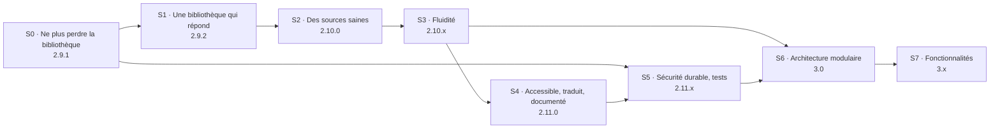

## 16. Feuille de route

> Conversion d'effort : **S ≈ 0,5 j · M ≈ 1,5 j · L ≈ 4 j · XL ≈ 8 j** (jours-personne, tests et revue inclus). Ce sont des **ordres de grandeur** pour séquencer, pas des engagements.

### 16.1 Principe d'ordonnancement

1. **D'abord ce qui peut faire perdre des données ou ouvrir une porte** (S0).
2. **Ensuite ce que l'utilisateur voit tous les jours** : la bibliothèque qui répond, les couvertures (S1).
3. **Puis la matière première** : les sources (S2) — sans elles, le reste n'a pas d'objet.
4. **Puis la vitesse** (S3), **la qualité perçue** (S4), **la solidité** (S5).
5. **L'architecture en dernier** (S6) : elle ne se voit pas, mais elle conditionne la vitesse de tout le reste — et elle est **beaucoup moins risquée** une fois les tests de comportement et la minification en place.
6. **Les fonctionnalités** (S7) se choisissent dans le §15 une fois les fondations posées.

### 16.2 Les sprints

#### S0 — Ne plus perdre la bibliothèque · **2.9.1** · ≈ 6,5 j

| ID | Tâche | Effort |
|---|---|:-:|
| — | Committer la garde du miroir (`assets/js/storage.js`, déjà écrite) avec son test de comportement | S |
| DAT-04 | La suite e2e refuse de tourner hors base `inko_e2e*` ; port dédié | S |
| DAT-02 | Origine des événements (appareil, agent, adresse hachée, canal) | S |
| DAT-01 | Corbeille 30 j + plafond de suppressions + sauvegarde avant ≥ 10 | M |
| DAT-03 | `POST /me/favorites/bulk-remove` atomique, `undoToken`, libellé « N sur N » | M |
| DAT-06 | Sauvegarde à la fermeture, avant migration, import, restauration | S |
| DAT-05 | Purger les 25 comptes de test (après sauvegarde) | S |
| SEC-01 | CORS fermé par défaut ; `/auth/local` exige l'en-tête client et refuse l'origine étrangère | S |
| SEC-02 | Liste blanche des fichiers servis | S |
| API-01 | `/me/import` : validation de forme, 400 et non 500 | S |
| SEC-04 | Schémas d'URL autorisés pour les couvertures | S |

**Sortie** : `FLUX-SUPPRESSION-MASSE`, `ACCES-CORS-*`, `ACCES-FICHIER-EXPOSE`, `FLUX-ETAPE-KO` à zéro. **Publier 2.9.1.**

#### S1 — Une bibliothèque qui répond · **2.9.2** · ≈ 9 j

| ID | Tâche | Effort |
|---|---|:-:|
| UPD-01 | Attacher les écouteurs **avant** `await loadLibrary()` ; enrichissement non bloquant | S |
| UPD-02 / COV-02 | Persister titre et couverture trouvés (`PUT /me/favorites/:id/meta`) | S |
| UPD-03 / UPD-04 | Retour immédiat au clic ; statut dans le bouton ; plus aucun décalage | S+S |
| UPD-05 / UPD-06 | Résultat honnête (injoignables) ; un bouton, un sens | M+S |
| COV-01 | Repli par œuvre : MangaDex API → AniList → Kitsu → Open Library → dessin | M |
| COV-03 | Réparation de fond des couvertures manquantes | M |
| COV-05 | `aspect-ratio`, fondu, un seul `onerror` | S |
| EXT-07 | `versions.json` généré et vérifié (🤖 correcteur `versions-extensions`) | S |
| A11Y-08 | `aria-live` sur le statut | S |

**Sortie** : sonde `couvertures` < 3 % d'échec ; `MAJ-*` et `BTN-MORT` à zéro sur la bibliothèque ; **c'est le correctif des trois demandes de l'utilisateur** (covers, bouton, « la maj ne fonctionne pas bien »).

#### S2 — Des sources saines · **2.10.0** · ≈ 19 j

| ID | Tâche | Effort |
|---|---|:-:|
| EXT-01…04, 06 | Réparer SushiScan, NovelBin, Chireads (patch prêt), Royal Road (message explicite), bac à sable multi-chapitres | M+S+S+S+S |
| EXT-05 | Gutenberg : index local du catalogue + miroirs | M |
| EXT-09, EXT-10 | Gabarit `new-extension`, `ext:record`, `ext:try` ; tests de contrat sur fixtures | M+M |
| EXT-08 | **Trois nouvelles sources de manga** (MangaKatana, Mangapill, Bato.to) et **trois de livres** (Wikisource, Standard Ebooks, Open Library/Internet Archive) | 6 × M |
| EXT-11, EXT-12 | Disjoncteur par source, bandeau « essayer ailleurs », tableau de santé | M+S |

**Sortie** : ≥ 6 sources de manga et ≥ 6 de livres au vert au bac à sable ; plus aucune dépendance à plus de 50 % envers une source. **Publier 2.10.0** (nouvelle version PC et mobile).

#### S3 — Fluidité · **2.10.x** · ≈ 14,5 j

PER-01 (minification et regroupement) · PER-02 (`defer`) · PER-03 (CLS < 0,1) · **PER-04 (fenêtrage de la grille)** · PER-05 (budget de requêtes) · PER-06 (CSS) · PER-07 (tâches longues) · PER-08/09 (polices, préchargement) · PER-12 (budget Android en CI).
**Sortie** : sonde `pages` — CLS < 0,1, tâches longues < 50 ms, JS par page < 200 Ko minifié.

#### S4 — Accessible, traduit, documenté · **2.11.0** · ≈ 16 j

A11Y-01…07, 09, 10 (contrastes par accent testés) · I18N-01 (338 chaînes + cliquet) et I18N-03 (locale) · DOC-01 (README et captures), DOC-02, DOC-03, DOC-05 (licences) · CI-01…07 (audit, permissions, timeouts, épinglage, lint serveur, **sondes nocturnes**).

#### S5 — Sécurité durable et tests · **2.11.x** · ≈ 21 j

SEC-03 (CSP stricte, scripts sortis des pages) · SEC-05/06/07/08/09/10 · MOB-01/02/03 (🤖 `allowbackup`) · DSK-01 (signature) / DSK-02 (mises à jour signées) · **TST-02** (contrat généré depuis OpenAPI) · TST-03/04/05/06 · API-03 (stale-while-revalidate) · API-08/09 (journal et métriques).

#### S6 — Architecture modulaire · **3.0** · ≈ 53,5 j

ARC-01 (`global.js` → 12 modules) · ARC-02 (le lecteur) · ARC-03 (contrôleurs et migrations) · ARC-04 (`public/` et `dist/`) · ARC-05 (JSDoc + `tsc`) · ARC-06 · **TST-01** (tests de comportement pour 20 modules) · I18N-02 (clés stables) · DAT-07…13.

#### S7 — Fonctionnalités · **3.x** · au choix

Dans l'ordre du §15.6 : corbeille/annuler/restaurer → bascule de source + santé → téléchargement intelligent + notifications d'arrière-plan.

### 16.3 Total et tranches rentables

| Tranche | Sprints | Effort | Ce qu'elle achète |
|---|---|---:|---|
| **Indispensable** | S0 + S1 | ≈ 15,5 j | plus de perte de données, bibliothèque fluide, couvertures, bouton |
| **Cœur du produit** | + S2 | ≈ 34,5 j | sources fiables et redondantes |
| **Perçu et durable** | + S3 + S4 | ≈ 65 j | rapide, accessible, traduit, documenté |
| **Solide** | + S5 | ≈ 86 j | sécurité, tests, livraison signée |
| **Évolutif** | + S6 | **≈ 140 j** | architecture qui supporte la suite |

### 16.4 Ce qui dépend d'une décision de votre part

| Décision | Pourquoi | Impact si repoussée |
|---|---|---|
| **Signature du code Windows** (SignPath gratuit pour l'open source ; Azure Trusted Signing payant) | DSK-01 | SmartScreen à chaque version |
| **Compte Google Play / F-Droid** | MOB-04 | installation manuelle de l'APK |
| **Appétit pour les sources « zone grise »** (Japscan, Asura…) | EXT-08 | on se limite aux sources ouvertes ou officielles |
| **GSAP** : garder ou remplacer par du CSS | DOC-05 | zone d'incertitude de licence |
| **Fournisseur de couvertures de repli** (AniList, Kitsu, Open Library : usages publics, limites de débit) | COV-01 | repli par AniList seul |
| **Langues cibles après EN** (ES, PT, AR ?) | I18N-02 | pas de 3ᵉ langue |
| **macOS / Linux** | DSK-04 | Windows et Android seulement |

### 16.5 Correspondance avec les demandes en attente

| Demande | Où c'est traité |
|---|---|
| « Les covers manquantes » | COV-01 à COV-06 (S1) |
| « Le bouton Mettre à jour » et « la maj ne fonctionne pas bien » | UPD-01 à UPD-09 (S1) — **cause racine trouvée : les écouteurs sont attachés après l'attente réseau** |
| « Pourquoi ma bibliothèque est vide » | §3.1 ; DAT-01…06 (S0) |
| « Chireads et les nouvelles extensions » | EXT-03 (patch prêt), EXT-08 (S2) |
| « La nouvelle version de l'app PC » | **2.9.1** (S0), **2.9.2** (S1), **2.10.0** (S2) |
| « Refaire le README et toutes les captures » | DOC-01 (S4, mais l'essentiel est faisable tout de suite) |
| « Un post LinkedIn parfait avec ce diagramme » | DOC-07 + DOC-11 (rédaction seule, **non publié**) |
| « Passer au peigne fin chaque page, bouton, fonctionnalité » | **§6**, et la sonde `boutons` rejouable (TST-05) |
